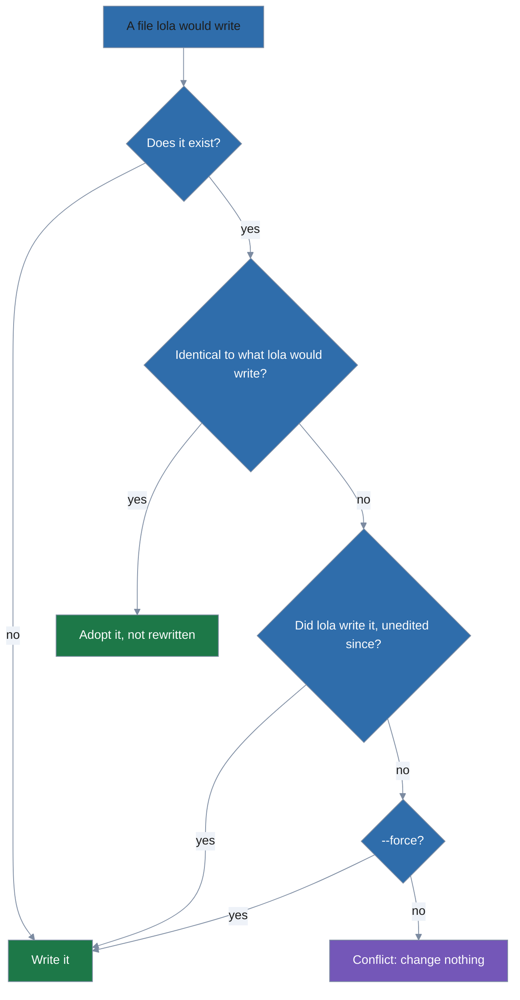

# lola

lola is a package manager for AI-assistant context: skills, slash commands, subagents, MCP
servers and always-on rules. You install a module once; lola renders it into each
assistant's native layout and records exactly what it wrote, so it can render again or
uninstall cleanly, without touching anything it did not write.

<!-- DEMO: add a hero demo showing lola in action. Record: lola check ./my-module, then lola install ./my-module, then ls .claude/, then lola uninstall my-module. Viewer sees: the portability report, the install writing the module into .claude/, the rendered files, and the uninstall removing exactly what lola wrote. Format: asciinema + svg-term-cli, or VHS (https://github.com/charmbracelet/vhs). Place the rendered .gif/.svg here and link it above. -->

Already using [LobsterTrap/lola](https://github.com/LobsterTrap/lola)? `lola migrate` installs
what it installed and moves its files to a trash you can restore from
([docs/guides/migrating.md](docs/guides/migrating.md)).

## What works today

- **Assistants:** Claude Code, Gemini CLI and OpenCode, at project scope or user scope
  (`--user`).
- **Modules:** in lola's native layout (with an optional `lola.yml`), Claude Code plugins and
  Agent Plugins packages, from a local folder, a git repository (`--ref` for a branch, tag or
  commit), or a zip or tar archive, local or downloaded.
- **Portability report:** `lola check ./my-module` shows what each assistant would drop,
  adapt or skip, without writing anything; `install` prints the same findings, and
  `--strict` makes them errors.
- **Safety:** lola only overwrites or deletes files it wrote and nobody has changed, unless
  you pass `--force`; an existing file identical to what lola would write is adopted, not
  rewritten. JSON files keep their comments; a file lola cannot parse is never rewritten.
  lola never edits your `CLAUDE.md`, `GEMINI.md` or `AGENTS.md`, and a module's install hooks
  run, and its Claude Code runtime hooks are installed, only with your consent.


- **Cleanup:** `lola tidy` moves what lola does not manage out of the assistants' directories
  and MCP server lists into a trash you can restore from, never an instruction file, nor what git
  tracks or your [keep-list](docs/guides/tidying.md#tidying) (the names you protect with
  `lola tidy --keep`) names unless you say so.
- **Sync and trust:** commit `.lola/project.yml`, and a teammate's `lola sync` installs every
  module at the commit and digest it pins. A fresh clone, a changed pin or a removal is shown
  and waits for your trust; `-y` never gives it
  ([Sync, pins and trust](docs/guides/sync-and-trust.md#sync-pins-and-trust)).

```mermaid
%%{init: {'theme': 'base', 'themeVariables': {
  'primaryColor': '#2f6dab',
  'primaryTextColor': '#1e1e1e',
  'primaryBorderColor': '#7c8ba1',
  'lineColor': '#7c8ba1',
  'edgeLabelBackground': '#eef2f8',
  'tertiaryColor': 'transparent',
  'tertiaryTextColor': '#7c8ba1',
  'tertiaryBorderColor': '#7c8ba1',
  'clusterBkg': 'transparent',
  'clusterBorder': '#7c8ba1',
  'titleColor': '#7c8ba1',
  'noteBkgColor': '#eef2f8',
  'noteTextColor': '#1e1e1e',
  'fontFamily': 'system-ui, sans-serif'
}, 'themeCSS': '.node .nodeLabel{color:#ffffff!important;fill:#ffffff!important;}'}}%%
stateDiagram-v2
  [*] --> Untrusted : fresh clone or moved project
  Untrusted --> Trusted : you accept it, or --trust=entries
  Untrusted --> Untrusted : declined, not installed, asked again next sync
  Trusted --> Changed : a pull changes or removes it, or sync would write a pin
  Changed --> Trusted : you accept the change, or --trust=entries
  Changed --> Changed : declined, left as installed, asked again next sync
```


- **Profiles:** named sets of modules you turn on and off per scope: your own, a project's
  committed ones, or remote ones fetched from a source
  ([Profiles](docs/guides/profiles.md#profiles)).
- **Marketplaces:** `lola market --add` registers a Claude Code `marketplace.json` or a catalog
  in lola's YAML format. `lola market` lists your marketplaces, `lola market acme` lists one's entries,
  and `lola market acme formatter` shows an entry, as `lola info @acme/formatter` does;
  `lola install @acme/formatter` installs it and records its real source, so a teammate needs
  no marketplace ([Marketplaces](docs/guides/marketplaces.md#marketplaces)).
- **Templating:** a module's `.md.liquid` files render per assistant, with partials, attribute
  files and vars a manifest entry can override ([Templates](docs/guides/templating.md#templates)).
- **Search:** `lola search` finds modules in your cache and in every marketplace catalog you
  have fetched ([`lola search`](docs/usage.md#lola-search)).
- **Migration:** `lola migrate` installs what LobsterTrap/lola installed and moves its files to
  a trash you can restore from ([Migrating](docs/guides/migrating.md)).

## Install

You need Go 1.26 or later, [Task](https://taskfile.dev) (the task runner that builds lola;
its site lists ways to install it), and git. `go.mod` pins toolchain
go1.26.10, which fixes a reachable standard-library vulnerability; Go fetches it automatically
unless `GOTOOLCHAIN=local` is set, as some distribution packages do (`go env -w
GOTOOLCHAIN=auto` re-enables it).

The clone lands in a `lola-go` directory:

```sh
git clone https://github.com/trevor-vaughan/lola-go && cd lola-go
task build          # writes bin/lola
```

## Quickstart

Run these in the `lola-go` checkout after `task build`. They make `my-project` and
`my-module` side by side in it.

1. Put lola on your `PATH`:

   ```sh
   export PATH="$PWD/bin:$PATH"          # in the lola-go checkout, after task build
   ```

2. Make a project directory and scaffold a module. `lola init` writes an Agent Plugins module
   with a `hello` skill (`skills/hello/SKILL.md`) and a `hello` command:

   ```sh
   mkdir my-project
   lola init my-module                   # plugin.json, one skill, one command (Agent Plugins)
   ```

3. Install the module into the project. `-t` names the target assistant: `claude-code`,
   `gemini-cli` or `opencode`:

   ```sh
   cd my-project
   # renders into .claude/ and records .lola/project.yml:
   lola install ../my-module --scope project -t claude-code
   lola list                             # my-module  claude-code  ✓ ok
   ```

4. Edit the module and install it again, which renders the edited skill into `.claude/`:

   ```sh
   echo "Say hello twice." >> ../my-module/skills/hello/SKILL.md   # edit the module
   lola install ../my-module             # no --scope: a terminal asks; a script uses the .lola/ found
   ```

5. Uninstall it:

   ```sh
   lola uninstall my-module -y           # removes exactly what lola wrote
   ```

A teammate gets your modules from the `.lola/project.yml` you commit. A clone is not trusted
yet, so off a terminal the first sync shows what it would install and refuses with two hints
(on a terminal it asks):

1. Clone the project:

   ```sh
   git clone https://example.com/acme/api.git && cd api
   ```

2. Sync. Off a terminal it refuses and hints the next two commands:

   ```sh
   lola sync                   # error: lola sync needs your trust for .lola/project.yml, …
   ```

3. See the changes. `--project` acts on this project's scope; `-n` (`--dry-run`) prints the
   plan and writes nothing:

   ```sh
   lola sync --project -n      # see them: the plan, nothing written
   ```

4. Accept them, which trusts the entries and installs them:

   ```sh
   lola sync --project --trust=entries # then accept them: trust and install
   ```

5. Check the result:

   ```sh
   lola sync                   # ✓ already in sync
   lola list
   ```

A teammate's sync refuses a local source outside the project, such as `../my-module` above:
share a module through a git repository or an `https://` archive.

## Learn more

- `lola help` prints concise help on a terminal; piped (`lola help | less`) it prints the
  full reference, including every alias.
- [docs/usage.md](docs/usage.md): every command, scopes, files and the output contract.
- [docs/guides/](docs/guides/): choosing what to install, authoring modules, templating, sync
  and trust, profiles, remote profiles, marketplaces, migrating from LobsterTrap/lola, and
  tidying.
- [docs/architecture.md](docs/architecture.md): how lola works, for contributors.
- [docs/decisions.md](docs/decisions.md) and [docs/roadmap.md](docs/roadmap.md): where this
  build departs from the upstream ADRs, and what comes next.
