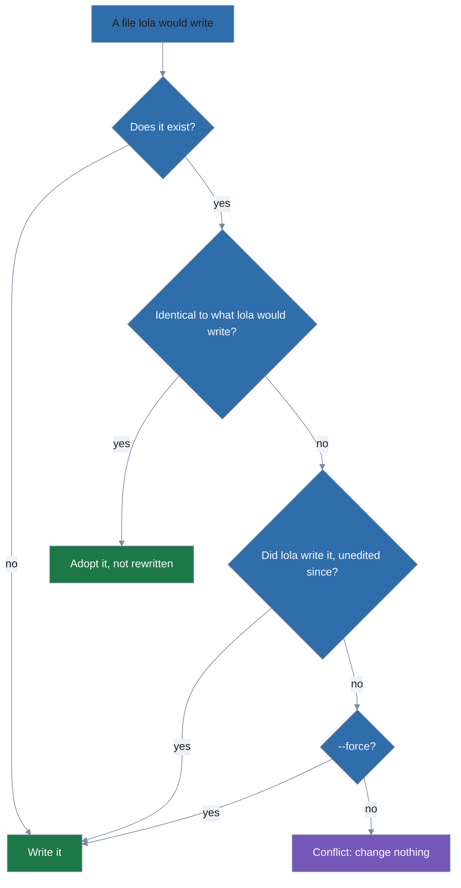

# lola

lola is a package manager for AI-assistant context: skills, slash commands, subagents, MCP
servers and always-on rules. You install a module once; lola renders it into each
assistant's native layout and records exactly what it wrote, so it can render again or
uninstall cleanly: it removes only what it wrote, and the empty directories that leaves
inside an assistant's directory. The assistant's root (`.claude/`) and `.lola/` stay.

Already using [LobsterTrap/lola](https://github.com/LobsterTrap/lola)? `lola migrate` installs
what it installed and moves its files to a trash you can restore from with `lola trash`
([docs/guides/migrating.md](docs/guides/migrating.md)).

## What works today

- **Assistants:** Claude Code, Gemini CLI and OpenCode, and through the `agents` target the
  skills of Codex, Cursor, Copilot and others, at project scope or user scope (`--user`).
- **Modules:** in lola's native layout (with an optional `lola.yml`), Claude Code plugins and
  Agent Plugins packages, from a local folder, a git repository (`--ref` for a branch, tag or
  commit), or a zip or tar archive, local or downloaded.
- **Portability report:** `lola check ./my-module` shows what each assistant would drop,
  adapt or skip, without writing anything; `install` counts them in one line per module
  (`-v` prints them), and `--strict` makes them errors.
- **Safety:** lola only overwrites or deletes files it wrote and nobody has changed, unless
  you pass `--force`; an existing file identical to what lola would write is adopted, not
  rewritten. JSON files keep their comments; a file lola cannot parse is never rewritten.
  lola never edits your `CLAUDE.md`, `GEMINI.md` or `AGENTS.md`, and a module's install hooks
  run, and its Claude Code runtime hooks are installed, only with your consent.



- **Cleanup:** `lola tidy` moves what lola does not manage out of the assistants' directories
  and MCP server lists into a trash you can restore from with `lola trash`. It never moves an
  instruction file; what git tracks or your [keep-list](docs/guides/tidying.md#tidying) (the names
  you protect with `lola tidy --keep`) names moves only if you say so.
- **Sync and trust:** commit `.lola/project.yml`, and a teammate's `lola sync` installs every
  module at the version `project.yml` pins for it (its commit and content digest). A fresh clone,
  a changed pin or a removal is shown and waits until you trust it; `-y` never trusts it for you
  ([Sync, pins and trust](docs/guides/sync-and-trust.md#sync-pins-and-trust)).

```mermaid
%%{init: {'theme': 'base', 'themeVariables': {
  'primaryColor': '#2f6dab',
  'primaryTextColor': '#1e1e1e',
  'primaryBorderColor': '#7c8ba1',
  'lineColor': '#7c8ba1',
  'edgeLabelBackground': '#eef2f8',
  'tertiaryColor': 'transparent',
  'tertiaryTextColor': '#7c8ba1',
  'tertiaryBorderColor': '#7c8ba1',
  'clusterBkg': 'transparent',
  'clusterBorder': '#7c8ba1',
  'titleColor': '#7c8ba1',
  'noteBkgColor': '#eef2f8',
  'noteTextColor': '#1e1e1e',
  'fontFamily': 'system-ui, sans-serif'
}, 'themeCSS': '.node .nodeLabel{color:#ffffff!important;fill:#ffffff!important;}'}}%%
stateDiagram-v2
  [*] --> Untrusted : fresh clone or moved project
  Untrusted --> Trusted : you accept it, or --trust=entries
  Untrusted --> Untrusted : declined, not installed, asked again next sync
  Trusted --> Changed : a pull changes or removes it, or sync would write a pin
  Changed --> Trusted : you accept the change, or --trust=entries
  Changed --> Changed : declined, left as installed, asked again next sync
```



- **Profiles:** each scope has a base that is always loaded (`default` at user scope, the
  project's `project.yml`) and at most one profile switched on over it; a bundle combines profiles. Every
  command that reads a scope names it first (`user scope: profile go-review over default`), and
  every write names the file it changed ([Profiles](docs/guides/profiles.md#profiles)).
- **Marketplaces:** `lola market [<name>] --add <source>` registers a Claude Code `marketplace.json` or a catalog
  in lola's YAML format (the name goes before `--add`, which takes the source). `lola market` lists your marketplaces, `lola market acme` lists one's entries,
  and `lola market acme formatter` shows an entry, as `lola info @acme/formatter` does;
  `lola install @acme/formatter` installs it and records its real source, so a teammate needs
  no marketplace ([Marketplaces](docs/guides/marketplaces.md#marketplaces)).
- **Templating:** a module's `.md.liquid` files render per assistant, with partials, attribute
  files and vars a manifest entry can override ([Templates](docs/guides/templating.md#templates)).
- **Search:** `lola search` finds modules in your cache and in every marketplace catalog you
  have fetched ([`lola search`](docs/reference/search.md#lola-search)).
- **Migration:** `lola migrate` installs what LobsterTrap/lola installed and moves its files to
  a trash you can restore from ([Migrating](docs/guides/migrating.md)).

## Install

You need Go 1.26 or later, [Task](https://taskfile.dev) (the task runner that builds lola;
its site lists ways to install it), and git. `go.mod` pins a toolchain
release that fixes a reachable standard-library vulnerability; Go fetches it automatically
unless `GOTOOLCHAIN=local` is set, as some distribution packages do (`go env -w
GOTOOLCHAIN=auto` re-enables it). `task lint` and `task vuln` build their pinned
golangci-lint and govulncheck into `.tools/bin` with the Go on your PATH the first time they
run (a minute or so). `task vuln` passes on Go 1.26.11, or 1.27.4 and later; an earlier 1.27
reports a standard-library vulnerability fixed in 1.27.4.

The clone lands in a `lola-go` directory:

```sh
git clone https://github.com/trevor-vaughan/lola-go && cd lola-go
task build          # writes bin/lola
```

## Quickstart

Run these in the `lola-go` checkout after `task build`. They make `my-project` and
`my-module` side by side in it.

1. Put lola on your `PATH`:

   ```sh
   export PATH="$PWD/bin:$PATH"          # in the lola-go checkout, after task build
   ```

2. Make a project directory and scaffold a module. `lola init` writes an Agent Plugins module
   with a `hello` skill (`skills/hello/SKILL.md`) and a `hello` command:

   ```sh
   mkdir my-project
   lola init my-module                   # plugin.json, one skill, one command (Agent Plugins)
   ```

3. Install the module into the project. `-t` names the target assistant: `claude-code`,
   `gemini-cli`, `opencode` or `agents` (skills only, for Codex, Cursor, Copilot and others):

   ```sh
   cd my-project
   lola install ../my-module --scope project -t claude-code
   lola list
   ```

   `install` renders into `.claude/` and records `.lola/project.yml`. A run's report folds the
   per-file lines into one `▸` line per module; add `-v` to list the files. The output of both
   (the path in the context line is wherever you made `my-project`):

   ```text
   project /tmp/tmp.7PXo8mZbW4/my-project: project.yml
   Notices:
   ⚠ my-module comes from ../my-module, outside the project: a teammate's sync will refuse it; share a module through a git repository or an https:// archive
   → keep it to yourself: lola profile --project --move my-module --to mine --switch
   → meant for every project? move it from this project into your user base: lola profile --user --move my-module --to base
   Files:
   ✓ added my-module to project.yml (base)
   ▸ my-module: 2 changes (claude-code 2)
   ✓ installed my-module (claude-code)
   → ▸ lines are folded; -v prints them in full

   project /tmp/tmp.7PXo8mZbW4/my-project: project.yml
   user scope: default
   SCOPE    MODULE     TARGET       STATUS  RULES  SOURCE
   project  my-module  claude-code  ✓ ok    on     ../my-module
   nothing installed at user scope (try: lola install --user <source>)
   ```

   On a terminal, lola first asks once whether your background is dark or light, then shows the
   install review (`Apply these changes? [y/c/n]`); `-y` answers the review. The block above is
   what a script sees.

4. Edit the module and install it again, which renders the edited skill into `.claude/`:

   ```sh
   echo "Say hello twice." >> ../my-module/skills/hello/SKILL.md   # edit the module
   lola install ../my-module             # no --scope: a terminal asks; a script uses the .lola/ found
   ```

5. Uninstall it:

   ```sh
   lola uninstall my-module -y           # removes what lola wrote, and the directories that leaves empty
   ```

A teammate gets your modules from the `.lola/project.yml` you commit. A clone is not trusted
yet, so off a terminal the first sync shows what it would install and refuses with two hints
(on a terminal it asks):

1. Clone the project:

   ```sh
   git clone https://example.com/acme/api.git && cd api
   ```

2. Sync. Off a terminal it refuses and hints the next two commands:

   ```sh
   lola sync                   # error: lola sync needs your trust for .lola/project.yml, …
   ```

3. See the changes. `-n` (`--dry-run`) prints the plan and writes nothing:

   ```sh
   lola sync -n                # see them: the plan, nothing written
   ```

4. Accept them, which trusts the entries and installs them. The hint names each module at the
   version the plan showed, so the run installs only what you saw:

   ```sh
   lola sync --trust=entries --at <module>=<version>   # then accept them: trust and install
   ```

5. Check the result:

   ```sh
   lola sync                   # ✓ already in sync
   lola list
   ```

A teammate's sync refuses a local source outside the project, such as `../my-module` above:
share a module through a git repository or an `https://` archive.

## Shell completion

lola completes commands, flags, module and profile names for bash, zsh, fish and PowerShell.
For bash, add this to `~/.bashrc`:

```sh
source <(lola completion bash)
```

zsh needs the script on your `fpath` before `compinit` runs, and the other shells have their
own place for it: [docs/reference/completion.md](docs/reference/completion.md#setting-it-up).

## Learn more

- `lola <command> -h` prints short help and `lola help <command>` (or `--help`) long help with a
  link to the command's reference page; `lola help --all | less` prints the whole reference,
  including every alias.
- [docs/usage.md](docs/usage.md): every command, scopes, files and the output contract.
- [docs/guides/](docs/guides/): choosing what to install, authoring modules, templating, sync
  and trust, profiles, remote profiles, marketplaces, migrating from LobsterTrap/lola, tidying,
  and [adding or replacing an assistant with a target spec](docs/guides/target-specs.md).
- [Removing lola](docs/usage.md#removing-lola): uninstall your modules, then delete what lola
  keeps and the binary.
- [docs/architecture.md](docs/architecture.md): how lola works, for contributors.
- [docs/decisions.md](docs/decisions.md): where this build departs from the upstream ADRs.
- [docs/template_engine_analysis.md](docs/template_engine_analysis.md): why templates use
  Liquid, and the engines that were weighed against it.
- [CHANGELOG.md](CHANGELOG.md): what changed in each release.
