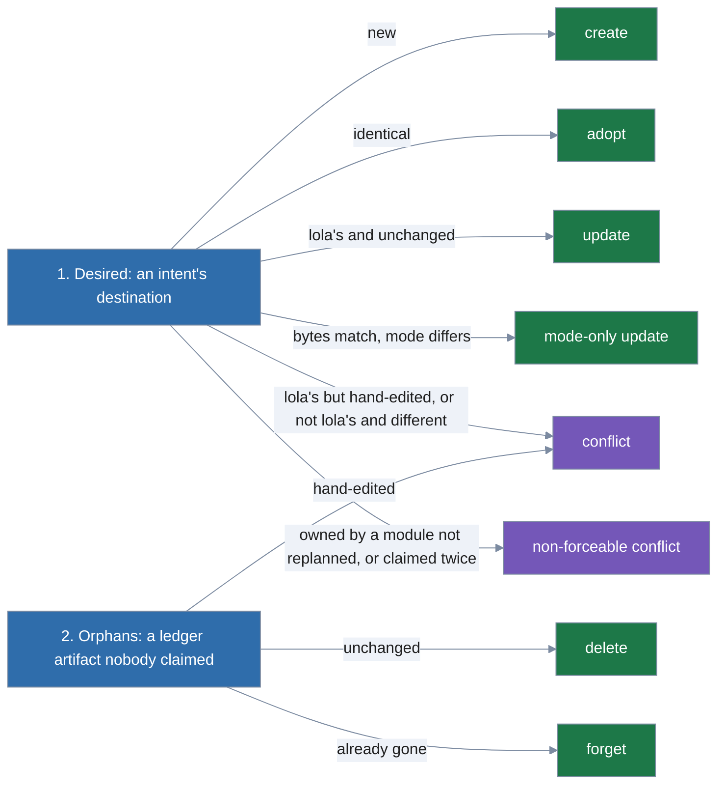

# Plans and the ledger

Maintainer notes on Plans and the ledger. It is split out of [architecture](../architecture.md).

Targets return **intents** (`WriteFile`, `CopyTree`, `SetJSON`, `AddJSONMember`).
`plan.Compute` expands trees, then, in two passes:

1. **Desired.** Each intent's destination is read at its symlink-resolved location and
   classified: new → create; identical → adopt (recorded, not rewritten); lola's and unchanged
   → update; lola's but hand-edited, or not lola's and different → conflict; owned by a module
   that is not being replanned, or claimed twice → non-forceable conflict. Two logical
   destinations that resolve to the same real file (symlink aliasing) are refused. A file whose
   bytes match but whose normalized mode differs is a **mode-only update** (noted as
   `mode changed`), not an adoption.
2. **Orphans.** Ledger artifacts nobody claimed are deleted if unchanged, kept as conflicts if
   hand-edited, forgotten if already gone. Running desires first lets a destination move between
   modules in one operation without a spurious conflict or delete.

The result is byte-exact `FileChange`s and the ledger that applying them produces. A dry run is
exactly this computation. Each ledger entry records the targets its module is installed on
(`ledger.Entry.Targets`, `targets` in `lock.json`), since a target can render none of a module's
files and still have run its hooks: `updateLedger` keeps the entry's targets outside the change's,
adds the change's entry targets (`ModuleChange.Entry.Targets`, the engine's `ModuleResult.Targets`)
and every target it writes an artifact on, and drops the entry once no target is left.

A `CopyTree` intent may carry an `Overlay`: files `expand` writes into the tree beside the ones it
walks, mode 0644, under the tree's consent. Targets put rendered template support files and sidecars
there and exclude their sources (`target.SkillTree`, `target.SidecarTree`). An entry of a module
with templates records `rendered_with` (`ledger.RenderedWith`): the precedence list (`default`, then
the active profile) when a template reads it (`templating.Uses`), and `vars`, the winning entry's
overrides as written. An edited, invalid one (vars read by the entry rules, `module.DecodedVars`) is
read as absent, so the module renders again.

`lock.json` and `trust.json` decode with `UseNumber`, a number reading as `int64` when integral and
in range, else a finite `float64`, so a large integer stays exact and a record still matches its
hash; a float is written with a point or an exponent (`module.Vars`), and read back as one, so `2.0`
and `2` stay two values in `SameVars`, `sameRendering` and the trust view's hash: an edit
between them re-renders and asks trust again.

`ledger.Load` refuses targets that are not target names, are listed twice, or omit an artifact's
target. An entry from before the field falls back to its artifacts' targets
(`Entry.InstalledTargets`).

**The profile in the ledger**. `profile` is the scope's active profile:
a qualified name (`user:go`, `project:go`, `remote:go`; never `default`) and the action that put it
there (`by`: `on` or `switch`). A pre-release `profiles` list is refused before the strict decode
(`ledger.ProfilesKeyError`), and `Engine.coachLedger` hints removing it and switching to its last
profile with the scope's flags.

A module's `from` names the profile whose entry won when lola last applied it (`profile:user:go`,
`profile:default`); an entry the scope's manifest won has none. Both keys are left out when empty,
so a ledger without profiles is written byte for byte as before them, and the version stays 1.
`ledger.Load` refuses a `profile` or a `from` lola never writes.

**Replaceable paths.** `Request.Replace` (from `ScopeInstall.Replace`) lists unowned destinations
the caller lets the plan overwrite instead of refusing: a file, every file below a directory, or a
JSON member at one pointer. Only the "exists and was not written by lola" case changes: the step is
an update marked `Replaced`.

Ownership still wins (a module's path, or its own hand-edited file, stays a conflict), and a path
with a symbolic link between the target's root and it (`fsx.Linked`) is never replaceable. lola
migrate passes the Python lola's recorded paths after its guards, and backs up exactly the steps
marked replaced.

Hashes: files are hashed by bytes, JSON members by their canonical JSON (sorted keys, no
comments). JSON edits operate on the hujson AST so bytes outside the edited member are
preserved; trailing line comments belong to the line they end. `ledger.created` remembers the
JSON files lola created, so they are deleted when lola's last member leaves them empty.

**Owned array members.** `AddJSONMember` claims one element, any JSON value, in a JSON array that
users also edit: a string for rule references (Gemini and OpenCode), an object for a runtime hook's
matcher group (Claude Code). Elements compare as canonical JSON, so key order and layout in the
user's file do not matter.

The ledger records a string as `value`, as it always has, and any other element as `member`, in
canonical JSON; either is part of the artifact's identity, so several modules can each own an entry
in one array, and the hash is over the element's canonical JSON. Files and step lines get the
element with `& < >` unescaped (`fsx.ReadableJSON`), so a shell operator reads as one. A ledger
`member` that another tool reformatted is recorded again as canonical JSON at load; one that is a
string or `null` is refused, with a hint.

A member is present or absent, never hand-edited: one the user removed is rewritten with a note, and
an orphan the user removed (or edited, which changes its identity) is forgotten. A string the user
already listed is adopted; any other element the user already has is a forceable conflict, since
owning the user's own hook group would delete it on uninstall.

A `created` entry with a `key` records an array lola created; when lola's last member leaves it, the
array goes too, with the parent objects it leaves empty, and the file if lola created that. A value
at the pointer that is not an array is a hard error. Appending keeps comments that follow the last
member before the closing bracket or brace, so removing lola's entry restores the file byte for
byte.

**Rules** are plain files each target writes where its assistant loads them, never in a user-owned
instruction file. Claude Code loads `.claude/rules/lola/<module>/<rule>.md` as is. Gemini CLI has no
rules directory: a module's rules are joined into `.gemini/lola/<module>/GEMINI.md`, and that
directory is an owned member of `context.includeDirectories` in `.gemini/settings.json` (Gemini
walks it for `GEMINI.md` in trusted folders; observed with 0.63.0).

OpenCode gets one file per rule in `.opencode/lola/<module>/` and one owned glob member in
`instructions`. At user scope the members are absolute, because user settings apply in every
project; OpenCode expands a wildcard only in the last component of an absolute entry, hence one
member per module. Every artifact belongs to exactly one module.
