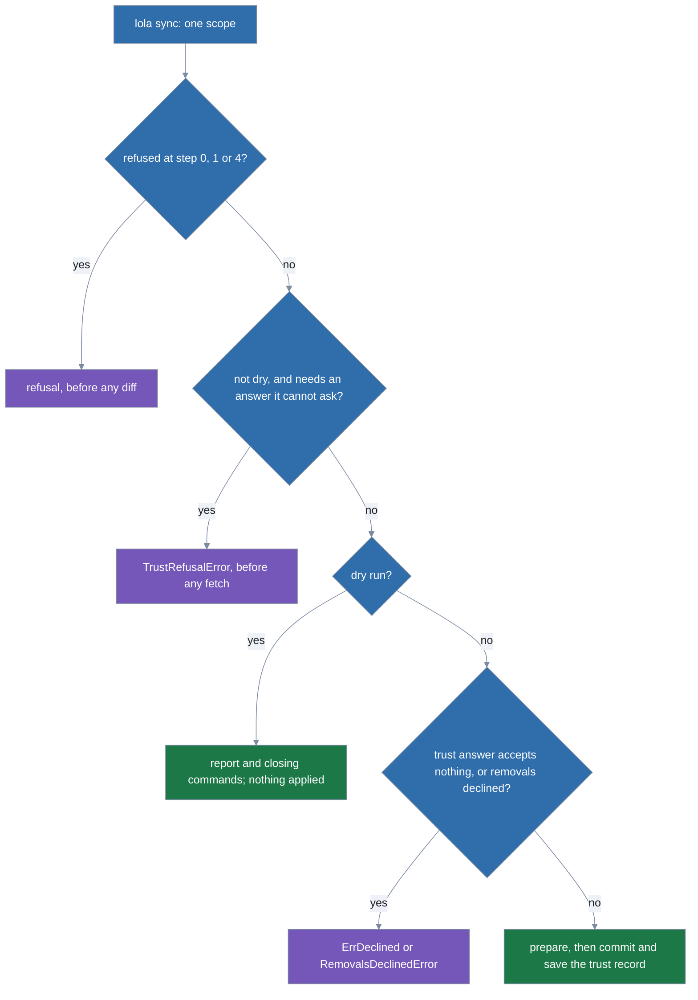

# Sync

How `lola sync` works. It is split out of [architecture](../architecture.md).

`Engine.Sync` (`internal/engine/sync.go`) makes one scope match its manifest. The CLI adapts it: it
answers the two questions (`SyncRequest.Trust`, `SyncRequest.ConfirmRemovals`) through the Prompter
on a terminal (`Prompter.Trust`, the picker, and `Confirm`), `-y` confirming, and nil (cannot ask)
otherwise.

`--trust`'s `entries` and `profiles` kinds (`Options.Trust`) answer the changes of their kind
without asking: the engine splits the report (`TrustReport.split`), shows the covered part through
`SyncRequest.Show` (the diff the CLI prints as a record) and asks `Trust` only about the rest,
merging the answer with `TrustAnswer.Kinds`. `SyncRequest.Modules` limits the run to the modules
named (`syncLimit`); `Update` re-pins the run's git and archive entries. The steps, in order, under
the scope lock (none in a dry run):

0. Refuse a project at the home directory and symlinked project state; then a tracked
   `lock.json` (`refuseTrackedLedger`), before the profiles it names are read.
1. Read the layers; refuse a scope without a manifest when no profile is in play: nothing a layer
   wants, no active profile, no module `lock.json` says a profile installed (an empty manifest
   means "remove everything"; otherwise the scope syncs as an empty manifest);
   refuse a name that is neither wanted nor an installed module (`limitTo`); sweep day-old
   `run-*` directories (best effort, also in a dry run) and create this run's.
2. Validate every entry of the run, `desired(layers)` in name order limited to the names, before any
   network contact or prompt:
   - `source.Parse` against `sourceRoot` and `source.Validate` with the entry's ref and path
     (git's `check-ref-format`);
   - the pin's shape against the source's kind;
   - a local source the cache records for the name that no longer exists (`Origin.LocalGone`,
     through `goneOrigin`), which the run's publish drops when the entry's source is local too
     (`syncEntry.goneFrom`, a warn notice); any other source of the name is an origin of its own
     (`Store.OriginFor`, `source.SameLocation`);
   - the effective targets.
   - An entry a profile won keeps that profile in `syncEntry.from` (written to `lock.json`'s
     `from`) and its file, which errors name.
   - A limited run notes the modules it left out of sync (`outOfSync`, from the layers and
     `lock.json` alone).
3. At project scope, `trust.Check` of the record against the manifest's view gives the status and
   the changes, limited to the run (`runReport`: the named entries' changes, and the top-level
   targets only when a named entry installs to them). Coverage (`Covers`) is the entry's own; a
   profile's entry is the user's own and always covered.
4. Containment (never for a profile's entry, which is the user's).
   - A folder or local archive whose Source and Path the record does not hold, and any one whose
     source as written (a relative one joined to the project, compared through `paths.KeyID`)
     names a path inside the project (`lexicallyInside`: a pulled link can lead it out), must
     resolve inside the project's real root (`source.IsWithin`), else the run is refused before
     any diff, whatever `--trust` or `-y` say.
   - Each covered manifest folder is then read (no network): content that is not the version
     `lock.json` records, or any content when it records none, marks the entry `folderChanged`, a
     trust change (`folderChanges`; an addition, `not installed yet`, when it records none:
     `notInstalled`).
   - The removals are listed now (`syncRemovals`, from `lock.json` and the manifest; each path
     confined first, since `lock.json` is hostile input).
   - Then the **early refusal**: a run that is not dry and needs an answer it cannot ask (the
     trust question with `Trust` nil, the removals with `ConfirmRemovals` nil) returns one
     `TrustRefusalError` naming every missing answer and cause (`syncRefusal`), with the report
     (each entry to pin named with `pinReasons`, changed folders with their content) and the
     removals, before any fetch or `ls-remote` of an entry the record does not cover.
   - When the trust it needs is missing, it first resolves (step 5) each **covered** entry it would
     pin into the run's staging: the user trusted that source and ref, so nothing a pull asked for
     is fetched.
     - `needsPin` is then false for an `--update` that found its pin, so an update with nothing new
       needs no trust and is not refused; otherwise the report shows the new pin and its files.
     - When no trust is missing (a refusal for removals alone), every entry is resolved this way,
       since the next run would fetch it anyway.
     - `readEarly` does both: a `sourceFailure` (a failed fetch, a commit its ref does not reach,
       content that differs from what its pin, catalog or sha256 says) leaves the entry unread with
       a warn notice carrying the failure and its hints (`TrustRefusalError.Notices`, JSON
       `notices`); any other error stops the run.
   - The read entries are planned (`planSync`, with `selections.yaml`, a move's picks and the
     layers') and `droppedFiles` gives the files their versions no longer ship, which join the
     refusal's removals.
     - `syncRefusal` names the removals by module and the dropped files (`whyDropped`) as each
       version's, and puts `-y` in the hint, the user's own included, only when every removal it
       would confirm is listed: not while an installed entry's new version is unread (`ContentDir`
       empty and a pin to write, or a pin other than the version installed);
     - the message then says the removals listed may change until it reads them.
     - Nothing is committed to the cache before the refusal.
   - Under `--json` the error document carries both (`JSONFields`, which `writeError` merges).
5. Resolve each entry:
   - a folder is fetched every run;
   - `--update` fetches the ref;
   - an unpinned git or archive entry takes a snapshot of the cache head for its ref, or fetches
     the ref when there is none or the head has no commit (written before pins);
   - a pinned entry takes a snapshot of its version (`Store.Pinned`), checking reachability for
     an uncovered git entry even on a hit, or fetches it by its commit (`fetchPin`).
   - Every fetch is prepared in the run's staging (`Store.Prepare`) and must declare the entry's
     name.
   - `--at` (`SyncRequest.At`, each entry's `at`, checked against the source's kind):
     - `resolveSync` refuses an entry whose resolved commit (git) or content digest (folder,
       archive) is not the one given, and one whose source does not serve it (a `sourceFailure`
       while `at` is set, never the soft `fetch-failed` of `lola update`).
     - Once every entry is resolved, a run given `--at` (in any scope of the command, `AtShared`)
       refuses any entry `--at` does not pin whose installed version would change, a pin a pull
       wrote included.
     - A refusal's accept hint (`syncRefusal`) adds `--at` for each new version it showed (an entry
       it read whose content is not the version installed), on `lola sync` and `lola update` only.
     - Under `--scope both` the CLI gives each scope the `--at` of its own modules (`SyncNames`) and
       refuses one no scope includes.
   - Everything stays staged until the run applies (`publishRun`, after `confirmTrusted`), so a
     refusal or a No leaves the cache as it was, every head and fetch time included.
6. The report compares the record with the manifest **as it will be saved** (the pins the run
   writes applied), so a pin change is a trust change.
   - `fillContent` (`content.go`) adds per added or changed entry:
     - the files against the version `lock.json` records (from the cache, never fetched; a lost
       or unreadable version lists every file as added with a note; the generated `lola.yml` only
       when it changed or went);
     - the module MCP servers (`contentMCPServer`: argv and cwd quoted word by word as consent
       shows it, env, headers: the diff is their only consent);
     - install hooks;
     - every runtime hook and agent MCP server the content declares (`declaredRuntimeHooks`: the
       module planned for every target lola knows without selections, probing no assistant).
   - Each MCP server and hook is **marked** `added`, `changed` (a server's `previous` form
     attached), `unchanged` or `removed` against the version installed (`markServers`,
     `markHooks`; a hook is identified by all its fields).
   - `note`, `reason`, `host_changed`, the folder lines (`folderEdits`) and `InstallsToTargets`
     complete it.
   - Every value goes through `untrusted.Text`.
7. Plan every module (`planSync`) from the snapshot or staged tree, then ask.
   - Dry: the report goes in the result.
   - Otherwise `Trust` answers All or the entries accepted (`TrustAnswer`); one that accepts
     nothing is `ErrDeclined`.
   - `accept` turns the answer into an `acceptance`: the accepted entries, whether the top-level
     targets are accepted (All, or an accepted added or changed entry without targets of its own;
     never a removed one), and the modules that **leave the run** (every change not accepted,
     and, when changed top-level targets are not accepted, every entry that installs to them).
   - A partial answer drops those entries, their removals and their report changes, adds the
     `left as installed until you trust them` notice, and plans the rest again from the same
     staged trees under the same lock (`planSync` again, no fetch), so the summary is the apply.
   - A declined entry's hooks never reach `prepare`.
8. Removals are confirmed through `ConfirmRemovals` before anything is published and before any
   hook consent is asked or recorded.
   - `droppedFiles` adds the whole files a version the run installs no longer ships: a plan of the
     run's changes, computed as `prepare` will but before consent narrows it, deletes them for a
     module whose digest changes, at a target no other removal covers (`deletedBy`, `not in the
     version this run installs`). A JSON member a plan moves or re-keys, and a file a pick or a
     setting drops from the same version, are not listed. One question asks about all of them;
     a dry run lists them.
   - A No (`declineRemovals`) applies nothing but saves `trust.Accept` of the loaded view for the
     answer given in step 7 (without the pins, which were not written), so the next sync asks
     again only the removals and the accepted entries whose pin or folder content it did not
     install.
   - It returns a `RemovalsDeclinedError` (wrapping `ErrDeclined`) that:
     - says whether the record changed;
     - names those entries (`Again`);
     - says whether the record changes what a sync of the trusted modules installs (`rendersOther`);
     - carries the run to repeat (`Retry`, `commandOf`: the sync, or an activation's
       `lola profile`).
9. Publish (`Store.Commit`, which checks the same-name rule again under the cache lock, and replaces
   a gone local source only after checking again that it is still missing): pinned fetches with
   `headIfAbsent`, the rest moving their ref's head; a declined entry's content is never
   committed. A dry run publishes nothing more, except `--update -n` at user scope.
10. `prepare` (consent to runtime hooks, the plan and its conflicts, consent to install hooks,
    the marks of pending hooks).
    - A forced copy whose pending hook was declined again is kept by `keepUnhooked` (a dry run
      keeps it replaced, so its plan shows the hook).
    - A dry run sets its closing commands (`ToApply`, `OffTerminal`, `EquivalentCommands`) and
      returns. `OffTerminal` adds the `--trust=` kinds the run needs, never a `-y` the user did
      not give.
    - `commit` applies the plan with the manifest edit of new pins staged in the same
      `plan.Apply` transaction (`saveManifest`).
    - The trust record is written once, after the apply, and only when the user answered:
      `trust.Accept` of the loaded view for the accepted entries, through `saveManifest` when pins
      are written, else by `Trust.Save`, also when nothing was applied.
    - A failed write fails closed: the error says what was applied and hints to run `lola sync`
      again (`syncAgain`, with the scope's flags; `install`, `uninstall` and `migrate` use it
      too).
11. `in_sync` is set when there is no step, pin, removal or module copy to replace and no
    active profile an activation changes (one that moves no module still writes it).
    - `Changed` names the modules the run changed.
    - After a trust answer, `Equivalent` is the command that gives it off a terminal:
      - the user's run with `--trust=` the kinds given and the report's for Trust all;
      - for a partial answer, `lola sync <names> --trust=…` naming every accepted entry (a
        field-only change renders nothing but changes the record) and every changed module;
      - `-y` when removals were confirmed.
    - The CLI prints it after the removals are answered, when it asked the question.

**Activation** (`internal/engine/activate.go`). `lola profile --on`, `--off` and `--switch` are
syncs: `SyncRequest.Profiles` (`ProfileChange{Action, Name}`, `Name` empty only for a bare `--off`)
runs under the same scope lock, after the tracked-`lock.json` refusal. `startActivation` lists the
profiles directory once and `activeProfile` computes the new profile on from the one `lock.json` has
(`cur`). `default` at project scope is refused (`default is user scope's base; this project's base
is project.yml`), hinting only runs that would change something.

`base`, and at user scope `default`, go to `baseChange`: `--off` of it is refused (hinting `--off`
when a profile is on), `--on` of it is a notice (`the base is always loaded`) when none is on and
refused hinting `base --switch` when one is, and `--switch` to it turns the profile on off, or is
the notice `already on the base`.

`--off` goes to `turnOff`: no name, the qualified name or the bare name of the profile on turns it
off, whether or not its file is still there; otherwise a bare name several kinds define is the
notice `neither … is on` (`resolveProfile`'s `ambiguousProfileError`), one that resolves to another
profile is `<name> is not on`, and an unknown one is refused.

`--on` and `--switch` resolve the typed name (`resolveProfile`) and refuse a remote profile a local
one shadows (`shadowing`). The profile already on is the notice `<name> is already on` (`already on,
in place of remote:go` when it is the user profile read in place of the stored remote one).

`--switch` sets the named profile (`by: switch`); `--on` does when none is on, or when the named
profile is the project's namesake of the one on (`replaces`), and otherwise returns
`*OtherProfileOnError{On, Name}`, whose hint is the `--switch` run keeping `--trust` but never
`--force`; the CLI asks that question on a terminal.

A run that leaves the profile on as it was returns at once with its notice and `in_sync`. Otherwise
hints that repeat the run name the profile as resolved, and a switch to the base as the `--off` it
is. `loadStack` reads `default` and the old and the new profile once each, reusing that listing, and
`assemble` builds the old and new layers.

`layerChanges` diffs the new `desired` against `lock.json` (`load`, `replace`, `unload`; its change
line's version comes from `wantedVersion`, which resolves an own entry's version as `validateSync`
does: `pins.yaml`, then `lock.json`, then a move's seed), and `moved` keeps what the change of
profile moves: a module whose winning entry differs from the old layers' (absent, another layer,
another entry), and an installed module the new layers do not want that the old ones did or that
`lock.json` says the named profile installed.

The other differences are pending from before: they are left to `lola sync`, with the notice `N
other changes are pending → lola sync <scope flag>` (`outOfSync` is skipped). The run is limited to
the moved modules (`syncLimit.only`, so none means none), plus modules whose templates read the
profile list and so render again (`rerenders`), so trust and removals see
only them; precedence notices name only modules the named profile lists (`desiredNoting`); the
missing-manifest refusal does not apply.

A trust answer that leaves some entries as installed is refused (`lola profile applies all of its
changes or none`): the new profile is committed with the apply, so an activation applies all it
planned or nothing. `prepare`'s ledger gets the new `profile`, so it is written in the apply's
commit, also when no module moves; a refusal, a No, an error or an interrupt leaves the old profile
and files.

The result embeds `*Activation`: `profile` (`Activation.Profile`, the profile on after the run by
qualified name, or `null`), `changes` (`{module, action, from, over}`, `over` from `Wanted.Over`; an
unload's `from` is the layer `lock.json` recorded) and `Named`/`File`/`Turned` (human output only).
Hints that repeat the run (`commandOf`) name `lola profile <name> --<action>` with the scope's flags
instead of `lola sync`.

**Prepare and commit.** `Store.Prepare` detects, normalizes, checks the cached copy reads the same,
and digests, in the run's staging, taking no lock and touching nothing in `modules/`. `Store.Commit`
copies the staged tree into a version (renamed into place, as before) under the cache lock and sets
the head; the run keeps rendering from its staged tree, the bytes that were hashed.

`Put`, used by install and `cache add`, is the two in a row, and lets a source the user names
replace a gone local one (`PutRequest.ReplaceGoneOrigin`). Content of an entry the user has not
trusted never enters the cache before they accept it, in a dry run included.

**Update.** `lola update` is `Engine.Sync` with `SyncRequest.Installed` (and `Refetch` for
`--fetch`); there is no second path, and `Engine.Render` and the `render` command are gone.
`installedLimit` (`internal/engine/installed.go`) narrows the run to the modules installed in the
scope (those named, when any) that a layer lists: a named module that is not installed is refused
before anything is fetched, and an installed module no layer lists is left as installed with a
`not-in-manifest` warn finding.

`validateSync` leaves an entry whose targets are not the installed ones with a `targets-differ`
finding; the run installs and removes no module. The files a new version no longer ships are its
only deletions, listed and confirmed as every sync's are (`droppedFiles`, below).

Freshness: a git or archive entry whose cache head was fetched within `cache_fresh_for:`
(`config.Age`, parsed like `cache_unused_for`, one day by default, `engine.freshFor`) is resolved
from that head by `resolveHead` with no network contact; `Store.Commit` stamps `Head.Fetched` (UTC
RFC 3339) on every fetch, including one that found the same digest, and a head with no or an
unparsable stamp is stale (`fresh`). Folder sources are read on every run, `Refetch` treats every
head as stale, and marketplace catalogs are fetched once per run.

A fetch that fails (`fetchFailedError`) leaves that module as installed with a `fetch-failed`
finding while the rest are applied, and `Sync` returns `FetchesFailedError` with the result so the
CLI exits `1`; it is a finding in `--json`, not a new key. `lola sync` re-renders installed modules
at the versions the ledger records and refuses the whole run, hinting `remove it: lola uninstall
<name>`, when it cannot load one.

**The viewer and paging.** `emit` (`internal/cli/output.go`), help (`showHelp`) and the consent
diffs a question follows (`syncScope`, `profileAdd`, `profileUpdate`), and the plan `confirm`
(`internal/cli/prompt.go`) shows on a terminal before its question, all print through `page`
(`internal/cli/pager.go`).

`paging` decides, first match winning: `--json` or `--plain`, stdout or stderr not a terminal
(`WithTerminals` stands in for them in specs), accessible mode (`app.accessible`), `--no-pager`, a
non-empty `NO_PAGER`, or `pager: false` in the user's `config.yaml` (default `true`, never a
project's, read only when the rules before it allow paging; unreadable, it is a warning and the
output is printed) print; a non-empty `$LOLA_PAGER` is the pager (`cat` alone prints); otherwise the
viewer. `$PAGER` is not read. `page` renders once with `style.paged`, which every capped printer
turns into an empty `more` (`style.more`), lifting the `filesShown` and `stepsShown` caps, in the
color of stdout.

A pager runs as before (`runPager`): split on whitespace with no shell, found with `exec.LookPath`,
refused in the current directory (`exec.ErrDot`), fed on a pipe, writing to stdout, with `LESS=FRX`
added to `Engine.Environ` when `LESS` is unset and `signal.Notify(os.Interrupt)` keeping Ctrl+C from
killing lola. The viewer opens only when the text, wrapped to the width, has at least as many lines
as the terminal has rows (`app.height`: `term.GetSize`, else `$LINES`); otherwise the text is
printed.

`viewerModel` (`internal/cli/viewer.go`) is a bubbletea model over `bubbles/v2/viewport`:
`ansi.Wrap` to the width, again on `tea.WindowSizeMsg`; `g`/`G`/`Home`/`End` added to the viewport's
keys; under the text a bold rule (`rule`: `━━ lines 41–80 of 312 · ↓ 232 more`, `· end` at the last
line), then the key line (`keyLine`, cut from the right to the width; `keyLineFor` builds it from
`viewerKeys`, each entry tagged with the modes it shows in). It has three modes. Read mode scrolls
and searches; `q`, Esc close it and Ctrl+C cancels (`viewCancel`). Continue mode, when `then` names
the question asked next, puts `q  continue to: <then>` first in the key line. Prompt mode (`prompt`
is the `Question`) puts the prompt line between the rule and the keys: only its answer letters,
Enter, Backspace, Esc, `q` and Ctrl+C answer (`promptKey`), so the search steps with Ctrl+N and
Ctrl+P, and `⏎ alone = no` leads the key line when the question has a default. With `inline` set, the
prompt line is drawn alone, under text lola printed before the program: no viewport and no alternate
screen.

`app.view(cmd, content, then)` runs the read or continue mode on stdout, on the alternate screen, and
prints the text there after it quits. Questions go through `app.ask` (`internal/cli/ask.go`), which
renders the question's text, then picks by the fit rule (`fits`, with `promptRows` for the prompt
line at its widest): through a `$LOLA_PAGER`, the text goes to that pager and the prompt is inline
after it; when text and prompt fit, the text is printed and the prompt is inline; otherwise the
viewer runs in prompt mode on stderr. `askIn` runs the model, prints the text and answered prompt
line after the viewer's alternate screen so both stay in scrollback, and maps the result to the
letter, `ErrBack`, a quit or `ErrAborted`. Inline, the done model's last frame ends in a newline,
because bubbletea erases from the last row of the last frame down when the program ends. The program reads the command's stdin: a terminal
`os.Stdin` is wrapped in `eofFile` and passed in, so the end of input is seen; only an `os.Stdin`
that is not a terminal falls back to bubbletea opening the terminal.

`page` returns only when the pager or the viewer has exited, so the question comes after it. A
missing, refused or failing pager, or a viewer that cannot start, is a warning, and the capped text
is printed.

`lola market <name>` fits every line to `app.width`: the terminal's width (`term.GetSize`), else
`$COLUMNS`, else no limit.

`printEntries` caps the name column at `maxNameCell` (32), printing a longer name whole on its own
line with the rest of its row indented under it (names are never cut: they are what you type), cuts
the version cell to `maxVersionCell` (16) columns and the source cell to `maxSourceCell` (40), or
fewer when the row needs it, and the description to what the row leaves, or puts it on its own line
when that is under `minDescCell` (20); `fitLines` wraps every other line at spaces (`wrapWords`), a
field's value in its column, and never breaks a word: one wider than the line is left whole on a
line of its own. Widths are measured and cut with `charmbracelet/x/ansi`.

**Accessible mode.** huh's line prompts read stdin in cooked mode, where Ctrl+C is a SIGINT.
While an accessible-mode form waits, `eofReader.catch` holds `signal.Notify(os.Interrupt)`; the
reader reads stdin in a goroutine, and an interrupt ends its input, so the form
returns `ErrAborted` (exit 0, the command's abort message). A goroutine left blocked on stdin
ends with the process, since a cancel always ends the command. The process-wide handler
(`cli.NotifyContext`) cancels the run's context too, but `Execute` maps `ErrAborted` before it
looks at the context's cause, so the form's cancel keeps exit 0.

**Restoring remote profiles** (`restoreRemotes`, `internal/engine/restore.go`). `Sync`,
`InstallAll`, `--switch`/`--on` and a `Move` that can cross scopes (for both scopes, before its
syncs, which run `held`) call it before `readProfiles`, so planning sees the profile.

It loads `pins.yaml` (validated, so a bad record refuses before any network contact) and, for each
remote profile the scope needs (`needed`: the profile on, the remote members of the bundle on or of
`default` (`x.left`), and the one an activation names; with none on and none named, nothing) that is
recorded and absent, `restoreOne` checks the source (`remoteSpec`: host rules), fetches a git source
by the recorded commit (`CheckReachable` first), reads the profile, and refuses unless commit and
digest equal the record.

It then writes it under the exclusive profiles lock, as `--add` does (`writeRemote`), with the
recorded origin. No consent question is asked: the digest is the proof. A file or link at the
profile's place (`inTheWay`) refuses the run before it plans, naming it, since a plan without the
profile would remove its modules; the context line and the warnings name it too.

Only a commit that is not on the ref (`NotOnRefError`'s message) or a digest that differs hints
`lola profile <name> --add <source>`; a transport failure keeps its own message and hints running
the same command again. Under `-n` it warns and fetches nothing. Read-only commands never restore:
`Context` sets `ScopeContext.Restore` to the sync command.

**Moving entries** (`Engine.Move`, `internal/engine/move.go`; hints in `hints_move.go`). Every
refusal and question comes before a write. A `moveEdit` is one scope's edits of its files: the
entries that leave a layer (`remove`), those a layer gains (`add`, which writes the target file's
effective targets into an entry that has none when the target file would give different ones), and
the profile files' edits, with `apply` laying them over the layers a sync reads.

`Move` hands it to that scope's `Sync` as `SyncRequest.move`, which reads the layers with the edits,
makes the run the moved modules, records lola's own writes as trusted (`moveEdit.trusted`, only an
entry's own file part) and writes the files in the apply's transaction with `lock.json` and
`pins.yaml`, so a failed apply leaves every file as it was.

An entry leaving `project.yml` for a profile carries its picks from `selections.yaml` (`carryPicks`:
an include joins the `only:` list); `moveEdit.selections` removes that section entry, in the
selections the sync plans with and, after the apply's transaction, on disk with `config.Save` under
the selections lock (taken before the scope locks). `lostPicks` compares, over the installed
version's components, what the section and the carried profile entry exclude; a difference refuses
the move (`picksLostError`; `--force` proceeds, `-n` warns), and `installMoveHints` offers no move
then (`picksStay`).

A module is moved within the target scope when that scope's layers list it; otherwise (`providers`)
from the other scope, which is a cross-scope move (`moveAcross`): under both scopes' locks in
`lockOrder`, held by the caller (`SyncRequest.held`), the target scope's sync first, the source
scope's second, with `SyncRequest.seed` carrying the version installed so the target takes it.

A failure between them leaves the module in both scopes, which the error reports. The entry written
into user scope uses the targets the module is installed to (from `lock.json`), never the project
file's possibly untrusted `targets:`. `installedAsTrusted` is the guard of an entry that leaves a
project file for a place nothing asks about it: user scope (`providers`), or a profile of yours
within a project (`intoYours`, before any question or write).

Ahead of it `localInProject` refuses such an entry outright when its folder or local archive lies
inside a project (`inProject`: `findProject` from the source with links evaluated, never the home
directory), since as yours its later content would never be judged; an
install that adds one to a file of yours warns instead (`inProjectNotices`, after the write).

`carriedOut` composes the two for every copy or move of a project file's entry into a file of yours:
a move, a `--new --from`, and an `--override` of `lola install` or `lola profile --edit`.
`installedAsTrusted` refuses unless the project's own dry sync of the modules (`held`) is in sync
and trusted, and an entry of a project profile that is off outright, hinting the switch that reviews
it.

Under the scope locks and after every question, `sourceUnchanged` reads the source scope again,
refuses when a moved module's entry or `lock.json` entry changed since the move read it, and runs
the guard again, so what is carried is what was judged. Edits come out as `removed` then `added`,
never `moved`.
