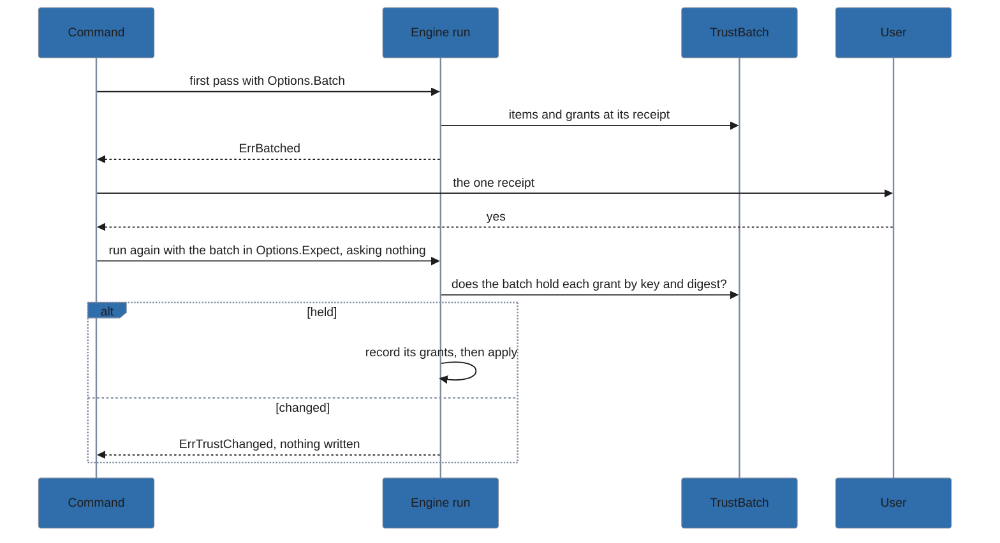

# Trust kinds

Back to the [README](../../README.md).

Maintainer notes on Trust kinds. It is split out of [architecture](../architecture.md).

`--trust[=kind,…]` is one flag (`internal/cli/trust.go`, `trustFlag`) on every command that can
ask a consent question; `engine.TrustKinds` (`internal/engine/trustkinds.go`) is the set, a bit per
kind in canonical order (`entries`, `profiles`, `scripts`, `hooks`, `runtime-hooks`), and
`CommandTrust` the kinds each command asks.

`ParseTrust` turns the flag's values into kinds before any network contact: a bare `--trust` reaches
it as `TrustBareValue` (pflag's `NoOptDefVal`) and is `entries,profiles` within the command's kinds;
`all` is the command's kinds; an unknown, empty or untaken kind is a `TrustFlagError` whose `Fix` is
the kinds of the run its hint offers. pflag gives a `NoOptDefVal` flag its default unless the value
is joined by `=`, so `--trust hooks` is bare `--trust` and an argument: `trustFlag.Set` records how
many positional arguments pflag had read (`FlagSet.Args()`), and `parse` refuses a kind-named
argument at that index, unless after `--` (`TrustArgument`).

`TrustKinds.Arg` writes kinds after `=`, never `all`, and every hint writes it.

`Options.Trust` covers items as they are planned: sync's trust report by kind (`TrustReport.split`,
`consents`), install hooks (`allowed`), runtime hooks (`runtimeHookConsent`), and a remote profile's
`add` or `update` (`consentRemote`). A covered item goes to `Result.Trusted` (a `Consent`: kind,
item, `new` or `changed`) and, for consent.json, a pending `grant`; an uncovered one is asked as
without the flag, its yes a pending `grant` too, or refused or declined (`Result.needs` keeps
the kinds that would refuse, for a dry run's command).

## The shown record

The consent kinds (`TrustConsent`: scripts, hooks, runtime hooks) grant, unasked, only content the
user has seen: all of it, through `untrusted.Text`, never a path and sha256, a cut or the first
lines. `$XDG_STATE_HOME/lola/shown.json` (`consent.Shown`, `paths.Shown`, `Engine.Shown`)
holds the sha256 of each consent item lola printed in full; `trustGrants` gives a covered item only
when the record holds every key of it, or `Options.Unseen` (`--unseen`) is set. A dry run counts
its items as shown, since its report prints them. A covered item the record lacks is handled as an
uncovered one (asked on a terminal, else declined or refused) and its hints (`unseenHints`,
`unseenInstead`) are the run as a dry run, then the run, or the run with `--unseen`.

Keys are content, never version or project, so one review covers the same hook anywhere: a runtime
hook's is the sha256 of its module, settings file and raw rendering (`RuntimeHook.ShownKey`,
`RuntimeHook.Content`, `rawHook`), never the `untrusted.Text` view, which can display two hooks
alike (lock.json's seen fold keeps `runtimeHookKey` over that view, since it is about what was
displayed), an install
hook's the sha256 of its event, path and script sha256 (`HookScript.ShownKey`), a project
script's of its event, path as configured and sha256 (`installScript.shownKey`).

The script's
body (`HookScript.Body`, `ScriptRun.Body`) is read raw by `readBody` in the pass that hashes the
stream, keeping at most `MaxBody`+1 bytes: one larger, not valid UTF-8 or holding a NUL is
`Withheld` (`BodyTooLarge`, `BodyNotText`), never printed, never recorded, so `trustGrants`
(given `showable` false) consents to it under `--unseen` alone and a refusal hints that
(`withheldInstead`). The CLI prints a body with tabs expanded, each line through
`untrusted.Text` (`bodyLines`); `--json` keeps it raw so its sha256 can be checked. An empty body
is shown by its line. `New` says whether the record lacks it.

Who adds to it is whoever printed the item, since only output shows it:

- The engine, for a question (after `Ask`, `AskRuntimeHooks` or `AskScript` returns, whose
  contract is to show the items in full, bodies too). A refusal (`hookConsentError`,
  `refuseScript`) names the scripts and their sha256 but records nothing; for an item lola has not
  shown, its hints are the dry run that shows it first (`unseenInstead`).
- A dry run lists every hook and project script its run would want consent for, a project
  script with nothing to wrap as `HookLater`, and the human report is never quiet while one is
  unshown (`nothingToDo`), so its `trusted` equals what the same run grants.
- The CLI, for what it printed (`emit`, and the plan before a question in `confirm`, or in the
  refusal off a terminal that stands for it, human or `--json`, whose plan holds the bodies):
  - The human renderers note each item they print in full through `style.saw`: `printReport` the
    new runtime hooks, or all under `-v`; `printBody` a body printed open, never a fold; `--plain`
    rows; `printInfo` the runtime hooks it rendered; `printMigrationRuns` the migrate preview.
  - `--json` adds every `ShownKeys` in the document (`shownIn`, `Result.ShownKeys`,
    `DestResult.ShownKeys`, `InfoRuns.ShownKeys`).
  - `RuntimeHook.New` is true for a hook the record lacks, so it is never folded.
  - A failure to write the record warns and fails nothing.

It lives in user state, never a project or the cache, because a shared file would let one checkout
vouch for what another user saw. It is written atomically, 0600, under `paths.ShownLock`, only when
it grows, and validated on load (one JSON object, version 1 or later, keys lowercase hex sha256,
each once); a corrupt file is an error whose hint says deleting it is safe, at the cost of
showing items again.

A runtime hook answered No at a question, as it is, is recorded in lock.json's `Safety`
(`answeredNoKey`) and not asked about again (`runtimeHookConsent`'s `earlier`);
`RuntimeHook.DeclinedEarlier` lets the report fold it as `declined earlier`. A No in a batch's
collect pass reaches its apply pass in `TrustBatch.noes`, which records it the same way. One declined where
nothing asked is asked on a later terminal run.

## The receipt

`confirmTrusted` runs once per engine run before the first write (`InstallAll` before `BeforeWrite`,
`execute`, `Sync` before the apply): it shows the items to `Options.Receipt` (No is `ErrDeclined`)
and only then writes the grants, the flag's and the terminal's alike; entries and profiles
are recorded in trust.json with the apply, as before.

A later failure of the run is a `TrustedError`, whose JSON carries the grants
written. The CLI's receipt prints them grouped by kind on stderr and asks `Proceed?` on a
terminal unless `-y`.

In the install flow, an Apply answered at the review (`reviewApplied`)
confirms every item the review listed in full (`reviewedConsents`), so `appliedReceipt` passes a
receipt of those alone without printing or asking, and hands any other to the receipt; under `--json` it prints nothing, as `trusted` carries them.

`Options.Rerun`
is the user's run for a given set of kinds: sync builds it (`commandOf`), the CLI passes `trustRun`
(`runWithout` the `--trust` given, through `fixedRun`) for install and migrate, and a refusal for
want of trust hints it with the kinds given plus the missing one.

A command that runs the engine more than once shows one receipt: each run gets a
`TrustBatch` in `Options.Batch`, which takes its items and grants at its receipt and stops it with
`ErrBatched`; the command asks the one receipt, then the runs go again, asking nothing, each with
the batch in `Options.Expect`: it records its own grants just before it applies, when each is one
the batch holds by key and digest (entries and profiles items by label), else it fails with
`ErrTrustChanged`, writing nothing, so one module at two versions in two scopes records
each digest before each apply.

A terminal yes to an install or runtime hook in the first run is one of the batch's grants: the
second run, which asks nothing, takes a hook whose key and digest the batch holds as consented
(`allowed`, `runtimeHookConsent`) and records it the same way, while a hook changed in between is
refused as one never answered.

`lola migrate` does so per destination; `sync --scope both` and `profile update` (with `--trust`)
also replay each scope's answers to trust and removals in the second run (`syncPass`). A failure
carries what was recorded so far as `trusted` (`syncedScopesError`, `updateError`, migrate's
`TrustedError`).

`profile update` keeps the profiles it accepts staged in the engine (`Engine.staged`, read by
`loadStack` in place of the files) until `CommitStaged` writes them after that receipt, in the order
they were asked about, each refused when its `source.json` changed since it was read; refusing after
a write stops the run as an `UpdateStoppedError` that names what was written and applies nothing.
`trustFlag` gives a bare `--trust` a value with a NUL byte (`TrustBareValue`), which no argument can
hold, so `--trust=entries,profiles` is never taken for it; help shows `[=entries,profiles]` or
`=<kinds>` through an annotation (`trustShownKey`, `aliasedFlagUsages`).

