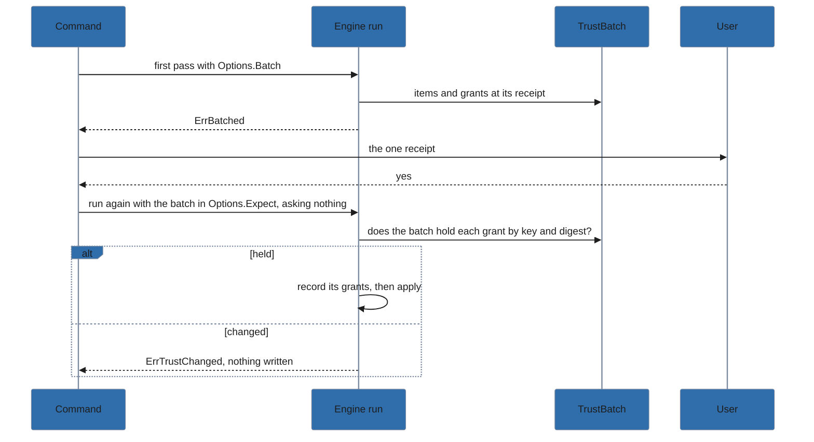

# Trust kinds

Maintainer notes on Trust kinds. It is split out of [architecture](../architecture.md).

`--trust[=kind,…]` is one flag (`internal/cli/trust.go`, `trustFlag`) on every command that can
ask a consent question; `engine.TrustKinds` (`internal/engine/trustkinds.go`) is the set, a bit per
kind in canonical order (`entries`, `profiles`, `scripts`, `hooks`, `runtime-hooks`), and
`CommandTrust` the kinds each command asks.

`ParseTrust` turns the flag's values into kinds before any network contact: a bare `--trust` reaches
it as `TrustBareValue` (pflag's `NoOptDefVal`) and is `entries,profiles` within the command's kinds;
`all` is the command's kinds; an unknown, empty or untaken kind is a `TrustFlagError` whose `Fix` is
the kinds of the run its hint offers. pflag gives a `NoOptDefVal` flag its default unless the value
is joined by `=`, so `--trust hooks` is bare `--trust` and an argument: `trustFlag.Set` records how
many positional arguments pflag had read (`FlagSet.Args()`), and `parse` refuses a kind-named
argument at that index, unless after `--` (`TrustArgument`).

`TrustKinds.Arg` writes kinds after `=`, never `all`, and every hint writes it.

`Options.Trust` covers items as they are planned: sync's trust report by kind (`TrustReport.split`,
`consents`), install hooks (`allowed`), runtime hooks (`runtimeHookConsent`), and a remote profile's
`--add` or `--update` (`consentRemote`). A covered item goes to `Result.Trusted` (a `Consent`: kind,
item, `new` or `changed`) and, for consent.json, a pending `grant`; an uncovered one is asked as
without the flag, its yes a pending `grant` too, or refused or declined (`Result.needs` keeps
the kinds that would refuse, for a dry run's command).

`confirmTrusted` runs once per engine run before the first write (`InstallAll` before `BeforeWrite`,
`execute`, `Sync` before the apply): it shows the items to `Options.Receipt` (No is `ErrDeclined`)
and only then writes the grants, the flag's and the terminal's alike; entries and profiles
are recorded in trust.json with the apply, as before.

A later failure of the run is a `TrustedError`, whose JSON carries the grants
written. The CLI's receipt prints them grouped by kind on stderr and asks `Proceed?` on a
terminal unless `-y`; under `--json` it prints nothing, as `trusted` carries them. `Options.Rerun`
is the user's run for a given set of kinds: sync builds it (`commandOf`), the CLI passes `trustRun`
(`runWithout` the `--trust` given, through `fixedRun`) for install and migrate, and a refusal for
want of trust hints it with the kinds given plus the missing one.

A command that runs the engine more than once shows one receipt: each run gets a
`TrustBatch` in `Options.Batch`, which takes its items and grants at its receipt and stops it with
`ErrBatched`; the command asks the one receipt, then the runs go again, asking nothing, each with
the batch in `Options.Expect`: it records its own grants just before it applies, when each is one
the batch holds by key and digest (entries and profiles items by label), else it fails with
`ErrTrustChanged`, writing nothing, so one module at two versions in two scopes records
each digest before each apply.

A terminal yes to an install or runtime hook in the first run is one of the batch's grants: the
second run, which asks nothing, takes a hook whose key and digest the batch holds as consented
(`allowed`, `runtimeHookConsent`) and records it the same way, while a hook changed in between is
refused as one never answered.

`lola migrate` does so per destination; `sync --scope both` and `profile --update` (with `--trust`)
also replay each scope's answers to trust and removals in the second run (`syncPass`). A failure
carries what was recorded so far as `trusted` (`syncedScopesError`, `updateError`, migrate's
`TrustedError`).

`profile --update` keeps the profiles it accepts staged in the engine (`Engine.staged`, read by
`loadStack` in place of the files) until `CommitStaged` writes them after that receipt, in the order
they were asked about, each refused when its `source.json` changed since it was read; refusing after
a write stops the run as an `UpdateStoppedError` that names what was written and applies nothing.
`trustFlag` gives a bare `--trust` a value with a NUL byte (`TrustBareValue`), which no argument can
hold, so `--trust=entries,profiles` is never taken for it; help shows `[=entries,profiles]` or
`=<kinds>` through an annotation (`trustShownKey`, `aliasedFlagUsages`).

