# TUI flows

Each interactive surface of lola, written down as a state machine: the screens it shows, every way
from one screen to the next, and what each way out leaves on disk. It describes behaviour as built;
when the code changes, this page changes with it. It is split out of
[architecture](../architecture.md); [Selections and the install flow](install-flow.md) explains
what the answers mean.

## Surfaces

- [Install](#install): `lola install`
- [Profile edit](#profile-edit): `lola profile [<name>] --edit [<module>...]` on a terminal
- [Scope picker](#scope-picker): the `<Verb> where?` question of `lola sync`, `update`, `tidy`,
  `repair`, `uninstall` and `lola profile --on/--off/--switch/--move/--split/--remove`
- [Trust question](#trust-question): `Trust these changes?`, its Choose… lists, the removals
  question and the `Proceed?` receipt, on `lola sync`, `update` and `lola profile`'s activations,
  `--move` and `--split`
- [Tidy](#tidy): `lola tidy`'s pickers and its closing question
- [Trash](#trash): bare `lola trash`'s picker and the questions after it, and `lola trash --empty`
- [Cache clean](#cache-clean): `lola cache clean`'s plan and question
- [Init](#init): `lola init` without a directory or `-y`, and the background question that can come
  before any command's first form
- [Market add](#market-add): the name and ssh host questions of `lola market [<name>] --add <source>`
- [Migrate](#migrate): `lola migrate`'s mapping questions, its plan and `Migrate?`
- [Hook and script consent](#hook-and-script-consent): the consent questions about install hooks,
  Claude Code hooks and a project's install scripts, asked by `lola install`, `sync`, `update`,
  `migrate` and `lola profile`'s writes
- [Viewer and pager](#viewer-and-pager): how output, help and a confirmation's plan reach the
  terminal, and the viewer's keys in read mode and in a review
- [Accessible mode](#accessible-mode): the line prompts `LOLA_ACCESSIBLE=1` and `TERM=dumb` ask
  instead of every screen above
- [Form keys](#form-keys): the keys every full-screen form takes

## Reading this page

Each surface has a diagram, a table of its states, a transition table, its exits and its re-entry
rules.

- **States** are the screens, named as the tables use them, with the title the user sees. A title
  is prefixed with `Step N of M — ` when the pass asks more than one field.
- **Transitions** read `| from | input | guard | to | effects |`: in state *from*, on *input*, when
  *guard* holds, the surface moves to *to* and does *effects*. `start` is the command line before any
  screen; *next step* is the first later step whose answer the run does not hold yet.
- **Exits** are the states that end the run, and what each leaves on disk.
- **Re-entry rules** say, for each way back to a screen (Esc, a review's Change entry), which answers
  are kept, which are asked again, and which are dropped.

Every transition row is pinned by a spec named `"<surface>: <from> --<input>--> <to>"` in the
surface's spec file (`internal/cli/flow_paths_test.go` for install,
`internal/cli/profile_edit_paths_test.go` for profile edit, `internal/cli/scope_paths_test.go`
for the scope picker and the trust question, `internal/cli/misc_paths_test.go` for tidy, trash
and cache clean, `internal/cli/misc2_paths_test.go` for init, market add, migrate and hook and
script consent, `internal/cli/keys_paths_internal_test.go` for the viewer and pager, accessible mode
and form keys), the input followed by its guard in
parentheses where rows share a *from* and an *input*, or by an existing spec that file lists at its
top in an `// also pinned (<row>; <row>): <file> "<spec>"` pointer. `task flows` checks both ways:
a row no name matches, and a name that matches no row. It matches a row's *from*, *input* and *to*;
the guard in a name may be shortened, a remark may follow *to* after `, ` or ` (`, and a pointer
without `<surface>: ` takes the surface of its file's own specs.

### Inputs

| input | what the user does |
|---|---|
| answer | submits the screen (Enter) with a valid answer |
| empty submit | submits a list with nothing ticked |
| `esc` | goes back a screen |
| `q` | quits the run |
| `ctrl+c` | cancels the run at once |
| end of input | stdin ends before the screen is answered |
| `Change …` | picks a step to ask again from the review (`c` in the viewer, then the "Change what?" menu; or the "Apply these changes?" menu) |
| yes / no | answers a yes/no question (`y` / `n`) |
| `Cancel` | picks a question's Cancel option, which reaches the flow as `ErrAborted` |
| an option | picks that option of a question (`Lists modules`, `Edit profile …`) |

The forms adapter (`internal/cli/huh.go`) turns keys into answers and errors; the flow only sees
answers, `ErrBack` (Esc) and errors that are `ErrAborted` (Ctrl+C, end of input, a No that cancels,
Quit, and `q`'s `quitError`). The flow treats every `ErrAborted` alike, and every one prints
`✗ cancelled — nothing was changed` and exits 0 (a command that names what the cancel left, as sync
does with `✗ cancelled — the project was not changed`, says so in the same form). A screen that requires a pick (the scope, module and assistant
pickers) refuses an empty submit in the form and stays; the flow never sees it.

### Guards

Guards are facts of the run that skip a screen or decide where an input leads.

| guard | effect |
|---|---|
| `--scope`, `--user`, `--project`, `-C` | the scope picker is not asked |
| module arguments | the module picker is not asked |
| `-t` | the assistant picker is not asked; `-t <id>@<version>` also answers that assistant's version question |
| a declared `target_versions` | that assistant's version question is not asked at that destination |
| `--skip`, `--only`, `--unskip` | no component page is asked |
| `-y`, `--force` | no review menu and no version question (the installed version is taken): the other open steps are still asked, then the summary is printed and applied |
| `-n` | the run ends in a dry run: the review is shown, Apply writes nothing |
| `--json`, or no terminal | nothing is asked |
| single option | an assistant taken as the only one installed (or the only target set up), and a module with one component and no exclusion, are not asked |

### Shared keys

These come from `internal/cli/keys.go` and hold on every full-screen form; [Form keys](#form-keys)
has each one's transitions, and [Viewer and pager](#viewer-and-pager) the viewer's.

- `q` quits. Once two or more answers are held (the step's `Nav.Answered` plus the form's earlier
  fields), it first asks "Quit? your answers so far are dropped — nothing has been changed"; `y`
  quits, `n`, Enter or Esc return to the screen as it was. `q` is text in a text input or a filter
  being typed.
- `esc` goes to the form's field before, and on its first field goes back a screen. On a screen
  with nothing before it (`Nav.Back` unset) it only shows "first step — q quits" (or "no step to go
  back to — q quits" once answers are held) in the key help, and stays.
- `ctrl+c` cancels at once, without asking; in the viewer showing a confirmation's plan it ends the
  command before the question.
- Every cancel prints `✗ cancelled — nothing was changed` and exits 0.
- Accessible mode (`LOLA_ACCESSIBLE=1`, `TERM=dumb`) asks numbered line prompts: `q` is no answer
  there and nothing goes back ([Accessible mode](#accessible-mode)).

## Install

`lola install`'s flow is `installFlow` (`internal/cli/flow.go`). Each pass of `run` calls `answer`,
which asks, in order, the scope, modules, assistants, versions and components, each only when its
answer is not held; then it builds the spec and, when the run reviews, shows the review. An Esc
(`back`) or a Change entry (`review`) forgets one answer, kept as that screen's preselection, and the
next pass asks exactly what is missing. The scope picker and Other directory are `scopePicker`
(`internal/cli/scope.go`).

The run reviews (`reviews`) on a terminal whenever lola chose something the user did not type: a
picker ran, or lola took an assistant the user did not name (the only one installed or set up).

```mermaid
%%{init: {'theme': 'base', 'themeVariables': {
  'primaryColor': '#2f6dab',
  'primaryTextColor': '#1e1e1e',
  'primaryBorderColor': '#7c8ba1',
  'lineColor': '#7c8ba1',
  'edgeLabelBackground': '#eef2f8',
  'tertiaryColor': 'transparent',
  'tertiaryTextColor': '#7c8ba1',
  'tertiaryBorderColor': '#7c8ba1',
  'clusterBkg': 'transparent',
  'clusterBorder': '#7c8ba1',
  'titleColor': '#7c8ba1',
  'noteBkgColor': '#eef2f8',
  'noteTextColor': '#1e1e1e',
  'fontFamily': 'system-ui, sans-serif'
}, 'themeCSS': '.node .nodeLabel{color:#ffffff!important;fill:#ffffff!important;}'}}%%
stateDiagram-v2
  direction TB
  createC: -C confirm
  createOther: create other
  addSource: add source
  noComponents: no components
  upToDate: up to date

  [*] --> createC: -C missing
  [*] --> scope
  createC --> scope: yes
  scope --> directory: Other ticked
  directory --> scope: esc
  directory --> createOther: missing path
  createOther --> directory: no / esc
  createOther --> modules: yes
  scope --> modules
  directory --> modules
  modules --> scope: esc
  modules --> addSource: Add a source…
  addSource --> modules
  modules --> assistants
  assistants --> modules: esc
  assistants --> version
  version --> assistants: esc
  version --> components
  components --> version: esc
  components --> noComponents: empty submit
  noComponents --> components: esc
  noComponents --> review: yes / no (or the next page)
  components --> review
  review --> components: esc
  review --> scope: Change scope
  review --> modules: Change modules
  review --> assistants: Change assistants
  review --> version: Change versions
  review --> components: Change components
  version --> review: esc (Change versions)
  scope --> review: esc (Change scope)
  modules --> review: esc (Change modules)
  assistants --> review: esc (Change assistants)
  components --> review: esc (Change components)
  review --> done: apply
  components --> upToDate: nothing would change
  components --> refused: dry run refuses
  review --> cancelled: quit / n / ctrl+c / q
  done --> [*]
  upToDate --> [*]
  refused --> [*]
  cancelled --> [*]
```

Every screen also goes to `cancelled` on `ctrl+c` or `q`; a skipped screen passes straight to the
next one; Esc goes to the last screen before it whose answer the run holds (the diagram shows the
usual one).

### States

| state | what the user sees | asked when |
|---|---|---|
| -C confirm | `Create <dir>? It does not exist yet` | `-C` names a missing directory, on a terminal, without `-y`, `--force` or `-n` |
| scope | `Install where?` (Project, Other directory…, User) | no scope flag |
| directory | `Other directory` (a path input) | Other directory… is ticked |
| create other | `Create <dir>? It does not exist yet` | the Other directory does not exist and is shown as it is |
| modules | `Install which modules?` (plus a group per marketplace) | no module argument |
| add source | `Source`, `Ref (optional)` | Add a source… is ticked |
| assistants | `Install for which assistants?` | no `-t`, the manifest fixes none, and lola cannot take the only one |
| version | `Write <id> files for which version?` (`Change versions — …` when asked again) | per destination and assistant with more than one era, unless `-t` or `target_versions` gives it, the scope's modules hold it, or `-y`/`--force` |
| components | `<file> › <module>` (`— <destination>` when one of several) | per module with more than one component or an exclusion, unless `--skip`/`--only`/`--unskip`; one page per destination when their preselections differ |
| no components | `Install <module> with no components?` (default No) | a page is submitted empty while it had a preselection |
| review | `Review`: the summary, then `y apply · c change · n cancel` (viewer) or `Apply these changes?` (menu) | the run reviews and the plan changes something |

### Transitions

| from | input | guard | to | effects |
|---|---|---|---|---|
| start | run | no scope flag, on a terminal | scope | |
| start | scope flag | `--scope`, `--user`, `--project` or `-C` | modules | context line printed; no Change scope entry |
| start | module argument | no scope flag | scope | no module picker and no Change modules entry |
| start | target flag | `-t`, no scope flag | scope | no assistant picker and no Change assistants entry; the review says "from -t" |
| start | component flag | `--skip`, `--only` or `--unskip`, no scope flag | scope | no component page and no Change components entry |
| start | target version flag | `-t <id>@<version>`, or `target_versions` declares it | next step | no version question; Change versions is still offered |
| start | held version | the modules installed at the destination, but the run's, are written for one era of the assistant | next step | no version question and no Change versions for it; the review's line adds "this scope's modules are written for it"; a `-t` for another era is refused at the dry run unless `--force` |
| start | run | `-C` missing, on a terminal, no `-y`/`--force`/`-n` | -C confirm | |
| start | run | `-C` missing and `-y` or `--force` | next step | creates it, prints `created <dir>` |
| start | run | `-C` missing and `-n` | next step | prints `would create <dir>`, plans for an empty directory, creates nothing |
| start | run | every answer given, lola chose nothing | apply | no review |
| start | run | the only assistant installed is taken | review | the review says "the only assistant found" |
| start | run | `-y` or `--force` | next step | the steps still open are asked (component pages included), but no version question and no review menu: the summary is printed on stderr and applied |
| start | run | `--json` or no terminal | apply | nothing is asked |
| -C confirm | yes | | next step | creates the directory |
| -C confirm | no | | cancelled | |
| -C confirm | ctrl+c | | cancelled | |
| scope | answer | Other not ticked | next step | context line; component picks at destinations no longer chosen are dropped and counted in the summary |
| scope | answer | Project is the home directory | scope | problem "the project here is your home directory; tick User instead" |
| scope | answer | Other ticked | directory | |
| scope | esc | first screen | scope | key help "first step — q quits" |
| scope | ctrl+c | | cancelled | |
| directory | answer | an existing directory, not the project above, not home | next step | |
| directory | answer | empty, not a directory, unreadable, the project above, or home | directory | problem says why; the answer is offered again |
| directory | answer | missing, shown as it is | create other | |
| directory | esc | | scope | Other directory… ticked |
| directory | ctrl+c | | cancelled | |
| create other | yes | | next step | creates it; removed again if the run installs nothing there |
| create other | no | | directory | problem `<dir> does not exist`; the answer offered again |
| create other | esc | | directory | as no |
| modules | answer | | next step | picks of modules no longer picked are dropped and counted |
| modules | answer | two picks are one module name | modules | problem "… are both the module …" |
| modules | Add a source… | | add source | |
| add source | answer | the source is added | modules | the source is in your cache now, its module ticked |
| add source | answer | the add fails | modules | the error is printed; problem "could not add …" |
| add source | empty submit | | modules | the picks as they were |
| add source | `esc` | | modules | the picks as they were |
| modules | esc | a scope picker was shown | scope | |
| modules | ctrl+c | | cancelled | |
| assistants | answer | | next step | |
| assistants | esc | a scope or module picker was shown | modules | the last of them asks again |
| assistants | esc | first screen | assistants | key help note |
| assistants | ctrl+c | | cancelled | |
| version | answer | another question is open | version | the next destination or assistant |
| version | answer | the last question | next step | the era is recorded on Apply |
| version | esc | a later question | version | the one before, its answer preselected |
| version | esc | the first question, an assistant picker shown | assistants | |
| version | esc | the first question, no assistant picker | modules | the last picker shown asks again |
| version | esc | asked by Change versions | review | the answers it had are kept |
| version | ctrl+c | | cancelled | |
| components | answer | something ticked, or nothing was preselected | next step | the next page, or the review |
| components | empty submit | the page had a preselection | no components | |
| components | esc | a later page | components | the page before, as answered |
| components | esc | the first page, after a version question | version | |
| components | esc | the first page | assistants | the last picker shown asks again |
| components | ctrl+c | | cancelled | |
| components | ctrl+c | lola created the `-C` directory | cancelled | the directory is removed |
| no components | yes | | next step | the module is installed with every component skipped |
| no components | no | other modules are left | next step | the module is dropped from the run |
| no components | no | it was the only module | cancelled | |
| no components | esc | | components | the page again, nothing ticked |
| no components | ctrl+c | | cancelled | |
| answers | all answered | nothing would change | up to date | the review is not shown |
| answers | dry-run refusal | the plan's dry run (or its preview) fails | refused | the flow exits; it does not return to a step |
| review | apply | | done | |
| review | esc | no component page | modules | the last picker shown asks again |
| review | esc | a component page was asked | components | the last page, as answered |
| review | Change scope | | scope | see re-entry |
| review | Change modules | | modules | see re-entry |
| review | Change assistants | | assistants | see re-entry |
| review | Change versions | | version | see re-entry |
| review | Change components | | components | see re-entry |
| review | Change components twice | | components | each time from the last answer |
| review | Change modules | re-adding a removed module | components | see re-entry |
| review | quit | Quit, `n` or `ctrl+c`, each reaching the flow as `ErrAborted` | cancelled | |
| review | q | | cancelled | |
| change scope | esc | the scope picker, reopened by Change scope | review | every answer as it was |
| change modules | esc | the module picker, reopened by Change modules | review | every answer as it was |
| change assistants | esc | the assistant picker, reopened by Change assistants | review | every answer as it was |
| change components | esc | the first page, reopened by Change components | review | every answer as it was; Esc on a later page goes to the page before |

### Exits

| exit | when | on disk | output, exit code |
|---|---|---|---|
| done | Apply, or a run that does not review | the module files, the destination's `.lola/lock.json` (user scope: `$XDG_STATE_HOME/lola/lock.json`), the entry in `.lola/project.yml` (user scope: `default.yml`, or the profile the install writes) or the picks in `selections.yaml`, any `target_versions` recorded; what the run fetched is committed to the cache | `✓ installed <module> (<targets>)` for each module installed; a module only rewritten for the new version has its `<module>: rewrote … files` line instead; 0 |
| up to date | the plan changes nothing | nothing | `✓ already up to date`; 0 |
| cancelled | Ctrl+C, q, Quit, a No that cancels | nothing; what the run fetched is dropped; a directory lola created for the run is removed (`removed <dir> (lola created it; nothing was installed there)`); a source added with Add a source… stays in your cache | `✗ cancelled — nothing was changed`; 0 |
| refused | an error after the answers, or before any screen | nothing; created directories removed as on cancel | `error: …` with `hint:` lines; 1 |

Under `-n` the done exit writes nothing: it prints the plan and, after a review, the equivalent
commands.

### Re-entry

| way back | asks again | keeps | drops |
|---|---|---|---|
| Change scope | the scope picker (its last answer preselected, the last Other directory offered), then the assistant picker where one is needed and the version questions, each preselected with its last answer | the modules, at the versions first listed; the component picks of the destinations still chosen | the picks of destinations no longer chosen (counted in the summary) |
| Change modules | the module picker (its last answer preselected), then a page for each module added | the assistants and the versions, which the modules added are written for; the picks of modules still picked | the picks of modules removed (counted); a module re-added opens its page with its last page answer if it had one from Change components or Esc, else its default |
| Change assistants | the assistant picker (its last answer preselected), then the version questions, as steps of the flow, each preselected | the scope, modules and component picks | the versions |
| Esc on the first screen of a reopened step | nothing: the run goes back to the review | every answer as it was before the Change entry | nothing. Once the step is answered, Esc on a later screen goes back in flow order, and the reopened step's first screen is then a step like any other |
| Change versions | every version question of a multi-era assistant the scope's modules do not hold, declared or given ones too, each preselected, unnumbered | everything else | nothing until answered: Esc on the first question restores the answers it had |
| Change components | every component page, each from its last answer | everything else | the pages' answers (kept as preselection) |
| Esc on a picker | the last picker before it whose answer is held, its answer preselected; that picker then resets as its Change entry does | as its Change entry keeps | as its Change entry drops |
| Esc on a component page or the review | the last page held before it, as answered; with none, the last picker | every other page | that page's answer (kept as preselection) |
| Esc on no components | its page, nothing ticked | everything | |

## Profile edit

`lola profile [<name>] --edit [<module>...]` is `profileEdit` (`internal/cli/profile_edit.go`).
What the name means is settled first, by the engine (`engine.EditArgs`, `engine.EditTarget` in
`internal/engine/profile_edit.go` and `internal/engine/target.go`), asking on a terminal when the
name is both a profile and a module, or when the write target needs a choice. Then:

- with modules, the edit is the [install flow](#install) (`runInstall`) into that profile, applied
  in each scope the profile is on (`engine.EditScopes`);
- bare `--edit` of a profile opens its module page (`editPage`), which is the install flow's
  module picker with the profile's modules ticked; a module unticked there is removed from the
  profile;
- bare `--edit` of a bundle opens its members page, then sets the members (`editBundle`);
- bare `--edit` of a name no profile has asks what the new profile is: a module page or a members
  page;
- `--new` without a module makes the profile, and `--bundle <members>` sets a bundle's members,
  without a page.

Where profile edit runs the install flow, every screen and row of [Install](#install) holds, except:

- there is no scope picker, `-C` confirm, Other directory or create other: the scopes are the
  profile's, and the review never offers Change scope;
- the module picker is asked only on the bare path, titled `<label> › modules`, and there nothing
  ticked is an answer; with module arguments the review never offers Change modules;
- the component page is titled `<label> › <module>`, the label naming the file it writes
  (`profile go`, `default (base)`);
- the review also lists the removal of each module unticked, and its Apply removes them.

```mermaid
%%{init: {'theme': 'base', 'themeVariables': {
  'primaryColor': '#2f6dab',
  'primaryTextColor': '#1e1e1e',
  'primaryBorderColor': '#7c8ba1',
  'lineColor': '#7c8ba1',
  'edgeLabelBackground': '#eef2f8',
  'tertiaryColor': 'transparent',
  'tertiaryTextColor': '#7c8ba1',
  'tertiaryBorderColor': '#7c8ba1',
  'clusterBkg': 'transparent',
  'clusterBorder': '#7c8ba1',
  'titleColor': '#7c8ba1',
  'noteBkgColor': '#eef2f8',
  'noteTextColor': '#1e1e1e',
  'fontFamily': 'system-ui, sans-serif'
}, 'themeCSS': '.node .nodeLabel{color:#ffffff!important;fill:#ffffff!important;}'}}%%
stateDiagram-v2
  direction TB
  newProfile: new profile
  installSteps: assistants, versions, components
  removeThere: remove there
  applyRemovals: apply removals

  [*] --> which: a profile and a module
  [*] --> where: the write target asks
  [*] --> installSteps: module arguments
  [*] --> modules: a profile
  [*] --> members: a bundle
  [*] --> newProfile: a new name
  [*] --> created: --new
  [*] --> applyRemovals: --bundle
  which --> installSteps: Edit profile / Edit module
  which --> modules: Edit profile, no other module
  where --> installSteps
  newProfile --> modules: Lists modules
  newProfile --> members: Bundles profiles
  modules --> newProfile: esc (new profile)
  members --> newProfile: esc (new bundle)
  modules --> installSteps
  modules --> remove: empty submit
  modules --> review: empty submit (new profile)
  installSteps --> modules: esc
  installSteps --> review
  installSteps --> remove: only an untick changes
  review --> installSteps: esc / Change …
  review --> modules: Change modules
  modules --> review: esc (Change modules)
  review --> done: apply
  review --> created: apply (new profile)
  remove --> modules: esc
  remove --> done: yes / no
  remove --> removeThere: yes, on in two scopes
  review --> removeThere: apply, on in two scopes
  removeThere --> done: yes
  removeThere --> cancelled: no
  members --> created: new bundle
  members --> trust: a pulled list
  members --> applyRemovals: removes files
  members --> done
  trust --> applyRemovals: accept
  trust --> done: accept
  applyRemovals --> members: esc
  applyRemovals --> done: yes
  applyRemovals --> cancelled: no
  review --> cancelled: quit
  done --> [*]
  created --> [*]
  refused --> [*]
  cancelled --> [*]
```

Every screen also goes to `cancelled` on `ctrl+c` or `q`, and every question's Cancel goes there
too. The engine's questions (which, where, new profile) and a bundle's members page are each the
run's first screen: Esc there stays, its key help saying `first step — q quits`. The pages new
profile opens go back to it.

### States

| state | what the user sees | asked when |
|---|---|---|
| which | `<m> names profile <p> (<path>) and a module.` (`Edit profile <p>` for each such profile, `Edit module <m> in <target>`, Cancel) | the first name is a profile here and reads as a module, on a terminal |
| where | the write target's question, with Cancel: `<bundle> is a bundle. Which profile gets <m>?`, `<m> comes from <base> (base), loaded under every profile at <scope>.`, `<remote> is read-only.` | the profile edits go to is a bundle or a remote profile, or the module comes from the base |
| new profile | `New profile <n>:` (Lists modules, Bundles profiles, Cancel) | bare `--edit` of a name no profile has |
| modules | `<label> › modules`, the profile's modules ticked, one your cache lacks labelled `(in <label>; not in your cache)`; nothing ticked is an answer | bare `--edit` of a profile, or Lists modules (`new profile <n> › modules`, nothing ticked) |
| assistants, version, components, no components | as [Install](#states) | as Install |
| review | as Install; below the summary, `Remove <m> from <label>, as you unticked …` and its plan for each module unticked; for a new profile with nothing ticked, `would make profile <n> (<path>, empty)` | as Install, and a new profile with nothing ticked |
| remove | the removal plan, then `Remove <m> from <label>?` | the page unticked modules, nothing else changes (so there is no review), and no `-y` or `--force` |
| remove there | the removals, then `Remove these there too? No changes nothing` | the profile is on in a later scope too, whose sync would remove files; asked before anything is written in any scope, and not under `-n` or `--force` |
| members | `<label> › members` (`new bundle <n> › members`), the members ticked, one that names no profile labelled `(names no profile here)`; nothing ticked is an answer | bare `--edit` of a bundle, or Bundles profiles |
| trust | the trust diff, then `Trust these changes?` (all or nothing) | the bundle is a project's whose member list a pull changed, and `--trust` does not cover it |
| apply removals | the removals, then `Remove these and apply? No applies nothing` | the bundle is on and its new members remove files, and no `-y` or `--force` |

### Transitions

| from | input | guard | to | effects |
|---|---|---|---|---|
| start | module argument | | components | on a terminal, the install flow: no scope or module picker; the review offers no Change scope or Change modules |
| start | module argument | a profile and a module | which | the first name is both |
| start | module argument | the write target asks | where | |
| start | module argument | a name no profile has | refused | without `--new`; hint: the run with `--new` |
| start | new flag with modules | | components | `--new`, a name no profile has: the profile is made on Apply (`, new` in its write line) |
| start | new flag | | created | `--new` and no module: no screen |
| start | bundle flag | | apply removals | `--bundle <members>`: no members page; when nothing is removed, straight to done |
| start | run | a profile | modules | no module |
| start | run | a bundle | members | no module |
| start | run | a name no profile has | new profile | no module |
| start | pick flags | no module | refused | `--skip`, `--only`, `--unskip`, `--exact`, `--ref` or `--path` |
| which | Edit profile | other module arguments | next step | they go into that profile; no review when lola chose nothing |
| which | Edit profile | no other module | modules | that profile's page |
| which | Edit module | | next step | the module goes into the profile edits go to |
| which | Cancel or ctrl+c | | cancelled | |
| which | esc | | which | first screen: key help note |
| where | answer | | next step | the page is titled with the file the answer writes |
| where | answer | a bundle on, then an inherited module | where | the inherited-edit question follows the member question, both before the page |
| where | answer | a remote profile on | next step | |
| where | Cancel or ctrl+c | | cancelled | |
| where | esc | | where | first screen: key help note |
| new profile | Lists modules | | modules | `new profile <n> › modules`, nothing ticked; the context line is printed once, before the question |
| new profile | Bundles profiles | | members | `new bundle <n> › members`, nothing ticked |
| new profile | Cancel or ctrl+c | | cancelled | |
| new profile | esc | | new profile | first screen: key help note |
| modules | answer | | next step | as [Install's](#transitions) modules answer |
| modules | answer | nothing would change | up to date | no review |
| modules | answer | only modules your cache lacks are kept | unchanged | the `lola cache add` that lets you pick them is hinted |
| modules | answer | what is kept is unchanged, something unticked | remove | after the component pages |
| modules | empty submit | a profile with modules | remove | the removal plan is printed |
| modules | empty submit | `-y` or `--force` | done | the removal plan is printed, and nothing asked |
| modules | empty submit | a new profile | review | `would make profile <n> (<path>, empty)`; no assistants, version or component step: there is nothing to install, so the review offers only Change modules |
| modules | empty submit | a new profile, after Change modules | review | as above: the assistants and versions answered for the modules unticked are dropped |
| modules | empty submit | a new profile, `-y` | created | the summary printed on stderr, nothing asked (`--force` alike) |
| modules | esc | first screen | modules | key help note |
| modules | esc | a new profile | new profile | Lists modules under the cursor |
| modules | ctrl+c | | cancelled | |
| components | esc | the first page, the module page shown | modules | its answer preselected |
| components | esc | the first page, module arguments | components | first screen: key help note |
| components | ctrl+c | | cancelled | |
| no components | no | module arguments, other modules left | done | the module is dropped; with nothing lola chose left, there is no review, so this run cannot bring it back |
| review | apply | | done | |
| review | apply | modules unticked | done | they are removed from the profile, asking nothing more |
| review | apply | modules unticked, the profile on in two scopes | remove there | asked before the install writes |
| review | apply | a new profile, nothing ticked | created | |
| review | apply | `-n` | done | nothing written |
| review | esc | | components | the last page, as answered |
| review | esc | a new profile, nothing ticked | modules | nothing ticked |
| review | Change modules | | modules | its answer preselected |
| review | Change modules | a new profile | modules | nothing ticked, as answered |
| review | quit | | cancelled | |
| change modules | esc | | review | the module page reopened by Change modules: every answer as it was |
| change components | esc | | review | the first page reopened by Change components: every answer as it was |
| remove | yes | | done | removed from the profile and applied |
| remove | yes | the profile on in two scopes | remove there | nothing is written yet |
| remove | no | | done | `kept <m> in <label>`; nothing written |
| remove | esc | | modules | the page as answered |
| remove | esc | a component page was asked | components | the last page, as answered |
| remove | ctrl+c | | cancelled | |
| remove there | yes | | done | that scope's sync after the write asks nothing more; a removal it did not show is still asked (`… No leaves that scope as it was`) |
| remove there | no | | cancelled | nothing written in any scope |
| remove there | ctrl+c | | cancelled | nothing written in any scope |
| members | answer | | done | the bundle's members set, in order |
| members | answer | removes modules of the bundle on | apply removals | |
| members | answer | unchanged | done | `bundle <n> already lists …`; nothing written |
| members | answer | a pulled member list | trust | |
| members | answer | a new bundle | created | |
| members | esc | first screen | members | key help note |
| members | esc | a new bundle | new profile | Bundles profiles under the cursor |
| members | ctrl+c | | cancelled | |
| trust | accept | | done | what was shown is recorded as trusted; apply removals follows when the apply removes files |
| trust | decline or ctrl+c | | cancelled | |
| apply removals | yes | | done | |
| apply removals | no | | cancelled | |
| apply removals | esc | | members | after the members page: the page as answered |
| apply removals | esc | after the trust question | members | the page as answered; the trust question was the edit's own, so Esc goes back past it |
| apply removals | esc | bundle flag, after the trust question | apply removals | first screen: key help note |
| apply removals | ctrl+c | | cancelled | |

### Exits

| exit | when | on disk | output, exit code |
|---|---|---|---|
| done | Apply, a yes, or a run that does not review | the profile's file (or the base's, or `selections.yaml` for picks alone, as the where answer says), the files it installs or removes in each scope it is on, their `lock.json` | as Install's done, then `✓ removed <m> from <label>` and the uninstall for each module removed, and each later scope's sync under its name; a No at remove prints `kept <m> in <label>`; 0 |
| created | `--new`, Apply on a new profile with nothing ticked, a new bundle's members | the new profile's file; nothing applied | `✓ new profile <n> (<path>, empty)` or `✓ new bundle <n> (<members>)`, and the `--switch` that turns it on; 0 |
| unchanged | only modules your cache lacks are kept and nothing unticked | nothing | `→ <label> is unchanged…`, with the `lola cache add` to run; 0 |
| up to date | the plan changes nothing | nothing | `✓ already up to date`; 0 |
| cancelled | Ctrl+C, q, Quit, Cancel, a No that cancels | nothing | as Install's cancelled; 0 |
| refused | an error before any screen or after the answers | nothing | `error: …` with `hint:` lines; 1 |

### Re-entry

| way back | asks again | keeps | drops |
|---|---|---|---|
| Esc and Change entries of the install flow | as [Install's re-entry](#re-entry) | as Install | as Install |
| Esc on remove | the last screen before it: the last component page held, else the module page, as answered | every answer | nothing |
| Esc on a new profile's review | the module page, nothing ticked | the new profile's choice | nothing |
| Esc on apply removals | the members page, ticked as answered | nothing is written yet | nothing |
| Esc on a new profile's module page or a new bundle's members page | new profile, its last answer under the cursor | the context line, not printed again | the page's ticks |
| Esc on which, where, new profile or a bundle's members page | nothing: a first screen stays | | |

## Scope picker

A command that writes and acts on a scope resolves it through `app.scopes`
(`internal/cli/scope.go`): `engine.ResolveScope` (`internal/engine/scope.go`) takes the scope flags,
and on a terminal with none of them answers "ask", which is the picker, `scopePicker.pick`. Its
answer is the command's scope (or scopes); the command then runs as it would with that flag.
Install has a picker of its own, written down under [Install](#install).

```mermaid
%%{init: {'theme': 'base', 'themeVariables': {
  'primaryColor': '#2f6dab',
  'primaryTextColor': '#1e1e1e',
  'primaryBorderColor': '#7c8ba1',
  'lineColor': '#7c8ba1',
  'edgeLabelBackground': '#eef2f8',
  'tertiaryColor': 'transparent',
  'tertiaryTextColor': '#7c8ba1',
  'tertiaryBorderColor': '#7c8ba1',
  'clusterBkg': 'transparent',
  'clusterBorder': '#7c8ba1',
  'titleColor': '#7c8ba1',
  'noteBkgColor': '#eef2f8',
  'noteTextColor': '#1e1e1e',
  'fontFamily': 'system-ui, sans-serif'
}, 'themeCSS': '.node .nodeLabel{color:#ffffff!important;fill:#ffffff!important;}'}}%%
stateDiagram-v2
  direction TB

  [*] --> scope: no scope flag, on a terminal
  [*] --> next: a scope flag, or --json
  scope --> directory: Other ticked
  directory --> scope: esc
  scope --> scope: a problem
  directory --> directory: a problem
  scope --> next
  directory --> next
  scope --> refused: Project has no .lola/
  next --> [*]
  refused --> [*]
  cancelled --> [*]
```

Every screen also goes to `cancelled` on `ctrl+c` or `q`. The picker is the run's first screen for
every command: Esc there stays, its key help saying `first step — q quits`.

| command | question | several scopes may be ticked | a project at your home directory |
|---|---|---|---|
| `lola sync` | `Sync where?` | yes: the project, then user scope | refused |
| `lola update` | `Update where?` | yes: the project, then user scope | refused |
| `lola tidy` | `Tidy where?` | no | accepted |
| `lola repair` | `Repair where?` | no | accepted |
| `lola uninstall` | `Uninstall from where?` | no | accepted |
| `lola profile --on` | `Turn it on where?` | no | refused |
| `lola profile --off` | `Turn it off where?` | no | refused |
| `lola profile --switch` | `Switch where?` | no | refused |
| `lola profile --move` | `Move where?` | no | refused |
| `lola profile --split` | `Split where?` | no | refused |
| `lola profile --remove` | `Check which scope before removing it?` | no | refused |

### States

| state | what the user sees | asked when |
|---|---|---|
| scope | the command's question (Project (`<root>`) with its context, User (~) with its context, Other directory…), nothing ticked; `pick one` below it where one scope is taken | no `--scope`, `--user`, `--project` or `-C`, on a terminal |
| directory | `Other directory` (a path input; `~` and `~/` are your home directory) | Other directory… is ticked |

Project is the project with `.lola/` found at or above the current directory, else the current
directory, which is offered without a `.lola/`.

### Transitions

| from | input | guard | to | effects |
|---|---|---|---|---|
| start | run | lola sync | scope | `Sync where?`; several may be ticked |
| start | run | lola update | scope | `Update where?`; several may be ticked |
| start | run | lola tidy | scope | `Tidy where?` |
| start | run | lola repair | scope | `Repair where?` |
| start | run | lola uninstall | scope | `Uninstall from where?` |
| start | run | lola profile --on | scope | `Turn it on where?` |
| start | run | lola profile --off | scope | `Turn it off where?` |
| start | run | lola profile --switch | scope | `Switch where?` |
| start | run | lola profile --move | scope | `Move where?` (with `--user` and `-C` together, no picker) |
| start | run | lola profile --split | scope | `Split where?` |
| start | run | lola profile --remove | scope | `Check which scope before removing it?` |
| start | scope flag | | next step | `--project`, `--user`, `-C <dir>` or `--scope`: nothing asked |
| start | run | -n, -y or --force | scope | none of them names a scope |
| start | run | --json | next step | nothing asked: the project found from here, else `default_scope`, else refused with the runs that name a scope |
| scope | answer | | next step | the command runs at the scope ticked |
| scope | answer | two ticked, one scope | scope | problem "pick one scope" |
| scope | answer | two ticked, sync or update | next step | each scope in turn, the project first, stopping at the first that fails or is declined |
| scope | answer | Project is the home directory, refused | scope | problem "the project here is your home directory; tick User instead", nothing ticked |
| scope | answer | Project is the home directory, accepted | next step | tidy, repair and uninstall run at the project there |
| scope | answer | Project has no .lola/ | refused | `lola sync`: `no project.yml in <dir>`, hinting `lola install --project <source>` |
| scope | answer | Other ticked | directory | |
| scope | esc | | scope | first screen: key help note |
| scope | ctrl+c | | cancelled | |
| directory | answer | | next step | an existing directory, not the project ticked above |
| directory | answer | not a directory | directory | empty, missing, a file, or the project ticked above: the problem says why; nothing is created; the answer is offered again |
| directory | answer | home, refused | directory | problem "that is your user scope (~); tick User instead" |
| directory | answer | home, accepted | next step | tidy, repair and uninstall run there as a project |
| directory | esc | | scope | the picker as ticked |
| directory | esc | typed path | scope | the path typed is dropped: ticked again, Other directory asks with an empty input |
| directory | ctrl+c | | cancelled | nothing runs, at any scope ticked |

### Exits

| exit | when | on disk | output, exit code |
|---|---|---|---|
| next step | an answer | what the command then writes at that scope | the command's own; its context line names the scope |
| cancelled | Ctrl+C, q | nothing | the command's cancel message; 0 |
| refused | the scope cannot be taken, or no scope can be resolved off a terminal | nothing | `error: …` with `hint:` lines; 1 |

### Re-entry

| way back | asks again | keeps | drops |
|---|---|---|---|
| Esc on directory | the picker | its ticks, Other directory… included | the path typed |
| a problem | the same screen | the picker: nothing ticked; directory: the answer, when it is safe to show | |
| Esc on the picker | nothing: a first screen stays | | |

## Trust question

A sync at project scope asks before it installs what the project's files changed since you last
trusted them (`engine.Sync`, `internal/engine/sync.go`). The CLI's questions are
`syncQuestions` (`internal/cli/cmd_sync.go`), drawn by the forms adapter's `Trust` and `Confirm`
(`internal/cli/huh.go`); the receipt is `app.receipt` (`internal/cli/trust.go`). In order, a run
asks:

1. the trust question, after the trust diff, about the changes `--trust` does not cover;
2. the removals question, after the list of removals, when the run removes files and `-y` or
   `--force` does not answer it: `Remove these and sync? No applies nothing` (`… and apply?` for
   an activation, `… and move?`, `… and split?`);
3. the receipt, `Proceed?`, after the list of what `--trust` covers, when `--trust` covers
   something and `-y` is not given.

An activation (`--on`, `--off`, `--switch`) and `--move` apply all they planned or nothing, so
their trust question offers no Choose…; `--split` and `lola sync`/`update` offer it. A run of
several scopes (`--scope both`, or both ticked) asks each scope's questions in turn and shows one
receipt for all of them; a No in one scope stops the scopes after it.

```mermaid
%%{init: {'theme': 'base', 'themeVariables': {
  'primaryColor': '#2f6dab',
  'primaryTextColor': '#1e1e1e',
  'primaryBorderColor': '#7c8ba1',
  'lineColor': '#7c8ba1',
  'edgeLabelBackground': '#eef2f8',
  'tertiaryColor': 'transparent',
  'tertiaryTextColor': '#7c8ba1',
  'tertiaryBorderColor': '#7c8ba1',
  'clusterBkg': 'transparent',
  'clusterBorder': '#7c8ba1',
  'titleColor': '#7c8ba1',
  'noteBkgColor': '#eef2f8',
  'noteTextColor': '#1e1e1e',
  'fontFamily': 'system-ui, sans-serif'
}, 'themeCSS': '.node .nodeLabel{color:#ffffff!important;fill:#ffffff!important;}'}}%%
stateDiagram-v2
  direction TB

  [*] --> trust: changes to trust, on a terminal
  [*] --> removals: only removals
  [*] --> receipt: --trust covers every change
  [*] --> refused: no terminal
  [*] --> done: -n
  trust --> choose: Choose…
  choose --> trust: esc
  choose --> removals
  trust --> removals: Trust all
  removals --> trust: esc (after a trust answer)
  trust --> receipt
  choose --> receipt
  removals --> receipt: yes
  trust --> done
  choose --> done
  removals --> done: yes
  removals --> declined: no
  receipt --> done: yes
  receipt --> cancelled: no
  trust --> cancelled: Cancel
  done --> [*]
  declined --> [*]
  refused --> [*]
  cancelled --> [*]
```

Every screen also goes to `cancelled` on `ctrl+c` or `q`. The trust question is a first screen:
Esc there stays.

### States

| state | what the user sees | asked when |
|---|---|---|
| trust | the trust diff, then `Trust these changes?` (`Trust all N changes` or `Trust this change`, Choose…, `Cancel (the project is not changed)`), the cursor on Cancel, or on the answer given before when asked again | a project's files changed since you last trusted them, in a kind `--trust` does not cover, on a terminal |
| choose | one list per kind of change (`Added (n)`, …), nothing ticked, or the entries chosen before when asked again | Choose… is picked; not offered by an activation or `--move`, or when the top-level targets are the only change |
| removals | the removals, then the command's removals question | the run removes files, without `-y` or `--force` |
| receipt | `trusting, as --trust=<kinds> allows:` and what it covers, then `Proceed?` (default No) | `--trust` covers a change, on a terminal, without `-y` |

### Transitions

| from | input | guard | to | effects |
|---|---|---|---|---|
| start | run | lola sync | trust | the trust diff on stderr first |
| start | run | lola update | trust | a folder's changed content, or a new pin, is a change too |
| start | run | an activation | trust | no Choose…: all or nothing |
| start | run | -y | trust | `-y` never trusts; it answers the removals |
| start | run | -n | done | asks nothing; prints the plan and the trust diff; writes nothing to the project, though it may cache the versions it would trust, at their pins |
| start | run | no terminal | refused | the diff on stderr; the hints give the run with `--trust` |
| start | run | only removals | removals | the trust is recorded already: the removals question is the first screen |
| start | trust flag | | receipt | `--trust` covers every change: no trust question; the receipt follows the removals |
| start | trust flag | -y | next step | the receipt is printed, not asked |
| trust | Trust all | | next step | `→ trusting …` is echoed; the trust is recorded with the apply; after the apply, the same run off a terminal is printed |
| trust | Trust all | removals follow | removals | |
| trust | Trust all | --trust covers the rest | receipt | |
| trust | Choose… | | choose | |
| trust | Cancel or ctrl+c | | cancelled | nothing written, nothing recorded |
| trust | esc | | trust | first screen: key help note |
| choose | answer | | next step | the entries ticked are trusted; the rest are left as installed, with a warning naming them and the sync that asks again |
| choose | empty submit | | choose | refused with the "nothing selected" note; Cancel is the way out |
| choose | esc | first list | trust | the cursor on Choose…, the ticks kept |
| choose | esc | a later list | choose | the list before |
| choose | ctrl+c | | cancelled | |
| removals | yes | | done | `→ removing <modules>` |
| removals | no | | declined | nothing applied; the trust you gave is recorded, and the message says so: the next sync asks only the removals (and again about what lola records only once it writes it) |
| removals | no | several scopes | declined | the scopes after it are not synced |
| removals | no | an activation | declined | the message names the activation to run again |
| removals | esc | after a trust answer | trust | `lola sync`, `update` and the activations: the trust question again, its answer under the cursor and Choose…'s ticks kept, `→ back to the trust question: the answer above no longer stands` printed; nothing is written until the removals are answered. `--move` and `--split` stay, as on a first screen |
| removals | esc | first screen | removals | key help note |
| removals | ctrl+c | | cancelled | |
| receipt | yes | | done | |
| receipt | no | | cancelled | nothing written in any scope |

### Exits

| exit | when | on disk | output, exit code |
|---|---|---|---|
| done | the answers allow the apply, or `-n` | the files, `lock.json`, the pins written to the project's files, the trust record (`$XDG_STATE_HOME/lola/trust.json`); under `-n`, nothing in the project | the sync's output; after a trust answer, `→ the same off a terminal: <run>`; 0 |
| declined | a No to the removals | the trust record only | `✗ removals declined; the project was not changed. The changes you trusted are recorded; …`; 0 |
| cancelled | Cancel, a No at the receipt, Ctrl+C, q | nothing, and nothing is cached | `✗ cancelled — the project was not changed` (`user scope` for a user-scope run, or `nothing was changed`); 0 |
| refused | no terminal to ask on, or a change a refusal guards | nothing | `error: …` with `hint:` lines; 1 |

### Re-entry

| way back | asks again | keeps | drops |
|---|---|---|---|
| Esc on the first list of choose | the trust question, the cursor on Choose… | the ticks | nothing |
| Esc on the removals after a trust answer | the trust question, then the run's later questions | the answer under the cursor, Choose…'s ticks | what the answer planned: the run is planned again from the report as first asked |
| Esc on the trust question, or on the removals question asked first | nothing: a first screen stays | | |

## Tidy

`lola tidy` (`runTidy`, `internal/cli/cmd_tidy.go`) resolves its scope with the
[Scope picker](#scope-picker) (`Tidy where?`, one scope), then calls `engine.Tidy`
(`internal/engine/tidy.go`), which takes the scope's lock, scans, and decides what moves
(`tidySelect`, `internal/engine/tidy_select.go`): what the names or `--all` select, else, on a
terminal, the pickers' answer (`TidyRequest.Choose`, the CLI's `tidyChoose`); then the closing
question (`TidyRequest.Confirm`). The lock is held from the scan to the end of the run, also while
the pickers and the question wait for you. Going back from the closing question (ErrBack) after the
pickers asks `Choose` again, which starts at the last picker shown, as answered.

```mermaid
%%{init: {'theme': 'base', 'themeVariables': {
  'primaryColor': '#2f6dab',
  'primaryTextColor': '#1e1e1e',
  'primaryBorderColor': '#7c8ba1',
  'lineColor': '#7c8ba1',
  'edgeLabelBackground': '#eef2f8',
  'tertiaryColor': 'transparent',
  'tertiaryTextColor': '#7c8ba1',
  'tertiaryBorderColor': '#7c8ba1',
  'clusterBkg': 'transparent',
  'clusterBorder': '#7c8ba1',
  'titleColor': '#7c8ba1',
  'noteBkgColor': '#eef2f8',
  'noteTextColor': '#1e1e1e',
  'fontFamily': 'system-ui, sans-serif'
}, 'themeCSS': '.node .nodeLabel{color:#ffffff!important;fill:#ffffff!important;}'}}%%
stateDiagram-v2
  direction TB
  dryRun: dry run

  [*] --> scope: no scope flag, on a terminal
  [*] --> move: a scope flag, no names or --all
  [*] --> confirm: names or --all
  [*] --> done: -y or --force with names, --keep, --unkeep, nothing to tidy
  [*] --> dryRun: -n
  [*] --> refused: no terminal or --json, without names or --all
  scope --> move
  move --> keep: names left unticked
  move --> confirm: every name ticked
  keep --> move: esc
  keep --> confirm
  confirm --> keep: esc (after the keep picker)
  confirm --> move: esc (after the move picker only)
  confirm --> done: yes
  confirm --> failed: yes, a move fails
  confirm --> cancelled: no
  done --> [*]
  dryRun --> [*]
  refused --> [*]
  failed --> [*]
  cancelled --> [*]
```

Every screen also goes to `cancelled` on `ctrl+c` or `q`. The move picker is the first screen of
tidy's own: Esc there stays, also after the scope picker. Under `-y` the pickers still run and the
closing question is not asked.

### States

| state | what the user sees | asked when |
|---|---|---|
| scope | `Tidy where?` (see [Scope picker](#scope-picker)) | no `--scope`, `--user`, `--project` or `-C`, on a terminal |
| move | `Move which to the trash?`: each candidate as `<assistant>  <kind>/<name>  <path>`, filterable, the locked items and their reasons above it; nothing ticked, or the last answer when asked again | something can move, on a terminal, without names, `--all`, `-n`, `--force`, `--keep` or `--unkeep` |
| keep | `Add any of the rest to your keep-list?`: one escaped literal selector per name not ticked to move, with the assistants it keeps; nothing ticked, or the last answer when the closing question goes back to it | the move picker left a name unticked |
| confirm | what moves, `keep <selector>` and `unkeep <selector>` lines, after the pickers the `Equivalent command:`, then `Move N items to the trash?`, `Keep M?` or `Stop keeping K?`, or two or three of them joined (default No) | something moves or the pickers keep something, without `-y` or `--force` |

### Transitions

| from | input | guard | to | effects |
|---|---|---|---|---|
| start | run | | scope | `Tidy where?`; one scope |
| start | run | --json or no terminal | refused | without names or `--all`: `lola tidy needs names or --all when it cannot ask …`, hinting the run with `--all -y`; nothing moves |
| start | scope flag | | move | |
| start | scope flag | nothing to tidy | done | `nothing to tidy at <scope>`; nothing asked |
| start | names | | confirm | first screen: Esc stays |
| start | names | -y | done | moves what the names select; nothing asked |
| start | names | --force | done | also what git tracks; nothing asked |
| start | run | --force, no names | refused | `--force needs names or --all: N items can move`; never the picker |
| start | run | --all | confirm | first screen: Esc stays |
| start | run | --scope both | refused | hints the run at each scope |
| start | run | -n | dry run | lists what would move and what is locked; asks nothing |
| start | run | --keep or --unkeep | done | edits `keep.yaml`, with no question on a terminal too; moves nothing |
| move | answer | | keep | the rest offered; nothing is written yet |
| move | answer | every name ticked | confirm | no keep picker |
| move | answer | -y, every name ticked | done | the move follows the pick |
| move | empty submit | | keep | it then needs a pick |
| move | esc | | move | first screen: key help note |
| move | ctrl+c | | cancelled | |
| keep | answer | | confirm | |
| keep | answer | -y | done | |
| keep | empty submit | something moves | confirm | keeps nothing |
| keep | empty submit | nothing moves | keep | refused with the "nothing selected" note; Esc or Ctrl+C is the way out |
| keep | esc | | move | the move ticks kept; the keep ticks dropped |
| keep | ctrl+c | | cancelled | |
| confirm | yes | | done | moves into one new trash run; writes `keep.yaml` |
| confirm | yes | a move fails | failed | what moved before it stays in the trash run; `keep.yaml` is written all the same |
| confirm | no | | cancelled | nothing moved, nothing written |
| confirm | esc | after the keep picker | keep | its ticks kept; the move ticks kept too |
| confirm | esc | after the move picker only | move | its ticks kept |
| confirm | esc | names | confirm | first screen (names or `--all`): key help note |
| confirm | ctrl+c | | cancelled | |

### Exits

| exit | when | on disk | output, exit code |
|---|---|---|---|
| done | a yes, `-y`, `--force`, `--keep`/`--unkeep` alone, or nothing to tidy | one trash run under `$XDG_STATE_HOME/lola/trash/` holding what moved, with `manifest.txt`; the scope's entries in `$XDG_CONFIG_HOME/lola/keep.yaml` | `✓ moved N items (<size>) to the trash: <run>`, `keep-list: added …`; 0 |
| dry run | `-n` | nothing | what would move and what is locked, and why; 0 |
| failed | a move fails | what moved before it, in the trash run; `keep.yaml` as the run asked | `error: …`, the keep-list edits and `what moved is in <run>`; 1 |
| cancelled | No, Ctrl+C, q | nothing | `✗ cancelled — nothing was changed`; 0 |
| refused | the run cannot be asked or done as given | nothing | `error: …` with `hint:` lines; 1 |

### Re-entry

| way back | asks again | keeps | drops |
|---|---|---|---|
| Esc on keep | the move picker | its ticks | the keep ticks |
| Esc on confirm, after the keep picker | the keep picker, then the question | the move and keep ticks | |
| Esc on confirm, after the move picker only | the move picker, then the keep picker if a name is left, then the question | the move ticks | |
| Esc on move, or on confirm after names or `--all` | nothing: a first screen stays | | |

## Trash

Bare `lola trash` on a terminal, with runs in the trash and without `--json` or `--plain`, is
`pickTrash` (`internal/cli/cmd_trash.go`): the picker of every run and its files, then, for
Restore ticked, the plan of each run ticked and `restorePicked`'s questions, or for Empty ticked
runs, `emptyTrash`'s plan and question. Nothing is written before the last question is answered.
`lola trash [<run>...] --empty` asks `emptyTrash`'s question alone, as a first screen;
`lola trash <run> [<original>...] --restore` asks nothing.

```mermaid
%%{init: {'theme': 'base', 'themeVariables': {
  'primaryColor': '#2f6dab',
  'primaryTextColor': '#1e1e1e',
  'primaryBorderColor': '#7c8ba1',
  'lineColor': '#7c8ba1',
  'edgeLabelBackground': '#eef2f8',
  'tertiaryColor': 'transparent',
  'tertiaryTextColor': '#7c8ba1',
  'tertiaryBorderColor': '#7c8ba1',
  'clusterBkg': 'transparent',
  'clusterBorder': '#7c8ba1',
  'titleColor': '#7c8ba1',
  'noteBkgColor': '#eef2f8',
  'noteTextColor': '#1e1e1e',
  'fontFamily': 'system-ui, sans-serif'
}, 'themeCSS': '.node .nodeLabel{color:#ffffff!important;fill:#ffffff!important;}'}}%%
stateDiagram-v2
  direction TB

  [*] --> pick: runs in the trash, on a terminal
  [*] --> empty: --empty
  [*] --> done: an empty trash, no terminal, --json, --plain, --restore, --empty -y or -n
  [*] --> refused: --empty with no terminal, --restore over what is there
  pick --> pick: a problem
  pick --> restore: Restore ticked
  pick --> empty: Empty ticked runs
  pick --> done: nothing left to restore
  restore --> pick: Cancel or esc
  restore --> force: Restore with --force
  restore --> done: Restore
  restore --> failed: Restore, a run fails
  force --> pick: esc
  force --> done: yes
  force --> cancelled: no
  empty --> pick: esc (from the picker)
  empty --> done: yes
  empty --> cancelled: no
  done --> [*]
  failed --> [*]
  refused --> [*]
  cancelled --> [*]
```

Every screen also goes to `cancelled` on `ctrl+c` or `q`. The picker is a first screen: Esc there
stays. Esc at any question after it goes back to the picker, never to the question before it.

### States

| state | what the user sees | asked when |
|---|---|---|
| pick | `Restore or empty which?`: each run, newest first, as a `[whole run]` row followed by its files, filterable, then `Do what with the ticked?` (Restore ticked, Empty ticked runs); nothing ticked and Restore ticked at first, the last ticks and action when asked again, with the problem that sends it back | bare `lola trash`, runs in the trash, on a terminal, without `--json` or `--plain` |
| restore | each run's restore plan, then `Restore N from the trash?` (`Restore`, or `Restore with --force: first move what is there into a new trash run` when an original exists; then Cancel) | Restore ticked, and something ticked is still in the trash |
| force | the plan with `--force`, then `Move N in the way into a new trash run, then restore M?` (default No) | Restore with --force |
| empty | the plan (`will delete from the trash:`), then `Delete N trash runs? This cannot be undone.` (default No) | Empty ticked runs with a `[whole run]` row ticked; `lola trash --empty` without `-y`, on a terminal |

### Transitions

| from | input | guard | to | effects |
|---|---|---|---|---|
| start | run | runs in the trash, on a terminal | pick | |
| start | run | the trash is empty | done | `✓ the trash is empty`; nothing asked |
| start | run | --json, --plain or no terminal | done | the runs listed; nothing asked |
| start | run | --restore | done | restores the run's entries, or the originals named; nothing asked |
| start | run | --restore, an original in the way | refused | names it and hints the run with `--force` |
| start | run | --empty | empty | first screen: Esc stays |
| start | run | --empty -y | done | deletes the runs; nothing asked |
| start | run | --empty -n | done | prints the plan; deletes nothing |
| start | run | --empty, no terminal | refused | the plan, then the error hinting `-y` |
| pick | Restore ticked | | restore | each run's plan printed first |
| pick | Restore ticked | an original in the way | restore | the only restore offered is `Restore with --force: …`; `--force` is never implied |
| pick | Restore ticked | two runs hold one original | pick | problem naming the path and both runs, `; untick one`; ticks and action kept; no plan shown |
| pick | Restore ticked | nothing left to restore | done | `→ nothing to restore, so nothing changed`, after the plan says what is gone; the run ends rather than asking the picker again |
| pick | Empty ticked runs | | empty | |
| pick | Empty ticked runs | only files ticked | pick | problem `Empty ticked runs deletes whole runs: tick a [whole run] row, not only files`; ticks and action kept |
| pick | empty submit | | pick | problem `nothing ticked: tick files or runs, then pick what to do with them`; the action kept |
| pick | esc | | pick | first screen: key help note |
| pick | ctrl+c | | cancelled | |
| restore | Restore | | done | each run restored in turn; a run emptied is removed |
| restore | Restore | several runs, one fails | failed | the runs restored before it stay restored: a restore of several runs is not atomic |
| restore | Restore with --force | | force | the runs with an original in the way are planned again with `--force` |
| restore | Cancel | | pick | the ticks and action kept |
| restore | esc | | pick | the ticks and action kept |
| restore | ctrl+c | | cancelled | the run ends; nothing restored |
| force | yes | | done | what is in the way moves into a new trash run, then the restore |
| force | no | | cancelled | nothing moved or restored |
| force | esc | | pick | the ticks and action kept; not back to `Restore N from the trash?` |
| force | ctrl+c | | cancelled | |
| empty | yes | | done | the runs deleted |
| empty | no | | cancelled | nothing deleted |
| empty | esc | from the picker | pick | the ticks and action kept |
| empty | esc | --empty | empty | first screen: key help note |
| empty | ctrl+c | | cancelled | |

### Exits

| exit | when | on disk | output, exit code |
|---|---|---|---|
| done | an answer that restores or deletes, a run that asks nothing, or nothing left to restore | restored files back at their originals, a run emptied by its restore removed; what `--force` moved, in a new trash run; deleted runs gone from `$XDG_STATE_HOME/lola/trash/` | `✓ restored N items from trash run <run>`, `✓ deleted N trash runs, freeing <size>`, the listing, or `→ nothing to restore, so nothing changed`; 0 |
| failed | a run's restore fails | the runs restored before it, restored; that run and the runs after it, as they were | the results so far, then `error: …`; 1 |
| cancelled | No, Ctrl+C, q | nothing | `✗ cancelled — nothing was changed`; 0 |
| refused | a restore over what is there, or `--empty` with no terminal to ask on | nothing | `error: …` with `hint:` lines; 1 |

### Re-entry

| way back | asks again | keeps | drops |
|---|---|---|---|
| a problem | the picker, saying why | the ticks and the action | |
| Cancel on restore; Esc on restore, force or empty after the picker | the picker | the ticks and the action | the plans: each is made again from the next answer |
| Esc on the picker, or on empty after `--empty` | nothing: a first screen stays | | |

## Cache clean

`lola cache clean` (`cacheCleanCmd`, `internal/cli/cmd_store.go`) plans the clean
(`engine.PlanClean`, `internal/engine/clean.go`), shows the plan and asks through `app.confirm`
(`internal/cli/prompt.go`), then applies it (`engine.ApplyClean`), which checks each item again
before it goes. The plan prints on stderr before the question, or opens in the viewer when it is
taller than the terminal; the question is asked after the viewer closes.

```mermaid
%%{init: {'theme': 'base', 'themeVariables': {
  'primaryColor': '#2f6dab',
  'primaryTextColor': '#1e1e1e',
  'primaryBorderColor': '#7c8ba1',
  'lineColor': '#7c8ba1',
  'edgeLabelBackground': '#eef2f8',
  'tertiaryColor': 'transparent',
  'tertiaryTextColor': '#7c8ba1',
  'tertiaryBorderColor': '#7c8ba1',
  'clusterBkg': 'transparent',
  'clusterBorder': '#7c8ba1',
  'titleColor': '#7c8ba1',
  'noteBkgColor': '#eef2f8',
  'noteTextColor': '#1e1e1e',
  'fontFamily': 'system-ui, sans-serif'
}, 'themeCSS': '.node .nodeLabel{color:#ffffff!important;fill:#ffffff!important;}'}}%%
stateDiagram-v2
  direction TB

  [*] --> confirm: something to remove, on a terminal
  [*] --> plan: the plan taller than the terminal
  [*] --> done: nothing to remove, -y, -n
  [*] --> refused: no terminal
  plan --> confirm: q
  plan --> cancelled: ctrl+c
  confirm --> done: yes
  confirm --> cancelled: no
  done --> [*]
  refused --> [*]
  cancelled --> [*]
```

The question also goes to `cancelled` on `ctrl+c` or `q`. It is a first screen: Esc there stays.

### States

| state | what the user sees | asked when |
|---|---|---|
| plan | the viewer holding the plan: `will remove from your cache:`, each item with its reason and size, the total, and what is kept and why | the plan is taller than the terminal, which shows the viewer |
| confirm | the plan (unless the viewer showed it), then `Remove these from your cache?` (default No) | something to remove, without `-y` or `-n`, on a terminal, also under `--json` |

### Transitions

| from | input | guard | to | effects |
|---|---|---|---|---|
| start | run | something to remove, on a terminal | confirm | the plan on stderr first |
| start | run | the plan taller than the terminal | plan | |
| start | run | nothing to remove | done | `✓ nothing to clean`; nothing asked; the clean still runs, dating each cached version that has no last-used date in its `index.yml` |
| start | run | --json, on a terminal | confirm | the plan and the question on stderr; the result as one JSON document on stdout |
| start | run | no terminal | refused | the plan, then the error hinting `-y`; under `--json`, one JSON line carrying the plan |
| start | run | -y | done | nothing asked |
| start | run | -n | done | the plan; nothing removed or dated |
| plan | q | | confirm | the viewer closes; the plan is not printed again |
| plan | ctrl+c | | cancelled | the viewer closes; the question is not asked |
| confirm | yes | | done | |
| confirm | yes | an item changed since the plan | done | that item is kept, `(changed)` |
| confirm | no | | cancelled | |
| confirm | esc | | confirm | first screen: key help note |
| confirm | ctrl+c | | cancelled | |

### Exits

| exit | when | on disk | output, exit code |
|---|---|---|---|
| done | a yes, `-y`, `-n`, or nothing to remove | the items removed from `$XDG_CACHE_HOME/lola/`; each module's `index.yml` updated; under `-n`, nothing | each item removed and kept, the bytes freed, or `✓ nothing to clean`; 0 |
| cancelled | No, Ctrl+C (in the plan's viewer too), q | nothing | `✗ cancelled — nothing was changed`; 0 |
| refused | no terminal to ask on | nothing | `error: …` with `hint:` lines; 1 |

### Re-entry

| way back | asks again | keeps | drops |
|---|---|---|---|
| Esc on the question | nothing: a first screen stays | | |

## Init

`lola init` with no directory (`initCmd`, `internal/cli/cmd_store.go`) plans the scaffold
(`engine.PlanInit`, `internal/engine/init.go`), shows the plan and asks through `app.confirm`
(`internal/cli/prompt.go`), then writes it (`engine.Init`), which checks every file again and
writes them one at a time. The plan prints on stderr before the question, or opens in the viewer
when it is taller than the terminal. With a directory, or `-y`, nothing is asked.

The background question can come before the first full-screen form of any command, and is written
down here once. The forms adapter resolves its colors once per run (`app.darkBackground`,
`internal/cli/theme.go`) and asks `Is your terminal background dark or light?` when config.yaml
has no `theme:`, the terminal does not answer lola's query, and accessible mode is off. The answer
is saved in config.yaml before the form it comes before is drawn, so a No or Ctrl+C at that form
leaves it saved.

```mermaid
%%{init: {'theme': 'base', 'themeVariables': {
  'primaryColor': '#2f6dab',
  'primaryTextColor': '#1e1e1e',
  'primaryBorderColor': '#7c8ba1',
  'lineColor': '#7c8ba1',
  'edgeLabelBackground': '#eef2f8',
  'tertiaryColor': 'transparent',
  'tertiaryTextColor': '#7c8ba1',
  'tertiaryBorderColor': '#7c8ba1',
  'clusterBkg': 'transparent',
  'clusterBorder': '#7c8ba1',
  'titleColor': '#7c8ba1',
  'noteBkgColor': '#eef2f8',
  'noteTextColor': '#1e1e1e',
  'fontFamily': 'system-ui, sans-serif'
}, 'themeCSS': '.node .nodeLabel{color:#ffffff!important;fill:#ffffff!important;}'}}%%
stateDiagram-v2
  direction TB

  [*] --> confirm: no directory, on a terminal
  [*] --> plan: the plan taller than the terminal
  [*] --> theme: the background unknown
  [*] --> done: a directory, -y
  [*] --> refused: no terminal, an invalid name
  plan --> theme: q, the background unknown
  plan --> confirm: q
  plan --> cancelled: ctrl+c
  theme --> confirm
  theme --> refused: end of input
  confirm --> done: yes
  confirm --> failed: yes, a write fails
  confirm --> cancelled: no
  done --> [*]
  failed --> [*]
  refused --> [*]
  cancelled --> [*]
```

Every screen also goes to `cancelled` on `ctrl+c` or `q`. The background question and the
confirm are first screens: Esc there stays.

### States

| state | what the user sees | asked when |
|---|---|---|
| plan | the viewer holding the plan: `will create module <name> in <path> (<format>):` and each file | the plan is taller than the terminal |
| theme | `Is your terminal background dark or light?` (Dark, Light), `lola picks its colors for it and saves your answer in config.yaml`, drawn without lola's colors | before a run's first full-screen form, on a terminal, when config.yaml has no `theme:`, the terminal does not say its background, and accessible mode is off |
| confirm | the plan (unless the viewer showed it), then `Create module <name> in <path>?` (default No) | no directory and no `-y`, on a terminal, also under `--json` |

### Transitions

| from | input | guard | to | effects |
|---|---|---|---|---|
| start | run | | confirm | the plan on stderr first |
| start | run | the plan taller than the terminal | plan | |
| start | run | the background unknown | theme | after the plan, before the question |
| start | dir | | done | scaffolds the directory given; nothing asked, on a terminal too |
| start | run | -y | done | scaffolds the current directory; nothing asked |
| start | run | --json, on a terminal | confirm | the plan and the question on stderr; the result as one JSON document on stdout |
| start | run | no terminal | refused | the plan, then the error hinting the run with `-y`; under `--json`, one JSON line carrying the plan |
| start | run | an invalid name | refused | nothing asked, no plan shown |
| plan | q | | confirm | the viewer closes; the plan is not printed again |
| plan | ctrl+c | | cancelled | the viewer closes; the question is not asked |
| theme | answer | | confirm | `theme: dark` or `theme: light` saved in config.yaml: `→ saved theme: <theme> in <path>` |
| theme | answer | the save fails | confirm | `⚠ could not save theme: …; set theme: <theme> in <path>`; the answer holds for this run |
| theme | esc | | theme | first screen: key help note |
| theme | end of input | | refused | the hint says how to skip the question: `set theme: dark or theme: light in <path>`; nothing saved |
| theme | ctrl+c | | cancelled | nothing saved |
| confirm | yes | | done | writes the files |
| confirm | yes | a write fails | failed | the files written before it stay: a partial scaffold |
| confirm | no | | cancelled | nothing written; a background answered before it stays saved |
| confirm | esc | | confirm | first screen: key help note |
| confirm | ctrl+c | | cancelled | |

### Exits

| exit | when | on disk | output, exit code |
|---|---|---|---|
| done | a yes, a directory, or `-y` | the module's files in the directory | `✓ created module <name> in <dir> (<format>)`, its files and `→ try it: lola install …`; 0 |
| failed | a write fails | the files written before it | `error: …`; 1 |
| cancelled | No, Ctrl+C (in the plan's viewer too), q | nothing but a background answered before it, in config.yaml | `✗ cancelled — nothing was changed`; 0 |
| refused | no terminal to ask on, an invalid name, or input ending at the background question | nothing | `error: …` with `hint:` lines; 1 |

### Re-entry

| way back | asks again | keeps | drops |
|---|---|---|---|
| Esc on the background question or on the confirm | nothing: a first screen stays | | |

## Market add

`lola market [<name>] --add <source>` (`marketAdd`, `internal/cli/cmd_market.go`) calls
`engine.AddMarket` (`internal/engine/market.go`), which checks the name and every `--ssh-host`
before any network contact, fetches the catalog, and only then asks: the name (`askName`), when
the one it has will not do, then which ssh hosts to allow (`chooseSSH`,
`internal/engine/market_ssh.go`), when the catalog names hosts you have not allowed. It writes the
catalog to the cache and the registration to markets.yaml after the last answer, under the
markets lock. Neither question is asked under `-n` or `--json`, or off a terminal.

```mermaid
%%{init: {'theme': 'base', 'themeVariables': {
  'primaryColor': '#2f6dab',
  'primaryTextColor': '#1e1e1e',
  'primaryBorderColor': '#7c8ba1',
  'lineColor': '#7c8ba1',
  'edgeLabelBackground': '#eef2f8',
  'tertiaryColor': 'transparent',
  'tertiaryTextColor': '#7c8ba1',
  'tertiaryBorderColor': '#7c8ba1',
  'clusterBkg': 'transparent',
  'clusterBorder': '#7c8ba1',
  'titleColor': '#7c8ba1',
  'noteBkgColor': '#eef2f8',
  'noteTextColor': '#1e1e1e',
  'fontFamily': 'system-ui, sans-serif'
}, 'themeCSS': '.node .nodeLabel{color:#ffffff!important;fill:#ffffff!important;}'}}%%
stateDiagram-v2
  direction TB

  [*] --> name: the name will not do, on a terminal
  [*] --> ssh: ssh hosts not allowed, on a terminal
  [*] --> done: a free name, no ssh host to ask, -n
  [*] --> refused: the name is this marketplace, or will not do off a terminal
  name --> name: a refused answer
  name --> ssh
  name --> done: no ssh host to ask
  ssh --> name: esc (after the name question)
  ssh --> done
  done --> [*]
  refused --> [*]
  cancelled --> [*]
```

Every screen also goes to `cancelled` on `ctrl+c` or `q`. The name question is a first screen:
Esc there stays; so is the ssh question when the run asked no name.

### States

| state | what the user sees | asked when |
|---|---|---|
| name | the problem note when the last answer was refused, then `Name the marketplace`, saying why the name it has will not do (`<name> is already a marketplace, from <source>`, or `the catalog names itself <x>, which cannot name a marketplace`); pre-filled with the first free name (`<name>-2`) or the catalog's slug at first, the refused answer as typed, or the name given when the ssh question goes back to it | after the fetch, when the name typed or the catalog's is another source's marketplace, or the catalog's own name cannot name one; on a terminal, without `-n` or `--json` |
| ssh | `Allow ssh to which hosts?` for the marketplace: each host the catalog names that you have not allowed, with how many entries it admits, filterable, nothing ticked | after the fetch and the name, when the catalog names such a host; on a terminal, without `-n` or `--json` |

### Transitions

| from | input | guard | to | effects |
|---|---|---|---|---|
| start | run | | done | fetches the catalog and registers it; nothing asked |
| start | run | the name is another source's | name | pre-filled with the first free name |
| start | run | the catalog's own name cannot name a marketplace | name | pre-filled with its slug |
| start | run | the name is this marketplace already | refused | `<name> is already this marketplace`, hinting its `--update`; nothing asked |
| start | run | ssh hosts not allowed | ssh | |
| start | run | --ssh-host | ssh | the hosts given are allowed; the picker offers only the others, and is not asked when none is left |
| start | run | no terminal or --json, a taken name | refused | the hint is the `--add` of the first free name, with the catalog file found |
| start | run | no terminal or --json, ssh hosts | done | their entries are skipped; a notice gives the `--update` that allows them |
| start | run | -n | done | `→ would add marketplace …`; asks nothing and writes nothing; a taken name is refused as off a terminal |
| name | answer | | ssh | the hosts offered for the name given |
| name | answer | no ssh host to ask | done | registers under the name: `→ the catalog calls itself <x>; it is your marketplace <name>` |
| name | answer | refused | name | the note says why (an invalid name, or another marketplace's); the answer kept as typed |
| name | esc | | name | first screen: key help note |
| name | ctrl+c | | cancelled | |
| ssh | answer | | done | allows the hosts ticked: `→ allowed ssh hosts: …`, and their entries are listed |
| ssh | empty submit | | done | allows no host: their entries stay skipped, with the `--update` notice |
| ssh | esc | after the name question | name | pre-filled with the name given; then this question again, for the name answered |
| ssh | esc | first screen | ssh | key help note |
| ssh | ctrl+c | | cancelled | the name answered is not registered |

### Exits

| exit | when | on disk | output, exit code |
|---|---|---|---|
| done | an answer that registers, a run that asks nothing, or `-n` | the registration (name, source, ref, the catalog file, `ssh_hosts`) in `$XDG_CONFIG_HOME/lola/markets.yaml`, the catalog in `$XDG_CACHE_HOME/lola/markets/<name>/`; under `-n`, nothing | `✓ marketplace <name>: N entries (<format>) from <source>` and its notices; 0 |
| cancelled | Ctrl+C, q | nothing | `✗ cancelled — nothing was changed`; 0 |
| refused | the name is this marketplace, or will not do and cannot be asked | nothing | `error: …` with `hint:` lines; 1 |

### Re-entry

| way back | asks again | keeps | drops |
|---|---|---|---|
| a refused name | the name question, saying why | the answer as typed | |
| Esc on ssh after the name question | the name question, then ssh for the name answered | the name given | the hosts ticked |
| Esc on the name question, or on ssh with no name asked | nothing: a first screen stays | | |

## Migrate

`lola migrate` (`migrateCmd`, `internal/cli/cmd_migrate.go`) loads the Python lola's state and asks
the mapping questions (`askMappings`): where each missing root is, then which assistants stand in
for each missing one. It plans from the answers (`migrate.NewPlan`, `internal/migrate`), fetching
the modules' sources into the cache, shows the plan and asks `Migrate?` through `app.confirm`, then
migrates each destination (`migrate.Migrate`), asking the
[hook and script consent](#hook-and-script-consent) questions and the receipt
([Trust question](#trust-question)) as it installs. Going back from `Migrate?` (Esc) asks the last
mapping question again, then plans again from the answers.

```mermaid
%%{init: {'theme': 'base', 'themeVariables': {
  'primaryColor': '#2f6dab',
  'primaryTextColor': '#1e1e1e',
  'primaryBorderColor': '#7c8ba1',
  'lineColor': '#7c8ba1',
  'edgeLabelBackground': '#eef2f8',
  'tertiaryColor': 'transparent',
  'tertiaryTextColor': '#7c8ba1',
  'tertiaryBorderColor': '#7c8ba1',
  'clusterBkg': 'transparent',
  'clusterBorder': '#7c8ba1',
  'titleColor': '#7c8ba1',
  'noteBkgColor': '#eef2f8',
  'noteTextColor': '#1e1e1e',
  'fontFamily': 'system-ui, sans-serif'
}, 'themeCSS': '.node .nodeLabel{color:#ffffff!important;fill:#ffffff!important;}'}}%%
stateDiagram-v2
  direction TB

  dryRun: dry run
  [*] --> root: a missing root
  [*] --> targets: a missing assistant, one on your PATH
  [*] --> confirm: no mapping question
  [*] --> plan: the plan taller than the terminal
  [*] --> done: -y, nothing to migrate
  [*] --> dryRun: -n, after the mapping questions
  [*] --> refused: no terminal
  root --> root: esc (after another root)
  root --> targets
  root --> confirm
  targets --> targets: esc (after another assistant)
  targets --> root: esc (the first, after a root)
  targets --> confirm
  plan --> confirm: q
  plan --> cancelled: ctrl+c
  confirm --> targets: esc (after an assistant question)
  confirm --> root: esc (after root questions only)
  confirm --> consent: yes, a hook or script without consent
  confirm --> receipt: yes, --trust
  confirm --> done: yes
  confirm --> failed: yes, a destination fails
  confirm --> cancelled: no
  consent --> done: yes
  consent --> failed: no, a pre-install hook
  receipt --> done: yes
  receipt --> cancelled: no
  done --> [*]
  dryRun --> [*]
  failed --> [*]
  refused --> [*]
  cancelled --> [*]
```

Every screen also goes to `cancelled` on `ctrl+c`, and every screen but the consent questions on
`q`. The first mapping question is a first screen: Esc there stays; so is `Migrate?` when no
mapping question was asked.

### States

| state | what the user sees | asked when |
|---|---|---|
| root | `<old> not found on this machine — new root (empty skips):`, `N project path(s) of the Python lola start with it`, pre-filled with your home, or the last answer when asked again | a root that missing project paths and local sources share, which `--map-root` does not map; on a terminal, without `-y` or `--json`, and under `-n` and `--force` too |
| targets | `<old> is not installed here — install its module(s) for:` (`… has no lola target …`), `choosing none leaves them as they are`: the assistants on your PATH, every one ticked, or the last answer when asked again | an assistant the records name that this machine lacks, which `--map-target` does not map, with one on your PATH; after the roots, on the same terms |
| plan | the viewer holding the plan | the plan is taller than the terminal |
| confirm | the plan (unless the viewer showed it), then `Migrate?` (default No) | something to migrate, without `-y`, `--force` or `-n`, on a terminal, also under `--json` |
| consent | the [consent questions](#hook-and-script-consent) of what it installs | a hook or script without your consent, after a yes |
| receipt | `Proceed?` after what `--trust` covers (see [Trust question](#trust-question)) | `--trust` covers something, after a yes, without `-y` |

### Transitions

| from | input | guard | to | effects |
|---|---|---|---|---|
| start | run | | confirm | the plan on stderr first; the sources are fetched into the cache, where a No leaves them |
| start | run | a missing root | root | |
| start | run | a missing assistant, one on your PATH | targets | |
| start | run | a missing assistant, none on your PATH | confirm | not asked: its records are left, `… is not installed here` |
| start | run | --map-root or --map-target | confirm | what they map is not asked |
| start | run | -n | dry run | the mapping questions are asked, then the plan is printed; nothing written |
| start | run | -y | done | asks nothing but consent |
| start | run | --force | root | the mapping questions are asked; `Migrate?` is not |
| start | run | --json, on a terminal | confirm | no mapping question; the plan and the question on stderr; the result as one JSON document on stdout |
| start | run | no terminal | refused | the plan, then the error hinting `-y` |
| start | run | the plan taller than the terminal | plan | |
| start | run | nothing to migrate | done | `nothing more to migrate …` and what is left, and why; nothing asked |
| root | answer | | next step | the root's records are looked for below the answer |
| root | empty submit | | next step | that root's records are left |
| root | esc | after another root | root | the one before, as answered |
| root | esc | first screen | root | key help note |
| root | ctrl+c | | cancelled | |
| targets | answer | | next step | the records are installed for the assistants ticked |
| targets | empty submit | | next step | the records are left as they are |
| targets | esc | after another assistant | targets | the one before, as answered |
| targets | esc | the first, after a root question | root | the last root, as answered; the assistants are worked out again after it |
| targets | esc | first screen | targets | key help note |
| targets | ctrl+c | | cancelled | |
| plan | q | | confirm | the viewer closes; the plan is not printed again |
| plan | ctrl+c | | cancelled | the viewer closes; the question is not asked |
| confirm | yes | | done | migrates each destination |
| confirm | yes | a hook or script without your consent | consent | asked as it installs |
| confirm | yes | --trust | receipt | |
| confirm | yes | a destination fails | failed | the other destinations are migrated |
| confirm | no | | cancelled | |
| confirm | esc | after an assistant question | targets | the last one, as answered; every answer kept, the plan made again |
| confirm | esc | after root questions only | root | the last one, as answered; the plan made again |
| confirm | esc | no mapping question | confirm | first screen: key help note |
| confirm | ctrl+c | | cancelled | |
| consent | yes | | done | |
| consent | no | a pre-install hook | failed | that destination is not migrated; the hint is the run with `--trust=hooks` |

### Exits

| exit | when | on disk | output, exit code |
|---|---|---|---|
| done | a yes, `-y`, `--force`, or nothing to migrate | each destination's modules installed with lola; the Python lola's files copied or moved into a trash run; its home moved to the trash when nothing is left in it; its marketplaces registered | the report; 0 |
| dry run | `-n` | nothing but the sources in the cache | the plan; 0 |
| failed | a destination fails | the other destinations, migrated | the report, then `error: …`; 1 |
| cancelled | No, Ctrl+C (in the plan's viewer too), q | nothing but the sources in the cache | `✗ cancelled — nothing was changed`; 0 |
| refused | no terminal to ask on | nothing | `error: …` with `hint:` lines; 1 |

### Re-entry

| way back | asks again | keeps | drops |
|---|---|---|---|
| Esc on a root after another | the root before, then the ones after it | every answer | |
| Esc on the first assistant question after a root | the last root, then the assistants worked out again | every answer | |
| Esc on an assistant question after another | the one before | every answer | |
| Esc on `Migrate?` after mapping questions | the last mapping question, then `Migrate?` | every answer | the plan: made again from the answers |
| Esc on the first mapping question, or on `Migrate?` with none | nothing: a first screen stays | | |

## Hook and script consent

The engine asks these as it plans a write, before anything is written, through the run's options
(`Options.Ask`, `AskRuntimeHooks` and `AskScript`, set by `app.hookOptions`,
`internal/cli/prompt.go`): `allowed` (`internal/engine/hooks.go`), `runtimeHookConsent`
(`internal/engine/runtimehooks.go`) and `trustScript` (`internal/engine/scripts.go`). Each is a
plain yes/no question (`Prompter.Consent`), drawn by huh with its own keys: `q` and Esc are no
answer there, nothing goes back, and Ctrl+C ends the run with nothing written. Before each, what it
asks about is listed on stderr: the hooks with their sha256, the Claude Code hooks with what they
run, a project's script by its path and sha256, never its body. A run asks about its modules'
install hooks and Claude Code hooks first, then about the project's scripts, pre-install before
post-install, then shows the receipt ([Trust question](#trust-question)). A yes is recorded in
`$XDG_STATE_HOME/lola/consent.json` with the run's writes, and a consent recorded for the same
digest is not asked again. `-y` and `--force` never answer these questions; `--trust=<kind>`
answers a kind, which the receipt lists.

```mermaid
%%{init: {'theme': 'base', 'themeVariables': {
  'primaryColor': '#2f6dab',
  'primaryTextColor': '#1e1e1e',
  'primaryBorderColor': '#7c8ba1',
  'lineColor': '#7c8ba1',
  'edgeLabelBackground': '#eef2f8',
  'tertiaryColor': 'transparent',
  'tertiaryTextColor': '#7c8ba1',
  'tertiaryBorderColor': '#7c8ba1',
  'clusterBkg': 'transparent',
  'clusterBorder': '#7c8ba1',
  'titleColor': '#7c8ba1',
  'noteBkgColor': '#eef2f8',
  'noteTextColor': '#1e1e1e',
  'fontFamily': 'system-ui, sans-serif'
}, 'themeCSS': '.node .nodeLabel{color:#ffffff!important;fill:#ffffff!important;}'}}%%
stateDiagram-v2
  direction TB

  [*] --> hooks: install hooks without consent
  [*] --> runtime: Claude Code hooks without consent
  [*] --> script: a project script without consent
  [*] --> later: a sync with nothing to install
  [*] --> receipt: --trust covers it
  [*] --> done: consent recorded, -n
  [*] --> refused: no terminal, a pre-install hook or script
  hooks --> script: yes
  hooks --> done: yes, or no to post-install hooks
  hooks --> refused: no, a pre-install hook
  runtime --> script
  runtime --> done
  script --> script: yes, pre-install
  script --> done: yes, or no to post-install
  script --> refused: no, pre-install
  later --> done: yes
  later --> refused: no
  receipt --> done: yes
  receipt --> cancelled: no
  done --> [*]
  refused --> [*]
  cancelled --> [*]
```

Every question also goes to `cancelled` on `ctrl+c`. *Next step* is the next consent question,
else the receipt when `--trust` covers something, else the run's writes.

### States

| state | what the user sees | asked when |
|---|---|---|
| hooks | `<m> has install hooks. They run as you, unconfined:`, each `<event>: <script> (sha256 <digest>)`, then `Run <m>'s install hooks?` (default No) | a module the run installs has hooks without a consent recorded for their digest, on a terminal, without `--json`, `-n` or a `--trust` covering hooks |
| runtime | `<m> has Claude Code hooks:` (`… and agent MCP servers:`), each with what it runs or where it connects, then `Install <m>'s Claude Code hooks?` (`… and agent MCP servers?`) (default No) | a module's Claude Code hooks without a consent recorded for their digest at that settings file, on the same terms |
| script | `The project at <root> has a <event> script. It runs as you, unconfined, for every module lola installs there:`, `<path> (sha256 <digest>)`, then `Run this project's <event> script?` (default No) | the project's pre-install or post-install script without a consent recorded for its digest, when the run installs a copy for it to wrap, on the same terms |
| later | the same listing, then `Trust this project's pre-install script for later runs?` (default No) | `lola sync` with nothing to install, the project's pre-install script without consent |
| receipt | `Proceed?` after what `--trust` covers (see [Trust question](#trust-question)) | `--trust` covers something, on a terminal, without `-y` |

### Transitions

| from | input | guard | to | effects |
|---|---|---|---|---|
| start | run | hooks without your consent, on a terminal | hooks | the hooks listed first |
| start | run | Claude Code hooks without your consent, on a terminal | runtime | |
| start | run | a project script without your consent, on a terminal | script | its path and sha256, not its body |
| start | run | lola sync, nothing to install | later | a pre-install script with no copy to wrap is asked about for later runs |
| start | run | consent recorded | done | the consent recorded for the same digest answers; nothing asked |
| start | run | -y or --force | hooks | neither answers consent |
| start | run | --trust | receipt | the kinds it names are not asked; each item is listed on the receipt |
| start | run | -n | done | asks nothing and records nothing; the hooks and scripts are listed as would-run |
| start | run | --json or no terminal, a pre-install hook or script | refused | hints `lola info` of the version and the run with `--trust=<kind>` |
| start | run | --json or no terminal, post-install only | done | declined and pending in lock.json, with the sync that runs it |
| hooks | yes | | next step | the hooks run with the install; the consent recorded |
| hooks | no | a pre-install hook | refused | nothing written |
| hooks | no | post-install hooks only | done | installed without them: `hooks_pending` in lock.json, and `<m>: post-install hook skipped without your consent; review and run it: lola sync … <m>` |
| hooks | ctrl+c | | cancelled | nothing written |
| hooks | esc or q | | hooks | no answer |
| runtime | yes | | next step | the hooks written to the assistant's settings; the consent recorded |
| runtime | no | | next step | the rest installed without the Claude Code hooks; the next sync asks again |
| runtime | ctrl+c | | cancelled | nothing written |
| runtime | esc or q | | runtime | no answer |
| script | yes | | next step | the script runs around each module's install; the consent recorded |
| script | no | pre-install | refused | nothing written |
| script | no | post-install | done | installed without it: `scripts_pending` in lock.json, and a warning naming the sync that runs it |
| script | ctrl+c | | cancelled | nothing written |
| script | esc or q | | script | no answer |
| later | yes | | done | the consent recorded; nothing runs |
| later | no | | refused | names the script; nothing recorded |
| later | ctrl+c | | cancelled | nothing recorded |
| later | esc or q | | later | no answer |

### Exits

| exit | when | on disk | output, exit code |
|---|---|---|---|
| done | the run's answers allow its writes | the run's writes; a consent for each yes in `$XDG_STATE_HOME/lola/consent.json`; a declined post-install hook or script pending in lock.json (`hooks_pending`, `scripts_pending`); declined Claude Code hooks not installed | the run's output, with a warning naming the sync that asks again; 0 |
| refused | a No to a pre-install hook or script, or one that cannot be asked | nothing | `error: <m> has a pre-install hook, and lola runs hooks only with your consent` (or the script's), with `hint:` lines; 1 |
| cancelled | Ctrl+C, or a No at the receipt | nothing | `✗ cancelled — nothing was changed`; 0 |

### Re-entry

| way back | asks again | keeps | drops |
|---|---|---|---|
| any consent question | nothing: no consent question goes back | | |

## Viewer and pager

`app.paging` (`internal/cli/pager.go`) decides how human output, help, and the plan a confirmation
asks about reach the terminal: printed, through the user's pager, or in lola's viewer
(`viewerModel`, `internal/cli/viewer.go`). `page` shows output and help; `pageThen` shows what a
question follows, and the question is asked once the viewer or pager exits: a confirmation's plan
(`app.confirm`, `internal/cli/prompt.go`), sync's trust diff and removals (`syncQuestions`,
`internal/cli/cmd_sync.go`), the trash's restore plan (`restorePicked`, `internal/cli/cmd_trash.go`),
the profiles `lola profile --add` and `--update` ask to consent to, and the record of what
`--trust` accepted when the `Proceed?` receipt asks after it (`receiptNext`). The viewer has two modes: read mode for output, help and plans, and confirm
mode for a review (`Review`, `internal/cli/huh.go`), which answers the flow that shows it.

```mermaid
%%{init: {'theme': 'base', 'themeVariables': {
  'primaryColor': '#2f6dab',
  'primaryTextColor': '#1e1e1e',
  'primaryBorderColor': '#7c8ba1',
  'lineColor': '#7c8ba1',
  'edgeLabelBackground': '#eef2f8',
  'tertiaryColor': 'transparent',
  'tertiaryTextColor': '#7c8ba1',
  'tertiaryBorderColor': '#7c8ba1',
  'clusterBkg': 'transparent',
  'clusterBorder': '#7c8ba1',
  'titleColor': '#7c8ba1',
  'noteBkgColor': '#eef2f8',
  'noteTextColor': '#1e1e1e',
  'fontFamily': 'system-ui, sans-serif'
}, 'themeCSS': '.node .nodeLabel{color:#ffffff!important;fill:#ffffff!important;}'}}%%
stateDiagram-v2
  direction TB

  [*] --> printed: --json, --plain, no terminal, accessible, --no-pager, NO_PAGER, pager false, fits
  [*] --> pager: LOLA_PAGER set
  [*] --> viewer: taller than the terminal
  [*] --> review: a review on a full terminal
  pager --> done: exits
  pager --> printed: fails
  viewer --> search: /
  search --> viewer: enter, esc
  search --> cancelled: ctrl+c, a question follows
  viewer --> done: q, esc
  viewer --> cancelled: ctrl+c, a question follows
  review --> apply: y
  review --> change: c
  review --> back: esc
  review --> quit: q, two or more answers
  review --> cancelled: n, ctrl+c, q
  quit --> review: n, enter, esc
  quit --> cancelled: y, ctrl+c
  printed --> [*]
  done --> [*]
  apply --> [*]
  change --> [*]
  back --> [*]
  cancelled --> [*]
```

Rules are tried in the order of the `start` rows below; the first that matches decides. The viewer
reads its keys from stdin, or from the terminal when stdin is not one; a read-mode viewer draws on
stdout, a review on stderr, and each prints its text whole where it drew once it closes, so the text
stays in the terminal's scrollback. A plan that fits is printed on stderr before its question; one in
the viewer goes to stdout, which is a terminal too whenever the viewer opens.

The viewer's own inputs: *scroll* is `↑`/`↓` or `j`/`k` (a line), `PgUp`/`PgDn` or `b`/space (a
page), `g`/`G` or `Home`/`End` (the top or the end); *resize* is the terminal changing size.

### States

| state | what the user sees | asked when |
|---|---|---|
| printed | the text as it is, on stdout (a plan on stderr, before its question) | a `start` row says so |
| pager | the user's `$LOLA_PAGER`, its stdin the text, uncapped; `LESS=FRX` unless `LESS` is set | `$LOLA_PAGER` is set and is not `cat` |
| viewer | the text wrapped to the width on the alternate screen; under it a bold rule across the width, `━━ lines 41–80 of 312 · ↓ 232 more ━━` (`· end` once the last line shows), then the key line `q quit · ↑↓ space b  scroll · g G  top/end · /  search`, cut from the right on a narrow terminal (j/k, PgUp/PgDn and Home/End work too); before a picker, `q  continue to: <title>` in place of `q quit` | the text is taller than the terminal |
| search | the key line `/<term>█  enter search · esc cancel` while the term is typed; once searched, `/<term> 2 of 7` (or `no match`) and `n N  next/prev` before the keys, the current match in reverse video | `/` in the viewer or a review |
| review | the summary in confirm mode, footer `y apply · c change · n cancel · esc back · q quit` and the scrolling keys (`c change` only with a step to change, `esc back` only with a screen before), search's `^n/^p next/prev` | a review on a full terminal, the viewer not bypassed, at any length |
| quit | the footer `Quit? your answers so far are dropped — nothing has been changed [y/N]` | `q` in a review with two or more answers held |

### Transitions

| from | input | guard | to | effects |
|---|---|---|---|---|
| start | run | --json or --plain | printed | |
| start | run | stdout or stderr not a terminal | printed | |
| start | run | accessible mode | printed | |
| start | run | --no-pager or NO_PAGER | printed | `NO_PAGER` set to anything but empty |
| start | run | pager: false | printed | `pager: false` in the user's `config.yaml` wins over a `$LOLA_PAGER` set too; a project's never counts |
| start | run | config.yaml unreadable | printed | `⚠ <why>; printing without the viewer` and its hints on stderr |
| start | run | LOLA_PAGER set | pager | at any length; split on whitespace and run without a shell; `$PAGER` is never read |
| start | run | LOLA_PAGER=cat | printed | |
| start | run | taller than the terminal | viewer | |
| start | run | fits, or the height unknown | printed | |
| start | run | a review, the viewer not bypassed | review | at any length; each time it opens again (after Change what?'s back, say) it prints the summary to scrollback once more; a review a pass reaches without asking a step (Esc back to it, Change versions) keeps its `Step N of N — Review` title as it was |
| pager | exits | | done | lola ignores Ctrl+C while it runs, as git does; the question, if one follows, is asked next |
| pager | fails | | printed | not found, found in the current directory, or exits non-zero: `⚠ <why>; showing it here`, and the text printed capped |
| viewer | scroll | | viewer | the footer's position follows |
| viewer | resize | | viewer | the text wrapped again, the top line kept in range; with a search, the first match at or below the top line is the current one |
| viewer | / | | search | |
| viewer | n or N | | viewer | the next or the previous match, wrapping at the ends; nothing without a search |
| viewer | q | | done | the text printed; a question that follows is asked next |
| viewer | esc | | done | as `q`; the footer names only `q` |
| viewer | ctrl+c | nothing asked after | done | the text printed; exit 0 |
| viewer | ctrl+c | a question follows | cancelled | the text printed; the question is not asked |
| viewer | y, c or n | | viewer | nothing |
| search | answer | a term | viewer | Enter: the first line at or below the top holding it (a term in lowercase matches any case) |
| search | answer | an empty term | viewer | the search cleared |
| search | esc | | viewer | the typing dropped |
| search | q | | search | typed as text, as every key but Enter, Esc, Backspace and Ctrl+C |
| search | ctrl+c | a question follows | cancelled | as the viewer's `ctrl+c` |
| review | y | | apply | |
| review | c | a step to change | change | the flow's "Change what?" menu |
| review | c | no step to change | review | nothing |
| review | n | | cancelled | `n` cancels here: search steps with Ctrl+N and Ctrl+P |
| review | ctrl+c | | cancelled | |
| review | q | fewer than two answers | cancelled | a quit |
| review | q | two or more answers | quit | |
| review | esc | a screen before | back | |
| review | esc | no screen before | review | the footer says `first step — q quits` until the next key |
| review | empty submit | | review | Enter answers nothing: there is no default |
| review | ctrl+n or ctrl+p | | review | the next or the previous match |
| quit | y | | cancelled | a quit |
| quit | n, enter or esc | | review | where it was |
| quit | ctrl+c | | cancelled | |

### Exits

| exit | when | on disk | output, exit code |
|---|---|---|---|
| printed | a `start` row prints, or the pager failed | nothing | the text; the command goes on |
| done | the viewer closed, or the pager exited | nothing | the text in the scrollback; the command goes on, a question that follows asked next |
| apply, change, back | a review's answer | nothing | the flow's next screen (see [Install](#install) and [Profile edit](#profile-edit)) |
| cancelled | Ctrl+C or `n` in a review, a quit, Ctrl+C in a plan's viewer | nothing | `✗ cancelled — nothing was changed` (or the command's own wording, see [Inputs](#inputs)); 0 |

### Re-entry

| way back | asks again | keeps | drops |
|---|---|---|---|
| `n`, Enter or Esc at the quit question | the review | its place and its search | |
| Esc in a review | the screen before (the flow's) | as the flow keeps | as the flow drops |

## Accessible mode

`LOLA_ACCESSIBLE=1` or `TERM=dumb` (`app.accessible`, `internal/cli/huh.go`) runs every question as
huh's line prompts for screen readers: no full screen, no viewer, no keys. A list prints its options
numbered; a text question prints its title as the prompt; a note prints its text. Every prompt whose
description carries meaning (why a picker asks again, `pick one`, what an ssh host gets, why a
marketplace needs another name) prints it in a note before the prompt (`described`), as huh prints a
line prompt's title alone. Input is read a line at a time from stdin (`eofReader`).

```mermaid
%%{init: {'theme': 'base', 'themeVariables': {
  'primaryColor': '#2f6dab',
  'primaryTextColor': '#1e1e1e',
  'primaryBorderColor': '#7c8ba1',
  'lineColor': '#7c8ba1',
  'edgeLabelBackground': '#eef2f8',
  'tertiaryColor': 'transparent',
  'tertiaryTextColor': '#7c8ba1',
  'tertiaryBorderColor': '#7c8ba1',
  'clusterBkg': 'transparent',
  'clusterBorder': '#7c8ba1',
  'titleColor': '#7c8ba1',
  'noteBkgColor': '#eef2f8',
  'noteTextColor': '#1e1e1e',
  'fontFamily': 'system-ui, sans-serif'
}, 'themeCSS': '.node .nodeLabel{color:#ffffff!important;fill:#ffffff!important;}'}}%%
stateDiagram-v2
  direction TB

  [*] --> pick: a picker
  [*] --> choose: a menu
  [*] --> line: a text question
  [*] --> yesno: a yes or no question
  pick --> pick: a number toggles it, a blank line, q, esc, invalid
  pick --> next: 0
  choose --> next: a number, a blank line with a default
  choose --> choose: a blank line with no default, q, invalid
  line --> next: answer, a blank line
  yesno --> next: y, n, a blank line
  yesno --> yesno: q, invalid
  pick --> cancelled: end of input, ctrl+c
  choose --> cancelled: end of input, ctrl+c
  line --> cancelled: end of input, ctrl+c
  yesno --> cancelled: end of input, ctrl+c
  next --> [*]
  cancelled --> [*]
```

The flows are the full screen's (the same states, in the same order, and the same exits), with these
differences: nothing goes back, as there is no Esc, so no re-entry rule reached by Esc applies; `q`
quits nothing; end of input cancels with exit 0 where a full screen's is an error; output never opens
the viewer; and the review is printed, then asked as the "Apply these changes?" menu, whose Change
entries reach the same steps the viewer's `c` does.

Accessible mode's own inputs: *a number* is a line holding an option's number; *a blank line* is
Enter alone; *invalid* is any other line a prompt refuses.

### States

| state | what the user sees | asked when |
|---|---|---|
| pick | the title, `Select up to N options.`, the options numbered (`[x]` before the ticked ones), and `Enter a number between 0 and N:` | a picker (huh's MultiSelect) |
| choose | the title, the options numbered, and `Enter a number between 1 and N:` | a menu or a question with options (huh's Select) |
| line | the title as the prompt | a text question (huh's Input) |
| yesno | the title and `[y/N]` (`[Y/n]` when the default is yes) | a yes or no question (huh's Confirm) |

Each `Prompter` method (`internal/cli/prompter.go`) as a line prompt:

| method | prompt | accepts | a blank line | `0` with nothing ticked | as the full screen |
|---|---|---|---|---|---|
| `Scope` | pick, `pick one` in a note when it takes one; Other directory… then asks `OtherDirectory` | numbers, `0` | invalid | refused | yes |
| `OtherDirectory` | line, the last path pre-filled; why it asks again and what it takes in notes before it | any text | the pre-filled path, or an empty answer | | yes, but a path pre-filled cannot be emptied |
| `Modules` | pick; one pick per list, in turn, with marketplaces; `What next?`, a choose, on an empty cache; Add a source… then asks `Source` and `Ref (optional)`, lines, each with what it takes in a note | numbers, `0`; text | invalid; an empty source or ref | refused, or every list asked again with marketplaces; an answer with `None` | yes |
| `MarketEntry` | choose | a number | the first entry | | yes |
| `Assistants` | pick, the scopes it is for in a note | numbers, `0` | invalid | refused | yes |
| `Version` | a note (the title, the scope, the version note), then choose titled `Type a number (Enter = 2, <why>)`, then the label taken (`→ >=2.0`) | a number | the preselected version; invalid with none preselected | | yes |
| `Components` | one pick per kind, in turn, a disabled kind as a note | numbers, `0` | invalid | an answer, which asks `ConfirmEmpty` when every list is empty | yes |
| `ConfirmEmpty` | yesno | y, n | No | | yes |
| `Review` | the summary printed, then choose: Apply, the Change entries, Quit, with what Ctrl+C does in a note | a number | invalid: Apply needs its number | | no viewer: this menu takes its place; Quit cancels |
| `Trust` | choose; Choose… then one pick per kind, in turn | a number; numbers, `0` | invalid: trust, or Cancel, needs its number, whatever the full screen's cursor would be on | refused on the last list | yes |
| `Confirm` | yesno | y, n | No | | yes |
| `Where` | choose, Cancel last | a number | the option preselected | | yes |
| `Profiles` | pick, the source in a note | numbers, `0` | invalid | an answer | yes |
| `Members` | pick, how members order in a note | numbers, `0` | invalid | an answer | yes |
| `MarketName` | line, a free name pre-filled; why it asks again, then why the name will not do, in notes | any text | the pre-filled name | | yes |
| `SSHHosts` | pick, what a host ticked gets (your ssh keys and agent) in a note | numbers, `0` | invalid | an answer: no host | yes |
| `TidyPick` | pick, the locked items in a note | numbers, `0` | invalid | an answer | yes |
| `TidyKeep` | pick, what a keep-list does in a note | numbers, `0` | invalid | refused when nothing moves, else an answer | yes |
| `TrashPick` | pick, what a whole-run row takes in a note; then choose `Do what with the ticked?` | numbers, `0`; a number | invalid; Restore ticked | an answer | yes |
| `MigrateRoot` | line, the suggestion in its title, nothing pre-filled, the paths it moves in a note | an absolute path | skips the root | | yes |
| `MigrateTargets` | pick, every assistant ticked, what none does in a note | numbers, `0` | invalid | an answer: skips them | yes |
| `Background` | choose (Dark, Light), what the answer does in a note | a number | Dark | | yes |
| `Consent` | yesno | y, n | No | | yes |

"As the full screen" means the same states, in the same order, with the same exits, but for what no
line prompt has: Esc, `q` and the viewer.

### Transitions

| from | input | guard | to | effects |
|---|---|---|---|---|
| pick | a number | | pick | toggles that option; the list is printed again |
| pick | empty submit | a pick needed | pick | `0` with nothing ticked: `nothing selected — type an option's number to select it, 0 confirms, ctrl+c quits` |
| pick | empty submit | none is an answer | next | |
| pick | answer | | next | `0` with something ticked |
| pick | a blank line | | pick | `Invalid: must be a number between 0 and N` |
| pick | q | | pick | invalid, as any word is |
| pick | esc | | pick | invalid: nothing goes back |
| pick | end of input | | cancelled | |
| choose | answer | | next | |
| choose | a blank line | a default | next | the default taken |
| choose | a blank line | no default | choose | `Invalid: must be a number between 1 and N`; the review's menu and the trust question have none, so Apply and trust need their number |
| choose | invalid | | choose | the same message |
| choose | end of input | | cancelled | |
| line | answer | | next | |
| line | a blank line | a value pre-filled | next | the pre-filled value |
| line | a blank line | nothing pre-filled | next | an empty answer |
| line | end of input | | cancelled | |
| yesno | y or n | | next | |
| yesno | a blank line | | next | the default, No unless the question says otherwise |
| yesno | invalid | | yesno | `invalid input. please try again` |
| yesno | end of input | | cancelled | |
| choose | ctrl+c | | cancelled | as at any prompt |

### Exits

| exit | when | on disk | output, exit code |
|---|---|---|---|
| next | an answer | as the flow does | the flow's next screen |
| cancelled | end of input, Ctrl+C, Quit, a No that cancels | nothing | `✗ cancelled — nothing was changed` (or the command's own wording); 0 |

### Re-entry

| way back | asks again | keeps | drops |
|---|---|---|---|
| none | nothing: no line prompt goes back; the review's Change entries ask a step again, as on the full screen | | |

## Form keys

`keyed` (`internal/cli/keys.go`) wraps every field of a full-screen form, so lola's keys hold on each:
`q`, Esc and the quit question are lola's; the rest are huh's own (v2.0.3) or the adapter's
(`internal/cli/huh.go`: `requiredPick`, `sourcePick`). The other sections' tables name these keys
where a surface uses them; this one says what each does on any form.

```mermaid
%%{init: {'theme': 'base', 'themeVariables': {
  'primaryColor': '#2f6dab',
  'primaryTextColor': '#1e1e1e',
  'primaryBorderColor': '#7c8ba1',
  'lineColor': '#7c8ba1',
  'edgeLabelBackground': '#eef2f8',
  'tertiaryColor': 'transparent',
  'tertiaryTextColor': '#7c8ba1',
  'tertiaryBorderColor': '#7c8ba1',
  'clusterBkg': 'transparent',
  'clusterBorder': '#7c8ba1',
  'titleColor': '#7c8ba1',
  'noteBkgColor': '#eef2f8',
  'noteTextColor': '#1e1e1e',
  'fontFamily': 'system-ui, sans-serif'
}, 'themeCSS': '.node .nodeLabel{color:#ffffff!important;fill:#ffffff!important;}'}}%%
stateDiagram-v2
  direction TB

  [*] --> screen
  screen --> next: answer
  screen --> back: esc, its first field, a screen before
  screen --> screen: esc, a field before or nothing before
  screen --> quit: q, two or more answers
  screen --> cancelled: q, ctrl+c
  screen --> refused: end of input
  screen --> filter: /, a picker
  filter --> filtered: enter, esc
  filtered --> screen: esc
  filtered --> cancelled: q
  quit --> screen: n, enter, esc
  quit --> cancelled: y, ctrl+c
  next --> [*]
  back --> [*]
  cancelled --> [*]
  refused --> [*]
```

*screen* is any field of a form: a picker (a multi-select), a menu (a select), a text input or a yes
or no question; *picker* and *input* name a screen that is a picker or a text input. A key answers only the form it was typed
in: keys read with the Esc or `q` that ended a form are dropped.

### States

| state | what the user sees | asked when |
|---|---|---|
| screen | the field, its key help led by `esc back · q quit` (no `esc back` with nothing before, `ctrl+c quits` in a text input) | a form |
| filter | the filter line with the term being typed; the list cut to the options holding it | `/` on a filterable picker |
| filtered | the list cut to the term, `esc clear filter` in the key help | the term set |
| quit | `Quit? your answers so far are dropped — nothing has been changed [y/N]` in the key help's place | `q` with two or more answers held |

### Transitions

| from | input | guard | to | effects |
|---|---|---|---|---|
| screen | answer | | next | Enter |
| screen | q | fewer than two answers | cancelled | a quit; the answers held are `Nav.Answered` plus the form's fields before |
| screen | q | two or more answers | quit | |
| screen | esc | a field before it | screen | the field before, as Shift+Tab |
| screen | esc | its first field, a screen before | back | |
| screen | esc | nothing before | screen | the key help says `first step — q quits` until the next key, in place of any note before it (an empty submit's `nothing selected …`) |
| screen | esc | nothing before, answers held | screen | the key help says `no step to go back to — q quits` |
| screen | ctrl+c | | cancelled | at once, never asking; no quit |
| screen | end of input | | refused | `error: input ended before the question was answered`, hinting a terminal or `-y`; 1 |
| quit | y | | cancelled | a quit |
| quit | n, enter or esc | | screen | as it was |
| quit | ctrl+c | | cancelled | |
| input | q | | input | typed as text |
| picker | x | | picker | toggles the option under the cursor (space too) |
| picker | ctrl+a | any other picker | picker | ticks every option shown; with each ticked, unticks them |
| picker | ctrl+a | a module picker | picker | ticks every module shown, never `Add a source…` |
| picker | ctrl+a | a module picker, every module shown ticked | picker | unticks every option shown |
| picker | ctrl+a | a module picker above marketplace lists | picker | ticks the cached modules shown, never `Add a source…` |
| picker | empty submit | a pick needed | picker | `nothing selected — space selects, enter confirms, ctrl+c quits` in the key help's place, until the next toggle |
| picker | empty submit | none is an answer | next | |
| picker | / | | filter | |
| filter | q | | filter | typed as text |
| filter | enter or esc | | filtered | the term kept |
| filter | ctrl+a | a module picker | filter | ticks the modules shown, never `Add a source…` |
| filtered | esc | | picker | the filter cleared |
| filtered | q | | cancelled | a quit (fewer than two answers), as on any screen |

### Exits

| exit | when | on disk | output, exit code |
|---|---|---|---|
| next, back | an answer, an Esc that goes back | as the flow does | the ended full-screen form is erased, on a submit, a back, a quit and a cancel alike, so only the flow's next screen shows; not erased: a form stopped by end of input (refused), a consent question after Ctrl+C (`huhForms.Consent`), and accessible mode's line prompts, which stay as typed |
| cancelled | Ctrl+C, a quit | nothing | the full-screen form erased (but for the exceptions above), then `✗ cancelled — nothing was changed` (or the command's own wording); 0 |
| refused | stdin ends | nothing | the error, with `hint:` lines; 1 |

### Re-entry

| way back | asks again | keeps | drops |
|---|---|---|---|
| `n`, Enter or Esc at the quit question | the screen | its ticks, cursor and filter | |
| Esc to the field before | that field | every field's answer | |
