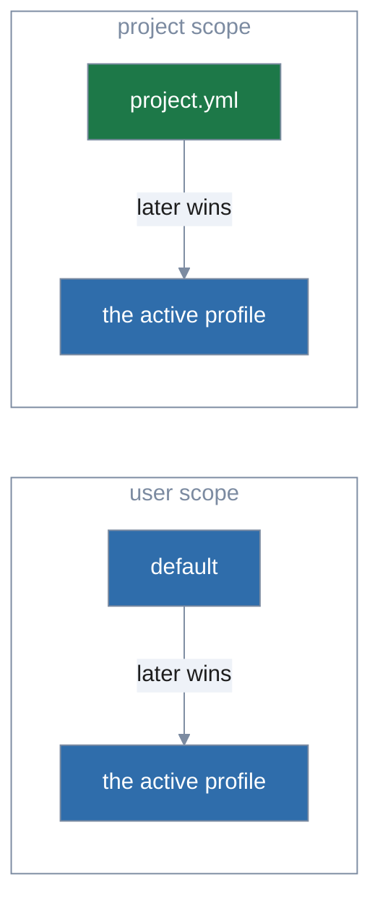
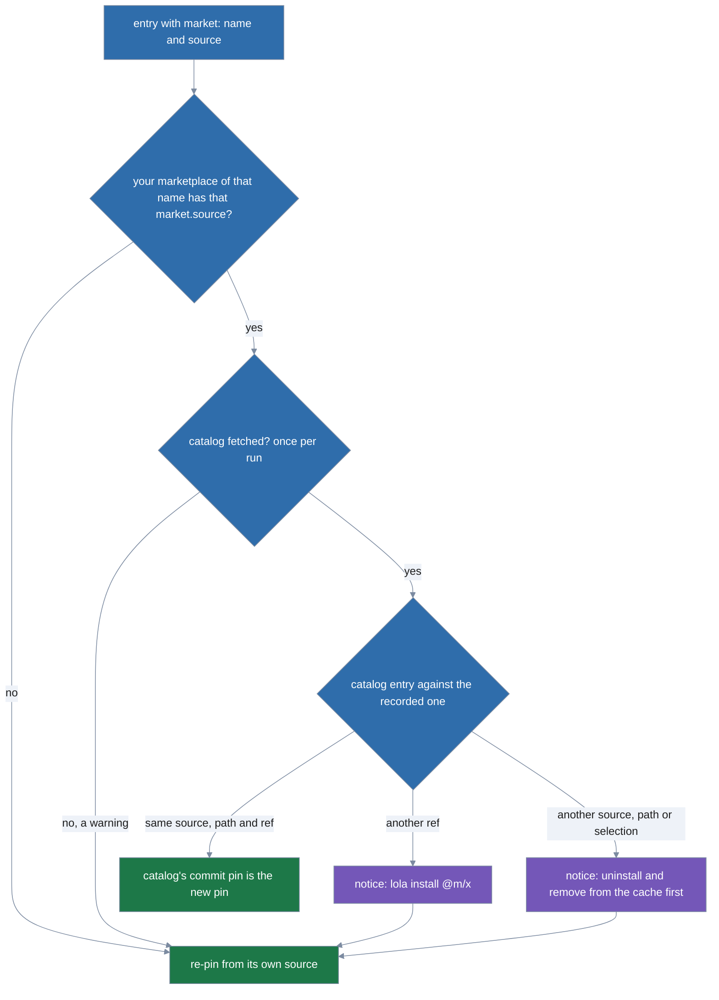

# Decisions

<!-- docs-audit decision (2026-11-05): DOUBLE_NEGATIVE reviewed. Five sentences were rewritten
     positively. The rest pair a negator with a word in another clause ("not … without",
     "cannot be read … fails") and read plainly; leave them. -->

Where lola follows or departs from the upstream ADRs, and why.

| Decision | Upstream position | Why |
|---|---|---|
| Client namespaces are routed per target. | The accepted Agent Plugins ADR ([#237](https://github.com/LobsterTrap/lola/pull/237)) feeds every namespace to every target. | A Claude-specific agent must not reach OpenCode or Gemini. |
| An Agent Plugins package renders like any module: portable skills and `mcp.json` to every assistant, client-namespace content to its own assistant, `dev.getlola` content to all. Nothing is installed into `.agents/plugins/`. | ADR [#243](https://github.com/LobsterTrap/lola/pull/243) (open) installs a package with no targets as a whole into `.agents/plugins/<name>/` and renders nothing. | None of Claude Code, Gemini CLI or OpenCode reads `.agents/plugins/`, so such an install would deliver nothing. (User decision, 2026-10-09.) |
| The `agents` target installs skills only, into `.agents/skills`. When it is in a module's targets, `gemini-cli` and `opencode` do not write their own copy of a skill it writes. It has no binary, so it is set up where `.agents/skills/` exists, is offered only there, and is never added beside a set-up assistant; naming it with `-t` or `targets:` always works. | ADR [#243](https://github.com/LobsterTrap/lola/pull/243) (open) installs plugins into `.agents/plugins/`, which no tool reads; the decision above stands. | `.agents/skills` is read by Codex, Cursor, Copilot, Amp, Gemini CLI and OpenCode (2026-11). Gemini prints "Skill conflict detected" on two copies and OpenCode keeps one silently, so lola writes one. Detection by PATH would never find a target with no binary; the marker is the one exception. (User approval, 2026-11-03.) |
| A plugin format is converted once, when it is added to the cache, and written down as an explicit `components:` list in the generated `lola.yml`; loading a cached module never runs a format adapter. | ADR #243 normalizes at add but does not say what the cached copy records. | A lola upgrade cannot change what a cached version means, and the plugin's own files stay untouched. (User decision, 2026-10-09.) |
| A module's Claude Code runtime hooks go to the per-user settings file: `.claude/settings.local.json` at project scope, `~/.claude/settings.json` at user scope, never the committed `.claude/settings.json`; lola skips them when git could commit `settings.local.json`. | No ADR covers runtime hooks; Claude Code installs a plugin's hooks with the plugin. | Consent is per user, so its effect must be per user too: the shared file would extend one user's consent to everyone who clones the repository. (User decision, 2026-10-09.) |
| Which scope a module installs at is unchanged by the module formats: `--user` or the project, as before. | — | Scope selection changes with the scope pickers (a prompt on a terminal, a configured default off one), not with formats. (User decision, 2026-10-09.) |
| Two MCP servers with one name in one module are an error. | Claude Code lets a server declared later replace an earlier one. | A silent replacement inside one module is how the wrong server gets installed. |
| Destinations are written through symlinks (directory and file) and shown as `path (via symlink → /resolved)`. | ADR [#239](https://github.com/LobsterTrap/lola/pull/239) and Python [#226](https://github.com/LobsterTrap/lola/issues/226) reject any path traversing a symlink. | Dotfile-farm users depend on it. Conflict detection plus the plan display bound the risk (see the security model in [architecture](architecture.md)). Two destinations that resolve to the same real file are refused. |
| The cache lives under XDG, not `~/.lola/modules/`. | ADR [#245](https://github.com/LobsterTrap/lola/pull/245) places it at `~/.lola/modules/`. | lola follows the XDG base-directory layout: `$XDG_CACHE_HOME/lola/modules/`. Installs run from their own module copies, so cached content can always be fetched again. |
| `lock.json` is gitignored. | — | It records machine-specific facts (resolved symlinks, digests); `project.yml` is the shareable intent. |
| MCP server names are not rewritten. | — | Rewriting breaks `mcp__<server>__<tool>` references in skills; ownership comes from the ledger. |
| Python-written managed sections are not migrated or cleaned. | — | lola cannot tell which edits were the Python tool's; it only manages what its own ledger recorded. `lola migrate` lists each block with its file and marker. |
| lola does not read the Python lola's state, nor an earlier lola-go build's; `lola migrate` imports it once and cleans up. | The go-migration ADR asks for compatibility with the Python state. | Two tools sharing one state would each have to understand the other's every format forever; a one-time import keeps lola's state its own. (User decision, 2026-10-12.) |
| `lola migrate` replaces the files the Python lola recorded, after copying them into a trash, instead of comparing them with what it would have written. | — | The Python lola transforms what it writes (agent frontmatter, Gemini TOML, OpenCode MCP shapes), so lola cannot prove a file is unedited; a copy keeps every edit recoverable. Files git tracks, symbolic links and files a lola module owns are never replaced or moved. (User decision, 2026-10-12.) |
| The `git` CLI is used rather than a Go git library. | — | Credential helpers and SSH agents keep working. |
| Modules ship always-on context as `rules/*.md`, delivered through each assistant's native loading (Claude `.claude/rules/`, Gemini `context.includeDirectories`, OpenCode `instructions`); lola never edits `CLAUDE.md`, `GEMINI.md` or `AGENTS.md`. | ADR [#242](https://github.com/LobsterTrap/lola/pull/242) ships `INSTRUCTIONS.md` through `@` pointer blocks in `CLAUDE.md`/`GEMINI.md`; Python installs a module's `AGENTS.md`. | Those files belong to the user. A lola-created `CLAUDE.md` also makes Claude Code stop reading an existing `AGENTS.md`. "Rules" says what the files do; `INSTRUCTIONS.md` reads like install instructions. |
| Python CLI compatibility is not a goal. | The go-migration ADR asks for identical commands. | The rewrite is an argument for a better UX. For the same reason there is no `mod` group: ADR #245 keeps one for compatibility, and nothing here needs it. |
| What lola writes depends on the declared target version (`target_versions`), never the installed one; the installed version only adds findings. | — | Teammates on different versions would otherwise rewrite each other's committed files on every render. |
| Rendering for the probed version (rejected). | — | The output would differ per machine, and committed files would flip with each teammate's upgrade; a declared version is committed with the project, so every render agrees. |
| Each target lists what it can express (capability tables) and reports what it loses as findings; one artifact a target cannot use is skipped, not the whole module. | APM drops unsupported content mostly silently and handles each target ad hoc. | Authors see every target's gaps with `lola check`; CI enforces them with `--strict`. |
| `lola install` never picks a scope silently: `--scope`, `--user`, `-C`, the picker on a terminal, a found `.lola/` project, or `default_scope`; otherwise it refuses. **Breaking change:** it no longer installs into a directory with no `.lola/` above it by default. | The Python CLI installs into the current directory. | Installing into the wrong place (a home directory, a parent repository) is hard to notice and to undo. `render` and `uninstall` at first kept the old resolution, since they act where lola already installed; the one scope rule (below) now resolves theirs as `install`'s. (User decision, 2026-10-10.) |
| Excluded components live in one hand-editable `selections.yaml` (global and per-project sections) that `install`, `render` and `check` all honor; picker answers and `--skip`/`--only`/`--unskip` write it for a `project.yml` module (and always with `--global`), and there is no run-only exclusion. A module a profile provides takes its picks from the profile entry's `only:` and `skip:` instead, plus the global `skip:`; `install`'s `--skip`/`--only`/`--unskip` and picker answers write that entry when the install writes a profile. | — | One authority means `render` never brings back what a picker removed, and editing the file is as good as re-running the picker. A profile carries what it installs, picks included, wherever it is switched on. (User decision, 2026-10-10.) |
| Every picker answer maps to a flag, and the summary prints the equivalent commands. | — | What a person did once on a terminal can be repeated in a script or CI without one. (User decision, 2026-10-10.) |
| Equivalent commands and commands in hints are quoted for PowerShell 7.3 or later on Windows and for a POSIX shell elsewhere. | — | Windows users paste them into PowerShell, where POSIX quoting breaks: `'\''` is no escaped quote there, and a bare `,` makes an array, `@` splats and `--%` stops parsing. Windows PowerShell 5.1 drops empty arguments and mangles embedded `"` when it runs a program, so lola does not target it. (User decision, 2026-10-12.) |
| `render` installs the version the manifest pins (the one lock.json records for an entry that pins none), never the cache head, so `lola cache update` no longer upgrades installed modules; `lola sync --update` does, and `lola list` says when one is available. | Rendering the cache head for each ref. | A shared project must install the same bytes on every machine, and a cache refresh on one machine must not silently change what a project runs. |
| `project.yml` pins git and archive modules by commit and content digest; folder modules are never pinned. | — | A pin makes an install reproducible for teammates; a folder is local and read again on every render. |
| Git content is checked out as committed: line endings are never converted, `.gitattributes` conversions and filter programs are off, and a symbolic link inside the module path, or on the way to it, is refused before checkout. Execute bits come from the source's metadata, not the file system. | — | The digest must not depend on the machine, its git config or its platform, and a repository must not run a filter program on the user's machine. |
| lola edits `project.yml` in place, keeping comments, order and entries it does not change, and writes it in the same transaction as the ledger. | — | The manifest is committed and edited by people; a rewrite that sorted it and dropped comments would fight them. |
| Every edit encodes the file again (`project.yml`, a profile): comments and order stay, blank lines between entries and the original indentation do not. A symlinked `project.yml` or project profile is refused; a symlinked profile of yours (`default.yml` included) is followed and written at its target, so a dotfile link stays a link. A profile whose bytes changed since the run read it is never written: the run refuses, naming the file. | — | yaml.v3 keeps comments and order but not blank lines. A repository can commit a symlink that would redirect the write outside the project, as it can for `.lola/`; the user's own files may link. |
| The install picker lists, per scope, the cache head of the scope's entry ref, and leaves out (with a warning that names the command) a module with no single listable version. | — | What the summary shows is what installs; an install that would be refused is not offered. |
| When `render` cannot obtain the version of an entry that pins none, it coaches `lola install <source>` (what the source serves now) and `lola uninstall <name>`; under a pin it coaches `lola sync --update <name>`, which shows the change first. | — | Installing the cache head instead would change the bytes a project runs without saying so; the user chooses between fetching what the source serves now and removing the module. |
| lola keeps a per-project trust record of what it wrote to `project.yml`, outside the project, and refuses to install by name or rewrite an entry the record does not cover; installing from the source writes the entry as new and trusts it. | — | A pull can change a source, ref or pin that `lola install <name>` would then fetch and run unreviewed. The record lives in the user's state, where a repository cannot write it. |
| Trust is refreshed per field: a write by lola trusts exactly the fields it changed. | — | Trusting the whole saved view would launder every pulled change the moment the user installs anything else. |
| A project with no trust record trusts nothing; there is no seeding from `lock.json`. | — | lola-go is unreleased, so no project predates the record (it was once seeded from an untracked ledger); seeding added a git-dependent path whose only users would be test fixtures. (User ruling, 2026-10-13.) |
| `render`, `install` (and its pickers) and `uninstall` refuse a project whose `.lola/lock.json` git tracks. | — | The ledger says which files lola owns and may remove, and which targets an install from a source keeps; a committed one would let a repository claim files on every clone, or have lola trust targets nobody in this checkout chose. |
| `lola sync` makes a scope match its manifest: it installs every entry at its pin, writes the pin of an unpinned entry back, re-pins with `--update`, and removes what the manifest no longer lists. It has no `-t` and no alias. | A `-t` on `sync`. | A target subset would leave the scope half-matching the manifest and make removals ambiguous. |
| Changes to `project.yml` since the user last trusted it, the pins sync writes included, are shown with the files, MCP servers and hooks each brings and accepted by an interactive yes or `--trust`; `-y` only confirms removals. Accepting is the consent to the module MCP servers listed; hook, runtime-hook and agent-MCP consent stay separate. | `-y` accepting everything off a terminal. | A pulled manifest can point lola at any source; a yes must be informed, and one flag for two kinds of risk would turn a CI convenience into a blind trust. |
| Off a terminal without `--trust`, a sync that needs the trust question is refused before any network contact for an entry the trust record does not cover; content the user has not trusted is fetched only into the run's private staging and enters the cache after a yes, never in a dry run. **Changed (2026-11-03):** before that refusal, a run fetches into its staging the covered entries it would pin (`lola update`, `sync --update`), so the one refusal lists the files the new version drops (planned with the run's picks), and an update that finds nothing new is not refused. The hint carries `-y` only when every removal it would confirm is listed: not while an installed entry a pull changed is unread, nor one whose read failed (a notice says why). A refusal whose trust is all given reads every version first. | Trust before any fetch; caching untrusted content; refusing a covered `--update` before its fetch, which took two runs (one for `--trust`, then one for `-y`). | The diff must show content, so an interactive or dry run fetches it, but nothing a pull asked for may persist on the machine, or be fetched by a run that cannot ask. A covered entry's source and ref are ones the user trusted, the git fetch runs no program the repository configures (hooks, the ext transport, fsmonitor, LFS filters and submodules are off), the same fetch an interactive run already makes before its question, and the staging is removed with the run. (User request, 2026-11-03.) |
| A folder, local archive or `file://` source of an entry whose Source and Path the trust record does not hold, or of one whose source as written (a relative one joined to the project, compared as the OS compares paths) is inside the project, must resolve inside the project, checked after symbolic links and before the diff; `--trust` and `-y` never bypass it. | Containment for every local entry; containment for every entry the record does not cover whole. | A pulled entry, or a pulled link under an entry lola wrote, must not read the user's other files; a source the user installed from outside the project is their own choice, and one deliberately linked outside is installed by its real location. An edit that keeps the trusted Source and Path (vars, targets, rules) reads nothing new, so trust asks about it rather than containment refusing it with a hint that would drop the edit. |
| At project scope a covered folder whose content is not the version `lock.json` records (or with none recorded) is a trust change: a `digest` change with its content, asked or refused like any other. | Trusting a folder entry as written. | `project.yml` names a folder, not its content, so a pull could change an in-repo module's MCP servers and hooks without a question, and trust is the consent to them; developers editing their own in-repo module answer one question per sync. |
| The trust record is written once per sync, after the apply, and only after a yes: the record becomes the view lola saved. | Writing it at the question. | A sync that fails after the question must ask again, and a failed write fails closed. |
| A sync refuses, before any question, a removal whose `lock.json` path leaves its target's root or whose target is unknown. | Trusting the ledger's paths. | `lock.json` is hostile input (a pulled or edited file); a confirmed removal must not delete outside the target. |
| The trust question is Trust all / Choose… / Cancel, Cancel under the cursor; Choose… is a filterable multi-select per kind of change with nothing preselected. A declined entry stays as installed and is asked again; the accepted ones are planned again from what was fetched, cached, pinned and recorded alone; `--trust <module>…` is the answer as flags. | One all-or-nothing yes/no. | Trust is security consent, and one suspicious entry must not block every other update. (User decision, 2026-10-13.) |
| Top-level `targets` are accepted with Trust all or with an accepted added or changed entry that has no `targets` of its own; a ticked removal never accepts them. | A separate option for them. | `--trust <names>` must express every answer, and an entry that installs to the targets cannot be accepted without them. |
| A No to the removals applies nothing but records the trust the user just gave (without the pins lola did not write), so the next sync asks only the removals and, for the entries whose new pin or folder content lola did not install, those again, which the message names. | Recording nothing. | The trust answer is the user's, and asking it again for a removal they declined sends them in circles. |
| **A refusal's hint pins the versions it showed with `--at <module>=<version>`** (a git commit, or `sha256:<digest>` for a folder or archive), on `lola sync` and `lola update`, and a run given `--at` applies only the versions a refusal showed: a module whose source now serves another version, or no longer serves that one, and any module `--at` does not pin whose installed version would change (a pin a pull wrote included, in any scope of the command), are refused before anything is written, hinting a fresh `-n`, whatever `--trust`, `-y` or `--force` say. The hint pins every version the refusal showed, a pulled pin's included; an `--at` naming a module no scope includes is refused. `lola install` takes the same `--at`, and its hook or script consent hint pins the version shown. A printed hint carries `-y` only when every removal it would confirm is listed; a `-y` you type yourself on a hinted run confirms that run's removals. (2026-11-03.) | Re-fetching the branch and trusting whatever it serves; asking the user to run `-n` again first; pinning every module of the run; refusing only an unpinned module's dropped files under `-y`. | The hinted run fetches again, and a branch can move between the two runs: without a pin its `--trust` and `-y` would answer changes and removals no refusal listed. The user chose pinning in the hint: a hinted run answers only what was listed. Pinning only what was shown keeps the hint short, and refusing every other change keeps it exact. A refusal that could not read a module (one a pull changed) therefore leads to a second refusal naming it, then a dry run that shows it. (User decision, 2026-11-03.) |
| **A conflict's `--force` hint on `lola sync` and `lola update` keeps the `--trust`, `--at` and `-y` you gave** (2026-11-03). | Dropping `-y` and `--trust` from every `--force` hint. | The hint completes your own run: `--force` answers only the conflict, and without the answers you already gave the hint would be refused again. It adds no consent you did not give. |
| **Two deletions are not confirmed** (2026-11-03): a JSON member (an MCP server, or a runtime hook entry) that a module's new version no longer ships is removed by `sync` and `update` without asking or `-y`; and the files dropped by the user's own edit of `selections.yaml` or of a module's `rules` setting are removed by the next `sync` without asking. Both are deleted, not moved to the trash, and both are in the plan and `-n`. | Confirming them as removals are confirmed. | lola cannot yet tell a member a version dropped from one it moves or re-keys, so asking would also ask about members that stay; the removals list counts whole files only (`droppedFiles`). The edit is the user's decision, made outside lola, and a sync that applies it should not ask again; a `rules` change in `project.yml` is still a trust change. (User decision, 2026-11-03.) |
| Module names limit a sync to those modules: validation, containment, fetching, trust, removals and the record. `--update` is a plain flag that re-pins the run's entries. **Changed:** `lola sync --update a` no longer syncs the other entries in the same run. | Names only with `--update`, re-pinning them in a sync of every entry. | A broken or untrusted entry the user did not name must not block the one they did, and the per-entry answer needs a flag form. (User decision, 2026-10-13.) |
| `render` renders the manifest's pin and leaves out, with a warn finding and the remedy, a module it may not act on: no longer listed, another source than installed, not trusted, or a folder whose content changed. It renders the others; only `--strict` turns a left-out module into a failure. | Refusing the whole render. | After a partial trust answer a whole-run refusal would make `render` unusable until everything is trusted; and render must not install a pulled change to an in-repo module that sync would have asked about. (User decision, 2026-10-13.) |
| Refusals over untrusted state coach `lola sync <module>`; nothing coaches installing from the source. | `lola install <source>` as the hint. | Installing from the source re-pins to whatever it serves now and skips the review sync shows. |
| Every `lola sync` command lola prints comes from one helper that adds the scope's flag, and the user's own names and flags where it repeats their run; install's equivalent commands decide `-C` by the same rule. **Changed:** the flag is `--user`, `--project` for the project found from the working directory, or `-C <root>` for another; it used to be none for the found project. | A special case for `lola migrate`'s hints. | A hint that drops the scope acts on another project, and, once commands ask for a scope on a terminal, would stop at the picker; one rule cannot drift between commands. |
| A declined post-install hook stays pending in `lock.json` and runs on the next `lola sync <module>` (or `lola sync --trust=hooks`) that gets consent, in a copy replaced from the hashed version first; any other sync asks nothing about it and prints `pending post-install hook for <module> → lola sync <module>`. | The hint "rerun with --allow-hooks" (`--allow-hooks` is the old flag, now `--trust=hooks`), which found nothing to do; asking on every full sync, which nagged and let end-of-input at that question abort the whole sync. | Hooks run only when a copy is replaced, and consent is keyed on the hashed scripts, so the kept copy must never run them. |
| A dry run's human plan lists at most 40 steps a module, then `… and N more` naming the user's own run with `-n --json`. | Every step. | A 120-line plan after a 20-line capped diff buries the summary; JSON and `--plain` still list every step. |
| `-C`'s long form is `--root`; `--project` is the boolean shorthand of `--scope project`, and the scope flags are global. | `--project <dir>`. | A flag cannot be both a directory and a boolean (pflag's optional value would break `--project <dir>`); lola-go is unreleased and every hint already prints `-C`. |
| One scope rule for the commands that write: `install`, `sync`, `uninstall` and `render` resolve their scope as `install` did: the flags, the picker on a terminal (nothing preselected), the project found walking up, `default_scope`, else a refusal. **Changed:** off a terminal outside a project with no `default_scope`, `sync`, `uninstall` and `render` refuse instead of using the current directory. | — | One rule is learned once, and a command never acts on a scope it guessed. (User decision, 2026-10-14.) |
| `sync --scope both` syncs the project, then user scope, and stops at the first scope that fails or is declined, reporting each scope under its label (`{"scopes": [...]}` in `--json`). | — | Each scope is its own consent; install's order. |
| Read-only commands (`list`, and `lola profile` without an action) never ask for a scope: the flags decide, `--scope both` included; otherwise they show user scope and the project found walking up, on a terminal or off it. `default_scope` does not apply, and every row names its scope. | Resolving as the writing commands do. | A question costs more than the answer when nothing is written. |
| Human output, help and consent diffs taller than the terminal open in lola's built-in viewer (bubbletea over bubbles' viewport), uncapped, and are printed in full when it quits; only when stdout and stderr are terminals, never in accessible mode or under `--json`, `--plain`, `--no-pager`, `NO_PAGER` or `pager: false`. An explicit `$LOLA_PAGER` is run instead, git-style (`LESS=FRX` when unset, split on whitespace with no shell, found with `exec.LookPath` and refused in the current directory); `$PAGER` is not read. The question comes after the viewer or pager exits; a failing one prints the diff capped. `pager` is read from the user's `config.yaml` only; unreadable, it is a warning. | Capped output with a pointer to `--json`; `$PAGER`, else `less` (`more` on Windows). | A long diff must be readable before consent, and a pager must not be a way to run a program a checkout planted; one viewer gives every OS the same keys. (User decision, 2026-10-14.) |
| A profile is its own file of module entries, separate from modules and from `project.yml`, which keeps meaning "what this project always wants"; at user scope the base is your default profile, `default.yml` (`user.yml` is gone). | `user.yml`, the first profile sketch, superseded. | A set of modules you switch between is not what a scope always wants, and a file of its own can be shared. (User decision, 2026-10-14.) |
| Layers merge by precedence, the later layer winning whole with a notice: a scope's **base** loads first and its **one active profile** on top: at user scope `default`, then the active profile; at project scope `project.yml`, then the active profile. An install writes the scope's write target (row: write target) and installs what then wins. **Reversed:** the manifest was the last word. | The manifest as the last word on its scope. | A profile you switch to must win where it and the base list one module, or switching would change nothing there; with one profile on top, which entry wins reads at a glance. No field merge can produce an entry nobody wrote. (User decision, 2026-10-14.) |
| `lola profile` lists profiles in one table whose rows each name their scope, as `lola list` does; `lola profile <name>` of a profile that is off shows, per scope, the layer each module would come from were it turned on. | Side-by-side Project / User columns; showing only the layers in force. | One table reads the same in a terminal of any width and in `--plain`; the preview answers the question asked before `--on`. |
| Turning a profile on, off or switching to one is a sync under the scope lock that applies only what the change moves (a module whose winning entry changes, or that the old profile wanted and the new one does not), with the new profile written in the apply's commit; other pending differences are left to `lola sync`, with a notice counting them; anything that removes files asks first (`-y`); a trust answer is all or nothing. | Computing the change outside the lock; applying every difference between `lock.json` and the new profile. | A concurrent sync cannot interleave; turning a profile on must not install, remove or ask about what it does not touch; the old and new layers come from one read of each profile; a partial answer would commit a profile whose modules were not applied. |
| `lola profile` takes one action and one name per run, checked on canonical flag names after parsing: `--on`, `--off` and `--switch` take one name (`--off` also none: the profile on goes off), and two names refuse (`one profile is on at a time; --switch takes one name`), hinting the run with each; `-y`, `--trust`, `-n` and `--force` refuse without an action. **Reversed:** they took one or more names. | Checking flags as typed; several names per action. | pflag normalization hides how a flag was typed, and a repeated alias is one action. One profile is on at a time, so a second name has nothing to do. A flag that does nothing must not look accepted. |
| `lola profile`'s action flags have aliases, `--on` (`--enable`, `--activate`), `--off` (`--disable`, `--deactivate`), `--switch` (`--use`), `--add` (`--get`), `--update` (`--upgrade`), `--remove` (`--rm`, `--delete`, `--del`, `--erase`, `--uninstall`), `--edit` (`--pick`, `--modify`): one flag each, through pflag's normalize function, listed in help beside the flag and pinned in the published alias table; docs, hints and JSON use the canonical names. | Separate hidden flags per alias. | Familiar from systemctl, conda, nvm, kubectl, brew, pip and `lola cache`; one definition cannot drift, and the one-action rule sees canonical names. |
| `default.yml` is always on, at user scope only. | — | Nothing from a project can become your default. (User decision, 2026-10-14.) |
| The active profile is kept in each scope's `lock.json` as `profile`, by qualified name (`user:go`) with the action that turned it on, and never committed; absent, only the base is loaded. A `lock.json` holding the `profiles` list of a pre-release lola is refused, naming the file, with the way out (remove the key, then `lola profile <name> --switch`). **Amended:** it was an ordered list. | A state file under `$XDG_STATE_HOME` keyed by project. | Activation is a per-checkout, per-user choice; a stored qualified name cannot be swapped for another kind of profile by a later file; one scalar says "one" in the file itself. Nothing is released, so the old list is not read. (User decision, 2026-10-14.) |
| Each scope has a **base**, always loaded, and at most **one active profile** on top: `default` at user scope, `project.yml` at project scope. `lola profile base --switch` turns the profile on off (`--off` does the same); `--on base` is a notice, refused while a profile is on; `--off base` is refused. At user scope `default` names the base too; at project scope `default` is refused (`default is user scope's base; this project's base is project.yml`). | An ordered list of active profiles over the manifest. | "Which profile am I on, and where does my change go" must have one answer. |
| `--switch` is the change of the active profile that never asks which: it replaces whatever is on. `--on` with another profile on asks on a terminal (`user:go is on. Switch to user:docs?`) and off one refuses (`user:go is on, and --on does not replace it without asking; --switch does`), hinting `--switch`. `-y` and `--force` on `--on`, `--off` and `--switch` answer only the removal of files (`--force` edited ones too), never that question. | `--on` stacking a second profile; `--on` replacing the one on silently. | Scripts need one way that never asks; a person typing `--on` with another on may not mean to drop it. |
| Every scope command (`install`, `uninstall`, `sync`, `update`, `list`, `info`, `check` when it reads the scope's entries, `tidy`, `repair`, and `lola profile` listing, showing, `--on`, `--off` and `--switch`) prints one context line per scope on stderr once the scope is resolved (`project <root>: profile go over project.yml`, `user scope: profile go over default`; under `--plain` a `context` row on stderr, not a line) and puts `context` first in its `--json` document and refusal; a change of the profile on ends with `now: <context>`; the scope picker's rows show the same. It reads `lock.json`, the profile listing and the file of the profile on, and never refuses: a profile on whose file is gone or does not load is named as unreadable. | Saying where only when a profile is involved; `install`'s `scope: project (found .lola/ at …)` line. | You must always know which profile you are on and where a change goes; stderr keeps stdout the command's result. |
| A scope with no manifest but a profile that lists modules syncs as if its manifest were empty. A profile's relative folder sources resolve against the profile's directory, and your own profiles are trusted as `default.yml` is: no trust question, no containment. | — | A profile must work on its own; the profile's directory is the only base its author can see. |
| lola writes a profile of yours (`default.yml` included) only on an explicit command (`install`, `uninstall`, `lola profile --edit`, `--edit --bundle`, `--remove`), and never a pin into it: an entry written there has no `commit:`/`digest:`, and the version installed is in `lock.json`, and at user scope also in `pins.yaml`. At user scope the versions of your entries are recorded in `pins.yaml` (`$XDG_CONFIG_HOME/lola/pins.yaml`), which lola writes in every user-scope apply and which wins over `lock.json`. A project profile's entries are written with their pins, and recorded as trusted, as `project.yml`'s are. | lola never writes your profiles, superseded. | Edits go to the profile on; a pin in a dotfile would churn it on every machine and freeze `lola update`. |
| **`pins.yaml`** records the version installed for each entry of your profiles at user scope, keyed by module, source, ref and path, and a record of each remote profile you have; it is synced with `~/.config/lola`, checked at every read, written only by lola, only when its bytes change, under `pins.lock` taken last. A run that needs a remote profile this machine lacks restores it at its recorded commit after checking its source and before planning; a digest that differs refuses. | (b) pins in your profiles; (c) `lock.json` in the config dir; (d) `lola pins export/import`; (ii) syncing `$XDG_DATA_HOME/lola/profiles` | A config dir that reproduces your versions on any machine). |
| `pins.yaml` pins only what a profile entry could pin on another machine: a folder, a local archive and a `file://` source are never pinned (a read refuses one, so a hand edit cannot smuggle a machine path in). A run sets the pins of the modules it resolved or changed and keeps every other pin as read, so a newer pin synced from another machine survives `lola install other --user` and is applied by the next sync; `--add`, `--update` and `--remove` touch `remotes:` only and leave `modules:` as read. The file keeps its leading comment, its mode (0600 when new) and a link; a file changed between the read a run planned from and its write is refused (`run the same command again`). yaml.v3 renders a record as a flow mapping with quoted values (`'https://…'`), kept as it renders them. | Pruning pins on every write; a hand-built emitter for unquoted values. | Machine paths do not belong in a synced file; a stale pin lingers at worst until a user-scope apply covers it; the file round-trips byte for byte. |
| Restoring a remote profile refuses only when the record cannot be honoured: a commit no longer on the ref, or a commit or digest that differs, hint `review and take what it serves now: lola profile <name> --add <source> …`; a transport failure keeps its own coaching and hints the same command again; a host-rule refusal keeps `pins.yaml`'s own fix hint, because `--add` of that source is refused by the same rule. Restoring covers the remote members of the bundle on (and of `default`, when it is a bundle) and the profile a `--switch` or `--on` names; a remote member of a project bundle only once the trust record covers that bundle's member list. Read-only commands never fetch: the context says `remote:go (not on this machine yet → lola sync --user)`. | Wrapping every error in the `--add` hint. | A hint that cannot work is untrue; the digest, not a question, is the consent. |
| **`lola profile --move`** moves whole entries from the layer each comes from (or one named) to `--to`, keeping the version installed; a profile that is off asks (`--switch`, `--keep-off`; both together, either with `--to base`, and `--keep-off` with a target that is on are refused); `--to` a new name creates your profile; across scopes it is two applies, target first, under both scope locks in `lockOrder` (projects by key, then user scope); every install that adds an entry hints the move that fixes a wrong target, never into a shared file. A move writes `removed` and `added` edits, never `moved`. | — | One obvious fix for a write in the wrong place. |
| A move within a scope when that scope's layers list the module, across scopes only when they do not or for an explicit cross-scope form (`--to base --user` from a project, `--to user:<name> -C <dir>`). Removals are asked before either scope is written, so a No leaves no duplicate; a failure between the two applies leaves the module in both, reported with the run that finishes it. A moved entry without targets of its own gets its source file's effective targets when the target file would give different ones, and a cross-scope move writes the targets the module is installed to (`lock.json`), never a project file's untrusted `targets:`: the move changes no installed file. | Moving by uninstalling and installing; copying the source line. | A move must be a change of files only; the version, targets and trust travel with the entry. |
| A project-to-user move judges the entry as the project's own sync would (its fields and, for a folder or local module, its content digest, and its targets) and refuses what the project's trust record does not cover, hinting `lola sync --project <module>` to review it first. A moved entry keeps only the trust its own file's record held. | Trusting what a move copies. | Moving must not launder an unreviewed project entry into user scope. |
| A hint never carries `--trust` and never offers a switch into a profile whose other entries need trust consent; a hint with `-y` for a switch that turns another profile off names it (`switches team off, removing its modules`); one write's added modules share one `--move a,b,c` hint; a hinted `-y` never replaces an entry in a profile that already lists the module. Choosing which switch to hint may fetch the uncached modules of at most one candidate profile per printed hint, under the host rules. | Hints that fail as printed. | Consent is never pre-filled; a hint that stops at a refusal is worse than a fetch in a command that already fetches. |
| An unlimited `lola sync` does not require trust for top-level `targets:` nothing installs to; an explicit consent covering entries (`--trust=entries`, `all`, or a yes on a terminal) still records them, and the refusal's hint is `lola sync … --trust=entries`. A project profile's own `targets:` that no entry inherits keeps the ask-on-sync behavior. | Recording unused targets never; asking about them always. | A scripted sync after turning a profile on must not need `--trust` for targets it does not use, and the hint must work. |
| **Write target.** A scope command's edit writes, in order: `--profile <name>` (`base` names the scope's base; `default` too at user scope, refused in a project); the profile on, when it is yours or the project's; while a remote profile is on, the base once the user says so (off a terminal refused, hinting `--profile base`); else the base. A `--profile` of a profile that is off is written and nothing is applied, saying how to switch to it. | Writing the manifest under a profile. | Every change lands where the user is working, named. |
| **Where an inherited edit goes.** An edit of a module another layer provides (the base under the profile on, or a remote profile that is a member of the bundle on) asks: change it in that layer (`--profile base`) or override it in the target (`--override`); a read-only layer offers Override alone; a request equal to the inherited entry is a notice. `-y` and `--force` answer neither; off a terminal the run refuses with both flag forms. An override copies the entry without its pin and keeps the version installed (under a bundle, into a member of yours: `--profile <member> --override`); an install that changes only picks keeps it too, except for a folder module, never pinned, which installs the version the cache holds, the one its component page offers, so the next sync of a cached folder changes nothing. An override never copies a `project.yml` entry the trust record does not cover. | Writing the target silently; a redirect and `--override-profile`. | No change goes to a file the user did not choose. |
| **Every write names its file.** `install` and `uninstall` print one `✓` line per entry written, naming the profile or base, a profile of yours with its path (`new` when created), the base or a project profile as shared when git tracks it; JSON `edits` and `--plain` `edit` rows carry them. `uninstall` removes an entry from the layer the module comes from, asking when that is not the target; a module another layer still lists stays installed. | — | — |
| **`--plain` context rows go to stderr**, beside the human line: `context`, the scope, its root, its base, the profile on and a bundle's members, tab-separated, one row per scope. `--json` keeps `context` in its document. | A `context` row on stdout. | stdout's row grammar stays the command's own, and a module named `context` cannot collide with a row; a first column no module name can take was rejected as a new rule to teach. A script reads stderr for the context. (AGENTS.md: scope commands print their context on stderr.) |
| **`lola list`'s human `FROM` column uses the context line's names** (`default`, `project.yml`, `profile go-review`, `docs (bundle work)`); `--plain` and `--json` keep `lock.json`'s `from` (`profile:default`, `profile:user:docs`). | `profile:user:docs` in the human table. | The names you read in the context line are the names in the table; scripts keep the stable, qualified form. |
| **Move hints after a write to a profile that is off** name that profile as the move's source (`lola profile --user rust --move kit --to base`), use `--keep-off` into a target that is off, and offer no cross-scope or keep-it-to-yourself line. After a write to a project profile that is off, no move is hinted. | A hint without the source, which moved from the profile on; a `--switch` into the target. | Nothing of the module is installed here to move, so the hint must name where it was saved; every hint runs as printed, and a project profile that is off is not moved out of until it is switched to. |
| **A change line names the version the run installs**, not the source, wherever a pin or `lock.json` records one: for an entry of yours, the one its pin in `pins.yaml` (user scope) or `lock.json` keeps, resolved as the sync resolves it. A move's change line names the version the other scope installed. | The source URL, as the line did before. | A change line that names a URL says nothing about what changed. |
| **An edit asks the question that decides its file before the component page**, and the page is titled `profile <name> › <module> › <kind>` (`default (base)` and `project.yml` for a base): `lola profile --edit <module>` asks the inherited-edit, bundle-member or remote-base question first, and `lola install --profile <name>` likewise. A plain `lola install` keeps its order and leaves the file out of a title a later question decides. An override with unchanged picks writes nothing and says so. | The page first, untitled; a title guessed before the answer. | A title that names a file the run may not write is untrue, and the page is the longest step to redo. |
| **A move between scopes prints the target scope's context line first**, then the source's once lola knows the entry comes from there. | The order of `--scope both`: project, then user. | The first line names where the move writes. Cosmetic; the lines say which scope each is. |
| A project may commit profiles in `.lola/profiles/`, used at its project scope only; they are read without following a symbolic link (the file, `.lola/` and `.lola/profiles/` must be the project's own), and a `default.yml` there is ignored with a warning. | Following links as for your own profiles. | A pulled link must not make lola read your files as a profile; nothing from a project can become your default. |
| The trust record gains a part per project profile, each entry with the targets it installs to; a run checks `project.yml` and the winning entries of the project profiles it uses (active, or being turned on), carries every other part, and records an answer part by part; a shadowed entry is reviewed, with its content, on the run that makes it win; the parts of deleted profiles are dropped when the record is saved. | One view of every file of the project; checking a profile's shadowed entries too; recording a profile's `targets` as their own field. | A change to a profile that is off is reviewed when it is turned on, not on every sync; an entry accepted while shadowed would be accepted without the content it installs, then win unseen; an entry's coverage is exactly what it installs, so accepting one entry never covers another's targets. |
| lola writes the pins of a project profile's entries back into that profile, in the apply's transaction, from the bytes it read and checked; `lola sync --update` re-pins them. | Keeping them in `lock.json`, as for your profiles. | A pulled unpinned entry would otherwise float on every checkout; the project owns the file, as it owns `project.yml`. |
| At project scope, a bare profile name that both a project and a user profile define is refused, naming both qualified names, for `--on`, `--switch` and showing. `--off` of such a name turns off the profile on when it has that name, its file gone or not; when neither is on it is an exit-0 notice (`neither user:go nor project:go is on`). **Amended:** with one profile on, a bare `--off` cannot mean another. | Preferring one kind. | Either choice would sometimes act on the profile you did not mean. When neither is on, nothing would change whichever was meant, so there is nothing to guess. With one profile on, the one on is the only one `--off` can turn off. (User confirmation, 2026-10-15.) |
| A project profile with the name of a `user:` profile active in that checkout takes its place only when you name it in `--on` or `--switch` (`lola profile project:go --on`), the one exception to `--on` refusing while a profile is on; the action shows `project:go now replaces user:go` as a trust change of its own in its all-or-none question. `lola sync`, with or without `--trust`, never swaps them and says `project:go also exists → lola profile project:go --on`, as other actions and listings do. | Offering the swap at every `lola sync`, which re-asked forever with nothing to remember a No by and let `--trust` overturn a profile you chose; recording the No. | A pull must not swap a profile you chose, and the swap is a choice you make by name; nothing new is stored. |
| Remote profiles live in `$XDG_DATA_HOME/lola/profiles/<name>/`, one directory each with the bytes you accepted (`profile.yml`) and their pin (`source.json`); a profile whose bytes no longer have that digest refuses every run that uses it. They are your own: no project's trust view holds them. | The cache; a project trust view entry. | A wiped cache must not drop a profile that is on, and the pin and your consent exist nowhere else; adding them to project views would make one update re-review every project that uses them. |
| Local beats remote: a bare name is a local profile when one has it, a remote profile with a local namesake is shadowed (listings say so) and `--on remote:<name>` refuses while it is, naming the local one. A user profile written after its remote namesake was turned on is used in its place, with a notice (`user:go now replaces remote:go`), while `lock.json` keeps `remote:go`; a project profile replaces an active remote one only when you turn it on, as for your own. A bare name that local profiles of two or more kinds define refuses, naming every one. | Letting a qualified `remote:` name override a local namesake. | Your own file must never lose to something fetched, and a remote profile that could be turned on while shadowed would be replaced at once by the shadowing rule. (User decision.) |
| **Superseded: `extends:` is gone; a bundle combines profiles.** `extends:` named remote profiles only, one level deep, merged inside one profile's layer without an override notice, and recorded in a project profile's trust part as `ExtendsView` on each entry. A file that still has it is refused at its line with the edit that keeps what it did. | Keeping `extends:` beside `bundle:`; reading it as a bundle. | Two ways to combine profiles, one of them a hidden merge point, would make what loads depend on which key a file used; a bundle's members are layers like any other, so `desired` stays the single merge point. |
| `lola profile --add` fetches only the source's `profiles/` (under `--path`), shows each entry with its module's content fetched at its pin, and keeps nothing (no profile, no cache entry) before you accept; off a terminal it needs `--trust`, checked before any network contact. It asks no scope (see below). | Fetching the whole source; caching the modules it showed. | Only `profiles/` is read, so a link elsewhere in a repository is no reason to refuse it, and one in what is read always is; consent must come before anything of a stranger's is kept. |
| **Superseded by the `--update` row below (`lola profile <name> --update` asks no scope).** `lola profile <name> --update` keeps the accepted profile, then, in the scope it runs in when that scope uses the profile (on, or a member of the bundle on), applies only what the update moves (modules whose winning entry changed) with a `lola sync` of them, counting other pending changes in a notice; a sync that stops leaves the update kept and says how to apply it. The other scope a user sees from there is read, never written: a notice gives the command that applies it there, or says it could not be read. | Applying it inside the update's own transaction; syncing every module of the profile; applying in every scope it finds. | The profile is shared by every scope, so it cannot change in one scope's transaction; an update, like an activation, must not apply or ask about what it does not move; each scope's apply is that scope's consent. |
| `lola profile <name> --remove` is refused while the scope it runs in, user scope, or the project found from the working directory has the profile on or as a member of the bundle on, naming that scope, and hints turning the bundle off or taking the member out: a bundle of yours that lists it is hinted with the run that does (`--edit --bundle`), a project's keeps the hand edit; `--force` overrides that check and answers the question, as `-y` does. Its modules stay installed until each scope's next sync. | Checking every checkout; removing the modules too. | lola keeps no list of checkouts; a profile's modules belong to the scopes that applied them, whose next sync removes them with the usual confirmation. A bundle that lists a remote profile that is gone would refuse every run, so it counts as use. (User decision, 2026-10-22.) |
| **A profile file lists `modules:` or is a `bundle:` of profiles, never both.** Members resolve by the file's kind (yours: bare is yours, else remote; a project's: bare is the project's, else remote, never yours; `project:` in a file of yours only inside that project; `default` and `base` never), depth-first in order over the base; a later member's entry wins whole with a notice naming the bundle; a bundle has no `targets:`. A cycle, 8 levels, 64 profiles or 64 bundles refuses with `path:line`; a cycle has no hint. | `extends:` with a wider meaning; `profiles:` as the key; one combined cap. | One shape per file and one obvious reading of what loads. Profiles and bundles are capped apart because a pulled project's files bound the bundles by their number, while the profiles are what an install walks. |
| **A profile or bundle reached twice expands once.** The second reach keeps the first place, with one notice per name however often it is reached. | Expanding every path; refusing a repeat. | A pulled project's wide, deep diamond of bundles (8 bundles of 8, 8 levels) has 8^8 paths and must not hang lola: the work grows with files and edges, not paths. |
| **`base` is reserved** for the scope's base: no profile has the name, a `base.yml` is listed as reserved and `user:base`, `project:base` and `remote:base` refuse. A `lock.json` that names `user:base` (active, or in a module's `from:`) refuses with the rename and the edit to the ledger; there is no legacy read. | Reading the old profile as one named `base`; rewriting `lock.json` silently. | `--switch base` already meant the base alone; a profile of that name could never be switched to. Coaching names a free `base-old` so the fix works. |
| **An edit under a bundle asks which writable member gets it**, even with one; off a terminal it refuses with a `--profile` per member, and neither `-y` nor `--force` answers it. A bundle that is on but gives no layer (empty, or only left-out remote members) asks before the base is written. A `--profile` or `--to` naming a bundle refuses, hinting each member. An uninstall removes from the layer the module comes from and asks first for a module the base gives, as it does under any profile. | Writing the last member silently; the base silently; removing a base module silently. | An edit never lands in a file nobody named. |
| **A project bundle's member list is trust content** (`trust.View.Bundle`, in the bundle's own part, order included), asked as a profile's change (`--trust=profiles`); what an untrusted bundle brings stays as installed. A remote member of a project bundle is restored from `pins.yaml` only once the record covers that member list, so pulled content fetches nothing before trust. | Trusting members by their own parts only; restoring first and asking after. | A pull cannot swap which profiles install, or make lola fetch, without a question. Costs one more sync after trusting a new bundle with a missing member. |
| **`lola profile <name> --switch --new`** makes a profile (empty, `--from`, or `--bundle` with bare missing members made empty) in the activation's transaction, so nothing is written unless the apply succeeds; `--create` is an alias. `--from project:x` passes the move's trust guard and the project-local refusal (`localInProject`, `installedAsTrusted`) before writing, since a copy puts the project's entries into your files. A copied bundle's members are written so they name the same profiles (qualified where the bare name would read as another). A refusal a bundle answers hints the command that makes it, and `--switch a b` hints the bundle off one and keeps refusing on a terminal (`--switch` is the way that never asks, user ruling, 2026-11-01); `--on` with another profile on asks on a terminal (the bundle of both, either alone, or adding it to the bundle on). | A separate `--create` action; a copy that skips the move's checks; a picker for `--switch a b`. | Creating is part of switching. A copy is a move of trust and must not be a way around the move's guard. |
| **`--split` keeps each entry's trust and asks about the member list.** It rewrites a file with both keys into a bundle of its members then `<name>-modules`, which gets the modules and targets; entries the old part covered stay covered, and the bundle's member list is not recorded, so a project's split is asked about at the switch-on of the split bundle (a split of a profile that is off writes and asks nothing; with the bundle on, `-y` alone is refused). Any command that reads such a file refuses with the `--split` hint and, on a terminal, offers the split. **Departs:** it recorded both files as trusted. | Recording both files as trusted. | `-y` answers the rewrite, never trust, and the member list is content a pull could have changed (AGENTS.md). |
| **`extends:` and an old `trust.json` are refused, not read.** A file with `extends:` refuses at its line with the edit that keeps what it did (a bundle of the remote profiles, and the `--split` for its own modules). A `trust.json` whose records hold the field `extends` (now `member`) is refused whole, naming those records and the hint to remove them; the record's hash covers the field name, so renaming it by hand cannot work, and the unaffected records keep their trust. | A legacy reader for the old key and field. | lola is pre-release, and a quiet reinterpretation would hide a changed meaning; the coaching names exactly what to remove. |
| `source.Parse` reads a URL or git's scp form by its form alone, never as a path on disk, even when a directory of that name exists. | Looking every argument up on disk first. | A checkout could plant a directory named like a remote profile's entry, or your own profile's, and have lola show and install its content in place of what the URL serves. |
| A remote profile, and every entry of one, names `https://`, `ssh://` or git's scp form at a host given by name; a URL that does not parse, plain `http://`, `localhost` and `*.localhost` (trailing dots included), a loopback, link-local, unspecified, private, carrier-grade NAT or site-local IP address (an IPv6 address embedding an IPv4 one, `::/96` or NAT64's `64:ff9b::/96`, judged as that IPv4 address; NAT64's local-use `64:ff9b:1::/48` as private), and an IP address in any form but `a.b.c.d` (a host whose last label is a number, such as `2130706433` or `0x7f.1`, which git and ssh still connect to) are refused. Host names are never resolved. Specs serve their remote profiles over https at `lola.test`, a reserved name, with a certificate made for the spec; a per-spec git config (`GIT_CONFIG_GLOBAL`) maps the name to the spec's server (`http.curloptResolve`) and trusts the certificate, so no code path of lola's needs a loopback exception or can relax the rule. | Refusing host names that resolve inside your network; a flag or variable that lets specs through. | lola fetches a stranger's profile and its modules before you consent, and in `-n`: an address inside your network would make that a request you never chose. Resolving names is left out: it races with the fetch and cannot be checked offline. A test-only switch in the engine would be one any caller could reach. |
| `--add` and `--update` show every file, MCP server and hook of each added or changed entry, whatever a scope's `lock.json` says; the scope's lock.json only notes when that version is installed there. | Showing only what differs from the scope's installed version, as `lola sync` does. | A planted, untracked `lock.json` could otherwise shorten what you consent to, and a remote profile's consent is the only review its entries get. |
| `lola profile --add`, `--update` and `--remove` fetch, show and ask under the shared profiles lock, and take it exclusively only to check again that what they showed still holds and to write. | Holding the exclusive lock throughout. | The lock is machine-wide: a question left open would stop every sync, render and install on the machine. |
| `--update` takes a bare name as the remote profile's, though resolving it to a local namesake first would be the alternative; `--remove` does so only when just a remote profile has the name (a bare name your profile also has is refused, naming `user:` and `remote:`; one only yours has is yours). | Resolving the name to a local namesake first and refusing. | Only remote profiles can be updated, so the bare name can mean nothing else, and the question names `remote:go`; a profile of yours can now be removed, so a name both have must be said. (Review deviation, round 3.) |
| A bare name's ambiguity counts only local candidates (your profile and the project's); a remote profile with a local namesake is shadowed, never a candidate. | Naming the remote profile among the candidates. | A local profile wins a bare name; offering the remote one would offer a profile `--on` then refuses. |
| An active `remote:go` that a user profile now shadows keeps its stored name: every run reads the user's in its place, and no action rewrites the stored profile unless it names that profile. | Storing the user's name at the next action, whatever it named. | Whether `remote:go` comes back when your file goes must not depend on an unrelated command, and an action that changes nothing must not commit a new stored profile. |
| `install` and `uninstall` take the shared profiles lock too, as well as the commands that change profiles, and dry runs take it without sweeping. | Only `sync`, activation and `render`. | Every command that reads the profiles reads the set once; a dry run must not see an update half done, yet writes nothing. |
| The read-only commands that read the remote profiles take the profiles lock shared too: `lola list`, `lola profile`'s listing and a profile's state, the install coaching and completion, as a dry run does (no sweep, and no lock before any lola has made the lock file). | Reading remote profiles without the lock in commands that write nothing. | Between an update's two renames a reader without the lock could report an active remote profile as gone or fail on a half-written `source.json`, and on Windows a file it holds open can fail the writer's rename. |
| `lola profile --add` asks no scope. A scope flag, when given, only names the scope whose installed modules the content is compared with; without one, the project found from the working directory, else user scope, as for the read-only commands. `--scope both` is refused. Hints that repeat the run carry a scope flag only when one was given. | Asking for a scope, as other actions do. | The profile file is shared by every scope and adding turns nothing on, and the content shown is the same whatever the scope: a question would suggest a choice that does not exist. |
| `lola profile <name> --update` asks no scope. It fetches, shows and asks once, keeps the accepted profile, then applies it in each known scope that uses it (on, or a member of the bundle on): the project found from the working directory, then user scope, as `lola sync --scope both` does, stopping at the first scope that fails or is declined and reporting each. Each scope applies only what the update moves there, with its own questions (removals, hooks, a project's trust). A known scope lola cannot read refuses the update before the question, hinting the update narrowed to the other scope. A note says other checkouts catch up at their next `lola sync`. `--project`, `--user` or `-C` alone narrows it to that scope, and only then does the other scope get a notice. `--scope both` is every known scope, as no flag is (with `-C`, that project and user scope), and is refused when no `.lola/` project is found, hinting the run with `--user` in its place and `-C` dropped. | Applying only in the resolved scope; asking for the scopes. | The profile file is shared by every scope, so the scopes that use it are the update's scope, and the consent no longer depends on a scope; leaving a scope you can see behind made you run a second command for the same change. Refusing an unreadable scope before asking keeps nothing that cannot be applied. Amends decision 7 for this action only. |
| `lola profile --update` takes one or more remote profile names, or `--all` for every remote profile you have (none is a notice, not an error); neither, names with `--all`, and a name given twice are refused, the first listing your remote profiles with both forms as commands that keep the run's flags; `--all` is refused with every other action. Each profile is fetched, shown and asked about on its own, in the order named (by name for `--all`): a No keeps that profile and goes on; a failure to fetch, read, check or write one keeps it as it was, is reported with its hints, and the run goes on, applies the others, then exits non-zero (with the profile's own error when only one was named); Ctrl+C stops the run, keeping what was updated, applying nothing, and naming the `lola sync` that applies it; it is an abort (exit 0) unless a profile failed before it. A run where every profile was declined is an abort (exit 0). Every hint that repeats the run keeps its flags; a sync hint keeps `--trust` (the kinds that answer a sync) and `-y` only when it names the modules the update moves; under `--json` notices stay in `notices`, never in `hints`. `--json` reports each profile's `outcome` in `updates`. `--all` has no alias. | One question for the whole set; stopping at the first failure; applying what was updated before Ctrl+C. | Each profile is its own consent, so declining or failing one must not cost the others. Ctrl+C means stop now: applying would act after you asked lola to stop, and what was updated is still applied by the next `lola sync` of each scope. |
| In an `--update` with no scope flag, `--trust` answers only the remote profiles' consent, never a trust question of a scope you did not name: a terminal asks the found project's question at its sync, and a run that cannot ask refuses before any network contact when the found project has changes you have not trusted, naming the project and modules, and hinting the run with `--project` or `--scope both` and `--trust`. Named, the project's trust is `--trust`'s to give, as before. | Letting the `--trust` given for the profile answer the found project too, as `sync --trust` does for its scope. | A hostile checkout you only `cd` into would have its project.yml recorded as trusted by an update you ran for a profile: one approval must never become another. |
| No hint widens consent: a whole scope's sync hint carries no `-y` or `--trust` (a sync of only the modules the update moves may keep them); a hint that narrows an `--update` to one of its scopes drops `--trust` and `-y`, and without a scope flag the message names the changes in the found project you have not trusted; hints that name more profiles than you did (the no-names and `--all` forms) drop `--trust` and `-y`; an `--add` refused because you already have the profile hints its `--update` without `--trust`, which approved the add's content, not an update's change; a `--remove` hint never carries `-y`, except the cannot-ask refusal that asks for it; an update whose scope's sync met a conflict hints that sync with `--force` and none of those answers when `--force` overrides every conflict, and no sync for that scope when another module owns a file, since the same sync would be refused again. | Keeping the run's flags in every hint; carrying an update's `-y` into the `--remove --force` hint. | A `-y` or `--trust` answers the question it was given for: a whole scope's sync confirms changes you never saw, and an update's `-y` approves removing rendered files, not deleting a profile. |
| A `.lola/` in your home directory is never the found project of `--add` or `--update`: it is skipped with a notice, and `--scope both`, or an `--update` whose `--project` or `-C` names it, is refused before any network contact with the run at `--user` as the hint; no hint offers `-C ~`. | Taking it as a project, as other commands find it. | User scope installs in your home directory and `lola sync` refuses a project there, so an update would write the profile and never apply it. |
| Claude Code's `marketplace.json` is the documented marketplace format; lola also reads the Python lola's YAML catalogs, and both become one model. An entry lola cannot use is skipped on its own, with its reason; the rest of the catalog stays usable. | — | Migrated users keep their marketplaces, and one bad entry in a stranger's catalog must not cost the others. (User decision, 2026-10-12.) |
| Marketplaces belong to the user and are shared by every scope: `lola market` asks no scope, and scope flags change nothing. Project-declared marketplaces are deferred. | — | A catalog is a place to browse; what a project installs is recorded with its real source, so a teammate never needs the marketplace |
| Registration is configuration, the catalog is cache: `markets.yaml` lists your marketplaces and is yours to edit; each catalog is cached under `$XDG_CACHE_HOME/lola/markets/`, written before its registration. | — | A wiped cache loses nothing you chose and costs one `lola market --update --all`; a failed registration leaves only a cache directory that listings ignore. |
| Adding or updating a marketplace asks nothing but a name when yours is taken. | Asking before fetching, as `lola profile --add` does. | A catalog installs and runs nothing, and you typed its source (as `lola cache add`); consent stays where content is installed. |
| Every source a catalog names is classified from its text alone, never looked up on disk, and must be `https://` at a host given by name (`source.CheckRemote`, moved from `profile`); ssh and scp-form sources are skipped unless you allow their host (`--ssh-host`, stored per host with the marketplace). The marketplace's own source, which you type, keeps the module source rules, ssh and local folders included. | — | A catalog could otherwise probe your files or reach hosts inside your network, and an ssh source would use your keys and agent on a stranger's host. (Allowed per host by user decision, 2026-10-28; this replaced "always skipped".) |
| Catalog JSON is decoded with case-exact keys: a key given twice, or a case variant of one lola reads or skips on, refuses the catalog at its top level and skips the entry inside one. Any key or read string that would not print as it is refuses the whole catalog, naming the field. | Go's struct decoding (case-insensitive, last duplicate wins). | A catalog must not show one key and act on another, nor hide text from the person reading it. |
| Entries that declare their components (`hooks`, `mcpServers`, `lspServers`, …), or carry `headers` or a `headersHelper`, are skipped; `command` and `npm` sources are skipped; the Python lola's catalog install hooks are never run. | — | lola installs only what a plugin's own files declare, through its consent; no catalog field ever runs a command. |
| A folder marketplace is allowed, recorded by its absolute path with links resolved, and cached like any other: its edits reach lola only through `--update`. | Reading a folder marketplace live. | Authors need it, and one cache rule for every marketplace keeps listings and installs reproducible. |
| A typed marketplace name already taken is refused: for the same source, ref and catalog file with the `--update` that fetches it; for another, a terminal asks a free name and off a terminal the hint is the `--add` of the first free name, never an `--update` of the other source. | — | A hint must never update a marketplace the user did not mean. |
| `yamldoc.Decode` reads bytes the caller has capped, with `Read`'s guards (one document, no anchors, aliases or merge keys) and a refusal of duplicate keys, and no version rule. | — | Catalogs are not files lola reads by path, and the Python ones carry a string `version`. yaml.v3 refuses duplicate keys only when it decodes into a Go value, not into a node. |
| Every `lola market` hint keeps the run's output flags (`--json`, `--plain`, `--no-pager`) as given, beside the flags the hint already carries. | A table of flags with no column for them. | A hint repeats the run; scripts that asked for JSON get JSON from the hint too, as `lola profile`'s hints do. |
| A local archive is no marketplace source: it is refused, with no hint. | Taking it as for modules. | No command adds it as it is; extracting it and adding the folder is the user's step. |
| An `--add` whose name another source has is refused, or asked, after the fetch, not before. | Refusing before any network contact. | The free-name hint then names the catalog file found with `--path`, so it runs; a name of the same source, ref and catalog file is still refused before the fetch. |
| A catalog entry's description may hold 4096 bytes; a catalog's own description stays at 1024. | 1024 bytes for both; truncating a longer one for display instead of skipping the entry. | Anthropic's official catalog has an entry (`hostinger`) with a 1221-byte description, which 1024 skipped. 4096 is the limit of an entry's source; what lola prints still goes through `untrusted.Text`. |
| The Python lola's `lola market` verbs (`add`, `ls`, `list`, `rm`, `remove`, `update`, `set`, `show`, `search`) are refused with lola's form, never accepted, and cannot name a marketplace; the translation is a hint only when it is a complete command that runs, `update` alone is `--update --all` (the Python lola updates every marketplace), and `set --disable` becomes `--remove` without `-y`. The name-less `rm` and `set` picker is not reproduced. | The go-migration ADR asks for identical commands. | One way to spell each action keeps flag aliases, completion and help coherent, and a translated hint teaches it; a hint must never answer a question the user did not answer. |
| `lola market --remove` has no `--force` and no safety check, and off a terminal without `-y` it is refused with its own `--remove -y` as the hint. | — | Installed entries record their real source, so nothing depends on a marketplace. The `-y` in that hint approves exactly the removal refused; no hint adds `-y` for any other question. |
| A source a catalog names is fetched under a stricter redirect rule, `source.Spec.FromCatalog`: every hop of its archive download passes `source.CheckRemote`, and git runs with `-c http.followRedirects=false`. A relative entry, which is the marketplace's own source, and every source you type keep today's rules. | Checking only the first URL, as for a source you type. | A catalog entry that passes the rule could otherwise be redirected to a host inside your network. Git hosts that redirect must be listed by their final URL. |
| A Claude archive entry's `sha256` is checked against the downloaded bytes before anything is extracted; a mismatch refuses, and nothing is extracted or cached. The sum is never recorded: what `project.yml` records is lola's own digest. | Recording the catalog's sum as a pin. | The catalog's sum is the author's word for the bytes; lola's digest of the normalized content is what every later fetch is checked against. |
| An entry installed through a marketplace records its real source, ref, path, commit and digest, plus `market: {name, source}` as provenance only, accepted in `project.yml` and in your profiles and a project's, refused in a remote profile. The trust diff shows it as `market (as written)`, through `untrusted.Text`, never as vetted. | Recording `@market/module` as the source. | A marketplace name is the reader's own, so a file that named one would install whatever the reader's catalog lists; the real source keeps the file reproducible without the marketplace. The name and its source are kept so a later update can follow the same catalog only when the reader's has that source. |
| A relative catalog entry's `skills`, `commands` and `agents` lists are read: they select which files of the marketplace's own tree form the module, each path relative, contained and a real directory (a skill) or file or directory (a command or an agent) in the fetched tree. On an entry whose source is another repository the lists skip the entry; `hooks`, `mcpServers`, `lspServers` and every other component field still skip it. Content lists no longer skip such an entry. | Skipping every entry that declares components, which left Anthropic's `anthropics/skills` marketplace with no usable entry. | When the source is relative, the catalog's author is the content's author, so the lists only pick among files they wrote; on another repository the catalog would choose content it does not own. Hooks and servers stay out: they run programs, and lola takes those only from a plugin's own files, through consent. (User decision, 2026-10-21.) |
| A `source:` of the form `@<market>/<module>` in any file lola reads (`project.yml`, every kind of profile) is refused by every command that reads the file, before its trust check and any network contact, naming the file, the line, the module and the address. With that marketplace, an entry of `project.yml` or `default.yml` named after the module its address installs gets one `lola install @m/x` hint of its own, which replaces just that entry (the others stay as written, each warned of with its hint); a profile's entry, or one named otherwise, gets `lola market <m>`; without the marketplace there is no hint, and the message says to edit the entry. | Resolving it through the reader's marketplaces at sync; one batched install of every entry. | A file's content must not depend on the marketplaces its reader happens to have, which a same-named marketplace could steer. |
| `lola migrate` registers each enabled marketplace of the Python lola with `lola market --add` under its name during the run (a dry run fetches nothing), translating its `url` (`git+` dropped, a git URL's `#path` as `--path`, a local catalog file as its folder with `--path`), and in a repository whose `url` names no file reading the catalog the Python lola read (its name, `marketplace.yml`, else the only root `.yml`) with that `--path`; `lola market --add` keeps its own lookup. A disabled one, a name lola cannot use or that one of yours has from another source, and a `url` lola cannot read are listed, with the `--add` that would register them (a free slug for a name) or, for a `url`, the reason alone; a failed fetch is that marketplace's outcome, never the migration's, with no `--add` when no file the Python lola would read is there, and `lola migrate` in its place when the `url` named no file. A `url` with credentials or a query is never registered, and no `url` is ever shown with its user info, query or fragment. Any of them but a disabled one keeps the Python home (lola has no disabled state). | — (the Python lola has no migration). | Migrated users keep their marketplaces without retyping them, and the Python home leaves only when nothing in it is still needed, as for an unmappable record. |
| `install @m/x --ref r` records `ref: r` and no `market:`, and says `pinned to your ref r; not following m`. | Recording `market:` with your ref. | `sync --update` follows a catalog only at the catalog's ref; a `market:` beside your ref would have it move the entry back, or notice a move on every run. |
| A catalog's commit pin, a `sha` or a full-SHA `ref`, must be reachable from the entry's ref, or the default branch, before anything is cached; the reachability check is given the catalog's ref, never the commit. | Installing the commit as Claude Code does. | A fork's commit can be served through the upstream URL; a pin must be on a branch someone reviewed. |
| A module installed from a catalog entry is named after the entry: content that declares no name takes it, here and in every later fetch by that name (a teammate's sync, `render`, `cache update`), and content that names itself otherwise is refused before anything is cached, naming both names, the hint installing it from its source under its own name with the run's flags when that command can (never for a selection). Every entry is fetched so, catalog or not: a module that names none takes the name its entry gives it. | Naming it after its path's last directory, as an install by source does; renaming a module that names itself, with a notice. | The Python lola's catalogs name modules whose directories are `module` or `lola-module`, so two entries would both install as `module`. Renaming content that declares its own name would make the cached copy read differently from what was fetched, and a teammate's sync could not reproduce it. |
| An entry installed from a catalog entry that lists its skills, commands and agents records the selection as `components: {skills, commands, agents}` (paths in the module's directory), in `project.yml` and profile entries, `lock.json`, the cache's record and the trust view (through `untrusted.Text`); every fetch of the entry stages exactly those, at `<kind>/<name>`. A profile never carries it. | Installing the whole tree with `selections.yaml` exclusions, which are per user; refusing such entries. | A selection decides the module's content, so it must travel with the entry for a teammate's sync, `render` and `cache update` to reproduce the digest without the marketplace. `components` is lola's word for skills, commands and agents (`lola.yml`'s section, `--skip`). |
| A bare name your cache lacks that your catalogs list is never resolved for you: a terminal asks which marketplace's entry it means, and off one it is refused with one `lola install @<market>/<name>` per marketplace, keeping the run's flags but `--path`. `lola install @acme` on a terminal is the module picker with acme's group alone, and off one a refusal naming its first ten entries, hinting `lola market acme`. | Installing the only listing silently; searching catalogs only through `lola market`. | A name is your cache's, and a stranger's catalog must not decide what it means; every answer a picker takes maps to an argument the summary can print. |
| `lola sync` fetches an entry whose `market:` names another source than the entry's own under the catalog redirect rule, in every run, `--update` or not; `render` (which fetches a pinned version from `lock.json`, which records no `market`), `lola cache update`, and an entry installed with `--ref` (which records no `market:`) fetch under today's rules. | Applying the rule only while `sync --update` follows a catalog. | The rule only adds refusals, so a forged `market:` cannot loosen it, and an entry's source stays the catalog's choice after install. The cases left are a residual, as host names are never resolved anyway. |
| `lola sync --update` follows an entry's catalog only when your marketplace of that name has the `market.source` the entry records, and only within the same source, path and ref: the catalog's commit pin is the new pin; another ref is a notice with `lola install @m/x`; another source, path or selection is a notice saying to uninstall the module and remove it from the cache first, with no command, since the cache holds one module of a name and would refuse the install; either way the entry re-pins from its own source. Each catalog is fetched once per run; a failed fetch is a warning and a plain re-pin; `lola sync` without `--update` reads no catalog. | Following a catalog's ref changes silently; re-pinning plain entries only. | A changed source or ref is an explicit install, never a sync, and a pulled file must not steer an update through the reader's same-named marketplace. |
| `lola sync --update` fetches a catalog only for the entries the trust record covered before the run; a pulled file makes no catalog request until it is trusted. | Fetching before the trust question, since the catalog is your own. | A file someone else wrote must not make lola contact anything before you trust it. The markets lock comes before the scope's, so the run cannot fetch after its own trust answer; such entries re-pin from their sources this once, with a notice. |
| The redirect rule of a catalog-named source does not reach `render`, `lola cache update`, an install by cached name that fetches again, or `--ref` installs (accepted residual). | Recording provenance in `lock.json` and the cache. | Those records carry no `market`; host names are never resolved anyway. |
| A marketplace's `source.json` records `root`, where its files were in the source when that is not the source's top (an archive's `repo-<sha>/`, a `module/`), and its relative entries record their path under it. A `source.json` written before has no `root` and reads as the top, as before: such a marketplace's relative entries keep the paths they had until `lola market <name> --update` fetches it again. | Recording paths relative to the found module root. | An entry's path is the `--path` of every later fetch, install, sync, `render` and `lola cache update`, and `--path` is relative to the source's top; without `root` no relative entry of a wrapped archive marketplace installed. |
| `--force` answers the destructive question without asking, on a terminal or off one, with no `-y`: in `install`, `sync` (the removals), `uninstall`, `lola profile --on`, `--off` and `--switch` (their removals; never whether `--on` switches), `lola profile --remove`, `lola migrate` (its `Migrate?`) and `lola tidy`, as well as overwriting or deleting edited and unowned files. It never answers a consent question: `--trust=<any kind>` (a pulled `project.yml` or profile, install hooks, runtime hooks) stays separate, and a forced run that needs one still asks, or off a terminal refuses with its hint. Every conflict refusal lists each edited or unowned file, by target and path, one per line; its hint is the run with `--force` and no `-y` or consent flag, which runs unasked. | `--force` overriding checks only, and never skipping a prompt. | A user who typed `--force` after a refusal listing the exact files has answered the question the prompt would ask; asking again, or demanding `-y` too, made the hint a two-step. Consent to what a module runs or what a pulled file says is another question, which `--force` must not answer. (User decision, 2026-10-22.) |
| A hand-edited file still aborts the whole `lola uninstall`: nothing is removed, the message says deleting the file would lose your edits, and the hint is the run with `--force`. | Removing the rest of the module and keeping the edited file with a warning. | Any conflict aborts the whole plan before anything is written, so a module is never left half removed. The alternative is a user-visible design change, left to the user. |
| **Amended: every hint now keeps the run's `-t` and `-n` (but the command that applies a dry run), and a hint that completes the run (a scope or an assistant it lacked, which a terminal would have asked; the qualified form of an ambiguous profile name it gave) keeps its `-y`, which the completed run asks again.** A hint that repeats the run for another reason (`--force`, a scope the user chose changed or narrowed, another scope, another profile, another command, `--global`, `--user`, a close marketplace name) drops `-y` and `--trust` in any form, and a hint that is a dry run carries no `-y`, since it asks nothing; a hint adds `-y` the run lacked only on the refusal for want of a terminal, and a run with `--force` needs no `-y`, since `--force` answers that question. A bool is repeated only as given: `--x=false` is never repeated as `--x`, and is repeated as `--x=false` only when the flag defaults to true. A conflict says `which --force overrides`, and hints the run with `--force`, only for a run that takes `--force`, never for `lola profile`. | Keeping every flag the run set in every hint. | An answer belongs to the question it was given for: a `-y` or `--trust` given for one scope or run must not answer another one you never saw, and repeating a false bool as its flag would turn a no into a yes. A hint `lola profile` refuses is no hint. |
| **No hint adds a `-y` you did not give for any question but its own refusal's.** The move hints after an install (`keep it to yourself`, `meant for …`, the two-step `lola uninstall …, then lola install …`), the `turn it on … --switch` hint after `lola profile --add`, the hints of a refused `lola profile --move`, and the command that applies a `lola tidy -n` or `lola sync -n` carry `-y` only when your run had it. | Carrying `-y` off a terminal so each hint runs as printed. | A `--switch` hint turns the profile on off, and with `-y` it removes that profile's files without asking; a dry run's closing command would confirm removals you only previewed. Off a terminal the hinted run refuses and its own hint adds `-y`: one more step, never an unasked removal. |
| `lola market <name>` never cuts an entry's name: the name column is at most 32 columns, a longer name prints whole on its own line with the rest of its row under it, and a word wider than the terminal stays whole on a line wider than the terminal. The source cell is cut with `…` to at most 40 columns and the version cell to at most 16. | Cutting names to the column, or breaking them at the terminal's width. | A name is what you type into `lola install`; a cut or broken one cannot be copied. A long name, source or version must not widen every row of the table. |
| An ownership conflict names both modules. It hints `lola uninstall <owner>` only when the run's command line named the module that wants the destination; otherwise the message says to remove that module from the file that lists it (`project.yml` or a profile), with no hint. | Hinting the owner's uninstall for every ownership conflict. | A pulled file must never steer you into removing a module you installed. |
| `lola tidy` moves what lola does not manage into the trash and never deletes; MCP servers it never wrote are offered too, unselected, with the file copied into the trash first. | Upstream has no such command; the request was `lola clean`. | The name `tidy` keeps `clean` for `cache clean`, planned then and since built (see its row below). Everything moved is restorable from `manifest.txt`; a server added by `claude mcp add` is residue as often as anything else. (User decisions.) |
| `lola tidy --force` offers what git tracks and skips the review, but still needs names or `--all` and never moves a kept or locked item. | — | `--force` means "do it", never "choose for me". (User decision.) |
| `lola tidy` never moves `CLAUDE.md`, `AGENTS.md` or `GEMINI.md`, or anything holding one, at any depth and in any case, so a Gemini rule directory lola left behind is removed by hand. | — | Instruction files are the user's; an exemption for lola's own would be the one way a planted name reaches them. |
| `lola tidy`'s keep-list is the user's, in `$XDG_CONFIG_HOME/lola/keep.yaml`, never in `project.yml`. | — | It needs no trust review and no schema change; a team's own files are protected by git tracking. |
| `lola tidy`'s JSON `path` and `trash` are raw, but for JSON's escaping. | AGENTS.md's output rule sends author text through `untrusted.Text`. | Scripts restore from the trash by exact path; JSON escaping already neutralizes control characters. |
| On a terminal without names, `--all` or `--force`, `lola tidy` asks in two filterable pickers with nothing ticked (what moves, then which keep-list entries to add: one per exact, escaped name, naming the assistants it covers, none for a name one of whose items was ticked to move), then the review, which prints the one command that selects the same set or says none does; `-y` skips only the review. | Refusing with an `--all` hint, as before; one keep option per item. | Pickers instead of silent defaults or forced flags; a keep entry covers every assistant's item of its name, so the ticked thing is what happens; the printed command makes a picked set repeatable off a terminal. |
| **Amended: `-n` is now kept too.** Every lola tidy hint keeps the run's `--json`, `--plain`, `--no-pager` and `-n`, but the closing hint that applies a dry run, which drops `-n`; a hint that is a dry run carries no `-y`. | Hints in human form only. | A hint is the command the user pastes; it must keep the run's flags, as profile's, market's and sync's do. |
| The keep picker never meets an `--unkeep`: a run with `--keep` or `--unkeep` and no names or `--all` is keep-only and runs no picker, so no keep answer can conflict with the flag, and the engine carries no check for it. | Refusing such an answer in the engine's `offered` check. | The conflict is unreachable by construction; a guard for an impossible state is code nobody can test through a run. |
| A hint is a command the user can run; what no command fixes (the source forms lola takes, or advice such as check's `pass a module folder…`) is said in the error, and no hint is printed when none works. | — | A pasted hint must work; `hints[0]` is run as is by scripts and the e2e suites. |
| A hint's label is lola's own words; author text (a profile, module or file name) appears only in the hint's command. | — | A label is not quoted for the shell and is not cleaned as a command argument is; `turn the profile off: lola profile …` names the profile where it is quoted. |
| No hint ends in a placeholder (`<module>…`, `<name>…`); one that would is dropped, and the error says what is wrong. | — | A placeholder is not a command; per-module choices are the terminal pickers' and `docs/guides/sync-and-trust.md`'s. |
| One `--trust[=kind,…]` flag on `sync`, `profile`, `install`, `render` and `migrate`, with kinds `entries`, `profiles`, `scripts`, `hooks`, `runtime-hooks` and `all`, replaces the boolean `--trust`, `--allow-hooks` and `--allow-runtime-hooks`. Bare `--trust` is `entries,profiles` within the command's kinds (refused where that is none: `install`, `render`, `migrate`); a kind the command never asks, an unknown or empty kind, and a kind written as its own argument after a bare `--trust` are refused before any network contact. What the kinds cover is listed once as a receipt and, on a terminal, asked once (`-y` answers); every hint names exact kinds, never `all`, adding only the kinds a refusal is missing. | A boolean `--trust` for project changes and one flag per kind of hook consent. | One flag a user can widen kind by kind, and see before anything is written, instead of three flags with three rules; `--trust hooks` reads as a module named `hooks` with pflag, so the value takes `=`. |
| A grant by `--trust` is recorded exactly as a yes at the prompt is (trust.json for `entries` and `profiles`, consent.json by digest for `scripts`, `hooks` and `runtime-hooks`), only after the receipt is answered, and a terminal yes to a hook's own question with it: a No, a refusal, Ctrl+C or `-n` records nothing. A command asks one receipt (`sync --scope both`, `profile --update`, `migrate`: each run collected, then applied after its yes). Under `--json` no receipt is printed; `trusted` carries the grants, in the error document too when the run fails after recording them. A changed digest asks again. On a CI machine whose `$XDG_STATE_HOME` persists between jobs, one job's grant covers later jobs with the same digests; a fresh `XDG_STATE_HOME` per job keeps consent per job. | `--allow-hooks` as consent for one run only. | One recording rule for every kind; the digest key bounds what a recorded grant covers, and the receipt and `trusted` key record each grant in the job's log. |
| A `--ref` of 40 or 64 hex characters is always that commit: lola fetches it by SHA, never looks it up as a branch or tag, and refuses a checkout whose HEAD is another commit. | A branch or tag of that name first (the earlier behavior). | Anyone who can push a branch named like a commit could make a pinned install, and the consent given for it, take other content. (User ruling.) |
| An install of a git source at a full commit SHA that the cache holds for exactly that source (location, path, selection; the commit a fetch recorded, never a head's ref) installs the cached version, hashed again, without fetching; `lola info` of it shows that version the same way. | Fetching a source on every install. | A commit names immutable content the cache verified when it stored it, and `lola info`'s next step pins that commit, so the install it names fetches nothing more. |
| `lola info`'s next step names a git module without a component selection (a source, a marketplace entry from git, or a cached git module whose scope entry records another ref) as its source at the full commit SHA shown, never by `--ref <head ref>`. | The cached name with `--ref <head ref>`. | A head moves with any later fetch and the default branch has no `--ref` spelling, while a commit is the content shown; a cached commit installs without fetching. Cost: the install pins the entry to that commit, and following a branch again takes `--ref <branch>`. |
| Install scripts from `config.yaml`, a project's `project.yml` and `install --pre-install`/`--post-install` wrap every module copy a run installs or replaces, once per assistant, around the module's own hooks; each runs from its absolute, resolved path with the module copy as its directory; only a project's needs trust (`scripts`, per project, event and digest), and a sync asks about it even when it installs nothing. | No ADR covers install scripts. | Teams need gates around installs that no module author controls; a relative path would run the module's file of that name (CWE-426), and a pulled script must be seen before any install runs it. Cost: a sync after a pull that adds or edits a project pre-install script refuses off a terminal until `--trust=scripts`; a post-install one is skipped with a warning and stays pending. |
| `lola cache clean` removes superseded versions and the scratch no running lola holds; `--unused-for` (or `config.yaml`'s `cache_unused_for`) also removes versions no run used for that long, current heads included, by the `last_used` day `index.yml` records per version; `--all` removes every module, catalog and scratch but held scratch. It asks as `cache rm` does, re-checks each item under the cache lock before it renames it aside, and never follows a link. Each run's scratch is held by a flock on `<dir>.lock` beside it. | No ADR covers cleaning the cache. | The cache only grew. A use date, not a fetch date, keeps what projects still render; the lock, not an age, tells a live run's scratch from a killed one's, so a clean never breaks a running install. Cost: a project whose recorded version was removed fetches it again on its next `render`, and a catalog removed by `--all` needs `lola market <name> --update` before an install from it. |
| `lola migrate` installs a record for its own assistant only where that assistant is installed or set up, as `lola tidy` counts them; a record for any other assistant, or for one lola has no target for, installs only for the assistants `--map-target` (or its question on a terminal) names, and a project path or local source another machine had only where `--map-root` finds it. | — | A Python home copied from another machine names assistants and paths this one lacks: installing for an absent assistant wrote files nothing reads, and a missing project left its records behind with no way forward. A mapped record writes nothing of the old assistant's, and a file of yours where the new one installs is a conflict, never replaced. |
| Pickers draw in lola's own huh theme: every color reaches WCAG 4.5:1 on the terminal's background (`theme:` in `config.yaml`, else the terminal's answer, else asked once on a terminal and saved, else light), picks are `[x]` in bold and the rest `[ ]`, also without color. A picker that needs a pick refuses an empty one in the form, naming the keys, instead of asking again after it; a module picker of several lists still asks again. | No ADR covers the pickers' look. | huh's default theme gave the key help a contrast of 1.9–3.4:1 on black, and users missed both the help and why an empty Enter was refused. Asking once beats guessing a background on every run. The refusal appears only after Enter, since huh would otherwise show it as the picker opens; a failed save of the answer only warns. |
| `lola install` ends with one review screen whenever lola chose something the user did not type (a picker's answer, or the only assistant installed, which the summary names with why): the summary, with the findings of a dry run of the same install, in the viewer's confirm mode, where `y` applies, `c` opens the Change entries (absent when no step can change), `n`/Ctrl+C cancel, `q` quits and Esc goes back to the last step answered; Enter answers nothing. Every list of a pass is numbered `Step n of m`, `m` a forecast until the modules are picked. Hook and script consent stays a separate question after the review. | A review menu, printed after the summary and shown only when a picker ran; findings only after the install. | One screen shows what will happen, including what will be skipped and why, and asks once; an automatic choice is a choice the user must see (user decision). |
| `lola update` updates installed modules from their sources, fetching a ref once `cache_fresh_for` (one day unless `config.yaml` says otherwise) has passed or with `--fetch`; it installs and removes no module (the files a new version no longer ships are removals, confirmed as any are, with `-y` off a terminal), and leaves a module no layer lists, or whose entry asks for other assistants, as installed with a finding. A module whose fetch fails stays installed and the run exits `1`. `lola render` is removed: `lola sync` renders at the installed versions. `upgrade` is `update`'s alias. `lola sync --update` always fetches, ignoring the window, and `lola update` fetches marketplace catalogs on every run, also ignoring it. `update` was `render`'s alias; repurposing it is a deliberate exception to the alias rule, because users read `update` as update-from-source. Earlier rows that name `render` describe the command it replaced; `sync` and `update` carry that behavior now. | — | Users expect `update` to fetch, and `render` could not: `sync --update` was the only way to move a pin, and it also installs and removes. Splitting the verbs keeps `update` safe to run (no module is installed or removed, and the only files it deletes, those a new version no longer ships, are listed and confirmed first) and `sync` the one command that makes a scope match its manifest. A freshness window keeps a routine `update` from contacting every source each time. |
| `--only` keeps its meaning (skips of the components that exist now, so a later version's components install); `--only --exact` saves an `only:` list instead, and `install`, `sync` and `update` name each new component that list leaves out, with the `--unskip` that adds it. `only:` lists merge by precedence: the scope's `include`, then every skip, then the most specific `only:` list, replacing the others. | Making `--only` exact; intersecting `only:` lists across sections. | A pack of dozens of skills grows; one user wants the new ones, another wants a fixed set. An opt-in keeps existing selections' behavior, and a replacing list is the one a reader can predict. (User ruling, 2026-10-29.) |
| `lola install` writes to the cache only on Apply: what the pickers and the run fetch is staged in a private run directory, and Apply commits the versions it installs before its first write. Cancelling, declining, `-n` and refusals leave the cache as it was. `lola cache add`, Add a source…, `lola info` and `lola migrate` still cache what they fetch at once. | No upstream ADR covers when the cache is written. | A user who tries a large module and quits should not find it in the cache; and the bytes reviewed must be the bytes installed. (User ruling, 2026-10-29.) |
| Mentions are information: lola reads a module's text for whole-token names (4 bytes or more) of its other components, on demand from the version it is about to install, and shows them (the component page, `lola info`, a notice after the picks); `lola install --with-mentions` adds one hop as `--unskip` edits saved to `selections.yaml`. An explicit `--skip` flag in the same run wins over `--with-mentions`: a mention it matches is not added (a notice says it is kept out by that `--skip`), and the notice of what the picks leave out neither names it nor adds it back through its hint, which repeats the `--skip`; an untick on the component page does not hold a mention out. | Following mentions as dependencies; adding them transitively; keeping a mention index. | The driver's skills cross-reference densely, so a transitive closure installs most of the pack and a dependency rule would refuse picks the user meant; one hop on request keeps the user's pick in charge, and a scan bounded at 16 MiB per module costs less than an index kept in step with the cache. An explicit `--skip` beside `--with-mentions` is the user's own word about that component, so it holds; a hint that dropped it would undo it. (User ruling, 2026-10-29.) |
| `lola profile --move` refuses carrying an entry of `project.yml` or a project profile whose folder or local archive lies inside a project (at or below a directory holding `.lola/`, links followed, never your home directory) into a file of yours; `lola install` that adds such an entry to a file of yours warns once, at that write. Nothing checks such an entry again later. | — | Your files are yours: user scope never asks about them, so a folder entry pointing into a project would install whatever a later pull put there, unreviewed. Refusing the one move that turned a project's reviewed entry into yours closes that path; a warning at the install names the risk where you chose it. Checking the folder's content on every sync was declined: it would be a second consent layer over entries that are already yours (security in proportion). Hand-written entries stay quiet (maintainer decision, 2026-10-31). |
| **`lola profile [<name>] --edit [<module>...]`** is `lola install` of the modules into that profile (`--profile`), or into the write target with no name; its questions and hints name `lola profile … --edit` (`base` and `--override` as its flag forms), it asks no scope, `--only` and `--exact` mean what they mean for `lola install` (`--only` skips the rest; `--exact` writes `only:`), and the first name is the profile when one has it. On a terminal without a module it opens the profile's or the bundle's page; what you untick is removed once asked; `-n` opens the page, asks, and writes nothing. | A second write path beside install's; `--profile` in the hints; an `--edit` flag taking the modules. | One write path keeps the write target, the questions and the picks' semantics; the noun-name shape (`lola profile <name> --<action>`) keeps the profile in view. One flag keeps one meaning in every file: the same `--only` wrote `skip:` through `lola install` and `only:` through `--edit` into one profile entry (user decision, 2026-11-01). |
| **`--edit` acts on one scope**: the scope resolution every scope command uses, never a silent second scope. A profile of yours that is on in several scopes is computed once from its file, written once and synced in each scope where it is on, each with its context line and result; "written differently for each scope" cannot arise for it. | Asking a scope; editing only the scope named. | The profile is one file; a scope that has it on must apply it or it drifts. |
| **A name that is both a profile and a module** (or source, or entry) after `--edit` is asked on a terminal (which one) and refused off one, naming both with qualified hints; only an unambiguous name is read silently. | Profile first, silently; module first. | Never silently cross contexts: reading it the wrong way writes the wrong file. Costs one question in a rare collision. |
| **One `carriedOut` guard** covers every copy or move of a project file's entry out of a project into a file of yours: `--move`, `--new --from`, `--edit --override` and `lola install --override`. It composes the move's trust guard and `refuseInProject`. | A guard per command. | One security rule must have one composition, or the next command forgets it. Cost: some overrides need a project sync first. |
| **Narrowing picks with `--edit` removes the files they leave out** without `-y` off a terminal, and after asking on one, as `install --skip` does; a hand-edited file refuses with a working `--force` hint. | Refusing every narrowing off a terminal. | Matches the install it is; `--force` and `-y` answer the removal question, never consent. A scripted narrowing removes rendered files. |
| **`--edit --bundle`** rewrites a bundle's members in place, making bare missing members, in one transaction with `lock.json`, applied where the bundle is on or nested; a pulled member list of a project bundle is asked about first, shown with the run's other changes, and `-y`/`--force`/hints never answer it, so consent covers only what was shown. | Editing bundles by hand only; recording the pulled list with the edit. | A hint that adds or takes out a member is a command. An edit must not record unseen pulled content as trusted. |
| **A bundle that names a profile that is gone** (after `--remove --force`) still refuses a run that loads it, but `--off`, `--switch` to the base and `--edit --bundle` pass over a member that resolves to nothing in a bundle other than the one being edited, with a warning naming the take-out run; an edit whose new member list newly reaches such a bundle judges its files in full and refuses. | Refusing every run until the file is hand-edited; passing over everything. | Every printed take-out run succeeds in sequence, so no hint points into a refusal loop, while an edit cannot create the breakage it passes over. |
| **`--remove` of a profile of yours** moves it to the trash, asked (`-y`, `--force`), refused while it is used (on, a member, the bundle on or one it nests; checked before `-y` is offered and again under the exclusive lock); `pins.yaml` is left to the next apply. | Deleting it; pruning pins.yaml outside an apply. | Your files are recoverable; a `-y` hint that is then refused is untrue. `modules:` is read as it is outside an apply. |
| **The listing's `state`** (`base`, `on`, `member`, `off`), `bundle` and `members` replace the active list's position; the listing reads each file of yours and the project's for its shape, listing one that does not load, or a bundle that does not expand, with a notice. | Reading no profile file. | Each row says whether it is a bundle. |
| **Re-pick hints name the layer that provides the module**: `lola profile <name> --edit <module>` for a profile of yours, the project's or your default; `lola install <module>` for `project.yml`'s while no profile is on there, `lola profile base --edit <module>` while one is; for a remote profile's, the switch to a copy of yours. Used by `lola info`'s `change it:`, a sync's new-component notice and the ignored-section warning; an install's own notice keeps the run's target. | `lola install <module> <scope flags>` everywhere. | Never silently cross contexts: an install of a profile's module writes the write target or asks where it goes, so the hint that works as printed is the edit of the layer that holds the picks. (User decision, 2026-11-01.) |
| **`lola info` shows component states only where a layer provides the module** (`from`, `components`, `change`); elsewhere the plan already says what an install takes. | Guessing the write target's picks for a module no layer lists. | The write target can depend on a question (a bundle member), which info never asks. |
| **A `projects[<dir>]` entry of `selections.yaml` for a module a profile provides is ignored with a warning** at every plan (sync, install), naming the file to delete it from and the profile's edit. | Applying both; silently ignoring it. | One authority per module; a quiet override of picks the user wrote would look like a bug. |
| **A committed project profile is edited without a confirmation**, like `project.yml`: the write line marks it `(shared: git tracks it)`. | A confirmation before a committed-file change. | The ruling "don't ask; show it as shared" covers every committed file a project command writes; git shows the change before it is shared. (User decision, 2026-11-01.) |
| **The source you give is the symlink boundary.** A relative link whose target is a regular file inside the fetched source (folder, clone or archive, not only the module directory) is copied into the cache as that file; the checks are in [Sources and the cache](usage.md#sources-and-the-cache). Residual risks: the boundary is whatever folder you name, so `lola install ~ --path mods/x` can copy a link to a file under `~` that is not an ignored name, such as `~/.ssh/id_rsa`; a target outside the module's git work tree but inside the boundary is not governed by that repository's `.gitignore`, so a `.env` in a sibling directory can be copied; Unicode name aliasing is not handled; a real file named like `notes~1.md` cannot be a link target; remote profile and marketplace sources use the same fetch and accept in-source links too. | Every link in a module was refused, which rejected real repositories whose skills link to a shared file elsewhere in the repository. | The trust decision is made on the source, not on a subdirectory of it: naming a repository already lets lola read all of it, so a link within it exposes nothing more. Links that could expose something else stay refused, each with its reason, and the cache never holds a link. (Real-world remotes work, 2026-11-02.) |
| Native executables are found with Go's `debug/elf`, `debug/macho` and `debug/pe` after a header check, not with `mimetype` or another file-type library. | — | The standard library adds no dependency. `mimetype` has retracted releases for a quadratic-time hang on crafted files and a 32-bit slice panic, and carries about 200 MIME types of untrusted-input parsing for the 3 lola needs; `h2non/filetype` has had no release since 2021. Parsers run under `recover`, and a file over 1 GiB is not parsed. |
| A module that installs a native executable gets one module-level warn finding, `module/native-executable`, which `--strict` fails; it is not forceable and asks no consent. | — | Consent questions cover code lola runs for you; a program the assistant may run later is the module's own content, so lola says what it is and leaves the decision to you. One finding per module names up to three and counts the rest, so a bundle of 200 binaries is not 200 lines; `lola info` lists them all. |
| Only the files a target copies are scanned (each skill's directory and each command's sidecar directory), not the source repository. | — | A binary that is not installed cannot run from your assistant; a warning about it is noise. A module whose root is a skill installs its whole directory, so there everything in it counts. |
| `lola info` scans on demand; the cache's metadata does not record binaries. | — | A recorded list would go stale or need a version of its own, and the cache would then be trusted for a security statement. Scanning the installed files again costs one pass over a module that has already been fetched. The libraries and sha256 are computed only for `lola info`. |
| A PE file needs the `PE\0\0` signature found through the DOS header's offset (so lola reads 64 bytes, not 4), and a `CAFEBABE` file is a fat Mach-O only when its architecture count is 1 to 30. | Sniffing the magic bytes alone (`MZ`, `CAFEBABE`). | Text that starts with `MZ` is not a program, and Java class files share `CAFEBABE` with fat Mach-O; their next field is a version number of 45 or more, while a fat file's is its architecture count. |
| **A target is a declarative YAML spec composing named Go mechanisms.** | Tools fully in data (a scripting language in YAML). | Mechanisms are real logic; an interpreter is a larger maintenance and security surface. |
| **Specs record facts; lola's policy layer owns severities, guards and hints.** | Mixing them in one table. | Facts stay reusable by other tools; coaching stays consistent across targets. |
| **A spec in `$XDG_CONFIG_HOME/lola/targets` adds a target, and one with a built-in's id replaces it whole, with a notice** (a stderr line in human output, an info finding `target/user-spec`). Only `.yaml` files are read; `.yml` is refused. | Merging a user spec over the built-in; silent replacement. | A tool lola has no target for needs no release, and a fix to a built-in needs none either. Merging would make the result depend on a file the user cannot see; a silent replacement would leave a stale copy unnoticed after an upgrade. |
| **A spec that cannot be loaded stops every command, naming the file, field and fix; lola never falls back to the built-in.** | Skipping the bad file with a warning. | Falling back would write into the built-in's directories while the user believes their spec is in force. |
| **A component's frontmatter `hooks` and `mcpServers` reach a file only through a layout entry with `hook_settings`, which must match the `claude-hooks` runtime-hook file; everywhere else policy drops them with a warning.** A spec cannot widen this. | A per-key switch in the spec. | They run code, so they stay behind the consent a module's runtime hooks need; the validator ties the entry to the one file that consent covers, and policy (lola's, not the spec's) decides. |

## Diagrams

### The trust question (row: Trust all / Choose… / Cancel)

```mermaid
%%{init: {'theme': 'base', 'themeVariables': {
  'primaryColor': '#2f6dab',
  'primaryTextColor': '#1e1e1e',
  'primaryBorderColor': '#7c8ba1',
  'lineColor': '#7c8ba1',
  'edgeLabelBackground': '#eef2f8',
  'tertiaryColor': 'transparent',
  'tertiaryTextColor': '#7c8ba1',
  'tertiaryBorderColor': '#7c8ba1',
  'clusterBkg': 'transparent',
  'clusterBorder': '#7c8ba1',
  'titleColor': '#7c8ba1',
  'noteBkgColor': '#eef2f8',
  'noteTextColor': '#1e1e1e',
  'fontFamily': 'system-ui, sans-serif'
}, 'themeCSS': '.node .nodeLabel{color:#ffffff!important;fill:#ffffff!important;}'}}%%
stateDiagram-v2
  state "Trust all / Choose… / Cancel, Cancel under the cursor" as Question
  state "Filterable multi-select per kind of change, nothing preselected" as Choose
  state "Accepted entries planned again from what was fetched" as Replan
  state "Declined entry stays as installed, asked again" as Declined
  [*] --> Question
  Question --> Replan: Trust all
  Question --> Choose: Choose…
  Question --> [*]: Cancel
  Choose --> Replan: accepted
  Choose --> Declined: declined
  Replan --> [*]
  Declined --> [*]
```

### Layer precedence (row: Layers merge by precedence)

Each arrow points to the layer that wins whole over the one before it: default, then the active profile at user scope.

### `lola sync --update` and a catalog (row: `lola sync --update` follows an entry's catalog)

### The install review screen

```mermaid
%%{init: {'theme': 'base', 'themeVariables': {
  'primaryColor': '#2f6dab',
  'primaryTextColor': '#1e1e1e',
  'primaryBorderColor': '#7c8ba1',
  'lineColor': '#7c8ba1',
  'edgeLabelBackground': '#eef2f8',
  'tertiaryColor': 'transparent',
  'tertiaryTextColor': '#7c8ba1',
  'tertiaryBorderColor': '#7c8ba1',
  'clusterBkg': 'transparent',
  'clusterBorder': '#7c8ba1',
  'titleColor': '#7c8ba1',
  'noteBkgColor': '#eef2f8',
  'noteTextColor': '#1e1e1e',
  'fontFamily': 'system-ui, sans-serif'
}, 'themeCSS': '.node .nodeLabel{color:#ffffff!important;fill:#ffffff!important;}'}}%%
stateDiagram-v2
  state "Review: summary and dry-run findings" as Review
  state "Change entries" as Change
  state "A step asked again" as Step
  state "Apply (hook and script consent stays a separate question)" as Apply
  [*] --> Review
  Review --> Review: Enter answers nothing
  Review --> Change: c
  Change --> Step: a Change entry
  Change --> Review: Back to the review or Esc
  Review --> Step: Esc goes back to the last step answered
  Step --> Review
  Review --> Apply: y
  Review --> [*]: n or Ctrl+C cancels
  Review --> [*]: q quits
  Apply --> [*]
```

