# Choosing what to install

This guide covers how lola decides the scope, assistants and components for an install.

## The install flow

`lola install` with no argument, on a terminal, asks what it needs, one step at a time, inline
on stderr. Every list is numbered, `Step 2 of 5 — Install which modules?`, and a form with several
lists says `enter: next` under each but the last. The count is lola's forecast until you pick the
modules, then exact: a step lola answers itself (the only assistant installed, a module with one
component) drops out of it. After a Change entry, the steps asked again are numbered from 1.

```mermaid
%%{init: {'theme': 'base', 'themeVariables': {
  'primaryColor': '#2f6dab',
  'primaryTextColor': '#1e1e1e',
  'primaryBorderColor': '#7c8ba1',
  'lineColor': '#7c8ba1',
  'edgeLabelBackground': '#eef2f8',
  'tertiaryColor': 'transparent',
  'tertiaryTextColor': '#7c8ba1',
  'tertiaryBorderColor': '#7c8ba1',
  'clusterBkg': 'transparent',
  'clusterBorder': '#7c8ba1',
  'titleColor': '#7c8ba1',
  'noteBkgColor': '#eef2f8',
  'noteTextColor': '#1e1e1e',
  'fontFamily': 'system-ui, sans-serif'
}, 'themeCSS': '.node .nodeLabel{color:#ffffff!important;fill:#ffffff!important;}'}}%%
stateDiagram-v2
  [*] --> Scope
  Scope --> Modules
  Modules --> Assistants
  Assistants --> Components
  Components --> Review
  Review --> Change: c
  Change --> Review: step asked again
  Review --> Applied: y
  Review --> Cancelled: n or Ctrl+C
  Applied --> [*]
  Cancelled --> [*]
```



1. **Scope**: **Project** (showing its root), **User** (`~`) and **Other directory…**, in that
   order; tick any of them, at least one.
   - Nothing is preselected, not even when `config.yaml` sets `default_scope` (it applies only
     off a terminal) or the project already uses lola.
   - **Other directory…** then asks for a path: a relative one starts from the current
     directory, and `~` is not expanded. It must be an existing directory, not the project you
     ticked above, and not your home directory (that is the user scope; tick User instead);
     otherwise lola says why and asks again.
   - Ticking Project where the project is your home directory is asked again the same way.
   - That directory is installed into as a project of its own, so one run can install into this
     project, another one and your user scope at once.
2. **Modules**: every module in your cache, as `source · name — description`, filterable by
   typing.
   - Modules already installed in a chosen scope are marked `(installed)`; picking one
     reconfigures it.
   - The last entry, **Add a source…**, asks for a source and an optional ref, adds it to your
     cache exactly like `lola cache add`, and shows the list again with it selected. Leaving the
     source empty returns to the list with the modules you ticked still ticked.
   - After the cache, each of your [marketplaces](marketplaces.md#marketplaces) with a fetched
     catalog is a group of its own, `@acme — <description>`, listing the entries it offers (name,
     version, description, tags and source host, filterable by typing); an entry your cache
     already holds from the same source is offered once, in the cache's list.
   - A marketplace entry you pick is fetched, as Add a source… fetches, before the component
     step, and installed as `@acme/<entry>` (the summary's equivalent command names it so); Add a
     source… takes an `@acme/<entry>` too, and selects it in its group.
   - Two picks that are one module name (a cached `formatter` and `@acme/formatter`, or
     `@acme/formatter` and `@other/formatter`) are asked again before anything is fetched, since
     lola installs one module of a name.
   - With an empty cache and no marketplace you get Add a source… or Quit.
3. **Assistants**: the installed assistants, as described under
   [Scopes and targets](../usage.md#scopes-and-targets).
4. **Components**: one page per module, a list per kind (skills, commands, agents, MCP
   servers, rules).
   - Everything is preselected except what `selections.yaml` skips (labelled `(skipped in
     selections.yaml)`) or the profile entry the install writes skips.
   - The page's title names the file the install writes (`profile go › review-kit`,
     `default › review-kit`, `project.yml › review-kit`).
   - MCP servers that run a command say `(runs a command)`.
   - Rules are shown disabled under `--no-rules` (or when the module's rules are off).
   - A module with runtime hooks ends its page with "Runtime hooks: N (you will be asked before
     they are installed)".
   - Unpicking everything asks "Install <module> with no components?"; No leaves the module out
     of this run.
   - With several destinations, a module whose preselection is the same everywhere gets one page
     for all of them; otherwise it gets one page per destination, titled `<module> — project
     (<root>)` or `<module> — user`.
5. **Review**: the summary, then `Apply these changes? [y/c/n]` under it, or with it in lola's
   [viewer](../usage.md#output-contract) when the summary does not fit your terminal.
   - Type `y` and Enter to apply; `n` and Ctrl+C cancel; `q` quits and Esc goes back to the last
     step you answered (see [Keys](#keys-q-quits-esc-goes-back)). Enter alone answers nothing:
     the review has no default.
   - `c` opens a menu of Change scope, Change modules, Change assistants and Change components
     (each offered when that step was asked), ending with **Back to the review** (Esc there goes
     back to the review too). When no step can change (every answer came from a flag or the
     situation), the question is `[y/n]` and `c` is not an answer.
   - Changing a step asks it again with your answers preselected, keeps later answers that still
     apply, and comes back to the review. Change scope keeps the component picks of the
     destinations you keep, and the summary counts the picks of the ones you remove as dropped.
   - The summary stays printed on your terminal, with your answer under it.
   - In accessible mode the summary is printed, then the menu of **Apply**, the Change entries and
     Quit.

A step with no real choice is not shown: a scope, module, assistant or component flag answers
it, as does a single installed assistant or a module with one component. The review is shown
whenever lola chose something you did not type: an answer at a picker, or the only assistant
installed, which the summary names (`→ for opencode (the only assistant found)`). A run the
flags specify fully asks nothing; `-y` and `--force` print the summary and apply without asking.

The install uses exactly the versions
the pickers listed, for source arguments and for modules picked from the cache, and keeps
them through the menu's "Change …" steps. If a listed version was removed from your cache in
the meantime, the run stops and asks you to run `lola install` again. Two arguments that
resolve to different versions of one module are refused.

For each module picked from your cache, the version listed for a scope is the newest one your
cache holds for the ref that scope's `project.yml` entry records (the default branch's when the
entry has no ref). A scope with no entry takes the version lola lists and records its ref.

A module whose version cannot be listed is left out of the module list, with a `⚠` warning that
names the command installing it: its entry's ref has no version in your cache, the scopes'
entries resolve to two versions, its entry has no ref and the default branch is not cached, or
your cache fetched it before lola recorded commits (`lola cache update <name>` fetches it again).
A module argument that resolves to such a version is refused before the summary.

A pick kept through "Change scope" that no longer matches a scope's entry ref is refused before
the summary, not after you confirm. When nothing would change, lola says
`already up to date`. lola asks for runtime hook consent during the install, as always.

The summary lists each destination with its directory (`project (<root>)`, `user (<home>)`) and
where it came from; under it, each assistant with why lola uses it (`→ for claude-code
(picked)`, `(from -t)`, `(from .lola/project.yml)`, `(the only assistant found)`), and each
module's components: `+` added, `~` updated (a newer cached version), `-` removed,
`= N unchanged` (a re-pin of a listed version shows as `→ review-kit: re-pinned at 1a2b3c4`); then
the `selections.yaml` entries and profile entries the run writes, notices, the
[findings](../usage.md#findings) a dry run of exactly this install reports, each with its hint, and the
**equivalent commands**, which do the same without a terminal, with the answers to
[where the edit goes](profiles.md#where-your-edits-go) (`--profile base`, `--override`).

Consent to hooks and scripts
is still asked after the review, as before:

```
Equivalent commands:
  lola cache add ../src/deploy
  lola install review-kit deploy --scope project -t claude-code --skip review-kit:skill/slow-lint
```

With more than one destination there is one `lola install` line per destination: each
project gets `--scope project -C <root>` and the user scope gets `--scope user`. There is no
flag for several project roots in one run; `--scope both` still installs into one project
and your user scope.

Equivalent commands, and commands inside hints, are quoted to paste into a POSIX shell (bash,
zsh) on Linux and macOS, and into PowerShell 7.3 or later on Windows. There an argument goes
in single quotes when it holds anything beyond letters, digits and `_ - . / : = +`, or starts
with `-` and holds a `.` (`-t 'claude-code,gemini-cli'`). Windows PowerShell 5.1 drops empty
arguments (`''`) and mangles embedded `"` when it runs a program.

When the `-C` path contains control or format characters, the line is shown with them
replaced by `?`, followed by a note that it is not copyable as shown.

Ctrl+C at any step cancels: `✗ cancelled — nothing was changed`; `q` quits, and Esc goes back a step
([Keys](#keys-q-quits-esc-goes-back)). Nothing is written before Apply, your cache included.

A source you name as an argument, or a marketplace entry you pick, is fetched into a private
staging directory: Apply puts it in your cache, before your scopes' files and `selections.yaml`
are written, and only if the run installs it. Ctrl+C, `q`, Quit, `-n` or a refusal leave your
cache as it was; so does a run off a terminal that stops before it writes. Add a source… is the
exception: it adds the source to your cache at once, as `lola cache add` does, and the review's
equivalent commands show it as `lola cache add`.

After Apply, when you consent to runtime hooks
at the prompt, lola records it in `consent.json` at once (a consent `--trust=runtime-hooks`
gives, once its receipt is answered), before `selections.yaml` and the installed files are
written; if the run then stops (a refusal, or a later prompt you decline), that consent stays
recorded and nothing else is written.
`--dry-run` runs the steps and the summary and writes nothing, not even `selections.yaml`.

`LOLA_ACCESSIBLE=1` (or `TERM=dumb`) asks the same questions as numbered line prompts, for
screen readers; each prompt's description (why it asks again, what the hosts you tick get) is
printed before it, and the review's "Apply these changes?" has no default: type Apply's number. There,
end of input at any prompt, runtime hook consent included, cancels the run (`✗ cancelled — nothing
was changed`), and Ctrl+C cancels (exit 0).

In a picker, space ticks the option under the cursor (`[x]`; the rest show `[ ]`), Ctrl+A ticks
every option shown and, when each is ticked, unticks them (in the module picker it ticks the
modules and never Add a source…), enter confirms, and Ctrl+C quits; the keys are listed under it. A picker that needs a pick (scope,
modules, assistants, and `lola tidy`'s keep-list when you chose nothing to move) refuses an empty
one when you press Enter with nothing ticked: `nothing selected — space selects, enter confirms, ctrl+c quits`, or in
accessible mode `nothing selected — type an option's number to select it, 0 confirms, ctrl+c
quits`. A module picker that lists your cache and your marketplaces asks again instead, with the
same message.

### Keys: q quits, Esc goes back

Every full-screen question (pickers, menus, text inputs, the install review) takes two more
keys, named first in its key help: `esc back · q quit`.

- `q` quits the command:
  - lola prints `✗ cancelled — nothing was changed` and exits 0, as Ctrl+C does.
  - Once you have answered two or more steps of the run, it asks first: `Quit? your answers so
    far are dropped — nothing has been changed [y/N]`; `y` quits, and `n`, Enter or Esc return to
    the question as you left it.
  - That includes the yes or no question that closes a run, such as `lola tidy`'s "Move…?" after the
    move and keep pickers or `lola migrate`'s "Migrate?" after two mapping questions; a yes or no
    question with no steps before it quits at once.
  - A command that names what its cancel left (`lola sync`'s `✗ cancelled — the project was not
    changed`, a `lola profile --update` that updated some profiles before it stopped) prints that
    instead, in the same form.
  - In a text input, and while you type a filter after `/`, `q` is typed as text (a text input's
    key help says `ctrl+c quits` in its place); Esc first sets,
    then clears, the filter, as before, and then `q` quits.
- Esc goes back one screen: the step before asks again with your answer preselected, and the run
  carries on from there.
  - In `lola install`: from the modules to the scope, from the assistants to the modules, from a
    component page to the page or step before it, from "Install <module> with no components?" to
    its page, and from the review to the last step you answered; Other directory… and Add a
    source… go back to their picker.
  - `lola tidy`'s keep-list goes back to the move picker; `lola migrate`'s questions about a
    missing root or assistant go back to the one before, and its "Migrate?" to the last of them,
    your answers kept; `lola market --add`'s "Allow ssh to which hosts?" goes back to the name
    question it asked; Choose… goes back to `lola sync`'s trust question.
  - On a page of several lists (a component page, the module picker with marketplace groups), Esc
    first moves to the list before, as Shift+Tab does.
  - On the first question of a run, or one that stands alone, Esc goes nowhere and the key help
    says `first step — q quits` (`first step — ctrl+c quits` in a text input); on a run's closing
    yes or no question it says `no step to go back to — q quits`.
- Ctrl+C cancels at once, without asking, everywhere.

Accessible mode's numbered prompts take neither key: there `q` is no answer, and Ctrl+C or end of
input cancels.

## Choosing a scope

The scope flags are global: every command takes them.

| Flag | Scope |
|---|---|
| `-s`, `--scope project\|user\|both` (also `project,user`) | that; `-C <dir>` sets the project |
| `--project` | project (`--scope project`) |
| `--user` | user (`--scope user`) |
| `-C, --root <dir>` | the project at `<dir>` |

`--user` and `--project` must agree with `--scope`, and `--user` cannot take `-C`. `--project`
and `--scope project` without `-C` use the nearest parent with a `.lola/`, else the current
directory. `--scope user -C <dir>` is an error.

**Commands that write** (`install`, `sync`, `update`, `uninstall`, `tidy`, and `lola profile`
with `--on`, `--off`, `--switch` or `--remove`) never pick a scope silently. lola reads the table
top to bottom and takes the first row that applies, so on a terminal the picker asks even inside
a `.lola/` project:

| You give | Scope |
|---|---|
| a scope flag | that scope |
| a terminal | the scope picker (Project, User, Other directory…), with nothing preselected; the Project and User rows end with the scope's context (`Project (<root>) — profile go over project.yml`, `User (~) — profile go over default`), the Project row naming `project.yml` even before `.lola/` exists, since that is the base the run would use |
| no flag, off a terminal, in or below a directory with `.lola/` | that project (`install` prints its context line on stderr: `project <path>: project.yml`) |
| `default_scope` in `config.yaml` | that scope |
| none of these | an error naming the command and the `config.yaml` that sets no `default_scope`, with your run plus `--project`, plus `--user` (and plus `--scope both` for `install` and `sync`) as hints, each keeping the source, `--ref`, `--path` and every other flag |

`install` and `sync` take both scopes (`--scope both`, both ticked, or `default_scope: both`):
`install` plans them together, and `sync` syncs the project, then user scope, stopping at the
first that fails or is declined (its message names the scopes it did not reach), with each
scope's output under its own `project (<root>):` or `user:` line; `--plain` output carries no
scope label, as with `install`. `uninstall`, `tidy` and `lola profile`'s actions act
on one scope: their picker asks you to tick one (pressing Enter with nothing ticked asks again),
and two scopes from the flags or `default_scope` are refused with `name one: --project or
--user` (`tidy` refuses `--scope both` with `lola tidy acts on one scope per run`).

**Commands that only read** (`list`, and `lola profile` without an action) never ask: the flags decide, `--scope both` included;
otherwise they show the project found walking up, if there is one, and user scope, on a terminal
or off it. `default_scope` does not apply to them, and every row names its scope. When one of
those two cannot be read (a damaged `default.yml`, say), `list` fails with a hint naming the other
scope's own command, such as `lola list --project` (`lola profile --project` for `lola profile`).

`lola profile --add` and `--update` never ask either: the remote profile they write is shared by
every scope. For `--add` a scope flag only names the scope its content is compared with; without
one, it is the project found walking up, else user scope. `--update` without a scope flag applies
in the project found walking up, then user scope, as `sync --scope both` does, and a scope flag
narrows it to that scope ([Remote profiles](remote-profiles.md)). `--add` refuses `--scope both`;
`--update` takes it as every known scope, and refuses it when there is no `.lola/` project.

`check` acts on the one scope the flags name, else on the nearest parent with a `.lola/`, else
the current directory, and never asks; `--scope both` is refused as above. It reads
`selections.yaml` for that scope. Commands
without a scope (`search`, `cache …`, `init`, `version`, `help`) accept the scope flags and
ignore them. `lola market` ignores them too, but refuses flags that contradict each other, such
as `--user -C <dir>`. `lola migrate` keeps its own.

You cannot install a project at your home directory: it renders exactly where the user scope
does (`~/.claude`, …), so the two would claim the same files. `install` refuses it however it
is chosen (`-C ~`, `--scope project` or `--scope both` run from `~`, or a `.lola/` found in
`~`), with a hint to use `--user` instead. `uninstall` still works on a home
project an older lola installed, so you can remove it. `--json` output lists every destination in
`scopes`, each with its `scope`, its `root` (for a project) and its `scope_source`: `flag`,
`config`, `discovered` or `picked`. Modules and steps carry the same `scope` and `root`.
`default_scope` is only read off a terminal; on one, the scope step asks.

**Breaking changes** from the [Python lola](migrating.md), which installs into the current
directory: off a terminal, in a directory with no `.lola/` above it and no `default_scope`,
`install`, `sync`, `update` and `uninstall` no longer act on the current directory; pass `--project` (or set `default_scope: project`). On a terminal they ask for the
scope unless a flag gives it.

**Breaking change** from earlier builds of this lola, where `--project <dir>` named the project:
`-C`'s long form is `--root`; `--project` is a scope flag and no longer takes a directory.

## Component flags

A pick change that deletes installed files (a `--skip`, or an `--only` that leaves some out) is
confirmed as `lola uninstall` is: asked on a terminal; off one it refuses, printing the files and
hinting the same command with `-y`. `-n` writes nothing; `--force` answers without asking.

| Flag | Effect |
|---|---|
| `--skip <selector>` | Do not install the matching components; saved as a skip in the profile entry the install writes, or for a `project.yml` module in `selections.yaml` (and a matching include in that section is removed). |
| `--only <selector>` | For each module with a match, skip every component that does not match and unskip those that do. Saved as skips of the components that exist now, so components a later version adds are installed. An `only:` list already in the section stays. Warns when a wider include in the section keeps a non-matching component installed. |
| `--exact` | With `--only`: save the selectors as the section's `only:` list (replacing one there) instead of skips, and remove the section's skips that name a match, so a component both skipped and listed is installed. Components a later version adds are then not installed; `install`, `sync` and `update` name them (see below). Refused without `--only`. |
| `--unskip <selector>` | Install skipped components again: removes the matching skips, and where a global skip or an `only:` list still leaves one out, adds an include. With `--global` (where includes are refused) it adds the component's `kind/name` to the global `only:` list when there is one, and warns when a scope section still skips the item. |
| `--global` | Save the above in the global section instead of the scope's. |
| `--with-mentions` | Also install the components your picks mention by name, one hop, saved as `--unskip` saves them ([Mentions](#mentions)). |

A selector is `kind/name` or `module:kind/name`, where `kind` is `skill`, `command`, `agent`,
`mcp` or `rule` and `name` may be a glob (`review-*`). A bare selector applies to every module
being installed that has a match; one that matches nothing is an error that lists that kind's
components (module-qualified), unless the section being changed saves that selector for the module
and the module no longer has such a component (a stale selector): the run removes it from the
section and says `<module>: removed <selector> from <section>; the module has no such component`.

When that empties an `only:` list, the module installs every component again, and the run warns
so: `<module>: only: in <section> is now empty, so <module> installs all its N components → lola
install … <module> --only <selector>`.

All three repeat, and always save (except under `--dry-run`), saying
`→ saved to <path>`: to the profile entry the install writes when a profile provides the module
(`only:` and `skip:` of the entry; the global `skip:` of `selections.yaml` still applies, its
`only:` does not), else to `selections.yaml`, where a project's picks are yours alone, as the run
says ([`config.yaml` and `selections.yaml`](#configyaml-and-selectionsyaml)). With more than one destination (`--scope
both`, or several ticked in the scope step) they need `--global`, since one flag cannot say
which scope it means. `--no-rules` wins over rule selections. Names in
selectors, from flags or the file, may not contain control or format characters.

Picks choose components, not runtime hooks: a module's runtime hooks (a Claude plugin's
`hooks/hooks.json`) install for the whole module, whatever `--only` or `--skip` leave out, and only
with your consent. When a `skip:` or `only:` selector of the module names a component of it, `install` and `sync` say `<module>: runtime
hooks are installed for the whole module; picks do not narrow them`. There is no `hook` selector kind.

A saved selector that names a component the module no longer has warns once per run, naming the
section that holds it, with the command that removes it (`--unskip` of that selector):

    selections.yaml projects[/p]: cc-skills-golang has no component agent/planner → lola install -C /p cc-skills-golang --unskip agent/planner

```sh
lola install review-kit --scope project --skip skill/slow-lint --skip 'mcp/internal-*'
lola install review-kit --scope user --only skill/review --only command/ship
lola install review-kit --scope project --unskip review-kit:skill/slow-lint
lola install review-kit deploy --scope both --skip command/deploy --global
lola install cc-skills-golang --scope project --only 'skill/golang-test*' --only skill/golang-gopls --exact
```

When a version adds components that an `only:` list leaves out, `install`, `sync` and `update`
say so once per module, with the command that adds them where the module comes from:

    → cc-skills-golang adds skill/golang-x, not installed (only: in selections.yaml projects[/p]) → lola install -C /p cc-skills-golang --unskip skill/golang-x
    → cc-skills-golang adds skill/golang-x, not installed (only: in profile go-review) → lola profile --user go-review --edit cc-skills-golang --unskip skill/golang-x

At most five are named, then `and N more`. Nothing is named when no `only:` list is in force,
while rules are off (a new rule is not named), or when the version you had installed is no
longer in your cache (`lola cache clean` removed it), since lola cannot tell what is new. A
cached installed version that cannot be read gives a warning instead:
`<module>: cannot tell which components are new: <reason>`.

With `--json` the line is in `notices`. On a terminal, the component page says
`only: in <section> — components a new version adds are not installed` while a list decides.
After an install, `install` and `check` print the components a list leaves out as
`<module>: not in only: (<section>): <kind/name>, …`, apart from those a skip leaves out
(`<module>: skipped in <section>: …`); `--json` has `not_in_only` and `only_in` beside `skipped`
and `skipped_in`.

The page labels a component the list leaves out `(not in only:)`, one a skip leaves out
`(skipped in <layer>)`, and one the version adds over the one installed `(new)`; while a profile
(or your default) provides the module, the footer says so (`cc-skills-golang comes from profile
go-review here`).

## Changing an installed module's components

`lola info <module>` lists, per scope, each component as its picks leave it and ends with the run
that changes them (`→ change it: …`). For a module `project.yml` provides that is
`lola install <module>` while no profile is on, and `lola profile --project base --edit <module>`
while one is (on a terminal either reopens the component page; `--skip`, `--unskip` and
`--only` work off one), and for a module a profile or your default provides it is
`lola profile <name> --edit <module>`, which writes that profile. A `projects[<dir>]` entry of
`selections.yaml` for a module a profile provides is ignored, and every sync says so, naming the
profile's edit; delete the entry once its picks are in the profile.

`lola uninstall <module>` at a project also removes the module's entry from that project's
section of `selections.yaml`, never from `global`, and prints the `lola install … --skip …` (or
`--unskip`, `--only … --exact`) that saves the picks again; a plain install afterwards installs
everything.

## Switching a branch or tag

A git module follows the ref `project.yml` records (the default branch when it records none).
`lola info <module>` shows it as `ref:`, and `lola list` shows it after the source
(`https://example.com/kit.git @ v1`). To follow another branch or tag, install the module again
with `--ref`; its picks and targets stay, and the entry's `ref`, `commit` and `digest` are
rewritten:

```
lola install kit --ref v2
```

`lola info <module>` ends with that run for a git module (`→ follow another branch or tag: …`).

## Mentions

Skills in a pack point at each other ("see also golang-gopls"). lola reads a module's text for
the names of its own other components and shows what it finds; a mention is information, never a
dependency, and a component is installed for one only when you ask.

- **What counts:** a component name of 4 bytes or more, in the same case, as a whole token: not
  inside a longer run of letters, digits, `_` and `-` (`golang-linter` does not mention
  `golang-lint`). A component never mentions itself; a name two kinds share (`command/deploy`,
  `agent/deploy`) is a mention of each. Another module's components are never mentions.
- **What is read:** every file of a skill's directory (but those the skill excludes), a
  command's file and its `commands/<name>/` files, an agent's file and a rule's text; MCP server
  definitions are not.
  - Symlinks, files over 1 MiB, binary files (a NUL byte in the first 8 KiB)
    and, once 16 MiB of a module have been read, every further file are skipped.
  - Nothing is stored: lola reads the version it is about to install, also one fetched for this
    run and not yet in your cache.
  - If it cannot read the module's files, a warning says so.
- **Where it shows:**
  - The component page labels a component `(mentions N)`.
  - `lola info <module>` lists what each component mentions.
  - After the pickers or the flags, `lola install` counts what your picks mention but leave out
    in its line of notices for the module, whose `lola check` names it, as `-v` and `--json` do,
    once per module:

        → cc-skills-golang: skill/golang-testing mentions 3 components you did not pick: skill/golang-gopls, skill/golang-lint, skill/golang-race → add them: lola install --project cc-skills-golang --with-mentions

  - The command keeps your `-t`, `--rules` or `--no-rules`, `-n` and output flags.
  - A rule is not named while rules are off, and a component this run's `--skip` flag kept out is
    not named; the command repeats that `--skip` (with `--global` if you gave it), so running it
    does not add the component.
  - Under `-n`, which saves nothing, it repeats every `--skip`, `--only` and `--unskip`
    flag of the run that selects a component of the module (and `--exact`).
  - A module this run fetched and has not cached is named by the source you gave, with its
    `--ref` and `--path`, where the run may end without caching it: under `-n`, and in the review
    before Apply.
- **`--with-mentions`** adds, for each component you pick, the components it mentions directly
  (one hop: what those mention is not followed), saved where the picks are (the profile entry, or
  the scope's section of `selections.yaml`) as `--unskip` saves them: an include where a global skip or an `only:` list
  would still leave one out.
  - On a terminal the component page still shows, and the mentions of
    what you tick are added after it; a component you unticked on the page is added if a ticked
    one mentions it.
  - The plan names each: `→ cc-skills-golang: + skill/golang-gopls (mentioned by
    skill/golang-testing)`; with nothing to add, `→ cc-skills-golang: nothing the picked
    components mention is left out`.
  - A component an explicit `--skip` flag in the same run
    matches is not added; its line says `<module>: <kind/name> is mentioned by <kind/name> but
    kept out by --skip <selector>`. A component you unticked on the page is not held out this way.
  - Run it again to follow the next hop.

With `--json` these lines are in `notices`.

## `config.yaml` and `selections.yaml`

What lola keeps in `config.yaml` and `selections.yaml`. It has its own page: [config.yaml and selections.yaml](config-and-selections.md).

## Skills for every tool: the agents target

`agents` is a fourth target. It installs a module's skills, and only skills, into
`.agents/skills/<skill>/` (at user scope, `~/.agents/skills/<skill>/`). It is not an assistant:
it has no command on your `PATH`.

As of 2026-11, these tools read `.agents/skills`: Codex (its own directory), Gemini CLI, OpenCode,
GitHub Copilot (CLI and VS Code), Cursor, Amp and Antigravity (project directory only). One
install reaches all of them. Claude Code does not read it, so `claude-code` stays a separate
target. Commands, agents, MCP servers, rules and hooks are not written there; lola reports each
as `kind-unsupported`.

Choose it with `-t agents`, or `targets:` in `project.yml` or a module's entry. That always
works, set up or not. lola creates the directory.

Without `-t` and without `targets:`, lola decides like this:

- `agents` is set up in a scope when `.agents/skills/` exists there. A bare `.agents/` does not
  count: other tools keep other things in it.
- Off a terminal, lola picks `agents` only when it is set up and no assistant is set up there.
  It is never added beside an assistant that is.
- On a terminal, the picker lists `agents` (after the assistants) only when it is set up. It is
  preselected only when nothing else is set up.
- When `agents` is the only choice, lola uses it without asking. It is separate from the "only
  assistant installed" case, where lola picks without a picker.
- A refusal that says no assistant is set up ends its hints with `-t agents`.
- `-t` completion lists `agents` last: "set up here", or the tools that read it.

A skill must meet the agentskills.io rules to be written there: a name of lowercase words
joined by single hyphens, at most 64 characters, equal to the directory name; a description of at
most 1024 characters. A name or description that breaks these is a forceable finding
(`name-rejected`, `description-too-long`). A skill with no description is never written, even with
`--force`: the tools that read `.agents` drop it. Claude-only keys `hooks`, `mcpServers` and
`mcp_servers` are dropped with a warning.

### One copy of a skill, not two

Gemini CLI and OpenCode read `.agents/skills` as well as their own skill directories. Two copies
make Gemini print "Skill conflict detected" at every start, and OpenCode keep one silently.

So when a module's targets include `agents`, `gemini-cli` and `opencode` do not write their own
copy of a skill that `agents` writes. Each is reported as `skill-via-agents` ("delivered through
.agents/skills, which gemini-cli reads"). The install summary counts these in its one-line notice
summary; `-v` prints each. `lola check` always prints them.

A skill that `agents` refuses, or writes only with `--force` (`--force` names the skill), stays
native in gemini and opencode. Other kinds are not affected. The rule uses the module's own
targets, after per-entry `targets:` overrides. An entry that lists `gemini-cli` but not `agents`
keeps its native copy.

Adding `agents` to a module's targets deletes the native gemini and opencode copies. On an
install, lola lists them and asks (`-y` off a terminal). A `lola sync` after you edit `targets:`
by hand to add `agents` removes them without asking, like the other deletions your own manifest
edits cause. Dropping `agents` writes the native copies back.

### Known limits

Checked 2026-11 against each tool's docs and source (sources are in the maintainer research
notes):

- Gemini CLI loads workspace skills only in trusted folders, so skipping its copy loses nothing.
- Gemini CLI is being replaced by Antigravity CLI for unpaid users. The Antigravity CLI is
  reported (secondary sources) not to read `~/.agents/skills`.
- A copy in two scopes is not merged: a project `.gemini/skills/x` plus a user
  `~/.agents/skills/x` still makes Gemini warn.
- Cursor, Copilot and OpenCode also read `.claude/skills`, and Amp reads `~/.claude/skills` (user
  scope only). With `claude-code` and `agents` (or `claude-code` and `opencode`), they see more
  than one copy.
- Amp ranks user scope above project scope, so a user-scope `agents` install can hide a project
  skill of the same name. Amp's own user directory, `~/.config/agents/skills`, is not used.
- Cursor, VS Code and Copilot accept some Claude skill keys (`disable-model-invocation`, `paths`,
  `argument-hint`, `context`); Codex and Amp ignore keys they do not know. None runs Claude's
  shell injection or fills `$ARGUMENTS` in skills. lola warns (`skill-shell-dropped`,
  `skill-arguments-dropped`).
- A `.claude/skills/<skill>` symlinked to `.agents/skills/<skill>` makes `claude-code` and
  `agents` write one real file. lola refuses. The hint says which target to drop: an install gives
  both `-t` commands, and a sync or profile run names the `targets:` line to edit.
- `lola tidy` looks in `.agents/skills` only when the scope's targets include `agents`, and then
  only at entries no lock records. It labels them "skills another tool installed", since Codex's
  skill installer and `npx skills` write there. A skill another tool wrote at the same name as yours
  is the usual unowned-file conflict; `--force` overwrites it.

## Off a terminal

Every answer has a flag, so scripts and CI never need a terminal. Off one (or with `--json`)
lola never asks; a missing answer is an error whose hint names the flag: no module →
`lola install <source|name>`; no scope → your run with each scope flag (see [Choosing a
scope](#choosing-a-scope)); no assistant found, or none of your installed ones set up here → your
run with `-t` and each assistant (every one lola knows, or the installed ones). Copy the
equivalent commands from an interactive run to repeat it.

## Install scripts

What install scripts are and when lola runs them. It has its own page: [Install scripts](install-scripts.md).

## Trust kinds

How trust kinds apply to an install. It has its own page: [Trust kinds](install-trust-kinds.md).
