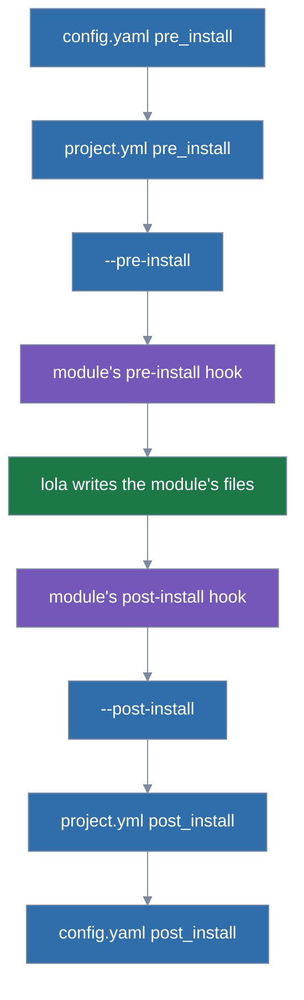

# Choosing what to install

This guide covers how lola decides the scope, assistants and components for an install.

## The install flow

`lola install` with no argument, on a terminal, asks what it needs, one step at a time, inline
on stderr. Every list is numbered, `Step 2 of 5 — Install which modules?`, and a form with several
lists says `enter: next` under each but the last. The count is lola's forecast until you pick the
modules, then exact: a step lola answers itself (the only assistant installed, a module with one
component) drops out of it. After a Change entry, the steps asked again are numbered from 1.

```mermaid
%%{init: {'theme': 'base', 'themeVariables': {
  'primaryColor': '#2f6dab',
  'primaryTextColor': '#1e1e1e',
  'primaryBorderColor': '#7c8ba1',
  'lineColor': '#7c8ba1',
  'edgeLabelBackground': '#eef2f8',
  'tertiaryColor': 'transparent',
  'tertiaryTextColor': '#7c8ba1',
  'tertiaryBorderColor': '#7c8ba1',
  'clusterBkg': 'transparent',
  'clusterBorder': '#7c8ba1',
  'titleColor': '#7c8ba1',
  'noteBkgColor': '#eef2f8',
  'noteTextColor': '#1e1e1e',
  'fontFamily': 'system-ui, sans-serif'
}, 'themeCSS': '.node .nodeLabel{color:#ffffff!important;fill:#ffffff!important;}'}}%%
stateDiagram-v2
  [*] --> Scope
  Scope --> Modules
  Modules --> Assistants
  Assistants --> Components
  Components --> Review
  Review --> Change: c
  Change --> Review: step asked again
  Review --> Applied: y
  Review --> Cancelled: n or Ctrl+C
  Applied --> [*]
  Cancelled --> [*]
```



1. **Scope**: **Project** (showing its root), **User** (`~`) and **Other directory…**, in that
   order; tick any of them, at least one.
   - Nothing is preselected, not even when `config.yaml` sets `default_scope` (it applies only
     off a terminal) or the project already uses lola.
   - **Other directory…** then asks for a path: a relative one starts from the current
     directory, and `~` is not expanded. It must be an existing directory, not the project you
     ticked above, and not your home directory (that is the user scope; tick User instead);
     otherwise lola says why and asks again.
   - Ticking Project where the project is your home directory is asked again the same way.
   - That directory is installed into as a project of its own, so one run can install into this
     project, another one and your user scope at once.
2. **Modules**: every module in your cache, as `source · name — description`, filterable by
   typing.
   - Modules already installed in a chosen scope are marked `(installed)`; picking one
     reconfigures it.
   - The last entry, **Add a source…**, asks for a source and an optional ref, adds it to your
     cache exactly like `lola cache add`, and shows the list again with it selected. Leaving the
     source empty returns to the list with the modules you ticked still ticked.
   - After the cache, each of your [marketplaces](marketplaces.md#marketplaces) with a fetched
     catalog is a group of its own, `@acme — <description>`, listing the entries it offers (name,
     version, description, tags and source host, filterable by typing); an entry your cache
     already holds from the same source is offered once, in the cache's list.
   - A marketplace entry you pick is fetched, as Add a source… fetches, before the component
     step, and installed as `@acme/<entry>` (the summary's equivalent command names it so); Add a
     source… takes an `@acme/<entry>` too, and selects it in its group.
   - Two picks that are one module name (a cached `formatter` and `@acme/formatter`, or
     `@acme/formatter` and `@other/formatter`) are asked again before anything is fetched, since
     lola installs one module of a name.
   - With an empty cache and no marketplace you get Add a source… or Quit.
3. **Assistants**: the installed assistants, as described under
   [Scopes and targets](../usage.md#scopes-and-targets).
4. **Components**: one page per module, a list per kind (skills, commands, agents, MCP
   servers, rules).
   - Everything is preselected except what `selections.yaml` skips (labelled `(skipped in
     selections.yaml)`).
   - MCP servers that run a command say `(runs a command)`.
   - Rules are shown disabled under `--no-rules` (or when the module's rules are off).
   - A module with runtime hooks ends its page with "Runtime hooks: N (you will be asked before
     they are installed)".
   - Unpicking everything asks "Install <module> with no components?"; No leaves the module out
     of this run.
   - With several destinations, a module whose preselection is the same everywhere gets one page
     for all of them; otherwise it gets one page per destination, titled `<module> — project
     (<root>)` or `<module> — user`.
5. **Review**: the summary in lola's [viewer](../usage.md#output-contract), with
   `y apply · c change · n cancel · esc back · q quit` in its footer.
   - `y` applies; `n` and Ctrl+C cancel; `q` quits and Esc goes back to the last step you
     answered (see [Keys](#keys-q-quits-esc-goes-back)); Enter answers nothing.
   - `c` opens a menu of Change scope, Change modules, Change assistants and Change components
     (each offered when that step was asked), ending with **Back to the review** (Esc there goes
     back to the review too). When no step can change (every answer came from a flag or the
     situation), the footer omits `c change` and `c` does nothing.
   - Changing a step asks it again with your answers preselected, keeps later answers that still
     apply, and comes back to the review. Change scope keeps the component picks of the
     destinations you keep, and the summary counts the picks of the ones you remove as dropped.
   - When you quit the viewer, the summary stays printed on your terminal.
   - In accessible mode, and wherever the viewer is turned off (`--no-pager`, `NO_PAGER`,
     `pager: false`, a `$LOLA_PAGER` you set), the summary is printed, then the menu of
     **Apply**, the Change entries and Quit.

A step with no real choice is not shown: a scope, module, assistant or component flag answers
it, as does a single installed assistant or a module with one component. The review is shown
whenever lola chose something you did not type: an answer at a picker, or the only assistant
installed, which the summary names (`→ for opencode (the only assistant found)`). A run the
flags specify fully asks nothing; `-y` and `--force` print the summary and apply without asking. The install uses exactly the versions
the pickers listed, for source arguments and for modules picked from the cache, and keeps
them through the menu's "Change …" steps. If a listed version was removed from your cache in
the meantime, the run stops and asks you to run `lola install` again. Two arguments that
resolve to different versions of one module are refused.

For each module picked from your cache, the version listed for a scope is the newest one your
cache holds for the ref that scope's `project.yml` entry records (the default branch's when the
entry has no ref). A scope with no entry takes the version lola lists and records its ref. A
module whose version cannot be listed is left out of the module list, with a `⚠` warning that
names the command installing it: its entry's ref has no version in your cache, the scopes'
entries resolve to two versions, its entry has no ref and the default branch is not cached, or
your cache fetched it before lola recorded commits (`lola cache update <name>` fetches it again).
A module argument that resolves to such a version is refused before the summary.
A pick kept through "Change scope" that no longer matches a scope's entry ref is refused before
the summary, not after you confirm. When nothing would change, lola says
`already up to date`. lola asks for runtime hook consent during the install, as always.

The summary lists each destination with its directory (`project (<root>)`, `user (<home>)`) and
where it came from; under it, each assistant with why lola uses it (`→ for claude-code
(picked)`, `(from -t)`, `(from .lola/project.yml)`, `(the only assistant found)`), and each
module's components: `+` added, `~` updated (a newer cached version), `-` removed,
`= N unchanged`; then the `selections.yaml` entries the run writes, notices, the
[findings](../usage.md#findings) a dry run of exactly this install reports, each with its hint, and the
**equivalent commands**, which do the same without a terminal. Consent to hooks and scripts
is still asked after the review, as before:

```
Equivalent commands:
  lola cache add ../src/deploy
  lola install review-kit deploy --scope project -t claude-code --skip review-kit:skill/slow-lint
```

With more than one destination there is one `lola install` line per destination: each
project gets `--scope project -C <root>` and the user scope gets `--scope user`. There is no
flag for several project roots in one run; `--scope both` still installs into one project
and your user scope.

Equivalent commands, and commands inside hints, are quoted to paste into a POSIX shell (bash,
zsh) on Linux and macOS, and into PowerShell 7.3 or later on Windows. There an argument goes
in single quotes when it holds anything beyond letters, digits and `_ - . / : = +`, or starts
with `-` and holds a `.` (`-t 'claude-code,gemini-cli'`). Windows PowerShell 5.1 drops empty
arguments (`''`) and mangles embedded `"` when it runs a program.

When the `-C` path contains control or format characters, the line is shown with them
replaced by `?`, followed by a note that it is not copyable as shown.

Ctrl+C at any step cancels: "aborted; nothing changed"; `q` quits, and Esc goes back a step
([Keys](#keys-q-quits-esc-goes-back)). Nothing is written before Apply,
except that Add a source… (and a source you name as an argument) is fetched into your
cache, which installs nothing. After Apply, when you consent to runtime hooks at the prompt,
lola records it in `consent.json` at once (a consent `--trust=runtime-hooks` gives, once its
receipt is answered), before
`selections.yaml` and the installed files are written; if the run then stops (a refusal, or
a later prompt you decline), that consent stays recorded and nothing else is written.
`--dry-run` runs the steps and the summary and writes nothing, not even `selections.yaml`.

`LOLA_ACCESSIBLE=1` (or `TERM=dumb`) asks the same questions as numbered line prompts, for
screen readers; there, end of input at any prompt, runtime hook consent included, cancels the
run ("aborted; nothing changed"), and Ctrl+C interrupts.

In a picker, space ticks the option under the cursor (`[x]`; the rest show `[ ]`), enter
confirms, and Ctrl+C quits; the keys are listed under it. A picker that needs a pick (scope,
modules, assistants, and `lola tidy`'s keep-list when you chose nothing to move) refuses an empty
one when you press Enter with nothing ticked: `nothing selected — space selects, enter confirms, ctrl+c quits`, or in
accessible mode `nothing selected — type an option's number to select it, 0 confirms, ctrl+c
quits`. A module picker that lists your cache and your marketplaces asks again instead, with the
same message.

### Keys: q quits, Esc goes back

Every full-screen question (pickers, menus, text inputs, the install review) takes two more
keys, named first in its key help: `esc back · q quit`.

- `q` quits the command:
  - lola prints `✗ cancelled — nothing was changed` and exits 0, as Ctrl+C does.
  - Once you have answered two or more steps of the run, it asks first: `Quit? your answers so
    far are dropped — nothing has been changed [y/N]`; `y` quits, and `n`, Enter or Esc return to
    the question as you left it.
  - That includes the yes/no question that closes a run, such as `lola tidy`'s "Move…?" after the
    move and keep pickers or `lola migrate`'s "Migrate?" after two mapping questions; a yes/no
    question with no steps before it quits at once.
  - A command that words its own cancel (`lola sync`, `lola profile` `--add`, `--remove` and
    `--update`, `lola market --remove`) prints that instead, since it says what was left as it
    was.
  - In a text input, and while you type a filter after `/`, `q` is typed as text; Esc first sets,
    then clears, the filter, as before, and then `q` quits.
- Esc goes back one screen: the step before asks again with your answer preselected, and the run
  carries on from there.
  - In `lola install`: from the modules to the scope, from the assistants to the modules, from a
    component page to the page or step before it, from "Install <module> with no components?" to
    its page, and from the review to the last step you answered; Other directory… and Add a
    source… go back to their picker.
  - `lola tidy`'s keep-list goes back to the move picker; `lola migrate`'s questions about a
    missing root or assistant go back to the one before; Choose… goes back to `lola sync`'s trust
    question.
  - On a page of several lists (a component page, the module picker with marketplace groups), Esc
    first moves to the list before, as Shift+Tab does.
  - On the first question of a run, or one that stands alone, Esc goes nowhere and the key help
    says `first step — q quits` (`first step — ctrl+c quits` in a text input); on a run's closing
    yes/no question it says `no step to go back to — q quits`.
- Ctrl+C cancels at once, without asking, everywhere.

Accessible mode's numbered prompts take neither key: there `q` is no answer, and Ctrl+C or end of
input cancels.

## Choosing a scope

The scope flags are global: every command takes them.

| Flag | Scope |
|---|---|
| `--scope project\|user\|both` (also `project,user`) | that; `-C <dir>` sets the project |
| `--project` | project (`--scope project`) |
| `--user` | user (`--scope user`) |
| `-C, --root <dir>` | the project at `<dir>` |

`--user` and `--project` must agree with `--scope`, and `--user` cannot take `-C`. `--project`
and `--scope project` without `-C` use the nearest parent with a `.lola/`, else the current
directory. `--scope user -C <dir>` is an error.

**Commands that write** (`install`, `sync`, `uninstall`, `render`, `tidy`, and `lola profile`
with `--on`, `--off`, `--switch` or `--remove`) never pick a scope silently. lola reads the table
top to bottom and takes the first row that applies, so on a terminal the picker asks even inside
a `.lola/` project:

| You give | Scope |
|---|---|
| a scope flag | that scope |
| a terminal | the scope picker (Project, User, Other directory…), with nothing preselected |
| no flag, off a terminal, in or below a directory with `.lola/` | that project (`install` says `scope: project (found .lola/ at <path>)` on stderr) |
| `default_scope` in `config.yaml` | that scope |
| none of these | an error naming the command and the `config.yaml` that sets no `default_scope`, with your run plus `--project`, plus `--user` (and plus `--scope both` for `install` and `sync`) as hints, each keeping the source, `--ref`, `--path` and every other flag |

`install` and `sync` take both scopes (`--scope both`, both ticked, or `default_scope: both`):
`install` plans them together, and `sync` syncs the project, then user scope, stopping at the
first that fails or is declined (its message names the scopes it did not reach), with each
scope's output under its own `project (<root>):` or `user:` line; `--plain` output carries no
scope label, as with `install`. `uninstall`, `render`, `tidy` and `lola profile`'s actions act
on one scope: their picker asks you to tick one (pressing Enter with nothing ticked asks again),
and two scopes from the flags or `default_scope` are refused with `name one: --project or
--user` (`tidy` refuses `--scope both` with `lola tidy acts on one scope per run`).

**Commands that only read** (`list`, and `lola profile` without an action) never ask: the flags decide, `--scope both` included;
otherwise they show the project found walking up, if there is one, and user scope, on a terminal
or off it. `default_scope` does not apply to them, and every row names its scope. When one of
those two cannot be read (a damaged `user.yml`, say), `list` fails with a hint naming the other
scope's own command, such as `lola list --project` (`lola profile --project` for `lola profile`).

`lola profile --add` and `--update` never ask either: the remote profile they write is shared by
every scope. For `--add` a scope flag only names the scope its content is compared with; without
one, it is the project found walking up, else user scope. `--update` without a scope flag applies
in the project found walking up, then user scope, as `sync --scope both` does, and a scope flag
narrows it to that scope ([Remote profiles](remote-profiles.md)). `--add` refuses `--scope both`;
`--update` takes it as every known scope, and refuses it when there is no `.lola/` project.

`check` acts on the one scope the flags name, else on the nearest parent with a `.lola/`, else
the current directory, and never asks; `--scope both` is refused as above. It reads
`selections.yaml` for that scope. Commands
without a scope (`search`, `cache …`, `init`, `version`, `help`) accept the scope flags and
ignore them. `lola market` ignores them too, but refuses flags that contradict each other, such
as `--user -C <dir>`. `lola migrate` keeps its own.

You cannot install a project at your home directory: it renders exactly where the user scope
does (`~/.claude`, …), so the two would claim the same files. `install` refuses it however it
is chosen (`-C ~`, `--scope project` or `--scope both` run from `~`, or a `.lola/` found in
`~`), with a hint to use `--user` instead. `render` and `uninstall` still work on a home
project an older lola installed, so you can remove it. `--json` output lists every destination in
`scopes`, each with its `scope`, its `root` (for a project) and its `scope_source`: `flag`,
`config`, `discovered` or `picked`. Modules and steps carry the same `scope` and `root`.
`default_scope` is only read off a terminal; on one, the scope step asks.

**Breaking changes** from the [Python lola](migrating.md), which installs into the current
directory: off a terminal, in a directory with no `.lola/` above it and no `default_scope`,
`install`, `sync`, `uninstall` and `render` no longer act on the current directory; pass `--project` (or set `default_scope: project`). On a terminal they ask for the
scope unless a flag gives it.

**Breaking change** from earlier builds of this lola, where `--project <dir>` named the project:
`-C`'s long form is `--root`; `--project` is a scope flag and no longer takes a directory.

## Component flags

| Flag | Effect |
|---|---|
| `--skip <selector>` | Do not install the matching components; saved as a skip (and a matching include in that section is removed). |
| `--only <selector>` | For each module with a match, skip every component that does not match and unskip those that do. Saved as skips of the components that exist now, so components a later version adds are installed. Warns when a wider include in the section keeps a non-matching component installed. |
| `--unskip <selector>` | Install skipped components again: removes the matching skips, and where a global skip still applies, adds an include. With `--global`, warns when a scope section still skips the item. |
| `--global` | Save the above in the global section instead of the scope's. |

A selector is `kind/name` or `module:kind/name`, where `kind` is `skill`, `command`, `agent`,
`mcp` or `rule` and `name` may be a glob (`review-*`). A bare selector applies to every module
being installed that has a match; one that matches nothing is an error that lists that kind's
components (module-qualified). All three repeat, and always write `selections.yaml` (except
under `--dry-run`), saying `→ saved to <path>`. With more than one destination (`--scope
both`, or several ticked in the scope step) they need `--global`, since one flag cannot say
which scope it means. `--no-rules` wins over rule selections. Names in
selectors, from flags or the file, may not contain control or format characters.

```sh
lola install review-kit --scope project --skip skill/slow-lint --skip 'mcp/internal-*'
lola install review-kit --scope user --only skill/review --only command/ship
lola install review-kit --scope project --unskip review-kit:skill/slow-lint
lola install review-kit deploy --scope both --skip command/deploy --global
```

## `config.yaml` and `selections.yaml`

Both live in `$XDG_CONFIG_HOME/lola/` (normally `~/.config/lola/`), are safe to edit by hand,
and are checked strictly: unknown keys, wrong types, unknown kinds, bad globs, relative or
`~` project keys, two keys for one project, control or format characters in selector names,
an `include` in the `global` section, anchors, aliases and merge keys, and files over
1 MiB are errors that name the file, line and key, with a hint.

```yaml
# lola settings. Safe to edit by hand.
version: 1
default_scope: project   # project | user | both; read off a terminal only
pager: true              # false prints everything without lola's viewer
pre_install: ~/bin/lola-pre.sh     # your own install scripts: absolute or ~/…, no trust asked
post_install: ~/bin/lola-post.sh
cache_unused_for: 30d    # lola cache clean also removes versions unused this long (<n>d, <n>w, never)
theme: dark              # your terminal's background, dark or light, for the pickers' colors
```

`selections.yaml` is the one place that says which components you do not want. `install`,
`render` and `check` all honor it, so editing it takes effect on the next `render` (a
component you skip after installing it is removed, unless you edited its file, which is kept
and reported):

```yaml
# lola selections: components you chose not to install.
version: 1
global:
  review-kit:                       # module name as `lola list` shows it
    skip: [skill/slow-lint, mcp/internal-db]
user:
  review-kit:
    include: [mcp/internal-db]      # overrides a global skip at user scope
projects:
  /home/me/src/api:
    review-kit:
      skip: [command/deploy]
      include: [skill/slow-lint]
```

A module's exclusions at a scope are the global skips, plus that scope's skips, minus that
scope's includes (`global` has no includes). Project keys are absolute paths; a key written
through a symlink or with `..` still matches its project. A selector naming a component the
module no longer has is a warning. lola writes the file under a lock, replacing only the
entries of the modules it changes, so your comments, order and other edits survive, even in a
file that holds only comments or a null document. A section or project key that a removal
empties is dropped, unless it carries a comment, in which case it stays as an empty mapping.
A symlinked file is written at its target. A file that does not parse is never overwritten.
Entries for projects you moved are left alone.

## Off a terminal

Every answer has a flag, so scripts and CI never need a terminal. Off one (or with `--json`)
lola never asks; a missing answer is an error whose hint names the flag: no module →
`lola install <source|name>`; no scope → your run with each scope flag (see [Choosing a
scope](#choosing-a-scope)); no assistant found, or none of your installed ones set up here → your
run with `-t` and each assistant (every one lola knows, or the installed ones). Copy the
equivalent commands from an interactive run to repeat it.

## Install scripts

Install scripts are code that runs around each copy of a module that a run installs or replaces
(`install`, `render` replacing a copy, `sync`, `profile`, `migrate`), once per assistant, whether
or not the module has hooks: your own, the project's (which needs your trust) and the run's, in
this order:



```
pre:  config.yaml → project.yml → --pre-install → the module's pre-install hook
      (lola writes the module's files)
post: the module's post-install hook → --post-install → project.yml → config.yaml
```

| Source | Where | Trust |
|---|---|---|
| yours | `pre_install:` and `post_install:` in `config.yaml`: an absolute path or `~/…` | none |
| the project's | top-level `pre_install:` and `post_install:` in `.lola/project.yml`, relative to the project, in plain text and without a `..` component; it must be a regular file inside the project, not a symbolic link | `scripts`, per project, event and the digest of the script |
| this run's | `install --pre-install <path>` and `--post-install <path>` | none |

Each runs as a hook does, but from its absolute path, with the module copy as its working
directory, the hook environment (`LOLA_MODULE_NAME`, `LOLA_MODULE_PATH`, `LOLA_PROJECT_PATH`,
`LOLA_ASSISTANT`, `LOLA_SCOPE`, `LOLA_HOOK`) and `LOLA_SCRIPT_SOURCE` (`user`, `project` or
`flag`), its output on stderr, under the hook timeout (10 minutes). A project's scripts run only
in runs whose scope is that project: a `--user` run never runs them, and under `--scope both` they
wrap the project's modules only. `user.yml` refuses the keys; yours belong in `config.yaml`.

- A missing, irregular or non-executable script is refused before anything is asked:
  - The refusal names the file, line and key (`/work/proj/.lola/project.yml:4: pre_install:
    ci/check.sh does not exist`) or the flag (`--pre-install ./hooks/pre.sh is not executable`,
    hinting `chmod +x ./hooks/pre.sh`).
  - So is a project's script that is an absolute path (`… is an absolute path; name the script
    by its path inside the project`), resolves outside the project, is a symbolic link, has a
    `..` component (`… has a .. component; name the script by its path inside the project`) or
    holds a control character or a line break.
  - `lola list` works with a missing script.
  - A project's script is shown by its path from the project's root, beside that root
    (`ci/check.sh (project at /work/proj, claude-code)`), and the path to every script is shown
    on one line.
- A pre-install script that fails or times out stops the run, nothing written (`pre-install
  script ci/check.sh (project) failed for kit on claude-code: exit status 3`); a post-install one
  is a warning and the installation is kept.
- lola hashes every script when the run plans it and again just before it runs it; one that
  changed in between is not run (`pre-install script ci/check.sh (project) changed after lola
  checked it; nothing was installed`; a post-install one is a warning).
- The project's scripts need your trust (`scripts`):
  - On a terminal lola shows the script and its sha256 and asks.
  - Off one a pre-install script is refused, hinting your run with `--trust=scripts`, and a
    post-install script is skipped with a warning and stays pending in `lock.json`
    (`scripts_pending`).
  - A pending one runs, alone, in the module's copy as it is, only in a `lola sync` that names
    the module or gives `--trust=scripts`, and only with your consent for the script as it is
    now. Any other sync says `pending post-install script for kit → lola sync --project kit (off
    a terminal: lola sync --project kit --trust=scripts)`, the part in parentheses only off a
    terminal.
  - The mark stays until the script has run on every assistant, so one that fails is offered
    again. Once `project.yml` no longer names a post-install script, a sync clears the mark.
  - A `lola sync` asks about the project's scripts even when it installs nothing, so a pulled
    `project.yml` that adds or edits one asks before any install runs it: a pre-install script
    as `Trust this project's pre-install script for later runs?` (off a terminal, refused until
    `--trust=scripts`), while a post-install one, which would only be skipped, is not asked
    about and is warned of (`post-install script ci/after.sh (project) is not trusted on this
    machine; trust it: lola sync --project --trust=scripts`).
  - Your own scripts and the flag's are checked only when a copy is written.
- A post-install script, like a post-install hook, is declined rather than refused when you have
  not trusted it, so the command a dry run ends with (`lola sync -n`) adds `--trust=scripts` only
  for a pre-install script; `-n` still says the post-install one needs it. A dry run of a sync that
  would run a pending script counts its module as changed; without the trust it needs, it marks
  the script and says it stays pending, as the run would.
- `-n` lists every script in run order with its source, and says which project script still
  needs `--trust=scripts`; JSON has `scripts` (`event`, `source`, `path`, `module`, `target`,
  `status`: `would-run`, `ran`, `failed` or `declined`), and `--plain` a `script` row for each
  (module, event, source, path, assistant, status). `lola info` lists
  them too.
- When lola refuses a run for want of trust, it hints the run with every kind it would still be
  refused for, not only the one refused: a module's pre-install hook and the project's
  pre-install script, both untrusted, hint `--trust=scripts,hooks`.

Consent covers the script itself, not the files it runs; lola runs no shell around it and runs
nothing in a sandbox.

## Trust kinds

Every question lola asks before it runs or installs something you did not write has a kind, and
`--trust` answers the kinds you name, on `sync`, `profile`, `install`, `render` and `migrate`:

| Kind | Covers | Recorded in |
|---|---|---|
| `entries` | The changes to `project.yml`, its top-level targets, and the pins and folder content a sync would write | `trust.json` |
| `profiles` | A project profile's changes, a project profile taking your profile's place, a remote profile `--add` or `--update` shows | `trust.json` |
| `scripts` | A project's install scripts, per project, event and the digest of the script ([Install scripts](#install-scripts)) | `consent.json` |
| `hooks` | A module's install hooks, by the digest of their scripts | `consent.json` |
| `runtime-hooks` | A module's Claude Code runtime hooks and agent MCP servers, per settings file | `consent.json` |

Write the kinds after `=`, as a comma list or the flag repeated (`--trust=entries,hooks`). A
command's help shows `--trust[=entries,profiles]` when a bare `--trust` (no `=`) grants those two
kinds there, and `--trust=<kinds>` when a bare `--trust` grants none there.

`--trust hooks` is bare `--trust` and a module named `hooks`: lola refuses an argument right after
a bare `--trust` that names kinds (in any case, or a list such as `hooks,scripts`; after `--` it
is a name), hinting your run with `--trust=` the kinds you wrote, never the ones a bare `--trust`
would add. `--trust=entries,profiles` written out is those two kinds, so `profile --add` refuses
it. Bare `--trust` is `entries,profiles`, the kinds that run no code; `all` is every kind the
command takes.

A kind the command never asks is refused, naming the ones it takes: `install`, `render` and
`migrate` take `scripts`, `hooks` and `runtime-hooks` (bare `--trust` is refused there, beside
other kinds too), `profile --add` takes `profiles`, and `sync` and the other `profile` actions
take all five. An unknown kind is refused, hinting the closest one within two edits (a stray
comma, the value without it). `profile --update` without a scope flag refuses `--trust=entries`,
which would answer nothing there, hinting the run with `--project` and with `--scope both`.

What the kinds cover is listed once, before anything is written, as a receipt on stderr:

```
trusting, as --trust=entries,hooks allows:
  → entries: targets (new), kit (new)
  → hooks: kit pre-install (new)
Proceed? [y/N]
```

On a terminal lola then asks once (`-y` answers; No installs and records nothing; fetched content
stays in the cache); what the kinds do not cover is asked item by item first, as without the flag.
`profile --add`, which takes no `-y`, asks it on a terminal too. A command asks one receipt for
everything it does: `sync --scope both` runs each scope up to its receipt, shows one, and applies
the scopes only after its yes, and `profile --update` with `--trust` does the same for the
profiles and each scope's sync, writing no profile before it (a scope's sync refused before the
receipt still keeps the update, after a receipt of the profiles; a Cancel or a No to its removals
updates nothing; a profile another lola run replaced while you were asked is not updated, and
the profiles written before it are named, not applied). Each scope records its grants just before it is applied, and one whose content
changed after the receipt is refused (`what --trust covers changed after you answered its receipt;
nothing more was written`). Off a terminal the run proceeds,
and under `--json` nothing is printed: the document's `trusted` key lists the same items, and so
does the error document of a run that fails after it recorded them (for several scopes or
destinations, what all of them recorded so far, `[]` for none). A run whose
answers the kinds do not cover is refused off a terminal, and its hint is your run with
`--trust=` the kinds you gave and exactly the ones missing; a post-install hook or runtime hook
without consent is declined with a warning that names the run with its kind. `-y` and `--force`
never consent to any kind.

A grant by `--trust` is recorded as a yes at the prompt is, once the receipt is answered: a later
run on the same machine with the same digests asks nothing and needs no flag, and a changed
script, hook set or runtime-hook group asks again. A yes at a hook's own question is recorded at
the same point, with them (just before the first write when nothing is covered). A No, a refusal,
Ctrl+C or `-n` records nothing, neither the flag's grants nor those yes answers. On a CI machine whose `$XDG_STATE_HOME` persists between jobs, one job's
`--trust=hooks` therefore covers later jobs that install the same hooks; give each job a fresh
`XDG_STATE_HOME` when you want consent per job.
