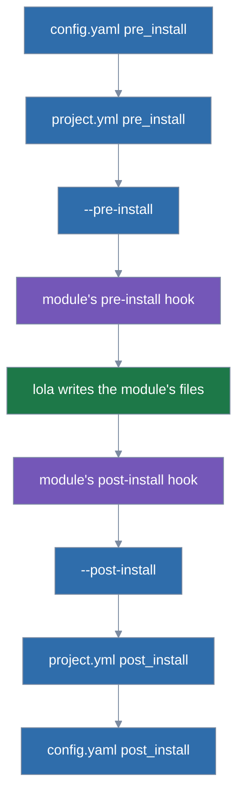

# Install scripts

What install scripts are and when lola runs them. It is split out of [choosing-what-to-install](choosing-what-to-install.md).

Install scripts are code that runs around each copy of a module that a run installs or replaces
(`install`, `update` replacing a copy, `sync`, `profile`, `migrate`), once per assistant, whether
or not the module has hooks: your own, the project's (which needs your trust) and the run's, in
this order:



```
pre:  config.yaml → project.yml → --pre-install → the module's pre-install hook
      (lola writes the module's files)
post: the module's post-install hook → --post-install → project.yml → config.yaml
```

| Source | Where | Trust |
|---|---|---|
| yours | `pre_install:` and `post_install:` in `config.yaml`: an absolute path or `~/…` | none |
| the project's | top-level `pre_install:` and `post_install:` in `.lola/project.yml`, relative to the project, in plain text and without a `..` component; it must be a regular file inside the project, not a symbolic link | `scripts`, per project, event and the digest of the script |
| this run's | `install --pre-install <path>` and `--post-install <path>` | none |

Each runs as a hook does, but from its absolute path, with the module copy as its working
directory, the hook environment (`LOLA_MODULE_NAME`, `LOLA_MODULE_PATH`, `LOLA_PROJECT_PATH`,
`LOLA_ASSISTANT`, `LOLA_SCOPE`, `LOLA_HOOK`) and `LOLA_SCRIPT_SOURCE` (`user`, `project` or
`flag`), its output on stderr, under the hook timeout (10 minutes). A project's scripts run only
in runs whose scope is that project: a `--user` run never runs them, and under `--scope both` they
wrap the project's modules only. `default.yml` refuses the keys; yours belong in `config.yaml`.

- A missing, irregular or non-executable script is refused before anything is asked:
  - The refusal names the file, line and key (`/work/proj/.lola/project.yml:4: pre_install:
    ci/check.sh does not exist`) or the flag (`--pre-install ./hooks/pre.sh is not executable`,
    hinting `chmod +x ./hooks/pre.sh`).
  - So is a project's script that is an absolute path (`… is an absolute path; name the script
    by its path inside the project`), resolves outside the project, is a symbolic link, has a
    `..` component (`… has a .. component; name the script by its path inside the project`) or
    holds a control character or a line break.
  - `lola list` works with a missing script.
  - A project's script is shown by its path from the project's root, beside that root
    (`ci/check.sh (project at /work/proj, claude-code)`), and the path to every script is shown
    on one line.
- A pre-install script that fails or times out stops the run, nothing written (`pre-install
  script ci/check.sh (project) failed for kit on claude-code: exit status 3`); a post-install one
  is a warning and the installation is kept.
- lola hashes every script when the run plans it and again just before it runs it; one that
  changed in between is not run (`pre-install script ci/check.sh (project) changed after lola
  checked it; nothing was installed`; a post-install one is a warning).
- The project's scripts need your trust (`scripts`):
  - On a terminal lola shows the script and its sha256 and asks.
  - Off one a pre-install script is refused, hinting your run with `--trust=scripts`, and a
    post-install script is skipped with a warning and stays pending in `lock.json`
    (`scripts_pending`).
  - A pending one runs, alone, in the module's copy as it is, only in a `lola sync` that names
    the module or gives `--trust=scripts`, and only with your consent for the script as it is
    now. Any other sync says `pending post-install script for kit → lola sync --project kit (off
    a terminal: lola sync --project kit --trust=scripts)`, the part in parentheses only off a
    terminal.
  - The mark stays until the script has run on every assistant, so one that fails is offered
    again. Once `project.yml` no longer names a post-install script, a sync clears the mark.
  - A `lola sync` asks about the project's scripts even when it installs nothing, so a pulled
    `project.yml` that adds or edits one asks before any install runs it: a pre-install script
    as `Trust this project's pre-install script for later runs?` (off a terminal, refused until
    `--trust=scripts`), while a post-install one, which would only be skipped, is not asked
    about and is warned of (`post-install script ci/after.sh (project) is not trusted on this
    machine; trust it: lola sync --project --trust=scripts`).
  - Your own scripts and the flag's are checked only when a copy is written.
- A post-install script, like a post-install hook, is declined rather than refused when you have
  not trusted it, so the command a dry run ends with (`lola sync -n`) adds `--trust=scripts` only
  for a pre-install script; `-n` still says the post-install one needs it. A dry run of a sync that
  would run a pending script counts its module as changed; without the trust it needs, it marks
  the script and says it stays pending, as the run would.
- `-n` lists every script in run order with its source, and says which project script still
  needs `--trust=scripts`; JSON has `scripts` (`event`, `source`, `path`, `module`, `target`,
  `status`: `would-run`, `ran`, `failed` or `declined`), and `--plain` a `script` row for each
  (module, event, source, path, assistant, status). `lola info` lists
  them too.
- When lola refuses a run for want of trust, it hints the run with every kind it would still be
  refused for, not only the one refused: a module's pre-install hook and the project's
  pre-install script, both untrusted, hint `--trust=scripts,hooks`.

Consent covers the script itself, not the files it runs; lola runs no shell around it and runs
nothing in a sandbox.
