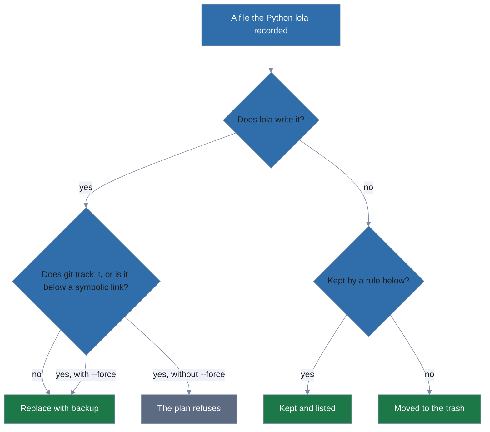
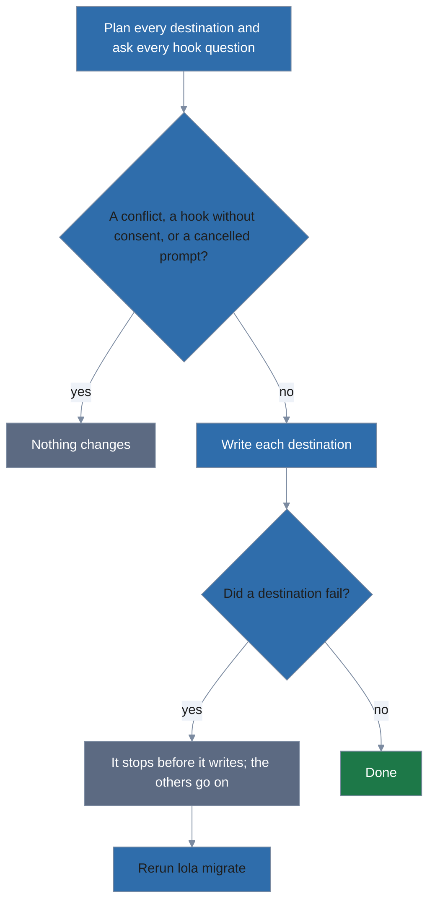

# Coming from the Python lola

lola does not read the Python lola's state (`~/.lola/installed.yml`, its module registry and
marketplaces), and the Python lola does not read lola's. `lola migrate` moves you over once,
modules and marketplaces:

```
lola migrate --dry-run    # the plan; writes nothing
lola migrate              # the plan, then "Migrate?" (default No); off a terminal, add -y (or --force)
```

`-y` only answers `Migrate?`. `--force` answers it too, and also replaces files in the way and
moves files git tracks ([Before anything is written](#before-anything-is-written)). Neither gives
a hook's consent; `--trust=<kinds>` does.

## What `lola migrate` does

1. **Reads the Python lola's home** (`$LOLA_HOME`, else `~/.lola`).
2. **Finds its records**: every project, and user scope, where the Python lola installed a module
   for Claude Code, Gemini CLI or OpenCode, and that assistant is installed or set up there
   ([From another machine](#from-another-machine)).
3. **Checks each source.** Before it plans anything else, lola fetches each source and checks
   that the module it finds there has every skill, command, agent and MCP server the Python lola
   recorded (a skill it renamed to `<module>_<skill>` counts as `<skill>`). If not, the record is
   not migrated:
   - lola found a different module root (the hint gives the `--path` to try), or
   - the source no longer ships it (the hint says what to do with the Python lola's files).

   A source lola cannot fetch (offline, say) leaves its records unmigrated the same way, with
   the hint to rerun `lola migrate` once the source is reachable. The module's other records in
   that place stay with them, and the rest of the plan goes on.
4. **Installs the same module with lola**, from the same source (with its ref and content
   directory as `--ref` and `--path`; a content directory of `/` is `--path .` for a folder or
   git source), on the same assistants. A module lola already has there stays at the version it
   has. An archive's content directory below `/` cannot be mapped (the Python lola looked it up
   below the module it found in the archive); install such a module yourself with `--path`.
5. **Cleans up**, as below.

### What happens to each file



`--keep-python` installs and replaces with backup, but moves nothing else to the trash.

- **Replace with backup.**
  - A file the Python lola recorded and lola now writes (a skill, a command and its sidecar
    directory, an agent, an MCP server entry at the same place) is copied into the trash first,
    then lola installs over it.
  - The Python lola transformed what it wrote, so lola cannot tell your edits from its own: the
    copy keeps them.
  - A file in a replaced directory that lola does not write is then removed if it still matches
    the copy, and kept and listed if it changed.
  - With `--keep-python` every such file stays and is listed.
- **Moved to the trash.**
  - A recorded file lola does not write (a renamed component, OpenCode's command sidecars and
    legacy `.opencode/command/` and `.opencode/agent/` files) goes to the trash.
  - The module copies in `.lola/modules/` go to the trash. A module copy stays while something
    the Python lola left in place still uses it.
- **Kept and listed.**
  - Symbolic links, and paths below one.
  - Files git tracks, unless `--force`. They are read by their literal names, so `*` or `[` in a
    name is no pattern. Inside a git work tree where git is missing or fails, they stay.
  - Anything a lola module owns.
  - With `--keep-python`, everything lola did not replace.
  - When lola would write such a file (one git tracks, or one below a symbolic link), the plan
    refuses and names the file and why it is kept. `--force` backs it up into the trash and
    replaces it, reported as replaced; for a symbolic link you can instead replace the link with
    a directory.
- **Marketplaces.** Each registration in `~/.lola/market/<name>.yml` is registered with
  [`lola market --add`](marketplaces.md#marketplaces) under its name, its catalog fetched during
  the run (never by `--dry-run`). The plan lists each one first (`register general from
  https://example.com/market.git`).
  - Its `url` is translated: `git+https://…` and `git+ssh://…` lose the `git+`, and a `#path`
    fragment of a git URL becomes `--path`.
  - An `https://` URL ending in `.git`, or git's `user@host:path` form, is a git repository.
  - Another `https://` URL is a catalog file, which lola reads when its path ends in `.json`,
    `.yml` or `.yaml`.
  - A `file://` URL or a path is a folder marketplace, with the catalog file in it as `--path`.
  - In a repository whose `url` names no file, the run reads the catalog the Python lola read
    (`<name>.yml` or `.yaml`, then `marketplace.yml` or `.yaml`, else the only `.yml` or `.yaml`
    file at the root other than `.pre-commit-config.yaml`) and registers it with that `--path`.
    `lola market --add` itself keeps its own lookup.
  - A disabled marketplace stays unregistered, since every marketplace lola registers is enabled, and is listed
    with the `lola market <name> --add <source> [--path …]` that registers it.
  - So is one whose name lola cannot use (uppercase, a space, one of the Python lola's verbs),
    that one of yours has from another source, or that an earlier one of the Python lola's
    marketplaces has, under a free slug of it (`lola market lola-general --add …`).
  - When only a fetch can tell that command's `--path`, `--dry-run` says the run gives it, and
    the run fetches to name it.
  - A `url` lola cannot read at all (plain `http://` off loopback, a relative path, credentials
    or a query, which lola never records) is listed with the reason and no command.
  - A `url` is only ever shown without its user, password, query and fragment, in every output.
  - One whose fetch fails is listed with the reason, the command that shows what the server says
    when there is one, and its `--add`. It gets `lola migrate` itself instead when its `url`
    named no file (an `--add` would not look for the file the Python lola read), and no command
    when the repository holds no file the Python lola would read (two `.yml` files at its root,
    say). The migration goes on without it, and the next `lola migrate` tries it again.
  - One you already have from the same source is `already registered` (when its `url` names no
    file, whichever catalog file you registered it with).
  - Every command listed keeps the run's `--json`, `--plain` and `--no-pager`.
- **The Python home** goes to the trash last, only when every record migrated, nothing failed,
  every marketplace but a disabled one is registered, and it holds nothing but what the Python
  lola writes there. While a `~/.lola` stays, lola sees a project at `~` and refuses to install
  there; the output says why it stayed.

### Not migrated, never changed

Each of these is listed with its file, and how to remove it by hand:

- Installs for Cursor, Copilot and OpenClaw. Their files stay exactly as they are, though
  `--map-target` can install their modules for an assistant lola has.
- Modules with no recorded source or a source lola cannot fetch (`git://`, `.tar.bz2`, …).
- Instruction blocks (`<!-- lola:module:<name>:start -->` in `CLAUDE.md`, `GEMINI.md`,
  `AGENTS.md`, and at user scope `~/.claude/CLAUDE.md`, `~/GEMINI.md`,
  `$XDG_CONFIG_HOME/opencode/AGENTS.md`), which keep working.
- Gemini's skill sections in `GEMINI.md`.
- MCP entries lola does not write (the Python lola put Claude Code's user-scope servers in
  `~/.mcp.json`, lola uses `~/.claude.json`).
- Plugin data (`.lola/plugin-data/<module>`), which MCP servers keep using.
- `.lola-req`.

lola keeps rules as files of their own instead of blocks in your instruction files
([decisions](../decisions.md)), so move a module's `AGENTS.md` to `rules/` to ship it with lola
([Module layout](authoring-modules.md#module-layout)).

A module's installs in one project (or at user scope) migrate together or not at all: when one
of them cannot be migrated (say, the module is also installed for Cursor there), the others stay
with it, since they share the Python lola's copy of the module.

### Before anything is written



1. **lola plans every destination and asks every hook question.** A hook question asks your
   consent to run a module's install hooks (`--trust=hooks`) or to install its Claude Code
   runtime hooks (`--trust=runtime-hooks`); those flags consent without asking
   ([Trust kinds](choosing-what-to-install.md#trust-kinds)), and lola lists what they cover in
   one receipt for every destination before anything is written. Any of these changes nothing:
   - a conflict lola may not resolve: a file in the way that the Python lola did not record, a
     directory in `.lola/modules/` that an install would replace and no migrated record accounts
     for, or one it would swap out that git tracks or that is a symbolic link (`--force` backs
     such a copy up and reports it replaced);
   - a hook without consent;
   - a cancelled prompt.
2. **lola writes each destination.** One destination that fails stops before it writes and the
   others go on.
3. **Rerun `lola migrate` after a failure**: rerunning finishes the job, and a second run says
   "nothing to migrate".

`--force` overwrites such files as `lola install --force` does, after copying each into the
trash, and lists them as replaced. It also answers `Migrate?`, so its refusal's hint `lola
migrate --force` runs off a terminal, though `--force` never gives a hook's consent.

When two modules the Python lola installed in one place ship a component of the same name, the
Python lola skipped one. lola refuses, naming both modules and the component, and gives the
Python lola's `lola uninstall <module> -a <assistant> <project>` command for the module it
skipped the component in. To go on:

1. Run that command with the Python lola.
2. Rerun `lola migrate`, which migrates the other module.

Like `lola install --dry-run`, the plan fetches the modules into your cache; the run you confirm
installs exactly the versions the plan showed, and refuses one removed from the cache in the
meantime.

### The trash

The trash is `$XDG_STATE_HOME/lola/trash/<UTC time>/`:

- one directory per destination (`user`, or a hash of the project's path) mirroring each path
  below the project or your home;
- the Python home as `python-home/`;
- `manifest.txt`, one `original<TAB>trash path` line per entry.

Restoring is a move back: to restore an entry, find its line in `manifest.txt` and move the
trash path back to the original. lola never deletes the trash.

lola refuses to write through a symbolic link inside the trash ("nothing was moved"). A move
across file systems copies, syncs the copy, then removes only the files and links that match it
and the directories left empty; anything created or changed after the copy stays in place, and
the run says which path changed while lola moved it.

## From another machine

A Python home copied from another machine names that machine's paths and assistants. `lola
migrate` says which it cannot use, and how to map them:

- **A project path or a local source that this machine lacks** (`project_path
  /Users/alice/src/app no longer exists`, `the local source /Users/alice/src/kit no longer
  exists`, or any Windows path on Linux or macOS). A local source is a folder or archive the
  Python lola added a module from.
  - Such paths are grouped by the root they came from, project paths and sources together: the
    home it is under (`/home/<user>`, `/Users/<user>`, `/root`, `C:\Users\<user>`) unless that
    is your own home, else the shallowest of its directories missing here.
  - `--map-root OLD=NEW` looks for each path below `OLD` at the same place below `NEW`: with
    `--map-root /Users/alice=/home/alice`, `/Users/alice/src/app` is `/home/alice/src/app`.
  - The longest `OLD` that matches wins, at whole directory names only, and one map moves
    project paths and sources alike.
  - Two Windows paths match with either separator and any case of the drive letter.
  - A mapped path is checked like any other; one that is still missing stays as it is, and its
    reason names where lola looked.
  - A path with a `..` name is never mapped: it is `not in its clean form`, and a local source of
    that kind hints `lola install <source>`.
  - `--map-root` refuses `/` or a drive as `OLD`, which would match every path, so lola never
    suggests one and such a record stays as it is.
- **An assistant this machine lacks.**
  - lola installs a record for its own assistant only where that assistant is installed (on
    your `PATH`) or set up, as `lola tidy` counts them: Claude Code's `.claude/` or `CLAUDE.md`,
    Gemini CLI's `.gemini/` or `GEMINI.md`, OpenCode's `.opencode/`, `opencode.json` or
    `opencode.jsonc`, and at user scope its config directory.
  - Otherwise, and for an assistant lola has no target for, `--map-target OLD=NEW[,NEW]` names
    the assistants to install its modules for instead, such as `--map-target
    claude-code=opencode`. Without it the record stays as it is (`claude-code is not installed
    here`).
  - lola writes only for those: the Python lola's files for the old assistant are not on this
    machine, and a file of yours where the new one installs is a conflict, never replaced.
  - `--map-target claude-code=claude-code` installs for Claude Code anyway.
  - Name each `OLD` once, with every assistant after the `=`.

On a terminal, without `-y`, lola asks before it plans:

1. For each missing root, `/Users/alice not found on this machine — new root (empty skips):`,
   filled in with your home.
2. For each missing assistant, which of the assistants on your `PATH` install its modules, all
   ticked (`claude-code is not installed here — install these 2 modules for:`). Ticking none
   leaves them as they are.

What a flag maps is not asked again. A flag that matches nothing (say, on a rerun after
everything migrated) is a warning, never an error: `⚠ --map-root /Users/alice=/home/alice
matches no missing project path or source of the Python lola; it changes nothing` (in `warnings`
under `--json`). A map that matches a path counts as used even when a longer map moves it.

Each record left as it is carries a hint with the map it needs: `rerun lola migrate with
--map-root /Users/alice=/home/alice` (your home as the new root), or `--map-target
claude-code=opencode` (the assistants on your `PATH`). When there is nothing to suggest (no
assistant on your `PATH`, a root `--map-root` refuses, or a path a map already moved), the hint
names what to write instead: `--map-root <old root>=<where it is on this machine>`,
`--map-target claude-code=<assistant>`.

Whatever is left, the run ends with the command that maps it: your run with every map it used,
plus a `--map-root` to your home for each missing root and a `--map-target` to the assistants on
your `PATH` for each missing assistant. It drops `-y` and any `--trust` or `--trust=<kinds>`,
which answer questions only you can (`remap` under `--json`):

```
→ map what this machine lacks: lola migrate --dry-run --map-root /Users/alice=/home/alice --map-target claude-code=opencode
```

A destination where every record stays says so (`⚠ nothing migrated at user scope: 2 record(s)
left as they are`), and the run counts the Python lola's records: `records: 3 migrated, 2 left as
they are`, with `already migrated` and `failed` when there are any. A run with records left as
they are still succeeds. Until a module is installed at user scope, lola has no `user.yml`, and
`lola sync --user` says so.

## Python lola commands

The Python lola's `lola market` verbs are coached rather than accepted: `lola market add <name>
<url>` is refused with `lola market <name> --add <url>`, `rm` with `--remove`, `update` with
`--update --all` ([Marketplaces](marketplaces.md#marketplaces)).

`lola install @market/module` works as there, but records the module's real source and pin, so
the marketplace is never needed again to install what `project.yml` lists. The Python lola's
`module@ref` is `--ref` here.
