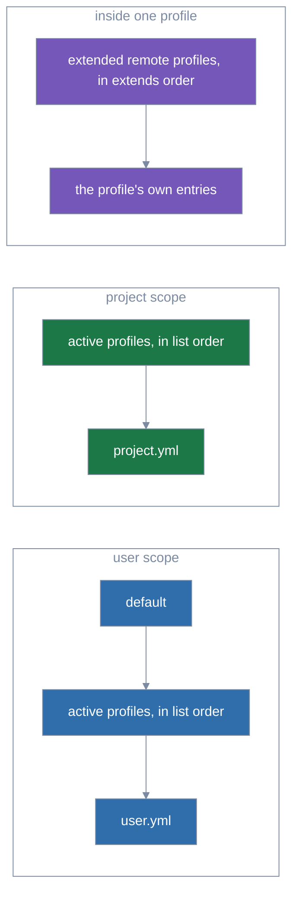

# Profiles

A **profile** is a named set of module entries, kept apart from any manifest (`project.yml` or
`user.yml`, the file listing what a scope installs).
lola reads your own profiles, in `$XDG_CONFIG_HOME/lola/profiles/<name>.yml`; a project's,
committed in `.lola/profiles/<name>.yml` (see [Project profiles](#project-profiles)); and remote
profiles, fetched from a source and kept in `$XDG_DATA_HOME/lola/profiles/<name>/` (see
[Remote profiles](remote-profiles.md)). A **scope** is where lola installs: user scope (your home
directory, for every project) or project scope (one project, with its state in `.lola/`); see
[Scopes and targets](../usage.md#scopes-and-targets).

## Turning profiles on and off

**`default.yml`**, your profile named `default` (`$XDG_CONFIG_HOME/lola/profiles/default.yml`), is
always on at user scope, and never at project scope: `lola sync --user`
installs what it lists as well as what `user.yml` lists. Turning it off means renaming or
deleting it. A profile with any other name is used only when it is **on** in a scope: each scope
has its own ordered active list, which `lola profile` changes and the scope's `lock.json` keeps,
never committed. `lock.json` is lola's ledger of what it installed in that scope ([Files lola
keeps](../usage.md#files-lola-keeps)); it records the list as `profiles`, each item's qualified
name and the action that put it there. In these examples `go` and `docs` are profile names, such
as your `$XDG_CONFIG_HOME/lola/profiles/go.yml`:

```sh
lola profile go --on                 # append go to the active list, and apply
lola profile go docs --switch        # replace the active list: it becomes go, docs (default stays on)
lola profile go --off                # turn it off; asks before removing files (-y)
lola profile go --on --dry-run       # show what it would change
```

The actions have aliases for muscle memory from other tools: `--on` (`--enable`, `--activate`),
`--off` (`--disable`, `--deactivate`), `--switch` (`--use`), and for [remote
profiles](remote-profiles.md) `--add` (`--get`), `--update` (`--upgrade`) and `--remove` (`--rm`,
`--delete`, `--del`, `--erase`, `--uninstall`); help shows them beside each flag, and messages use
the canonical names.

An action names one or more profiles, in order; a name given twice refuses, and so do two
actions in one run (`--on and --off cannot be combined; pick one`). It resolves its scope as
`sync` does ([Choosing a scope](choosing-what-to-install.md#choosing-a-scope)) and applies only what the change moves: each
module is loaded, replaced (another layer's entry wins now) or unloaded (no layer wants it any
more; never one another layer still wants).

Anything else the scope is waiting for, such as an
entry you added to `user.yml` and have not synced, is left to `lola sync`, with a notice (`2 other
changes are pending → lola sync --user`). Whenever the change removes files it asks first, on a
terminal; `-y` confirms, and off a terminal without `-y` it refuses, naming the command that
would, with the profiles by their qualified names.

`--trust` and its [kinds](choosing-what-to-install.md#trust-kinds) work as for `lola sync` (a project profile's changes are
`profiles`), except that the trust question offers only Trust all or Cancel: an action applies
all of its changes or none. The new list is written only with a successful apply: a No, a refusal, an error or
Ctrl+C leaves the old list and the old files.

A profile already on (`user:go is already on (2nd of 3)`), one not on, or a switch to the current list is a notice and changes nothing. `--on
default` is a notice; `--off` and `--switch` of `default` refuse (`rename or delete <path> to turn
it off`), and at project scope `default` refuses (`default applies to user scope only`).

The summary names each profile the run turns on or off with its file (`Profile user:go (<path>) → on, 2nd of 2`;
one it leaves as it was is its notice alone) and lists each change (`+ a  <version>  profile:user:go`, `~ c  …  profile:user:go overrides
profile:default`, `- a  …`) and is paged as `lola sync`'s diff is; `--json` gives the sync's
document, its `trust` object included, plus `profiles` (the active list after the run) and
`changes` (`{module, action: load|replace|unload, from, over}`).

An active profile whose file is gone is a warning (`profile user:go is on but no longer exists →
lola profile --user user:go --off`), and the run treats it as off; `--off` takes it by either
name. `lola uninstall` refuses a module an active profile lists (`<module> is wanted by profile
user:go`, hint `turn the profile off: lola profile --user user:go --off`), since the next sync
would install it again. For a module `default.yml` lists, which no command turns off, the error
says to remove it from `default.yml` and carries no hint.

## Writing a profile

A profile has the shape of a manifest, with an optional `description`:

```yaml
version: 1
description: Go tooling          # optional, at most 256 bytes
targets: [claude-code]           # optional; entries without targets use these
extends: [go]                    # optional: remote profiles whose entries come first
modules:
  - name: go-style
    source: https://github.com/example/go-style
    ref: v1.2.0
  - name: notes
    source: ../notes             # relative to this file's directory
```

## How the layers stack

How the layers of a scope stack, a later entry of a module replacing an earlier one whole:



- **Precedence.** When two layers list one module, the later one's entry wins whole.
  - At user scope: `default`, then the active profiles in list order, then `user.yml`.
  - At project scope: the active profiles in order, then `project.yml`; `user.yml` never applies
    to a project.
  - No field is merged, [vars](templating.md#vars) included.
  - When the entries differ, a notice says so: `gopls: user.yml overrides profile:user:go (v2.0
    over v1.2)`.
  - When the replaced entry set vars, the notice adds `; gopls's vars from profile:user:go are
    dropped: the entry from user.yml sets none` (or `sets its own`).
  - `lock.json` records the profile that won (`from`).
- **Targets.** An entry without `targets` uses its profile's `targets`, else the scope manifest's.

## Building on a remote profile

- **Extends.** `extends:` names up to 16 [remote profiles](#remote-profiles) whose entries your
  profile, or a project's, builds on.
  - Names are bare (`go`, never `remote:go`).
  - Their entries come first, in the order listed, then the profile's own; a later entry of a
    module replaces an earlier one whole. `lola profile <name>` shows the replaced remote profile
    as `(over profile:remote:go)`.
  - An entry without `targets` takes the extending profile's.
  - That is how a profile of yours named `go` builds on the remote `go` it shadows (`extends:
    [go]`).
  - A name that is not a remote profile you have refuses with the file and line (`extends: go is
    not a remote profile you have`), whether it is missing, invalid or one of your own profiles.
  - A remote profile cannot extend another; one level is all there is.
  - The extended remote profile's entries keep their pins, which only `lola profile remote:<name>
    --update` changes (`lola sync --update <module>` refuses them).
  - In a project profile, the trust record notes the remote profile each entry comes from, with
    its source and pin, so after you update it the entries it gives are asked about again.

## Folders, pins and a missing manifest

- **Folders.** A relative folder or archive path resolves against the profile file's directory.
  Your profiles are trusted as `user.yml` is: their entries are never asked about, and their
  folders may be anywhere, even at project scope.
- **Pins.** lola never writes a profile of yours; it writes pins only into a project's profiles
  ([Pinned in place](#project-profiles)). In yours:
  - An unpinned git or archive entry installs what its ref serves when it is first synced.
  - `lock.json` keeps that version, which later syncs and `render` install, until `lola sync
    --update <module>` (with the scope's flag) resolves the ref again.
  - To fix a version for good, write `commit` and `digest` into the profile yourself. `commit` is
    the full commit id a git fetch resolved (40 or 64 hex digits); `digest` is `sha256:` followed by
    the 64 hex digits of the sha256 of the module's content.
  - A pinned profile entry installs that pin. `lola sync --update <module>` refuses it (`edit the
    pin in <path>`), while `lola sync --update` without names leaves it at its pin, with a notice.
- **No manifest needed.** A scope with no `user.yml` (or `project.yml`) but a profile that lists
  modules syncs as if the manifest were empty, and so does one whose profile is gone but whose
  modules are still installed (they are removed); with none of these, `lola sync` still refuses.

## Listing and showing profiles

- **Seeing them.** `lola profile` lists the profiles each scope can use, and `lola profile go`
  shows one.
  - It shows, per scope, whether it is on and, for each of its modules, the layer the scope takes
    it from (`b  user.yml  (over profile:user:go)`).
  - A name is the profile's file name without `.yml`; `user:go` says it is yours, and `default`
    exists at user scope only.
  - Files in a profiles directory whose names are not valid profile names are counted (`1 file
    with an invalid name in … is not a profile`), never shown.
  - `--json` gives `profiles` and `notices`. Each item of `profiles` has:
    - `name`, `kind`, `path`, `source`, `ref`, `commit`, `digest`, `active`, `position`, `scope`
      and `shadowed_by`;
    - `extends`, the remote profiles it extends, which only a profile's state fills in;
    - with a name, also `modules` with `name`, `from` and `overrides`, and `read_as`, the profile
      of yours read in place of an active remote one, else `null`.
  - `--plain` rows are scope, name, kind, `on`/`off`, position and path (with a name: scope,
    module, from and the overridden layers), followed by a `notice` row (`notice`, level, text)
    per notice, as `lola list --plain` has.
  - At project scope a bare name is the project's profile or yours. A name both of them define is
    refused until you qualify it:
    - The refusal reads `go is ambiguous: your profile user:go (<file>) and the project's
      project:go (<file>) are both named go`.
    - It has a hint for each that is your command, flags included, with the name qualified
      (`yours: lola profile --project user:go --on`).
  - With `--off`:
    - When only one of them is on, the refusal says which (`go is ambiguous: your profile user:go
      (<file>) is on and the project's project:go (<file>) is off`) and hints only its `--off`.
    - When neither is on, nothing changes and lola says so (`neither user:go nor project:go is
      on`), as for any profile that is off.
    - `--off go` is refused too when both `go`s are on and both files are gone (a `--off` hint
      for each).
    - It is refused when the `go` that is on has lost its file while the other kind's exists and
      is off (`go is ambiguous: user:go is on but its file <file> is gone, and project:go
      (<file>) is off`), hinting the `--off` of the one that is on and, when the other is the
      project's, `lola profile --project project:go --on` to use it instead.

## How lola reads a profile

- **Reading.** A profile is read as strictly as `project.yml`:
  - one YAML document of at most 1 MiB;
  - version first (a newer lola's file asks you to upgrade lola);
  - known keys only;
  - at most 512 entries, each checked as a manifest entry;
  - every refusal names the file and line.
  - A profile may be a symbolic link (a dotfile manager's), as `user.yml` may; one that is not a
    regular file (a directory, a FIFO) is refused.
  - Each profiles directory (`$XDG_CONFIG_HOME/lola/profiles/`, a project's `.lola/profiles/` and
    `$XDG_DATA_HOME/lola/profiles/`) may hold at most 256 entries. In the first two, a file whose
    name is not a valid module name followed by `.yml` is not a profile.

## Remote profiles

Profiles fetched from a git repository or an https archive, and shared by every scope, are
covered in [Remote profiles](remote-profiles.md): adding one with `lola profile --add`, fetching
it again with `--update`, and deleting it with `--remove`.

## Project profiles

A project can commit profiles for its team in `.lola/profiles/<name>.yml`, in the same format.
They are listed and used at that project's scope only, by their file name or as `project:<name>`
(`lola profile project:go --on`), and turned on per checkout like any profile: committing one
turns nothing on. A project cannot define `default`: a `default.yml` there is not a profile, and
every listing says so (`a project cannot define default; rename <path>`).

A project profile came with the project, so lola treats it as it treats `project.yml`:

- **Reviewed before use.** The entries of every active project profile, and of one being turned
  on, are checked against what you last trusted, as `project.yml`'s are
  ([Sync, pins and trust](sync-and-trust.md#sync-pins-and-trust)).
  - A pulled change is shown in the diff under its profile (`in profile project:go
    (.lola/profiles/go.yml):`) and needs your answer or `--trust` before anything is fetched.
  - A change to a profile that is off is reviewed when you turn it on.
  - Only the entries that win are checked: an entry another layer overrides (`project.yml`'s, or a
    later profile's) is reviewed, with what it installs, when it starts to win, whatever makes it
    win (a sync after `project.yml` drops the module, or turning the other profile off), so one
    profile may be asked about in two steps.
  - An entry without `targets` installs to the profile's `targets`, so changing those changes each
    such entry.
  - `render` leaves out a module whose project-profile entry you have not trusted, as it does for
    `project.yml`'s.
- **Pinned in place.** `lola sync` pins an unpinned git or archive entry, with your trust, by
  writing `commit` and `digest` into the profile file (comments and other keys kept), and
  `lola sync --update <module>` re-pins it, as for `project.yml`. Commit the result so your team
  installs the same version.
- **Never replacing yours silently.** When a project gains a profile with the name of one of
  yours that is on there (`user:go`), lola leaves yours on.
  - `lola sync` (with or without `--trust`), other `lola profile` actions and listings say
    `project:go also exists → lola profile project:go --on` (with the scope's flag).
  - Turning it on, by `--on` or by naming it in `--switch`, puts it in your profile's place in the
    active list, keeping its position.
  - The action's diff shows `~ project:go now replaces user:go (a, b)` with the modules it
    changes, and its trust question (Trust all or Cancel), or `--trust`, covers it.
  - Cancel, and yours stays on.
- **Kept inside the project.** Relative folder and archive sources resolve against
  `.lola/profiles/`, and like `project.yml`'s must resolve inside the project, links followed.
  The diff and `lock.json` show them relative to the project root, as `project.yml`'s are
  (`../../mods/a` in the profile shows as `mods/a`). The profile files, `.lola/` and
  `.lola/profiles/` must be the project's own: a symbolic link there is refused before anything
  is read, by every run at project scope with any profile on, yours included.
