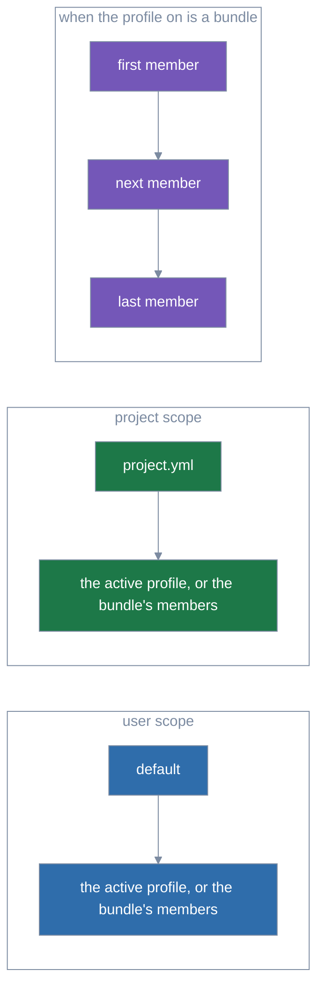

# Profiles

A **profile** is a named set of module entries, kept apart from the manifest (`project.yml`, the
file listing what a project always installs).
lola reads your own profiles, in `$XDG_CONFIG_HOME/lola/profiles/<name>.yml`; a project's,
committed in `.lola/profiles/<name>.yml` (see [Project profiles](#project-profiles)); and remote
profiles, fetched from a source and kept in `$XDG_DATA_HOME/lola/profiles/<name>/` (see
[Remote profiles](remote-profiles.md)). A **scope** is where lola installs: user scope (your home
directory, for every project) or project scope (one project, with its state in `.lola/`); see
[Scopes and targets](../usage.md#scopes-and-targets).

## Turning profiles on and off

Each scope has a **base**, always loaded, and at most **one profile on** over it. At user scope the
base is **`default.yml`**, your profile named `default`
(`$XDG_CONFIG_HOME/lola/profiles/default.yml`); in a project it is `project.yml`. `user.yml` is
no longer read. Turning `default` off means renaming or deleting it. The profile on is recorded in
the scope's `lock.json` as `profile` (its qualified name and the action that put it there), never
committed; `lock.json` is lola's ledger of what it installed in that scope ([Files lola
keeps](../usage.md#files-lola-keeps)). In these examples `go` and `docs` are profile names, such as
your `$XDG_CONFIG_HOME/lola/profiles/go.yml`:

```sh
lola profile go --switch             # go is the profile on, whatever was on; never asks which
lola profile go --on                 # turn go on when none is; with another on, asks (or refuses off a terminal)
lola profile --off                   # turn off the profile on; asks before removing files (-y)
lola profile base --switch           # the same: back to the base alone
lola profile go --switch --dry-run   # show what it would change
```

Every scope command (`install`, `uninstall`, `sync`, `update`, `list`, `info`, `check` when it reads
the scope's entries, `tidy`, `repair`, and `lola profile` listing, showing, `--on`, `--off` and
`--switch`) starts with a context line on stderr naming the scope, its base and the profile on
(`project /home/me/src/acme: profile go over project.yml`); `--json` carries it as `context`. After
a change of the profile on, the summary ends with the new one (`now: user scope: profile go over
default`).

The actions have aliases for muscle memory from other tools: `--on` (`--enable`, `--activate`),
`--off` (`--disable`, `--deactivate`), `--switch` (`--use`), and for [remote
profiles](remote-profiles.md) `--add` (`--get`), `--update` (`--upgrade`) and `--remove` (`--rm`,
`--delete`, `--del`, `--erase`, `--uninstall`); help shows them beside each flag, and messages use
the canonical names.

An action names one profile (`--off` may name none); two names refuse, and so do two actions in
one run (`--on and --off cannot be combined; pick one`). To have two profiles on, make a
[bundle](#bundles) of them: `--switch` and `--on` with two names refuse with the command that does
(`one profile is on at a time; to combine go and docs make a bundle`, hinting `lola profile
go-docs --switch --new --bundle go,docs`), and `--off` with two names refuses with `--off` for each
(`one profile is on at a time; --off takes one name`).

`--switch` is the way scripts change the
profile on: it never asks which.

`--on` with another profile on asks on a terminal (`user:go is
on.` with up to four answers: switch to the named profile, make a bundle of both and switch to
that, add it to the bundle on, which stays on, or cancel) and off one refuses, hinting `--switch`,
the bundle of both and, when the profile on is a bundle of yours or the project's that can take
another member, adding it to that bundle.

`--switch go docs` still refuses, hinting the bundle:
`--switch` is the way that never asks. It resolves its scope as
`sync` does ([Choosing a scope](choosing-what-to-install.md#choosing-a-scope)) and applies only what
the change moves: each module is loaded, replaced (another layer's entry wins now) or unloaded (no
layer wants it any more; never one another layer still wants).

Anything else the scope is waiting for, such as an entry you added to `default.yml` and have not
synced, is left to `lola sync`, with a notice (`2 other changes are pending → lola sync --user`).
Whenever the change removes files it asks first, on a terminal; `-y` confirms, `--force` removes
without asking (edited files too), and off a terminal without either it refuses, naming the
command that would, with the profile by its qualified name. Neither `-y` nor `--force` answers
`--on`'s question.

`--trust` and its [kinds](choosing-what-to-install.md#trust-kinds) work as for `lola sync` (a
project profile's changes are `profiles`), except that the trust question offers only Trust all or
Cancel: an action applies all of its changes or none. The new profile is written only with a
successful apply: a No, a refusal, an error or Ctrl+C leaves the old one and the old files.

`base` is reserved for the scope's base: no profile is named `base`. A `base.yml` in a profiles
directory is listed as a warning (`base is reserved for the scope's base; rename <path>`), never
as a profile, and `user:base` refuses with the rename that makes it usable (`rename <path> to
<dir>/base-old.yml to use it as the profile user:base-old`). A `lock.json` from before the
reservation that names `user:base` refuses with the same rename and the `lock.json` edit that
follows it.

A profile already on (`user:go is already on`) or not on is a notice and changes nothing. The base
is named `base` (at user scope `default` too): `--on base` is a notice (`the base is always
loaded`), refused while a profile is on; `base --switch` with none on is a notice (`already on the
base`); `--off base` is refused; at project scope `default` is refused (`default is user scope's
base; this project's base is project.yml`).

The summary names the profile the run turns on or off with its file (`Profile user:go (<path>) →
on`; one already as asked is its notice alone) and lists each change (`+ a  <version>
profile:user:go`, `~ c  …  profile:user:go overrides profile:default`, `- a  …`) and is paged as
`lola sync`'s diff is; `--json` gives the sync's document, its `trust` object included, plus
`profile` (the profile on after the run, or `null`) and `changes` (`{module, action:
load|replace|unload, from, over}`). Each change line names the version installed after the switch;
an entry of yours keeps the commit its pin records (`~ cc-skills-golang  897c0d803c71  …`).

An active profile whose file is gone is a warning (`profile user:go is on but no longer exists →
lola profile --user user:go --off`), and the run treats it as off; `--off` takes it by either
name.

**Removing a profile of yours.** `lola profile user:try --remove` (or `try`, when no remote profile
has the name) moves the file to lola's trash (`$XDG_STATE_HOME/lola/trash`), asking first on a
terminal (`-y`); a link goes as a link. It is refused while the profile is on, in the bundle on, or
in a bundle the one on nests, hinting the `--off` that frees it (`--force` removes it anyway and
answers the question).

A bundle of yours that lists the removed profile then refuses to load; the
warning prints the run that takes it out (`lola profile mine --edit --bundle …`), and `--off` and
`--edit --bundle` still work on it.

A project's profile is committed: `git rm` it. The base is
never removed. Modules the profile installed stay until each scope's next `lola sync`. `--remove`
of a remote profile works as in [Remote profiles](remote-profiles.md).

## Writing a profile

A profile has the shape of a manifest, with an optional `description`:

```yaml
version: 1
description: Go tooling          # optional, at most 256 bytes
targets: [claude-code]           # optional; entries without targets use these
modules:
  - name: go-style
    source: https://github.com/example/go-style
    ref: v1.2.0
  - name: notes
    source: ../notes             # relative to this file's directory
    skip: [skill/draft*]         # components of this module this profile leaves out
```

An entry takes a manifest entry's keys, plus `market:` and `components:` (the provenance a
marketplace install records) and the picks `only:` and `skip:`, lists of `kind/name` selectors
(`skill/review`, `command/ship*`; no module prefix, the entry names it). A remote profile's entry
takes none of those four. `lola install` and `lola uninstall` write your profiles (and a project's)
when you tell them to, as [Where your edits go](#where-your-edits-go) says, keeping your comments
and order, and never a pin into one of yours.

A profile lists modules, or it is a **bundle** that combines other profiles, and never both:

```yaml
version: 1
description: Go and docs work
bundle: [go-review, docs, remote:go]
```

A bundle has no `targets:` (its members' apply) and lists at most 64 names, each once. lola
refuses a file with both `bundle:` and `modules:`, naming the line, and offers to split it
(`lola profile <name> --split`; see [Bundles](#bundles)). The `extends:` key is gone: a file
that still has it refuses at its line with the edit that keeps what it did (`extends: is no
longer a key; a bundle combines profiles now`).

## How the layers stack

How the layers of a scope stack, a later entry of a module replacing an earlier one whole:



- **Precedence.** When two layers list one module, the later one's entry wins whole.
  - At user scope: `default`, then the profile on (a bundle's members, in order).
  - At project scope: `project.yml`, then the profile on (a bundle's members, in order);
    `default` never applies to a project.
  - A profile cannot hide a module its base gives: to have a module in some profiles only, move
    it out of the base into those profiles (`lola profile --move <module> --to <profile>`; see
    [Moving a module](#moving-a-module)).
  - An install writes the file [Where your edits go](#where-your-edits-go) names; where a higher
    layer lists the module, that entry keeps winning: the install writes its entry, installs
    nothing of it, and, when the entries differ, says `gopls: profile go's entry wins; this change
    to project.yml (base) applies when it is off`.
  - No field is merged, [vars](templating.md#vars) included.
  - When the entries differ, a notice says so: `gopls: profile:user:go overrides project.yml (v2.0
    over v1.2)`.
  - When the replaced entry set vars, the notice adds `; gopls's vars from project.yml are
    dropped: the entry from profile:user:go sets none` (or `sets its own`).
  - `lock.json` records the profile that won (`from`).
- **Targets.** An entry without `targets` uses its profile's `targets`, else the scope manifest's.

## Where your edits go

`lola install` and `lola uninstall` each write one file per scope, the first that applies:

1. `--profile <name>`: that profile. `base` is the scope's base (`default` names it too at user
   scope; at project scope it is refused).
2. The profile on, when it is yours or the project's. When it is a [bundle](#bundles), the member
   you pick (see below).
3. While a remote profile is on: the base, once you say so. A terminal asks; off one the command
   refuses, hinting `--profile base`.
4. The base: `project.yml` in a project, `default.yml` at user scope.

```sh
lola install go-style                       # into the profile on, else the base
lola install go-style --profile docs        # into docs; if docs is off, saved and not applied
lola install go-style --profile base        # into project.yml, or default.yml at user scope
```

A profile that is off is written and nothing is applied: `saved to profile docs; it is not on at
user scope → lola profile --user docs --switch`. Its move hints name that profile as the move's
source (`lola profile --user docs --move go-style --to base`), and a move into a profile that is
off keeps it off (`--keep-off`); nothing of the module is installed here to move. After a write to
a project's profile that is off, no move is hinted.

**Changing a module another layer provides** (the base under the profile on, or a remote profile
as a member of the bundle on) asks where: change it in that layer (`--profile base`) or override
it in the profile on (`--override`, which copies that entry without its pin and keeps the version
installed; under a bundle, in a member of yours, `--profile <member> --override`). A read-only
layer, a remote profile, offers Override alone; a request equal to the inherited entry is a notice.
`-y` and `--force` never answer it. Off a terminal the command
refuses and prints both flag forms:

```
error: gopls comes from default (base); lola install needs to know whether to change it there or override it in profile go, and there is no terminal to ask on
  hint: lola install gopls --skip skill/slow --user --profile base
  hint: lola install gopls --skip skill/slow --user --override
```

An install that changes only picks keeps the installed version, as an override does; `lola update`
moves it. An override never copies a `project.yml` entry you have not trusted.

**Write lines.** Each entry written prints one, naming the file:

```
✓ added gopls to profile go  (/home/me/.config/lola/profiles/go.yml)
✓ removed gopls from default (base)  (/home/me/.config/lola/profiles/default.yml)
```

A file of yours shows its path (`, new` when the run created it); the base or a project profile says
`shared: git tracks it` when git does; under `-n` the line starts `→ would add`.
[`--json` carries them as `edits`](../usage.md#output-contract).

**`lola uninstall`** removes the entry from the layer the module comes from: the profile on (under a
bundle, the member it comes from), or, for a module the base provides, the base, once you say so
(`--profile base` answers off a terminal). Where exactly one layer lists the module, `-y` is that
answer too (not under `-t`, whose "change it there" question needs a terminal or `--profile`);
where several do, name one with `--profile`, and the hint keeps your `-y`.

A module another layer
still lists stays installed, and the notice names that layer and the command that removes it there
too (`→ gopls stays: default (base) lists it too → also remove it there: lola uninstall --user
gopls --profile base`).

With `-t` and `--profile` naming a lower or off layer, it narrows that
entry's targets and removes no files, and asks nothing; a run that removes no files asks no
confirmation.

## Editing a profile

`lola profile <name> --edit` is `lola install` of the modules into that profile
(`lola install --profile <name>`), so it asks and refuses what an install does. Its aliases are
`--pick` and `--modify`.

- **`lola profile go-review --edit cc-skills-golang --only skill/golang-testing`** writes
  go-review's entry as `lola install --profile go-review` would, and applies it where go-review is
  on (saved where it is off).
  - `--only` means what it means for `lola install`: the entry skips
    every other component that exists now, so components a later version adds are installed (a long
    list of skips is written one a line, and `lola profile <name>` shows it as `only (not exact):
    <picks>; <n> others skipped`);
  - `--only … --exact` writes the entry's `only:` list instead, so they are not.
  - `--skip` and `--unskip` edit it too.
- **What the profile picks**: `lola profile go-review` lists each entry's `only:` and `skip:`; when
  a profile's entry replaces a lower layer's, the override notice says that entry's picks are
  dropped (`cc-skills-golang's picks from default (base) are dropped: the entry from profile
  go-review sets none`).
- **One scope.** The edit asks no scope: it uses the scope flag's, else the project found from
  here, else user scope. A profile of yours that is also on in the other scope is written once and
  applied in each scope where it is on, each with its context line and result.
- **No name** edits the profile your edits go to: the profile on, or the base. Under a bundle it
  asks which member, as an install does.
- **On a terminal, no module** opens the profile's page: its modules ticked, then each one's
  components (`profile go-review › cc-skills-golang › skills`). Untick a module to remove it from
  the profile; the review lists what goes, and No keeps it. A bundle's page lists the profiles it
  can combine, its members ticked. `-n` opens the page, asks, and writes nothing.
- **A module another layer gives** asks whether to change it there or give the profile its own
  entry.
  - On a terminal it asks first, then opens the module's component page titled with the
    file your answer writes (`profile go-review › cc-skills-golang › skills`, or
    `default (base) › cc-skills-golang › skills`).
  - Off a terminal, `lola profile base --edit
    <module> …` changes it there and `lola profile <name> --edit <module> … --override` gives the
    profile its own.
  - `--override` is
    refused for a project's entry its own sync has not trusted, and for one whose folder lies inside
    a project, whether it is `lola profile --edit` or `lola install` that copies it.
- **Narrowing picks removes files**, asked on a terminal as `lola uninstall` asks; off one it
  refuses, printing the files and hinting the same command with `-y`, and `--force` answers without
  asking. `-n` shows the plan and writes nothing. A change that only
  adds components asks nothing. A file you edited by hand is kept and refused, hinting `--force`.
- **`--new`** makes the profile: with modules, written with them; without, empty, a copy
  (`--from <profile>`) or a bundle (`--bundle a,b`). Nothing is switched on. On a terminal with
  no modules the page asks whether it lists modules or bundles profiles.
- **`lola profile work --edit --bundle go-review,docs`** sets a bundle's members in place, in
  order (`''` for none), making a bare one that names no profile, and applies them where the
  bundle is on or nested in the bundle on; what that removes asks first. It refuses a profile that
  lists modules, the base and a remote profile, each with a run that works. A project's bundle is
  the team's: a member list pulled and not yet trusted is asked about first, never written along
  with your edit unseen.
- **The first name** is the profile when a profile has it and no module does, or `base`,
  `default`, a qualified name, or any name with `--new`; otherwise every name is a module and the
  edit goes to the profile edits go to. A name that is both a profile and a module asks on a
  terminal and is refused off one, hinting each qualified (`user:go`).

Hints that add a member to a bundle or take one out are runs of this command
(`lola profile work --edit --bundle go-review`).

## Moving a module

An install that landed in the wrong file is fixed by moving the entry, not by uninstalling and
installing again: `lola profile --move <module>... --to <name>` (alias `--mv`) takes whole entries
out of the layer each comes from and puts them into `<name>`, in one transaction, and applies it.
The version installed is kept, so nothing is fetched again and no installed file changes.

```sh
lola profile --move my-notes --to me --user               # from where it comes from into your profile me
lola profile --move a,b --to base --user                  # the base: default.yml, or project.yml in a project
lola profile default --move my-notes --to me --user       # from default, named first
lola profile --move my-notes --to me --user --switch -n   # show what it would write
```

```
user scope: default
✓ new profile me  (/home/me/.config/lola/profiles/me.yml)
✓ removed my-notes from default (base)  (/home/me/.config/lola/profiles/default.yml)
✓ added my-notes to profile me  (/home/me/.config/lola/profiles/me.yml)
Profile user:me (/home/me/.config/lola/profiles/me.yml) → on
✓ 1 unchanged
now: user scope: profile me over default
```

- **The source.** The layer the module's entry comes from, or the one you name before `--move`: a
  profile, `base`, or `default` / `project.yml` for a base. A module no layer lists is refused.
- **Picks.** The entry takes its `only:` and `skip:` with it. A module moved out of `project.yml`
  into a profile takes its picks from `selections.yaml`'s section of the project: they become the
  profile entry's (an `include:` joins its `only:` list), leave `selections.yaml`, and the write
  line says `picks: carried from selections.yaml`. A profile entry has no `include:`, always
  takes the global `skip:` and never the global `only:`, so the move is refused when, for a
  component of the version installed:
  - an `include:` keeps it while the global `skip:` skips it;
  - an `include:` keeps it while another `skip:` selector of the section skips it (a glob such as
    `skill/*` beside `include: [skill/a1]`), with or without an `only:` list;
  - the global `only:` list leaves it out and the section has no `only:` list of its own.

  A glob `skip:` with no `include:` over it, an `include:` beside an `only:` list, and a `skip:`
  equal to an `include:` all carry. The refusal names each module, the selector and the files the
  move would remove or install; `--force` moves anyway, `-n` shows the refusal beside the plan,
  and lola hints no move after the install.
- **The target.** `--to` takes a profile of yours or the project's, or `base`. A name no profile
  has creates your profile (`✓ new profile me`, and `created` in `--json`). A target the module's
  entry already comes from is refused (`kit is in default (base) already`); one that lists the
  module while its entry comes from another layer asks to replace that entry (`-y` or `--force`).
- **A target that is off.** The move must say what happens to a profile it adds to:
  a terminal asks whether to switch to it or keep it off; off a terminal the run refuses and
  hints both forms.
  - `--switch` switches to the target too: the profile that was on goes off, and what only it
    wanted is removed, asked as `lola profile --switch` asks.
  - `--keep-off` leaves the target off, so the moved modules' files are removed in this scope
    (asked; `-y`).
  - Neither answers the other: both together are refused. `-y` and `--force` do not answer the
    question. Both are refused with `--to base`, which is always loaded.
- **Across scopes.** A module that only the other scope provides moves from there:
  `lola profile --move <module> --to base --user` from a project, or `--to user:<name> -C <dir>`
  from user scope, into a project's profile of yours.
  - It is two applies, the target's first and
    the source's second, under both scope locks (projects first, user scope last). A failure between
    them leaves the module in both places, which is reported, never a loss.
  - Moved installs keep the
    targets and the version they were installed at, even where `pins.yaml` pins the key: that pin
    stays, and the next `lola sync --user` applies it.
  - Moving out of a project moves only what it
    installed as you trusted; anything the project's trust record does not cover is refused with
    `lola sync` as the way to review it first, and an entry of a project profile that is off with
    `lola profile <name> --switch`.
  - The source is read again under the locks after every question:
    one that changed meanwhile is refused, and nothing is written.
- **Into a profile of yours in a project.** What a profile of yours lists is yours, so nothing asks
  about it. A move from `project.yml` or a project profile into one is held to the same rule as a
  move out of the project: only what the project installed as you trusted moves.
- **A project's folders stay in the project.** A move out of `project.yml` or a project profile into
  a file of yours (within the project or across scopes) is refused when the entry's folder or local
  archive lies inside a project: `notes (<file>) installs from <path>, inside project <root>:
  changes there install without review wherever that file is on; lola keeps a project's local
  modules out of your files`.
  - In your file it would be yours, which nothing asks about, so the next
    pull there would install unreviewed wherever that file is on.
  - Moves between a project's own files are unaffected.
  - `lola install` of such a folder into a file of yours warns with that text up to
    the semicolon, once, at that write (see [`lola install`](../reference/install.md#lola-install)).
- **Refused.** A remote profile, as source or target (it is read-only); `project.yml` as a target
  from user scope; a module both scopes provide, for a cross-scope form (the refusal hints the run
  from each source). Every refusal comes before anything is written.
- **Shared files.** A move into or out of `project.yml` or a project profile writes a file git
  tracks, so each write line says `shared: git tracks it`.

After an install lola hints the move that fixes a wrong target, printed as a command that runs as
shown in the state the install leaves:

```
✓ added extra to default (base)  (/home/me/.config/lola/profiles/default.yml)
→ meant for another profile? lola profile --user --move extra --to me
```

The hint names a profile of yours that lists none of the modules (at most two, then a listing),
or the base, or, after a write to a shared file, a new profile; it adds `--switch` when that
profile is off, and never `-y`: the move asks before it removes anything, and off a terminal it is
refused with a hint that adds `-y`. A switch that turns another profile off says so in the hint. A hint never names `project.yml`, a project profile or a bundle as the target and never
carries `--trust`. One install's added modules share one line (`--move a,b,c`).

## Bundles

A bundle combines profiles into one. It has its own page: [Bundles](bundles.md).

## Folders, pins and a missing manifest

- **Folders.** A relative folder or archive path resolves against the profile file's directory.
  Your profiles are trusted as `default.yml` is: their entries are never asked about, and their
  folders may be anywhere, even at project scope.
- **Pins.** lola writes a profile of yours only on `install` or `uninstall`, and never a pin into
  it; it writes pins only into a project's profiles ([Pinned in place](#project-profiles)). In
  yours:
  - An unpinned git or archive entry installs what its ref serves when it is first synced.
  - `lock.json` keeps that version, which later syncs install, until `lola sync
    --update <module>` (with the scope's flag) resolves the ref again.
  - To fix a version for good, write `commit` and `digest` into the profile yourself. `commit` is
    the full commit id a git fetch resolved (40 or 64 hex digits); `digest` is `sha256:` followed by
    the 64 hex digits of the sha256 of the module's content.
  - A pinned profile entry installs that pin. `lola sync --update <module>` refuses it (`edit the
    pin in <path>`), while `lola sync --update` without names leaves it at its pin, with a notice.
- **No manifest needed.** A scope with no manifest (`default.yml` at user scope, `project.yml` in a
  project) but a profile that lists
  modules syncs as if the manifest were empty, and so does one whose profile is gone but whose
  modules are still installed (they are removed); with none of these, `lola sync` still refuses.

## Listing and showing profiles

- **Seeing them.** `lola profile` lists the profiles each scope can use, and `lola profile go`
  shows one.
  - The listing gives each profile a state: `base` (`default`, at user scope), `on`,
    `in bundle <the one on>` for a profile or nested bundle the bundle on reaches, or `off`;
    `(bundle)` follows `on` and `off` for a bundle. A file that does not load, or a bundle that
    does not expand, is listed all the same, with a notice.
  - It shows, per scope, its state (as above) and, for each of its modules, the layer the scope
    takes it from (`b  profile:user:go  (over profile:default)`).
  - A name is the profile's file name without `.yml`; `user:go` says it is yours, and `default`
    exists at user scope only.
  - Files in a profiles directory whose names are not valid profile names are counted (`1 file
    with an invalid name in … is not a profile`), never shown.
  - `--json` gives `profiles` and `notices`. Each item of `profiles` has:
    - `name`, `kind`, `path`, `source`, `ref`, `commit`, `digest`, `active`, `state`, `bundle`,
      `scope` and `shadowed_by`;
    - `state` is `base`, `on`, `member` or `off`, and `active` is `state` other than `off`;
      `bundle` says the file is a bundle;
    - `members`, a bundle's members (qualified) as lola expands them, in a listing too; `[]` for a
      profile that lists modules, and for a bundle that does not expand;
    - with a name, also `modules` with `name`, `from` and `overrides`, and `read_as`, the profile
      of yours read in place of an active remote one, else `null`.
  - A bundle shows `bundle of <members>` beneath its path, the members in load order, a remote
    one this machine lacks included.
  - `--plain` rows are scope, name, kind, state, `bundle` (empty for a profile), members
    (comma-separated) and path (with a name: scope, module, from and the overridden layers),
    followed by a `notice` row (`notice`, level, text) per notice, as `lola list --plain` has.
  - At project scope a bare name is the project's profile or yours. A name both of them define is
    refused until you qualify it:
    - The refusal reads `go is ambiguous: your profile user:go (<file>) and the project's
      project:go (<file>) are both named go`.
    - It has a hint for each that is your command, flags included, with the name qualified
      (`yours: lola profile --project user:go --on`).
  - With `--off`, a bare name turns off the profile on when it has that name, whichever kind it
    is and whether or not its file is still there; when neither of them is on, nothing changes
    and lola says so (`neither user:go nor project:go is on`).

## How lola reads a profile

- **Reading.** A profile is read as strictly as `project.yml`:
  - one YAML document of at most 1 MiB;
  - version first (a newer lola's file asks you to upgrade lola);
  - known keys only;
  - at most 512 entries, each checked as a manifest entry;
  - for a bundle, a `bundle:` list of at most 64 names that are strings, each a valid profile
    name, none repeated, beside no `modules:` and no `targets:`;
  - every refusal names the file and line (`go.yml:2: unknown key "foo" (a profile has: …)`), an
    unknown key lists the keys that are allowed there, and a value of the wrong kind says what was
    expected (`only: expected a list, found text`);
  - an empty file (0 bytes, or only comments) is an empty profile: it is accepted and holds no
    modules.
  - A profile may be a symbolic link (a dotfile manager's), as `default.yml` may; one that is not a
    regular file (a directory, a FIFO) is refused.
  - Each profiles directory (`$XDG_CONFIG_HOME/lola/profiles/`, a project's `.lola/profiles/` and
    `$XDG_DATA_HOME/lola/profiles/`) may hold at most 256 entries. In the first two, a file whose
    name is not a valid module name followed by `.yml` is not a profile.

## Walkthroughs

Worked examples of profile commands. It has its own page: [Walkthroughs](profile-walkthroughs.md).

## Remote profiles

Profiles fetched from a git repository or an https archive, and shared by every scope, are
covered in [Remote profiles](remote-profiles.md): adding one with `lola profile --add`, fetching
it again with `--update`, and deleting it with `--remove`.

## Project profiles

A project can commit profiles for its team in `.lola/profiles/<name>.yml`, in the same format.
They are listed and used at that project's scope only, by their file name or as `project:<name>`
(`lola profile project:go --on`), and turned on per checkout like any profile: committing one
turns nothing on. A project cannot define `default`: a `default.yml` there is not a profile, and
every listing says so (`a project cannot define default; rename <path>`).

A project profile came with the project, so lola treats it as it treats `project.yml`:

- **Reviewed before use.** The entries of every active project profile, and of one being turned
  on, are checked against what you last trusted, as `project.yml`'s are
  ([Sync, pins and trust](sync-and-trust.md#sync-pins-and-trust)).
  - A pulled change is shown in the diff under its profile (`in profile project:go
    (.lola/profiles/go.yml):`) and needs your answer or `--trust` before anything is fetched.
  - A change to a profile that is off is reviewed when you turn it on.
  - Only the entries that win are checked: an entry another layer overrides (`project.yml`'s, or a
    later profile's) is reviewed, with what it installs, when it starts to win, whatever makes it
    win (a sync after `project.yml` drops the module, or turning the other profile off), so one
    profile may be asked about in two steps.
  - A project bundle's member list is trust content too: a pulled change to it is shown as `~
    bundle  [review] → [review, lint]` under the bundle and asked about as a profile's change
    (`--trust=profiles`), a reorder included, since the order decides which member wins. Until you
    trust it, what the changed list brings stays as installed.
  - An entry without `targets` installs to the profile's `targets`, so changing those changes each
    such entry. A project profile's top-level `targets:` is trust content: sync shows a change to
    it as a `~ targets` row under the profile, and Trust all accepts it.
  - `lola update` asks about a module whose project-profile entry you have not trusted, as it does
    for `project.yml`'s.
- **Pinned in place.** `lola sync` pins an unpinned git or archive entry, with your trust, by
  writing `commit` and `digest` into the profile file (comments and other keys kept), and
  `lola sync --update <module>` re-pins it, as for `project.yml`. Commit the result so your team
  installs the same version. An entry `lola install` or `lola uninstall` writes there carries its
  pin and is recorded as trusted, as `project.yml`'s are; the write line says `shared: git tracks
  it` when git tracks the file.
- **Never replacing yours silently.** When a project gains a profile with the name of one of
  yours that is on there (`user:go`), lola leaves yours on.
  - `lola sync` (with or without `--trust`), other `lola profile` actions and listings say
    `project:go also exists → lola profile project:go --on` (with the scope's flag).
  - Turning it on, by `--on` or `--switch` naming it, puts it in your profile's place (the one
    case where `--on` replaces the profile on).
  - The action's diff shows `~ project:go now replaces user:go (a, b)` with the modules it
    changes, and its trust question (Trust all or Cancel), or `--trust`, covers it.
  - Cancel, and yours stays on.
- **Kept inside the project.** Relative folder and archive sources resolve against
  `.lola/profiles/`, and like `project.yml`'s must resolve inside the project, links followed.
  The diff and `lock.json` show them relative to the project root, as `project.yml`'s are
  (`../../mods/a` in the profile shows as `mods/a`). The profile files, `.lola/` and
  `.lola/profiles/` must be the project's own: a symbolic link there is refused before anything
  is read, by every run at project scope with any profile on, yours included.
