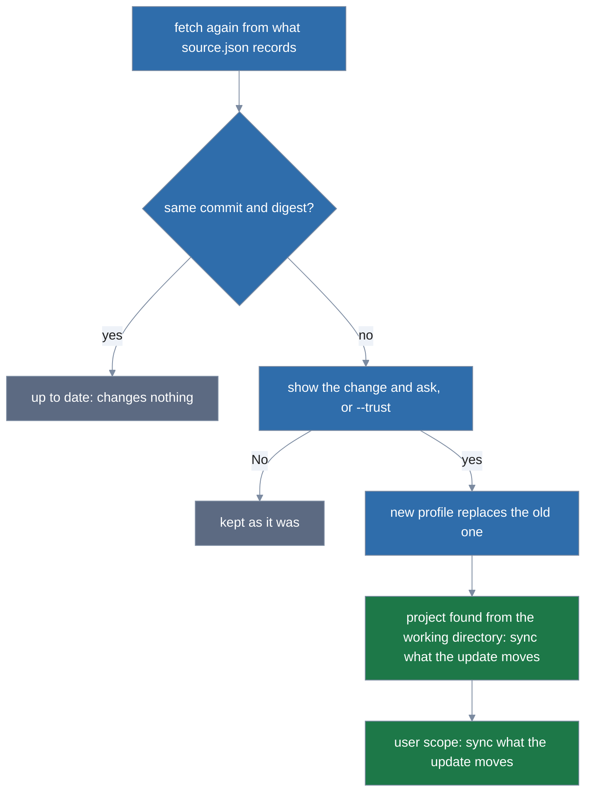
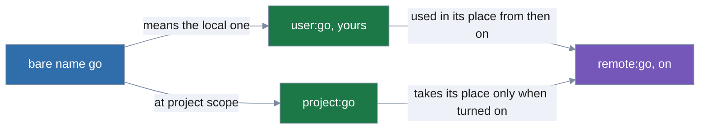

# Remote profiles

Remote profiles are profiles fetched from a source, a git repository or an https archive, and
shared by every scope. To write your own profiles and turn profiles on and off, see
[Profiles](profiles.md).

A remote profile is one someone shares from a git repository or an https archive. lola keeps
each in `$XDG_DATA_HOME/lola/profiles/<name>/`: `profile.yml`, the file as fetched, and
`source.json`, where it came from and its pin (the commit, and the digest of `profile.yml`). It
lives with lola's data, not the cache, so clearing the cache never drops a profile that is on. It
is used at user scope and in any project, by its name or as `remote:<name>`.

```sh
lola profile go --add https://github.com/example/profiles         # fetch profiles/go.yml, show it, ask
lola profile --add https://github.com/example/profiles            # on a terminal: pick among its profiles
lola profile go --add https://example.com/p.tar.gz --path team    # team/profiles/go.yml in an archive
lola profile go --add https://github.com/example/profiles -n      # show it, keep nothing
lola profile remote:go --on                                       # adding turns nothing on
lola profile go --update                                          # fetch it again, show the change, ask, apply in each scope that uses it
lola profile --update --all                                       # every remote profile, each asked on its own
lola profile go --remove                                          # delete it; asks (-y)
```

- **Adding.** `lola profile <name> --add <source>` (alias `--get`; `go` or `remote:go`) fetches a
  remote profile, shows it, and asks before keeping it.
  - It fetches the source, at `--ref` (a branch, tag or commit of a git source), into lola's
    staging and reads `profiles/<name>.yml` under its root, or under `--path`.
  - The source must be a git repository (`https://`, `ssh://`, `user@host:path`) or an `https://`
    archive at a host named by name.
  - These are refused before anything is fetched (`… names the private address 10.0.0.7; a remote
    profile reaches hosts by name only, never inside your network; use the repository's https://
    or ssh:// URL (or user@host:path), with its host name`):
    - a folder, a local archive, a `file://` URL, a URL lola cannot parse, and plain `http://`;
    - `localhost` and `*.localhost` (with or without trailing dots);
    - a host given as a loopback, link-local, unspecified, private, carrier-grade NAT or site-local
      IP address (an IPv6 address that embeds an IPv4 one, such as `::127.0.0.1` or
      `64:ff9b::7f00:1`, counts as that address);
    - a host whose last label is a number in any form but `a.b.c.d` (`2130706433`, `0x7f.1`,
      `127.1`);
    - a hostile ref, a remote helper (`ext::`), `git://` and credentials in the URL.
  - Only `profiles/` is fetched, and a symbolic link in it, or on the way to it through `--path`,
    is refused before anything is read.
  - The profile is read as strictly as any other, and each of its modules is fetched at its pin to
    show:
    - under a header naming the file every scope shares and the scope it is compared with
      (`remote:go → <path> (shared by every scope); content compared with project <dir>`) and the
      profile's source and pin;
    - every entry with all the MCP servers, hooks and files it brings, whatever that scope's
      `lock.json` says, which only notes when it has this version installed;
    - in the viewer, as `lola sync`'s diff is. Printed without it, the files are capped with the
      `-n --json` command that lists them all, which names the profile even when you picked it:
      `lola profile remote:go --add <source> -n --json`.
  - Then it asks. Nothing is kept or cached before you say yes: a No or Ctrl+C leaves no trace.
    Other lola commands go on while it asks.
  - Without a name, a terminal offers the source's profiles to pick from (filterable, nothing
    preselected; files whose names are not valid profile names, and `default.yml`, are only
    counted). Off a terminal it refuses, naming them, with the command that adds each (that shows
    each, for `-n`).
  - A `--path` the source does not have, and a source without `profiles/`, are refused saying
    which (`the source has no profiles/ directory at its root`).
  - **`--trust` and `-n`.**
    - `--trust` takes the `profiles` kind, all `--add` takes; any other kind,
      `--trust=entries,profiles` written out included, is refused.
    - Off a terminal `--trust` accepts what it shows, after its receipt, which on a terminal asks
      `Proceed?` (`--add` takes no `-y`).
    - Without it lola refuses off a terminal before any network contact, hinting the run with
      `--trust=profiles`.
    - `-n` shows it and keeps nothing.
  - **Refused names.**
    - A remote profile of that name already kept is refused (`lola profile remote:<name>
      --update` fetches it again; the hint keeps the run's flags but `--trust`, which answered the
      add, never an update's change).
    - So are the name `default`, a `user:` or `project:` name, and a file in the profile's place.
  - **Scope.** `--add` asks no scope: the profile is shared by every scope.
    - `--project`, `--user` or `-C <dir>` only names the scope its content is compared with.
      Without them it is the project found from the working directory, else user scope
      (`--scope both` is refused).
    - Hints that repeat the run keep its flags (`--trust`, `-n`, `--json`, `--plain`,
      `--no-pager`; a hint that shows the profile, or adds it unasked, sets `-n` or `--trust`
      itself) and carry a scope flag only when you gave one.
    - A `.lola/` in your home directory is never that project: user scope installs there, so it is
      skipped, with a notice (`<home> has .lola/, but it is your home directory, where user scope
      installs; it is not taken as a project`).
    - When the found project cannot be read (its `lock.json` tracked by git, say), the refusal
      also offers the run at user scope (`or compare with user scope: lola profile --user go --add
      <source>`).
  - Adding turns nothing on (`turn it on: lola profile --project remote:go --on`).
  - `--json` gives `remote_profiles` (`profile`, `file`, `source`, `ref`, `path`, `commit`,
    `digest`, `previous_commit` and `previous_digest` (both `""` for `--add`), `compared_with`,
    `description`, `changes` as in the trust diff, `written`), `notices` and `dry_run`.

How `--update` reaches each scope that uses the profile:



- **Updating.** `lola profile <name>... --update` (alias `--upgrade`; `go` or `remote:go`) takes one
  or more remote profiles' names, or `--all` for every remote profile you have, and fetches each
  again from the source, ref and `--path` its `source.json` records, which are checked as a typed
  source is.
  - When the commit and digest are the same it says so (`remote:go is up to date with <source>
    (commit …, sha256:…)`) and changes nothing.
  - Otherwise it shows the old and new pins and how each entry changes, paged, and asks (`Update
    remote:go?`):
    - a changed entry as `~ example  rules (none) → false`;
    - a new entry with what it brings, a dropped one with `-`;
    - `(no entry changes)` when only the file's other fields changed.
  - **`--trust`.** `--trust` (its `profiles` kind) accepts it instead, and off a terminal without
    it lola refuses before any network contact.
    - With `--trust` of any kind the update writes nothing before one receipt that lists every
      profile it covers and what each scope's sync covers.
    - It keeps the profiles in memory, runs each scope's sync up to its receipt against them,
      then, on a yes, writes them and applies each scope.
    - A No, or Ctrl+C at any question, updates nothing (`aborted; nothing was updated.`).
    - A scope's sync refused before the receipt still keeps the update, after a receipt of the
      profiles, as below.
  - **One profile at a time.** Each profile is fetched, shown and asked about on its own, in the
    order named (by name for `--all`).
    - A No keeps that profile and goes on to the next (`declined remote:go; it is kept as it
      was`).
    - A profile that cannot be fetched, read, checked or written is kept as it was and reported
      (`✗ remote:go was not updated (the error says why)`). The run goes on, applies the others,
      and then fails, saying why each failed, with their hints (`1 of 2 remote profiles was not
      updated: remote:go: <why>`; a run of one profile fails with that profile's own error).
    - When every profile is declined, nothing was updated (`aborted; nothing was updated.`, after
      the run's notices).
    - A profile that changed while you were asked is kept as it was too (`remote:go changed while
      you were asked; it was not updated`).
  - **Ctrl+C.**
    - Ctrl+C at a question stops the run: the profiles already updated are kept and not applied,
      and the message names the `lola sync` that applies them (`aborted; remote:docs is updated,
      but not applied (lola sync --user example); nothing else was updated.`).
    - It is an error instead when a profile failed before, or a scope could not be read once the
      profiles were written (`… is updated, but not applied; the run stopped at Ctrl+C, and: …`,
      with that error's hints). The error counts and names each profile the stop left with the
      failed ones (`2 of 3 remote profiles were not updated: remote:docs: <why>; remote:zed:
      stopped before it was updated; remote:go is updated, but not applied; the run stopped at
      Ctrl+C`).
    - Ctrl+C while lola fetches or syncs ends the process, as for any lola command: what was
      written is kept, and the next `lola sync` of each scope applies it.
  - **Naming profiles.**
    - Without names or `--all` it refuses, listing your remote profiles with both forms (`name
      them: lola profile remote:docs remote:go --update`, `or every one: lola profile --update
      --all`), which drop `--trust` and `-y`: those answered only for what you named.
    - Names with `--all`, and a name given twice, are refused, and `--all` is refused with every
      other action.
    - `--update` of `user:go` or `project:go` is refused: those are files you edit.
  - The new profile replaces the old one in one step.
  - **Applying it.** `--update` asks no scope: the profile is shared by every scope, so lola then
    applies it in each scope it knows of that uses the profile (it is on, or an active profile or
    `default` extends it): the project found from the working directory, then user scope, as
    `lola sync --scope both` does.
    - In each, it applies what the update moves there, the modules whose winning entry it changes,
      with a `lola sync` of them, asking that scope's own questions: before it removes files
      (`-y`), about hooks, and about any project trust the change needs (`--trust`).
    - Any other change a scope was waiting for is left to `lola sync`, with a notice (`1 other
      change is pending → lola sync --user`).
    - A scope where the update changes nothing installed, or that does not use the profile, says
      so (`remote:go is not in use in project <dir>`).
    - Each scope's sync is reported after the update's own lines, under its own `project
      (<root>):` or `user:` line when both apply something.
    - lola keeps no list of every checkout, so a note says the others catch up later (`every other
      checkout that uses remote:go picks the update up at its next lola sync`).
  - **`--trust` without a scope flag** answers only the remote profiles' consent, never the found
    project's trust (its `entries` and `profiles` kinds; the others, `hooks` say, still answer
    each scope's sync).
    - On a terminal that question is asked.
    - Off one, a found project with changes you have not trusted refuses the update before
      anything is fetched (`project <dir> has changes you have not trusted (planted), which its
      sync asks about, and no flag named it: --trust then answers only for the remote profiles`),
      hinting the run with `--project`, or `--scope both`, and `--trust=` the kinds it needs.
    - That check reads the project's trust before the update, and a project profile that extends
      the updated remote profile changes what that project trusts: an unscoped `--trust` run off a
      terminal can then write the profile and have the project's sync refuse.
    - The error's `apply it later: lola sync --project …` hint applies it once you have reviewed
      the change (add `--trust`); naming the project up front (`--project … --trust`) avoids the
      stop.
  - **A scope lola cannot read.** A known scope lola cannot read refuses the update before the
    question, with the command that updates it in the other scope only (`or update it at user
    scope only: lola profile --user remote:go --update`), without `-y` or `--trust`, since the
    run's answers were given for every scope at once. Without a scope flag, the message names the
    changes in the project you have not trusted.
  - **Scope flags.**
    - `--scope both` means the same as no scope flag (with `-C <dir>`, that project and user
      scope).
    - With no `.lola/` project to name, or your home directory as that project (never taken as a
      found project either, with a notice), `--scope both` is refused, hinting the run with
      `--user` in its place (`update at user scope only: lola profile go --update --user`; `-C`,
      `-y` and `--trust` are dropped too).
    - `--project`, `--user` or `-C <dir>` alone narrows the update to that scope.
    - `--project` or `-C` naming your home directory is refused before anything is fetched
      (`project scope at <home> is your home directory, where user scope installs`), hinting the
      run with `--user` in its place.
    - In a narrowed run, the other scope you can see from there (user scope, or from user scope
      the project found from the working directory) is then read, never written:
      - when it uses the profile, a notice gives the command that applies it there (`remote:go is
        also on at user scope; apply it there: lola sync --user example`);
      - one that cannot be read is said so;
      - a narrowed run that finds the profile unused says `every scope that uses it picks the
        update up at its next lola sync`.
  - **A scope's sync that stops.** If a scope's sync stops, the update is kept, later scopes are
    not reached, and the error says so (`remote:go is updated, but not applied to the project: …;
    user scope was not synced`), with a hint `apply it later: lola sync --project example` for
    that scope and each one not reached.
    - A conflict would stop that sync again. A file you edited by hand gives the hint `apply it
      later, overwriting what the conflicts list: lola sync --project example --force` instead
      (without `-y` or `--trust`). A file another module owns gives none for that scope, the
      conflict naming what to remove.
    - Every such hint keeps `--json`, `--plain` and `--no-pager`.
    - A No at that sync's own question aborts the run, and the message names those commands (`…
      Apply it later: lola sync --project example, then lola sync --user example.`).
    - Under `--json` the error document carries the run's document (`remote_profiles`, `updates`,
      `notices`, `scopes` done).
  - **Flags in hints.**
    - Every hint that repeats the update keeps the run's flags (`--trust` as its kinds, `-n`,
      `--json`, `--plain`, `--no-pager`, `-y`), and a scope flag only when you gave one.
    - A hint that narrows the run to one of its scopes, or names more profiles than you named,
      carries no `--trust` or `-y`.
    - A `lola sync` hint keeps `--trust` (the kinds that answer a sync) and `-y` only when it names
      the modules the update moves; a whole scope's sync carries none, since it would answer for
      changes you never saw.
    - A `--remove` hint carries `-y` only as the `confirm it` hint of its refusal off a terminal,
      which asks for exactly that answer.
  - **`--json`** gives:
    - `remote_profiles` (with `previous_commit` and `previous_digest`);
    - `updates`, one per profile named, in order (`profile`, `file`, `outcome`: `updated`,
      `up_to_date`, `would_update`, `declined`, `failed` or `skipped`, and for a failure its
      `error` and `hints`);
    - `notices` and `dry_run`;
    - `scopes`, one per scope the run covers, in order (`apply` empty and `sync` `null` where
      nothing moves; `[]` when nothing was written): `scope`, `root`, `apply` (the modules it
      moves there) and `sync`, that scope's sync document or `null`.
    - A run that does not finish as asked (a failed profile, a scope not applied, a stop) prints
      that document as its error document, beside `error` and `hints`.
  - `--plain` prints one row per profile: its outcome (`updated`, `up-to-date`, …), the profile
    and its file.
- **Removing.** `lola profile <name> --remove` (aliases `--rm`, `--delete`, `--del`, `--erase`,
  `--uninstall`) deletes a remote profile's directory, after asking on a terminal; `-y` confirms,
  and off a terminal without it lola refuses.
  - It is refused while the scope you run it in, user scope, or the project found from the working
    directory uses the profile (`remote:go is on at user scope`, `remote:go is on in project
    <dir>`, or `remote:go is extended by user:mine, on at user scope`), and while one of them
    cannot be read to tell.
    - The refusal hints the `--off` that frees it, or editing the `extends:` that names it (the
      only way for `default.yml`).
    - None of these hints carries `-y`, which answers only whether to remove the profile; `-n`
      (`--dry-run`) and the run's `--json`, `--plain` and `--no-pager` are kept.
    - lola keeps no list of every checkout, so other projects are not checked.
  - `--force` removes it anyway, turning those checks into warnings, and answers the question, off
    a terminal too.
  - Its modules stay installed until each scope's next `lola sync`, which warns that the profile
    is on but gone and removes them (asking first); a profile that extends it refuses until you
    edit its `extends:`.
  - `-n` (`--dry-run`) says what it would remove, and the command that removes it.
- **Your consent is its pin.** A remote profile is yours once you accept it, so its entries are
  never asked about in the trust diff of a project.
  - Every entry must carry its pin (`commit` and `digest` for git, `digest` for an archive).
  - Every entry must name a git repository or an https archive over `https://` or `ssh://` at a
    host named by name, never a path on your machine, plain `http://`, `localhost` or an address
    inside your network. An IP address counts only in its `a.b.c.d` form: `2130706433` or
    `0x7f.1`, which git still connects to, is refused.
  - A remote profile with an entry that does not, or whose `profile.yml` no longer has the digest
    `source.json` records, refuses every run that uses it, hinting the commands that replace it:
    - `remove it: lola profile remote:go --remove --force` (it is in use wherever it was read, and
      no check of that can pass; `--force` answers its question, so the hint needs no `-y`);
    - then `then add it again: lola profile go --add <its source>` when `--add` accepts the source
      `source.json` records, or why it does not.
  - An entry's URL is never looked up on disk, so a directory a checkout names like it never
    stands in for it.
  - `lola sync --update <module>` refuses a module whose pin a remote profile sets (`update it:
    lola profile remote:<name> --update`).
  - lola does not resolve host names: a name that points inside your network, or a server that
    redirects there, is still fetched; add profiles only from sources you trust to that extent.

How a local profile shadows a remote one of the same name:



- **Local beats remote.** A profile of yours, or of the project at its scope, shadows a remote
  profile of the same name.
  - A bare name means the local one, and listings say `(shadowed by user:go)`.
  - `lola profile remote:go --on` is refused while it is shadowed (`use yours: lola profile
    user:go --on`, or build on it with `extends:`, or rename or delete yours).
  - When you write a profile with the name of a remote one that is on, yours is used in its place
    from then on (`user:go now replaces remote:go`), while the active list keeps `remote:go`:
    - delete yours and the remote one is used again;
    - `--off` of it takes `remote:go`;
    - `--on` of yours changes nothing (`user:go is already on, in place of remote:go (1st of
      1)`).
  - A project profile never replaces it on its own: as for your profiles, lola says `project:go
    also exists → lola profile project:go --on`. Turning that on puts it in the remote profile's
    place as a trust change, dropping every other active profile of yours or remote one of its
    name.
- **Seeing them.** `lola profile` lists them with kind `remote`.
  - `lola profile remote:go` shows the source, ref, commit and digest (`source`, `ref`, `commit`
    and `digest` in `--json`, `""` for a local profile) and its modules.
  - An active remote profile that a profile of yours now shadows shows `user: 1st of 1, read as
    user:go; its modules:` and lists the remote profile's own modules.
  - One that a project profile shadows stays in effect until you turn that on: `project (<dir>):
    1st of 1, in effect; project:go would take its place if turned on`, with `to use project:go
    instead: lola profile --project project:go --on`.
  - When both are on, it says so instead (`project:go is on too, 2nd of 2, and its entry wins
    where both list a module`): the later of the two in the active list wins.
  - A name in `$XDG_DATA_HOME/lola/profiles/` that is not a valid profile name is counted, never
    shown; a name starting with `.` is a directory lola is writing.
