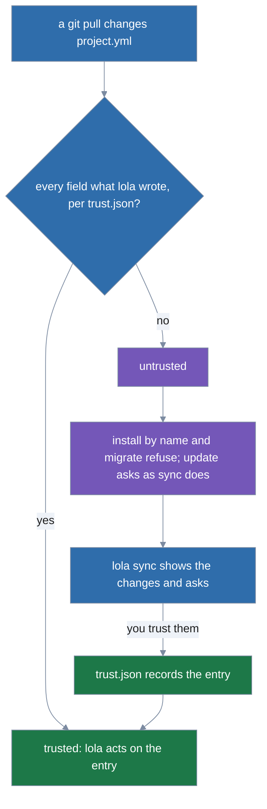

# Sources and the cache

How lola reads sources and keeps them in its cache. It is split out of [usage](../usage.md).

A **source** is where a module comes from. lola copies the module into your **cache**
(`$XDG_CACHE_HOME/lola/modules/`, normally `~/.cache/lola/modules/`), so a source can move or
disappear without breaking installs. lola recognizes these forms, first match first:

| You pass | lola reads it as |
|---|---|
| An existing directory | a folder |
| An existing file ending in `.zip`, `.tar`, `.tar.gz` or `.tgz` (any case) | an archive |
| A `file://` URL | a folder or an archive, by what the path is |
| An `https://` URL whose path ends in an archive suffix | an archive, downloaded |
| Any other `https://` or `ssh://` URL, or `user@host:path` | a git repository |
| An `http://` URL | as `https://`, but only for `localhost`, `127.0.0.0/8` or `::1` |

Anything else is not a source: a bare name means a module in your cache, and `@market/module`
an entry of one of your [marketplaces](marketplaces.md#marketplaces), on the command line only (a directory of
that name is `./@market/module`). lola refuses, with a hint:

- an argument, `--ref` or recorded location that starts with `-`;
- git's `<transport>::<address>` remote-helper syntax and `git://` URLs;
- credentials in a URL:
  - any user name or password in an `http(s)` URL (GitHub and GitLab take a token as the user
    name), and any query string or fragment (presigned URLs carry secrets there). The URL is
    written to `.lola/project.yml` and your cache, where a secret would be committed.
  - For git, let a credential helper or `ssh-agent` supply credentials; for a private archive,
    download it and install the file.
  - A user name in an `ssh://` URL or in `git@host:path` is fine, but a password never is, and
    the `user:password@host:path` form is refused (git would pass the password to ssh as part
    of the remote path).
  - `file://` URLs follow the same rules, and `?` or `#` in `git@host:path` is refused like a
    URL's query or fragment.
  - No error repeats a URL's password, query or fragment, or the user name of an `http(s)` or
    `file` URL, not even for a URL that does not parse or the target of a redirect (an `ssh`
    user name is no secret and may appear);
- a source, `--ref` or `--path` that the scope's manifest (`project.yml` or a profile) or
  `lock.json` could not load again (a control or invisible character, such as a zero-width
  joiner in a folder name, a source over 4096 bytes or a ref over 256 bytes), before anything is
  fetched or written; the hint names the field to fix, or, for a module named from your cache
  whose recorded source is the problem, `lola cache rm <name>`;
- an existing file that is not an archive, and a local archive that is not a regular file once
  its links are resolved (a pipe or device named like an archive, or a link to one).

Adding a module to the cache normalizes it: the cached copy holds exactly one `lola.yml`,
generated from the module's manifest. lola reads the first manifest it finds (see
[Module formats](authoring-modules.md#module-formats)) and warns about each lower-precedence one it ignores. A
plugin format is converted once, here: the generated `lola.yml` lists every artifact the plugin
declared, so a cached version means the same thing to every later lola.

For every kind of source:

- `.git`, `.venv`, `node_modules`, `.lola`, `__pycache__` and `.DS_Store` are never copied.
- A relative symlink is copied into the cache as the regular file it names, never as a link, when
  that file is inside the source you gave (the folder, the repository or the extracted archive,
  not just the module's directory) and lola would copy it.
  - Anything else refuses the install with the link, the reason and a hint:
    - an absolute link;
    - one that leaves the source;
    - a missing target (dangling);
    - a loop or a chain of more than 8 links;
    - a target that is a directory or goes through one;
    - a target under an ignored name above, in any letter case, or a Windows short name (a path
      segment ending `~<digits>`, so a real file named like `notes~1.md` cannot be a target);
    - in a git work tree, a target git ignores.
  - On Windows a link git checked out inside the module is a plain file lola cannot tell from one,
    so it is refused.
  - A link lola would refuse that lies outside the module's directory, off the way to it, and that
    no link in the module goes through, is left out silently, such as an archive's test fixture
    that points to an absolute path.
  - The source is the boundary: `lola install ~ --path mods/x` can copy a link to any file under
    `~` that is not ignored.
- `--path <dir>` picks the module root inside the source, for monorepos.

**Folders.** In a git work tree, lola copies the files git would track (`.gitignore` is
respected; new, unstaged files are included). A directory `module/` inside the source is the
module root unless you pass `--path`; `--path .` picks the folder itself. `--ref` is refused, even for a folder that is a git
repository (a local path is always read as a folder; lola reads no branch, tag or commit of it).

**Git.** lola runs your `git` (it must be on `PATH`) with a shallow clone of the default
branch, or of `--ref`: a branch name, a tag name, or a full 40- or 64-character commit SHA.
lola never guesses:

- A ref that names both a branch and a tag is an error, and so is an abbreviated SHA.
- A full commit SHA, in any case, is always that commit, never a branch or tag of that name.
  lola records and shows it lower-cased. A server that serves another commit for it is refused.
- The SHA of an annotated tag object is refused; the error names the commit the tag points to,
  and the hint is your run at that commit.
- Any other hex-looking name is a branch or tag.

A commit that no branch or tag points to needs a server that serves such commits (servers
speaking git protocol v2 do). Only committed files are copied; the module root is `--path`,
else `module/`, else the repository root.
`--path .` picks the repository root and names the module after the repository. lola records
the commit it fetched. A source is fetched again on every install, with one exception: installing
at a full commit SHA that your cache already holds for exactly that source (the same location,
`--path` and selection, the version lola recorded when it fetched that commit) fetches nothing;
lola hashes the cached version again and installs it. A branch, a tag or a short SHA always
fetches.

- Your git config, credential helpers and `ssh-agent` are used. Git hooks, `core.fsmonitor`,
  the `ext::` transport and Git LFS filters are switched off for the repository lola fetches.
- **Git LFS files are not fetched.** A module receives LFS pointer files as they are committed.
- git never prompts for a user name or password (`GIT_TERMINAL_PROMPT=0`). This holds for every
  fetch: modules, marketplaces, profiles and `lola migrate`.
  - A repository git may not read is refused in lola's words, never with git's output: `<url>
    was not found, or it is private and git has no credentials for it` (a server that wants
    credentials looks the same as one hiding a missing repository), `… or it is private and the
    credentials git has, if any, cannot read it`, `git's credentials for <url> were refused`,
    or `the ssh server for <url> refused every key ssh offered, or ssh had none` (hinting
    `ssh-add` when the server takes keys).
  - The hint `git ls-remote -- <url>` (with `-c http.followRedirects=false` for a source a
    catalog named) checks it with your own git, which may ask for credentials and keep them in
    your credential helper.
    - A location too long or odd to print whole gets no hint.
    - A github.com web page or organisation page gets no such check (it would fail on it).
    - A web page (`/tree/<ref>/…` or `/blob/<ref>/…`) is called one in the message, and hints
      your own command (`lola info` stays `lola info`, with your scope, `-t`, `-n` and output
      flags, and `-y` on a run that asks) on the repository with `--ref <ref>` and the `--path`
      it names.
    - A path ending in `skills/` hints the repository root or the directory above it, and the
      message says `--path skills/<name>` takes one skill.
    - The same holds for a `--path` naming a `skills/` directory: the hint is your command on the
      directory above it.
  - Only git's own `fatal:` lines and ssh's are read, never a server's `remote:` lines.
  - ssh still can prompt: it asks on the terminal for a key passphrase or an unknown host key.
    Load your key into `ssh-agent` and add the host to `known_hosts` first, or the fetch waits
    until it gives up after 5 minutes. A child process that keeps git's output open (ssh
    prompting, a stalled https helper) delays that stop by at most 5 more seconds.

**Archives.** zip, tar and gzip tar, chosen by the file name's suffix. `--ref` is refused.
The module root is the first of:

1. `--path`, relative to the archive's root as `tar tf` or `unzip -l` show it;
2. the shallowest directory holding `lola.yaml`, `lola.yml`, `.lola.yaml`, `.lola.yml`,
   `plugin.json` or `.claude-plugin/`;
3. the parent of the shallowest `skills/`, `commands/`, `agents/` or `rules/` directory;
4. the archive's single top-level directory, if that is all it holds;
5. the archive's root.

Two different candidates at the same depth are an error; pick one with `--path`. Without a
`lola.yml` name, the module is named after its root directory, or after the archive file
(without its suffix) when the root is the archive's root.

An archive may hold only regular files and directories. lola refuses the whole archive if any
entry is absolute, contains `..` or a backslash, is a link or device, or repeats a path. Files
keep only their execute bit (`0755` or `0644`). Limits, which are not configurable:

| Limit | Value |
|---|---|
| Entries | 20,000 |
| Zip central directory | about 19.5 MiB (1 KiB for each of 20,000 entries), checked before it is read |
| Unpacked size | 512 MiB in total |
| Compression ratio of one zip entry | 200 to 1 |
| Download size | 256 MiB |
| Download time | 2 minutes |
| Redirects | 5, never from `https` to `http`, and never to `http` off loopback |

Once a module is cached, `lola install <name>` uses the cached copy without touching the source:
the cache's newest version for the ref the project already records for it (`--ref` picks
another). `lola cache update` fetches every cached module again: a git branch (or the default
branch) may have moved, a local archive is read again, and an archive URL is downloaded again.
The content digest decides whether anything changed. Installed modules keep the versions they
were installed at: `lola list` shows `→ update available`, and `lola install <name>` installs
the new version.

**Pins.** When lola installs a git or archive module, it records the version in the module's
entry in `project.yml` or a project profile: `digest`, the sha256
of the module's content, and for git `commit`, the commit the fetch resolved. lola never writes a
pin into a profile of yours, `default.yml` included: the version installed is in `lock.json`. `ref` stays what
you asked for. A folder module is never pinned.

A manifest or `lock.json` may come from someone
else, so lola checks every entry when it reads them and refuses, before running git, a source or
ref that git would read as an option, a git remote helper (`ext::…`), `git://`, a path that
leaves its source, a commit or digest lola would not write (a `commit` on an archive or a folder
included), and any control or invisible character.

A git checkout holds the bytes as committed on every machine: lola turns off line-ending
conversion and every `.gitattributes` conversion and filter for its checkouts, and refuses a
symbolic link on the way to the module's `--path` before checking anything out. A link inside the
module (anywhere in the repository when there is no `--path`) is copied as the file or directory
it names, and refused when it leaves the source, dangles, loops, is absolute or names `.git`; a
link elsewhere in the repository is allowed, and so is a refused link outside every component a
marketplace entry selects.

A git `--path` must name a directory of the repository in its exact letter case, so
a case-insensitive file system never checks out another one in its place. Execute bits come from
the source itself (git's file modes, an archive's entry modes, a folder's files), never from the
file system lola copied to, so the same module has the same digest on Linux, macOS and Windows.

**Trust.** `project.yml` is committed, so a `git pull` can change it. lola keeps, per project,
what it last wrote there in `$XDG_STATE_HOME/lola/trust.json`: the top-level `targets` and each
entry's `name`, `source`, `ref`, `path`, `components`, `commit`, `digest`, `targets`, `rules`,
`vars` (the entry's overrides of the module's [vars](templating.md#vars)), `member` (for a
project profile's entry that comes from a remote profile that is a member of a project bundle:
that profile's name, source and pin), the member list of each project bundle (`bundle`) and `market` (the marketplace an entry says it came from; the diff shows it as `market
(as written)`, since lola never checks it).

An entry is **trusted** when every one of those fields is what lola wrote. Each write lola makes trusts
exactly the fields it changes, so after a pull adds an entry or changes one, installing another
module leaves that entry untrusted.

lola refuses to act on an untrusted entry as written:

- `lola install <name>`, a `lola uninstall -t` that keeps some of its targets, and
  `lola migrate` refuse with `<name>: project.yml changed for it since you last trusted it` (for
  an entry a pull added: `<name>: project.yml added it since you last trusted the file`; with no
  record: `<name>: project.yml has not been trusted on this machine`), and the hint
  `review and apply it: lola sync --project <name>`; the partial uninstall adds
  `or remove it: lola uninstall --project <name>`;
- an install, by name or by source, that would take its assistants from top-level `targets` you
  have not trusted (no `-t`, and no entry with `targets` of its own) refuses before fetching
  anything with `project.yml's top-level targets [claude-code, opencode] changed since you last trusted them` (`are not
  trusted yet` when the record never held them, as after installs that named their assistants with
  `-t` into a `project.yml` written by hand), hinting
  `lola sync` or your own install with `-t <id>` added (your `--ref` and `--path` kept). When no
  entry installs to them and nothing else in the file needs your trust, a plain sync does not ask
  about them, so the hint is
  `lola sync --project --trust=entries`, and the refusal first shows what that trusts, as the sync's
  trust diff does (`+ targets       [opencode]`, `+ target_versions opencode "1.0"`; `--json` adds
  `trust`); the install pickers ask for the assistants instead and never preselect those targets;
- the install pickers leave such modules out, with one notice per project:
  `2 modules in project.yml changed since you last trusted them: a, b → lola sync --project` (`are new or
  changed since you last trusted the file` when a pull added one). Add a
  source… in the pickers adds the module to your cache and lists it by name, so it is left out
  too; Change scope onto a project where a module you picked is untrusted stops with the refusal;
- `lola update` asks about it as `lola sync` does, and off a terminal needs `--trust`
  ([Sync, pins and trust](sync-and-trust.md#sync-pins-and-trust)).

An argument that names such an entry is taken as that name, even when a folder of that name is
in the current directory: write the folder as `./<name>`.

`lola sync <name>` shows such changes and asks you to trust them
([Sync, pins and trust](sync-and-trust.md#sync-pins-and-trust)), which is what every refusal hints. Every
`lola sync`, `lola update` or `lola install` command lola prints carries your scope: `--user` at
user scope, `--project` for the project found from the directory you ran lola in, and
`-C <root>` for another; so does an
install's `retry with: lola install <names>` after a failure that left fetched modules in your
cache, which these refusals and conflicts leave out, since retrying would refuse again.

Installing the module from its source still works, and writes the entry as new, keeping none of the changed
entry's `targets`, `rules`, `ref` or `path`, but it installs what the source serves now without
letting you review the change as sync does, so lola no longer suggests it. Without `-t`, such an install keeps the
module on the assistants this checkout installed it on (`lock.json`), not on targets a pull set.
Removing the module (`lola uninstall <name>`) always works.

A project with no record in
`trust.json` (a fresh clone, a moved directory, a deleted state directory) has every entry
untrusted until you trust them with `lola sync`. `lola sync`, `lola update`, `lola install` and
`lola uninstall` refuse a project whose `.lola/lock.json` git tracks, before fetching anything,
since a committed `lock.json` lets a pull decide what lola deletes; lola keeps it private to each
checkout. The hint untracks it: `git rm --cached .lola/lock.json`, with `-C <project>` when you
run lola from elsewhere. If you never installed with lola in that checkout, the error says to
untrack and delete it, then run `lola sync`.

A local source is read through its symbolic links once: lola records the real path, and a source
you type relative to the project is recorded relative to the project's real root, however you
reached it. A local archive given through a symbolic link must resolve to a file with the same
archive suffix as the path you typed; otherwise lola refuses and suggests installing the target
itself (`lola install <target>`). When it is accepted, a module without its own name takes its
name from the target file.

Installing a module also gives it a **module copy**: `.lola/modules/<module>/` in the project, or
`$XDG_DATA_HOME/lola/user-modules/<module>/` at user scope. `${PLUGIN_ROOT}` ([Module
layout](authoring-modules.md#module-layout)) points there, so removing a module with `lola
cache rm` never breaks an installed one; `lola sync` fetches the version it renders again if it
needs to: a git module by its commit, which must still be on its ref, and an archive whose content
must still match.

When the version is the pin `project.yml` names and the fetch returns other
content or the commit is not on the ref, it suggests `lola sync --update <name>` to re-pin; when it
is the version installed of an entry that pins none (a git version with no recorded commit, say), it
suggests `lola install <source> [--ref r] [--path p]`, which installs what the source serves now, or
`lola uninstall <name>`.

Hooks may build inside the copy: lola leaves its content alone, replaces
the copy only for a new version, when it is gone, or when the module gains a target `lock.json` does
not record it on (`lola install -t`, or a target added to `project.yml`), and then runs the hooks
again with your consent. Without it, a pre-install hook refuses the run and a declined post-install
hook stays pending (see [Hooks](authoring-modules.md#components)).

Reinstalling the version
already installed on the same targets with `lola install` replaces the copy from the cache to run
its hooks again when you consent; without consent the copy stays as it is. `lola sync` replaces it
for the same version and targets only to run a pending post-install hook, when you consent; declined
again, the copy stays as it is.

Known limitations: three refusals of a source read from a file (a manifest, profile or catalog
entry) hint advice, not a command: a ref that starts with `-` (`ref "-x" starts with '-'`) hints `a
branch, tag or commit never starts with '-'`; a folder location that is not absolute (`folder source
x is not an absolute path`) hints `give the absolute path of the folder`; and an archive location
that starts with `//` (`archive location starts with //, a URL without a scheme`) hints `give the
archive's https:// URL or its absolute path`.
