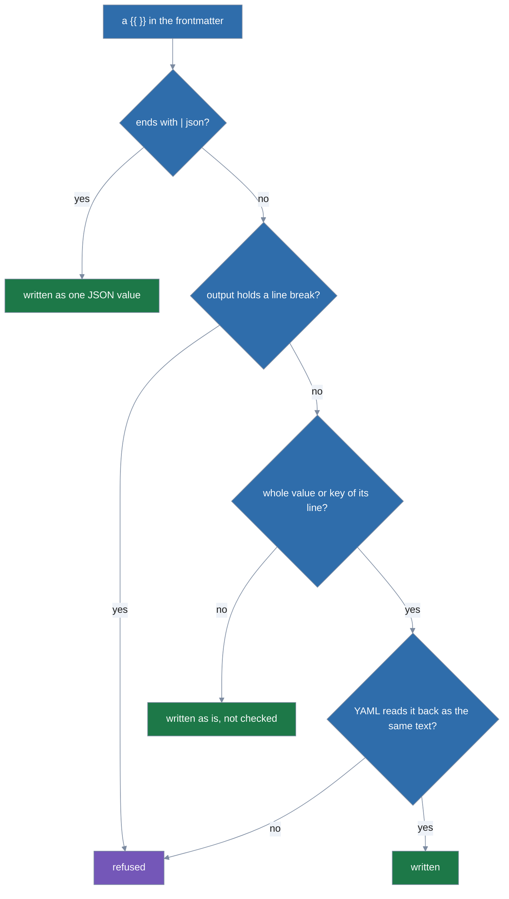
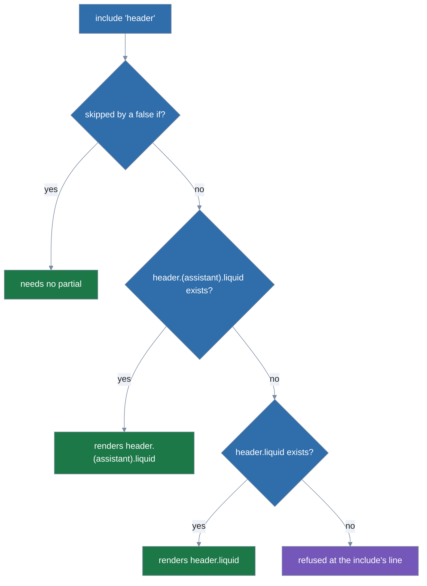
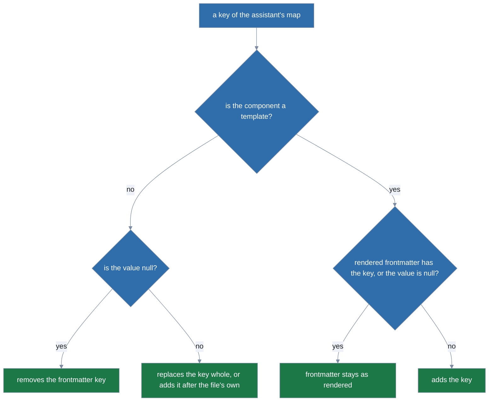

# Templates

A Markdown component whose file name ends in exactly `.md.liquid` is a
[Liquid](https://shopify.github.io/liquid/) template: lola renders it for each assistant it
installs to, frontmatter included, so one file can give each assistant keys and text of its own.
[Partials](#partials), the pieces a template includes, end in `.liquid` alone.

In this example, `target` is the assistant lola renders for: every assistant gets a description
naming it (`description: "Review code for claude-code"`), only `claude-code` gets `model: opus`,
and only `opencode` gets the extra clause in the body.

```markdown
---
description: {{ "Review code for " | append: target | json }}
model: opus
---
Review the change and say which files you read.
```

- **Which files.**
  - `skills/<skill>/SKILL.md.liquid` (and a root `SKILL.md.liquid`), any `<file>.md.liquid`
    below a skill, `commands/<command>.md.liquid`, `<file>.md.liquid` in a command's
    `commands/<command>/` directory, `agents/<agent>.md.liquid` and `rules/<rule>.md.liquid`;
    also wherever [`components`](authoring-modules.md#components) entries or a plugin
    [format](authoring-modules.md#module-formats) name `.md` files.
  - The rendered file drops `.liquid`; the component's name still comes from the path, and a
    rendered `name:` that differs is refused.
  - `mcps.json`, hooks files, `lola.yml` and every other file are never templates:
    `x.json.liquid` is copied as it is, and a module-root `mcps.json.liquid` (or another
    configuration name plus `.liquid`) warns that it is not read.
  - A module-root `INSTRUCTIONS.md.liquid` and `AGENTS.md.liquid` also warn that they are not
    read; they are never part of the root skill, even beside the literal file.
  - A suffix that is `.md.liquid` only in another case (`x.MD.liquid`) warns and is not a
    template.
  - A directory named like a template (`x.md.liquid/`) refuses the module, in every format.
  - A literal file and a template of one name (compared ignoring case: `ref.md` and
    `REF.md.liquid`) refuse the module: "keep one".
  - A variant spelling of `SKILL.md.liquid` in a skill is never copied and warns.
  - A skill whose `SKILL.md` is spelled in another case (`skill.md`) is not a skill on any
    system: lola warns `skills/x/skill.md is not read; name it SKILL.md`.
  - At most 256 templates per module, each at most 256 KiB of UTF-8.
- **Per assistant, then checked.**
  - lola renders each template for each target (assistant) before it plans what to write.
  - It then checks the result exactly as it checks a literal file with those bytes:
    - the frontmatter is parsed with the rules of [Module layout](authoring-modules.md#module-layout);
    - hooks and an agent's MCP servers are checked;
    - [findings](../usage.md#findings) are computed;
    - your consent to [hooks](authoring-modules.md#runtime-hooks) is asked on the hooks *as
      rendered* for that assistant, again whenever they render differently.
  - `lola install`, `sync`, `render`, profile switches and `lola check` render; nothing is
    written until every template of the run rendered.
- **Frontmatter.**
  - When the first line is `---`, the frontmatter ends at the first line that is exactly `---`
    in the template's own text, outside any ``, ``, ``,
    ``, `` or ``; put a closing `` on its own line
    before it.
  - The frontmatter and the body render separately: an `` in one is not seen in the
    other.
  - A `{{ }}` in the frontmatter, or in a partial included there, whose output holds a line
    break is refused unless it ends with the `json` filter, which writes the value as one JSON
    (so YAML) value on one line: a value holding a line break or `---` then stays one string
    (`agents/a.md.liquid:2: in frontmatter, this {{ }} rendered a line break; end it with |
    json so the value stays one YAML value: {{ vars.intro | json }}`).
  - Every line break YAML reads counts: line feed, carriage return, U+0085, U+2028 and U+2029,
    in any string the value prints, a list's items and a map's keys included.
  - A `{{ }}` without `| json` that is a line's whole value (after `key: ` or `- `, with nothing
    but spaces after it) or its whole key (`{{ k }}: v`) must also write text YAML reads back as
    the same text, or YAML would silently change it:
    - `model: {{ attrs.model }}` works for `sonnet`, `opus-4`, `claude 3`, `path/x` or `a-b`.
    - It is refused for text holding ` #` (YAML drops the rest as a comment) or `: `; starting
      with `[`, `{`, `*`, `&`, `!`, `|`, `>`, `%`, `@`, `` ` ``, `- ` or `? `; with spaces at
      either end; empty; or that YAML reads as a number, true or false, null or a date (`123`,
      `0x1F`, `true`, `null`, `~`, `2024-01-01`) (`agents/a.md.liquid:2: in frontmatter, YAML
      would read "sonnet #fast" as a comment after "sonnet"; end that {{ }} with | json`).
    - Ending that `{{ }}` with `| json` writes a quoted string, which YAML reads back exactly.
    - A number or a boolean value is written with its own type and is not checked.
  - A value composed around a `{{ }}` (`v{{ vars.ver }}`, `"{{ vars.d }}"` in your own quotes,
    `Review {{ vars.d }}`) is yours to shape and is not checked: such a value holding ` #` is
    still cut short there by YAML, so build the whole value inside one `{{ … | json }}`
    (`description: {{ "Review " | append: vars.d | json }}`).
  - The check is a data-correctness aid and covers only a `{{ }}` that is the whole value or key
    on its own line in the source of the template or partial that holds it.
    - It does not cover a value inside a tag on the same line (`d: {{ v }}`,
      `d: {{ v }}`), a value followed by a comment (`d: {{ v }} # note`, a
      `` tag), a value under a quoted or `?` key, a value written by a partial
      included on the line (`d: `), or a list or nil value (a list prints
      concatenated, nil prints empty).
    - YAML can silently misread these: end such values in `| json`, or build the whole value
      inside one `{{ … | json }}`.
  - A value without a line break is written as it is, and may write a key where the template
    puts it at a line start; whatever it adds is checked as written: hooks and an agent's MCP
    servers are asked about, and a `name:` must match the path.
  - A rendered frontmatter line that is `---` or `...`, with only spaces or tabs or a carriage
    return after it, is refused, however the template built it.

How lola checks one `{{ }}` in the frontmatter:



- **What a template sees.**
  - `target` (`claude-code`, `gemini-cli` or `opencode`).
  - `scope` (`project` or `user`).
  - `profiles`: the active profiles as `lola profile` lists them, `default` first at user scope,
    `[]` when none.
  - `vars`: every var the module declares, with its entry's value or its default
    ([Vars](#vars)). `{{ vars.x }}` reads the var named `x`; one the module does not declare is
    refused, naming the vars it declares.
  - `attrs`: the component's [attribute file](#attribute-files) for this assistant, `{}` without
    one.
  - A key `attrs` lacks, at any depth (`attrs.model`, `attrs.opts.depth`), reads as nil: it
    prints nothing, is false in `` and takes `default`
    (`{{ attrs.model | default: "sonnet" }}`).
  - `lola check` warns (`attrs-undefined`) on a literal `attrs` path no attribute file of the
    module defines for any assistant, so a typo does not go unseen.
  - A property of a value that is not a map or a list reads as nil too (`attrs.model.x` when
    `model` is text), but Liquid's own `size`, `first` and `last` keep their meaning
    (`attrs.model.size`, `attrs.tools.first`).
  - This holds only on a path written from `attrs`: a value you `assign` from it
    (``) or a loop variable over it (``) is
    plain data, where a missing key is an error.
  - Any other undefined name is an error, `vars.x` included; test a key with `contains`
    (``).
  - Loops over a map visit its keys sorted.
  - Output that reads `profiles` depends on your local profile names: do not commit it.
- **What a template can do.**
  - Tags: `assign`, `if`, `unless`, `case`, `for` (with `break`, `continue`, `cycle`), `comment`
    and `raw` (`{{ x }}` writes `{{ x }}`).
  - `include` reads a [partial](#partials).
  - Refused: `capture`, `tablerow` and `render`; `..` inside `{{ }}` or `` outside a quoted
    string (ranges, `(1..n)`; `{{ "../docs" }}` is text); `forloop` used other than through a
    property (`forloop.index`, `forloop["first"]`, but not a computed key or a quoted key
    starting with `.`); and an `assign` or loop variable named `vars` or `attrs`.
  - 41 filters: `abs`, `append`, `at_least`, `at_most`, `capitalize`, `compact`, `concat`,
    `default`, `divided_by`, `downcase`, `first`, `join`, `json`, `last`, `lstrip`, `map`,
    `minus`, `modulo`, `plus`, `prepend`, `remove`, `remove_first`, `remove_last`, `replace`,
    `replace_first`, `replace_last`, `reverse`, `rstrip`, `size`, `slice`, `sort`,
    `sort_natural`, `split`, `strip`, `strip_newlines`, `times`, `truncate`, `truncatewords`,
    `uniq`, `upcase` and `where`.
  - The math filters follow Liquid on whole numbers and decimals: two whole numbers give a whole
    number, a decimal makes the result a decimal (`{{ 0.1 | plus: 0.2 }}` writes
    `0.30000000000000004`, never an exponent), `divided_by` a whole number truncates
    (`{{ 7 | divided_by: 2 }}` writes `3`, exactly however large), `modulo` and `abs` give
    decimals.
  - They take only numbers (a string such as `"3"` is refused, where Liquid would convert it)
    and refuse a whole number past 64 bits, a result that is not finite, and dividing by zero.
  - `{{ vars }}` and `{{ attrs }}` printed whole are refused.
  - A map nested in a list prints in Go's `map[k:v]` form, so print its keys instead.
  - A template reads no file and no environment: partials come from the module, in memory.
- **Caps.** A value at most 64 KiB, a list a filter makes at most 4096 items, 256 `assign` tags
  and 64 nested blocks per template with its partials, 64 includes, 1 MiB of output and 2 s per
  file, and 32 MiB and 20 s of rendering per run.
- **Errors.**
  - A template error refuses the run before anything is written, naming the module, assistant,
    component, file and line.
  - Its hint is `lola check <source>` with the run's scope flag, its assistants (each `-t` as
    `--target <assistant>`) and its output flags. That check lists every template error of the
    module at once, as `skip` [findings](../usage.md#findings): the component is not rendered for
    that assistant. A timeout or the run budget refuses the check too.
  - There is no hint when no check reaches the version refused:
    - a git entry with a `ref` or `path` (`lola check` takes neither);
    - a pinned entry, marketplace entries included, that the run did not pin itself
      (`lola check` fetches the newest version, never a pin; a fresh install keeps the hint);
    - a module installed by its cache name;
    - a `components` entry not installed through a marketplace;
    - an address that would print altered (control or format characters, or over 256 bytes);
    - a timeout and the run budget.
  - A rendered file that a load check refuses (hooks, an agent's MCP servers, a rule's `paths:`,
    an Agent Plugins skill's `name` and `description`) is `template-rendered-check`.

## Partials

A template includes a partial with ``: a file in `_partials/` at the
module root, named `<name>.liquid` (not `.md.liquid`), rendered in its place for the same
assistant. A partial sees what the including template sees (`target`, `scope`, `profiles`,
`vars`, `attrs` and the `assign`s made before the include); an `assign` inside it is not seen
outside it.

```text
_partials/header.liquid               # for every assistant
_partials/header.claude-code.liquid   # for claude-code, chosen over header.liquid
```

How lola finds the partial for ``, for each assistant:



- **Names.**
  - `_partials/<name>.liquid` or `_partials/<name>.<assistant>.liquid`: `<name>` is a lowercase
    letter or digit followed by up to 63 lowercase letters, digits, `_` and `-`, and
    `<assistant>` is `claude-code`, `gemini-cli` or `opencode`.
  - For each assistant, `header` is `header.<assistant>.liquid` if it exists, else
    `header.liquid`; with neither, an include that renders is refused at its line:
    `skills/review/SKILL.md.liquid:4: no partial header for claude-code (looked for
    _partials/header.claude-code.liquid, _partials/header.liquid)`.
  - An include that a false `` skips needs no partial, so
    `` needs
    `_partials/claude.liquid` for no other assistant.
  - Any other entry of `_partials/` (a subdirectory, another name, an unknown assistant) warns
    and is ignored.
  - `_partials` that is not a directory refuses the module, and a variant spelling
    (`_Partials`) warns and is never read.
  - At most 256 partials per module, each at most 256 KiB of UTF-8, 4 MiB together.
- **Includes.** The name is written in quotes, single or double; a variable, a path, `with` or a
  filter after it is refused, and so is the `render` tag. A partial may include partials; a
  cycle is refused, and so is a chain of more than 8 partials. A file renders at most 64
  includes, each turn of a loop counting.
- **Checked as templates.**
  - Before anything renders, lola checks every partial a template can reach, for that
    assistant, with the template rules above.
  - The 256 `assign` tags and 64 nested blocks count across a template and its partials; a
    missing partial counts in none of these.
  - When a partial is included in the frontmatter, each `{{ }}` in it gets the
    [frontmatter](#templates) checks, judged by its line in the partial's own text; a refusal
    names the partial's file and line:
    - A line break without `| json` is refused.
    - A `{{ }}` that is the whole value or key of its line in the partial (`m: {{ attrs.v }}`)
      must write text YAML reads back as the same text, as in a template.
    - Any other `{{ }}`, such as one whose value follows a key on the including line
      (`d: `), gets only the line-break check.
  - A `---` or `...` line it writes is refused with the rendered frontmatter.
- **Errors** in a partial name its file and line and its first include site (in the order lola
  walks the includes, which for a partial included once is where it is included):
  `_partials/header.claude-code.liquid:2: undefined variable in {{ titel }} (included from
  skills/review/SKILL.md.liquid:4)`; `--json` puts the include site in `included_from`.
- `_partials/` is never installed to an assistant, also by a skill at the module root, and a
  `components` entry or plugin path inside it is refused: partials are not components.

## Attribute files

Beside a skill's `SKILL.md`, a command's or an agent's file, `<base>.targets.yaml` or
`<base>.targets.jsonc` gives each assistant frontmatter keys of its own, as data, with no
template: `agents/reviewer.targets.yaml`, `commands/review.targets.jsonc`,
`skills/<skill>/SKILL.targets.yaml`, and a root skill's `SKILL.targets.yaml`.

```yaml
claude-code:
  model: sonnet
  tools: [Read, Grep]
opencode:
  model: anthropic/claude-sonnet-4
  tools: null        # removes tools: for opencode
```

How lola merges one key of an assistant's map into the component's frontmatter:



- **Merge.**
  - For each assistant, each key of its map replaces the frontmatter key of that name whole
    (one level deep: a map replaces the map), new keys follow the file's own, and `null`
    removes the key.
  - The file's comments and the order of its other keys stay.
  - In a template the rendered frontmatter wins: the file only adds keys it lacks, and `null`
    removes nothing.
  - Hooks and `mcpServers` set this way are checked, and asked about, as frontmatter hooks are.
  - When lola refuses what the file added, the error names the file
    (`agents/guard.targets.yaml (merged for claude-code): agent guard: frontmatter hooks: …`).
  - Templates and their partials read the map as `attrs`.
- **Values.**
  - The top level maps assistant ids (`claude-code`, `gemini-cli`, `opencode`) to maps of keys;
    any other id refuses on its line (`agents/reviewer.targets.yaml:2: nope: unknown target; the
    targets are claude-code, gemini-cli, opencode`).
  - A file of only comments sets nothing.
  - Values are strings, `true`/`false`, whole numbers (at most 64 bits), decimals
    (`temperature: 0.2`, `1e-3`, written to the assistant as YAML numbers), `null`, lists and
    maps. `1.0` is a decimal, `1` a whole number.
  - A date, NaN or infinity (`.nan`, `.inf`, or a number such as `1e999` too large to be finite:
    `agents/reviewer.targets.yaml:4: claude-code.temperature: NaN and infinity are not
    supported`), `!!binary` or another tag, on a value, a list or a map, refuses (quote it to
    make it a string), as do anchors, aliases, `<<` and a key given twice.
  - Limits:
    - at most 64 KiB per file;
    - at most 64 keys per assistant, each key at most 256 bytes, with no control or invisible
      characters, and `name` refused (the name comes from the path);
    - strings of at most 16 KiB, whose only allowed control characters are tab and line feed;
    - lists and maps of at most 4096 items at every depth, nested at most 8 deep counting the
      file's own map.
  - When lola refuses a YAML file, it names the line (`agents/reviewer.targets.yaml:4:
    claude-code.since: a date is not supported; quote it to make it a string`); a JSONC file,
    the line and the JSON pointer (`agents/reviewer.targets.jsonc:4: /claude-code/temperature:
    …`).
- **Names.** Both `.targets.yaml` and `.targets.jsonc` beside one component refuse the module
  ("keep one"). `.targets.yml` and `.targets.json` warn and are not read, nor is a name spelled
  in another case (`Reviewer.targets.yaml`); a skill never copies any of them to an assistant.
  Rules, sidecars and support files have no attribute files.

## Vars

A module declares the vars its templates read in `lola.yml` `vars:`, each with its default:

```yaml
vars:
  language: go
  strict: false
  tools: [rg, jq]
```

A default is a string, `true` or `false`, a number (whole or decimal, finite), or a list of
strings. Names are `a-z`, `0-9` and `_`, start with a letter, and are at most 64 characters; at
most 64 vars, strings of at most 4096 bytes without control characters but tab and line feed,
lists of at most 64 strings, 64 KiB together.

A date, or a number in a list, refuses with the quoting that fixes it
(`lola.yml:13: vars.since: dates are not supported; quote it to make it a string: "2024-01-02"`),
NaN and infinity refuse, and an alias (`*name`) refuses as not supported. An empty `vars: {}`
declares none.

An entry in `project.yml`, `user.yml` or a profile sets its own values, under the same rules:

```yaml
modules:
  - name: review-kit
    source: https://github.com/acme/review-kit.git
    vars: {language: rust, strict: true}
```

- **Precedence.** A var the entry sets wins over its default. The entry that wins across
  [layers](profiles.md#profiles) replaces a lower one whole, its `vars` included: vars it does not set are
  the defaults again, and the override notice says so (`review-kit: project.yml overrides
  profile:user:work; review-kit's vars from profile:user:work are dropped: the entry from
  project.yml sets none`).
- **Checked before rendering.**
  - An entry setting a var the module does not declare, or a value of another type than its
    default, refuses the run (`project.yml: modules[review-kit].vars.strict: review-kit's
    default is true or false; this is a string`; a whole number and a decimal are one type, so
    `temperature: 1` overrides a default of `0.7`).
  - The refusal has the hint `lola info --project review-kit` (the run's scope and output flags)
    when your cache's current version is the one refused.
  - `lola check` renders with the winning entry's vars when that entry's source is the one
    checked (the same location and path, marketplace address, or the source your cache recorded
    for a module named by its cache name), else with the defaults.
  - When an entry overrides a var badly, `lola check` reports it as a skip finding,
    `vars-override`, and goes on with the defaults.
  - When `lola check` cannot read a manifest or profile, it leaves every module its defaults and
    reports an info finding, `vars-defaults`.
- **Trusted with the entry.** [Trust](sync-and-trust.md#sync-pins-and-trust) covers a project
  entry's vars: a vars-only edit to `project.yml` or a project profile is shown (`vars`) and asked
  about like any change, and a hook a var changes is asked about again. `lola install` keeps a
  trusted entry's vars when it rewrites the entry. `lock.json` records the overrides each
  module rendered with (`rendered_with.vars`).
- **Decimals keep their point.** `lola info` and the trust prompt show a decimal with its
  point (`temperature = 2.0`), and `2.0` and `2` are different values: changing one to the other
  renders again and is asked about again, since a filter such as `divided_by` gives a different
  result for each.
