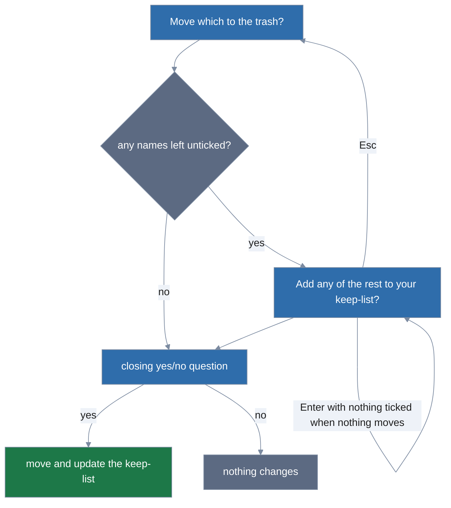

# Tidying

`lola tidy` moves what lola does not manage out of the places lola writes into, so a profile
switch, a migration or an assistant's own edits leave nothing behind you did not choose to keep.
It moves; it never deletes. Below, an *item* is one thing lola tidy can move, a *locked* item is
one it never moves, your *keep-list* names what it stops offering, and the *trash* is where moved
items go; each has its own section.

```
lola tidy                                 # on a terminal: pick what moves and what to keep
lola tidy -n                              # what would move, what is locked, and why
lola tidy skill/old-review 'command/tmp-*'  # asks first on a terminal; off one, add -y
lola tidy --all -y                        # every item that is not locked
lola tidy --all --force                   # also what git tracks; never asks
lola tidy --keep skill/notes              # never offer skill/notes in this scope again
```

Every flag is in the [`lola tidy` reference](../usage.md#lola-tidy).

**What it sees.** lola tidy looks at each assistant of the scope: the targets the scope's manifest
lists (`.lola/project.yml`, or `user.yml` at user scope), as far as you trusted them
([Sync, pins and trust](sync-and-trust.md)), and every assistant lola installed for; `-t` names
others. For each assistant it sees:

- the entries directly inside its directories (`.claude/skills`, `.claude/commands`,
  `.claude/agents`, lola's own rule directory `.claude/rules/lola`, and the Gemini CLI and
  OpenCode equivalents);
- the servers directly inside its MCP server list (`.mcp.json` `mcpServers`, `~/.claude.json`
  `mcpServers`, `.gemini/settings.json` `mcpServers`, and `opencode.jsonc` `mcp` when that file
  exists, else `opencode.json` `mcp`).

An entry is one item: a whole directory, a file, or a symbolic link, moved as a link. What lola
wrote, and any entry holding something it wrote, is never offered; your own `.claude/rules/*.md`
and every other file are never looked at. MCP servers lola did not install are offered too (a
`claude mcp add` server, say), unselected.

**Selectors** are `kind/name` (kinds `skill`, `command`, `agent`, `mcp`, `rule`), the name
without the file's extension (`command/tmp` names `tmp.md` and its `tmp/` directory). The name
may be a glob (`*`, `?`, `[a-z]`); quote it, as in `'command/tmp-*'`, so your shell passes it to
lola unexpanded. `\` escapes one of `*?[\` (`skill/\*` names a skill called `*`). A selector
matches in every assistant scanned; `-t` narrows.

**Locked.** Never moved, whatever the flags:

- `CLAUDE.md`, `AGENTS.md` and `GEMINI.md` (in any case), and any directory holding one;
- entries named `.git` or `.lola`;
- fifos, sockets and devices, and directories holding one;
- a directory lola cannot read all of;
- a path with a tab or line break (rename it, then rerun);
- a name no selector can name exactly (a control, format or invisible character, or over 128
  characters).

A whole directory or MCP file is skipped, with a notice, when it leads outside the scope's root,
onto the root or above it, onto another assistant directory, into `.git`, `.lola` or lola's own
directories, into another lola project (with the `lola tidy -C <that project>` that tidies it), or
through a symbolic link git tracks. An MCP file is also skipped when it is not a regular file,
does not parse or names a server twice.

What git tracks, or lies in an MCP file git tracks, moves only with `--include-tracked` or
`--force`; in a git work tree where git is missing or fails, everything counts as tracked. What
your keep-list names moves only after `--unkeep`. lola tidy refuses a project whose
`.lola/lock.json` git tracks, or about which git cannot say, also with `--force`.

**Asking.** Names or `--all` choose what moves. On a terminal without either, `lola tidy` asks in
two pickers, with nothing ticked, then asks one closing question:



1. **"Move which to the trash?"** lists every candidate as `<assistant>  <kind>/<name>  <path>`.
   An MCP server shows as `mcp/<name> (<label>)` and its file and pointer
   (`.mcp.json /mcpServers/<name>`), where the label is only its command's name or its URL's
   host, never its arguments, environment, headers or the rest of its URL. Above the list it shows
   the locked items with their reasons, cut to fit a short terminal ("and N more"). Space ticks an
   item and Enter confirms; ticking nothing is an answer. To tick a group:
   1. Press `/`.
   2. Type `skill/`, which narrows the items shown to skills.
   3. Press `ctrl+a`, which ticks every item shown.
2. **"Add any of the rest to your keep-list?"** offers one entry per name you did not tick, as the
   keep-list will hold it (the exact name, with `*?[\` escaped), and the assistants whose items it
   keeps (`command/deploy  claude-code, opencode`). A name one of whose items you ticked to move is
   not offered, so when you ticked every name this picker is skipped. Esc goes back to the move
   picker with your ticks kept.
   - When you ticked something to move, ticking nothing here is an answer.
   - When you ticked nothing to move, this picker needs a pick: Enter with nothing ticked shows
     `nothing selected — space selects, enter confirms, ctrl+c quits` and stays. Tick an entry,
     and the run only adds to your keep-list and moves nothing; or press Esc to go back and tick
     something to move; or cancel with Ctrl+C or `q`
     ([Keys](choosing-what-to-install.md#keys-q-quits-esc-goes-back)).
3. **The question.** lola lists what moves and what the keep-list gains or loses, prints the one
   command that does the same (`Equivalent command:` and the command, the keep entries as
   `--keep`), and asks one question naming what the run does: "Move N items to the trash?",
   "Keep M?" or "Stop keeping K?", or two or three of them joined, such as "Move 2 items to the
   trash and keep 1?". Answering no changes nothing.
   - When no command selects the set (a name two items share, say), lola prints "no single
     command selects this set" instead.
   - When the command holds characters lola does not print or a word too long to print (in the
     project's path, say), it prints "lola cannot show the equivalent command: it holds
     characters lola does not print or a word too long to print".

With names or `--all`, lola lists what moves and what the keep-list gains or loses and asks the
same question. `-y` answers the question; on a terminal without names or `--all` the pickers still
run.

In accessible mode (`LOLA_ACCESSIBLE=1` or `TERM=dumb`) the pickers are numbered lists and every
locked item is printed above them. There a keep picker that needs a pick refuses `0` with nothing
selected, and Ctrl+C or the end of input cancels.

**When lola cannot ask** (off a terminal, or with `--json`), a run without names or `--all` lists
every candidate and refuses ("lola tidy needs names or --all when it cannot ask (off a terminal or
with --json): N items can move") with the command that moves them, `lola tidy --all -y`, and a run
with names needs `-y`.

**Flags that change asking:**

- `--keep` or `--unkeep` without names or `--all` moves nothing and runs no picker.
- `--force` answers the question as `-y` does and also offers what git tracks, but still needs
  names or `--all` (it never runs the pickers), and never moves a locked or kept item.
- `-n` wins over `-y` and `--force`, takes no lock, writes nothing, and ends with the command that
  applies it.

Every command lola tidy hints keeps the run's `--json`, `--plain` and `--no-pager`. A name that
matches nothing movable says exactly why (installed by a module, tracked, kept, locked, or nothing
at all) with the command that gets past it, when one exists.

Before each move lola checks the item again; one that changed since the listing is left with a
notice ("changed since lola looked; run lola tidy again"). The first move that fails stops the
run, which reports what moved.

**The keep-list** is yours, in `$XDG_CONFIG_HOME/lola/keep.yaml`; lola never commits it:

```yaml
# lola keep-list: what `lola tidy` never offers. Safe to edit by hand.
version: 1
user:
  - skill/my-notes
projects:
  /home/me/work/app:
    - command/deploy
    - "skill/scratch-*"
```

A section applies to its scope only; project keys are absolute paths, and a project reached
through a link finds its section. `--keep <selector>` (alias `--protect`) adds an entry (once),
`--unkeep <entry>` (alias `--unprotect`) removes the entry written exactly so, and refuses one the
section lacks, listing what it holds.
Both apply to this run's listing, and alone they move nothing and ask nothing. lola writes them
after the run, keeping your comments and order; a declined question writes nothing.

**The trash.** Each run that moves anything makes one directory
`$XDG_STATE_HOME/lola/trash/<UTC time>/`, with one subdirectory per scope (`user`, or a hash of
the project's path), each item mirrored below the scope's root (its real path, past symbolic
links), and `manifest.txt`, one `original<TAB>trash path` line per item, written before the item
moves. The run prints the directory and its size; lola never deletes it.

Restore a file or directory by moving it back. Below, `$TRASH` stands for the run's directory and
`<hash>` for the project's subdirectory; `manifest.txt` gives each item's full trash path:

```sh
mv "$TRASH/<hash>/.claude/skills/old-review" /work/app/.claude/skills/old-review
```

An MCP server is removed from its file in place, keeping every other byte, comments included; the
file as lola read it is copied into the trash first, at mode 0600, since it may hold credentials
(the run says so, naming the file; `--json` lists each copy's trash path in `trash_credentials`).
Restore a server by copying it back out of that copy. For example, this `jq` command prints the
entry of a server named `legacy` from the copy of `.mcp.json`:

```sh
jq '.mcpServers.legacy' "$TRASH/<hash>/.mcp.json"   # then paste it into .mcp.json's mcpServers
```

`lola tidy --json` prints `scope`, `root` (`""` at user scope), `dry_run`, `targets`, `trash`
(`""` when nothing moved), `size_bytes`, `candidates` (what would move, on a dry run and in a
refusal; else `[]`), `moved`, `protected`, `skipped`, `keep_added`, `keep_removed`,
`trash_credentials` (the MCP copies), `notices` and `hints`. Items carry `target`, `kind`,
`name`, `path`, `key` (an MCP server's JSON Pointer), and `trash` (moved) or `code` and `reason`
(protected, skipped). `path` and `trash` are raw, but for JSON's escaping. JSON never carries a
server's command, arguments, environment, headers or URL; human output shows only its program's
name or its URL's host.
