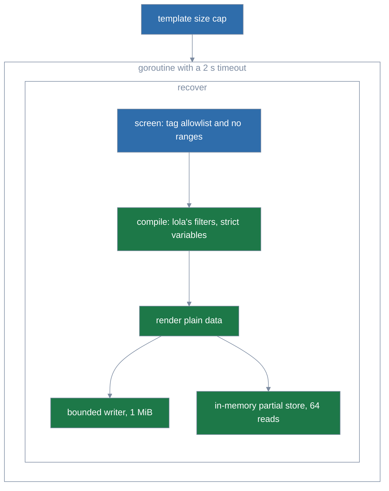

# Template engine analysis of alternatives

Roadmap item 7 ([roadmap](roadmap.md)), Plan 7, adds opt-in, per-file templating of module content
([#195](https://github.com/LobsterTrap/lola/issues/195)). Plan 7's design spec is
`docs/superpowers/specs/2026-10-22-plan-7-templating-design.md`, a local maintainer file that is
not published; its sub-plans are 7.1 to 7.5. This document records which Go template
engines were considered, how they were tested, and why lola uses Liquid through
[`github.com/osteele/liquid`](https://github.com/osteele/liquid) v1.9.2.

Analysis date: 2026-10-21. Go toolchain: go1.26.10.

## Context

Module authors write the templates and lola renders them on the user's machine. Authors are
mostly people writing Markdown and YAML for AI assistants, not Go programmers. A template is
therefore **untrusted input**: a module from a stranger must not be able to read the user's files,
call into lola, hang it, or crash it.

Issue #195 suggests "something like jet" and sets no syntax requirement.

## Criteria

In priority order:

1. **Author friendliness.** Familiar syntax, whitespace control that suits Markdown, and error
   messages that name the file and line.
2. **Safety with untrusted templates.** No file or environment access, no method calls on host
   values, and failures that are clean errors rather than hangs or process crashes.
3. **Project health.** License, release cadence, maintainers, open issues, transitive
   dependencies, and known vulnerabilities (`govulncheck`).

## Method

Each engine was pinned at its latest release in a throwaway Go module, outside the repository.
Adversarial templates were run in a child process killed after 10 s, with a limit of 6 GB on its
address space, so a "fatal" result below is a real crash of the rendering process, not a test
artifact.

A probe is one such template, written to test one failure mode. The probes:

- **Recursion:** a template that includes itself, a recursive macro or block, and deeply nested
  expressions.
- **Huge loop:** a loop over a range of about 10⁹.
- **String bomb:** repeated string doubling (`capture`, `append`, `*`, padding filters).
- **File access:** includes of `/etc/passwd` and `../` paths through the engine's default loader.
- **Method calls:** calling methods, with and without arguments, on Go values bound as data.
- **Environment:** any access to environment variables or command execution.
- **Errors:** the message for a misspelled filter or variable, and whether it carries the line.

`govulncheck` ran with go1.26.10 on each module.

## Candidates and results

| Engine (version) | Syntax and errors | Default file access | Recursion | Huge loop | String bomb | Health | Compiled deps | License |
|---|---|---|---|---|---|---|---|---|
| **osteele/liquid v1.9.2** | Liquid (Jekyll, GitHub Pages, Shopify). `` whitespace control. `Liquid error (line 3): undefined filter "uppcase" in skills/review/SKILL.md`. Optional strict variables. | Refused: absolute and `../` paths are rejected through `os.OpenRoot`. | Fatal stack overflow through `include`, avoided by removing `include`/`render` or by an in-memory store that caps reads (tested: clean "include limit exceeded"). | Hangs. `FRender` checks a context, but only as output is written. | Fatal out-of-memory (`capture`, `append`). | 5 releases and 76 commits in 12 months, 6 contributors, 9 open issues, `SECURITY.md`, no advisories. | `osteele/tuesday`, `gopkg.in/yaml.v2` | MIT |
| Notifuse/liquidgo (pseudo-version) | Liquid. Some errors are bare keys (`errors.syntax.unknown_tag`). | None (`BlankFileSystem`). | Clean "Nesting too deep". | `(1..1e9)` builds the whole range: out-of-memory even with limits on. Nested loops hang. | Clean "Memory limits exceeded" when limits are on. | v5 tags lack a `/v5` module path, so only pseudo-versions resolve. One maintainer; last commit 2026-01. | `yaml.v3` | MIT |
| cbroglie/mustache v1.4.2 | Mustache: no comparisons, so lola would pass flags such as `{{#is.claude}}`. `line 4: Section tools has no closing tag`. | **Reads `/etc/passwd`** through partials unless a `StaticProvider` is supplied. | Fatal stack overflow after about 40 s. | Not possible: loops run only over host data. Exponential nested sections hang. | Not possible. | 2 releases and 4 commits in 12 months, 10 open issues. | none | MIT |
| flosch/pongo2 v6.1.0 | Django/Jinja. Best errors: `Line 3 Col 14 near 'uppcase'`. | **Reads `/etc/passwd`** through `include` and `ssi`. | Fatal (include, macro, deep expressions). | Hangs. | Fatal (`ljust`, `lorem`). | 2 releases in 12 months, one maintainer, 76 open issues. Filters and tags register globally. | none | MIT |
| nikolalohinski/gonja v2.9.1 | Jinja2. Parse errors print the whole template source. | **Reads `/etc/passwd`**. | Fatal (include, macro, deep expressions). | Hangs. | Fatal (`"x"*n`, namespace doubling). | Tags only, no GitHub releases; 58 commits in 12 months. | 10 modules, including logrus and json-iterator. **Reachable GO-2026-5970** (`golang.org/x/text`). | MIT |
| ardanlabs/jinja v1.8.0 | Jinja for LLM chat templates. Most errors lack line numbers. | No `include`. | Fatal (macro, deep expressions). | Out-of-memory on `range(1e9)`. | Fatal. | v1.9.0 requires go 1.27, pinning lola to v1.8.0. 20 stars. | none | Apache-2.0 |
| tyler-sommer/stick v1.0.10 | Twig. Whitespace trimming had no effect in the probe. | In-memory or rooted loader. | Fatal (macro, deep expressions). | Out-of-memory on `1..1e9`. | n/a | No releases; 17 commits in 12 months. | `shopspring/decimal` | MIT |
| CloudyKit/jet v6.3.3 | Jet. | None through an in-memory loader; `exec`/`include` resolve through the host's loader. | **Fatal stack overflow** (recursive `block`/`yield`), which `recover` cannot catch. | `repeat(2000000000)` hangs and cannot be stopped. | — | Sparse releases (6.2.0 2022-12 … 6.3.3 2026-09); recent fixes are panics and unbounded `include` recursion (CWE-674); no security policy. | `CloudyKit/fastprinter` (untagged pseudo-version) | Apache-2.0 |
| text/template (standard library) | `{{ .x }}`, `{{- -}}`. `probe:2:7: map has no entry for key "assistnt"`. | Not possible. | Clean "exceeded maximum template depth". | Hangs. | Fatal. | Standard library. | none | BSD-3-Clause |

### Findings that apply to every engine

- **Memory cannot be bounded in-process.** No Go engine tested limits how much a template
  allocates in general: Notifuse/liquidgo's memory limits stopped string doubling, but not its own
  `(1..1e9)` range. Every option therefore needs a render timeout and an output cap from lola, and
  only a separate process can cap memory.
- **Context cancellation** is not supported natively by any engine.
- **Method calls:** every engine calls methods on bound Go values. pongo2, gonja, stick and
  text/template also pass arguments (`obj.Delete("/x")`); osteele/liquid and mustache call only
  zero-argument methods. The remedy is the same everywhere: bind plain maps, lists and strings.
- **Environment:** no engine reads environment variables or runs commands.

### osteele/liquid defects found

- `{{ assistant | slice: 9223372036854775807, … }}` panics out of the engine (slice out of
  range); a `recover` in the caller catches it.
- Line numbers are off by one unless templates are parsed with
  `ParseTemplateLocation(src, path, 1)`.
- An unknown opening tag followed by its closing tag reports "endif not inside" rather than
  "undefined tag".
- A range literal `(1..n)` exposes a callable method.
  - It builds a `values.Range`, liquid's own Go struct for a range, and a template can call its
    exported `AsArray` method.
  - `{{ r.AsArray | size }}` on `(1..50000000)` peaked at 1.1 GB RSS (`values/range.go:20-27`).
  - Binding plain data leaves this open, since the engine builds the range itself.
  - The analysis proposed refusing `..` anywhere inside `{{ }}` and ``. Plan 7.5 narrowed
    that: lola's screen refuses `..` outside a quoted string in a tag or object ("ranges like
    (1..n) are not available in lola templates; loop over a list").
- Chained right-trimmed output (`{{ s -}}{{ s -}}…`) buffers in the engine's `trimWriter`, past
  the caller's capped writer: 2000 links of a 64 KiB `s` allocated about 400 MB against a 1 MiB
  cap. lola vendors v1.9.2 with a one-hunk fix (`third_party/liquid/PATCHES.md`).
- Compiling panics too, not only rendering: the expression lexer panics with a plain string on an
  identifier that is not a valid Unicode identifier, such as `{{ ☃ }}`
  (`expressions/scanner.go:563-565`, `:674-676`), and the parser re-panics everything but its own
  errors (`expressions/parser.go:43-56`).
- Its `go.mod` lists its linters in `tool` directives, so `go mod graph` shows 230 edges, but only
  three modules are compiled in; they add about two indirect lines to lola's `go.mod`.

## Decision

**Liquid, through `github.com/osteele/liquid` v1.9.2.** Approved by the maintainer on 2026-10-21.

- Liquid is the template syntax Markdown authors are most likely to know already (Jekyll front
  matter, GitHub Pages, Shopify, Eleventy). It has no general expression language and was designed
  for templates written by untrusted users.
- Its errors name the file and line.
- It is the only candidate that refuses file reads by default, and it documents its security
  boundary.
- It is the healthiest project of those surveyed, with no known vulnerabilities.

**Runner-up: `github.com/cbroglie/mustache` v1.4.2.** It has no dependencies and the smallest
attack surface, but authors cannot compare values, and its default partial loader reads any file.

**Rejected:**

- **jet:** a hostile template kills the lola process with an uncatchable stack overflow, and the
  project's recent history is mostly crash and denial-of-service fixes.
- **pongo2 and gonja:** they read arbitrary files by default; gonja also brings in ten modules and
  a reachable vulnerability.
- **ardanlabs/jinja and stick:** weak error messages or trimming, little maintenance, and crashes
  on recursion and large ranges.
- **Notifuse/liquidgo:** usable only through pseudo-versions, with one maintainer.
- **text/template:** the safest failure modes, but `{{ .Field }}` syntax and its whitespace rules
  are the least friendly for authors who are not Go programmers, and it still needs every
  mitigation below.

## Required mitigations

The analysis required these around osteele/liquid. Plan 7 implemented them in
`internal/templating`; where the code differs from what the analysis proposed, the item says so.

The guards nest: the timeout and `recover` wrap the whole render, the screen runs before
liquid compiles anything, and the bounded writer and the partial store sit inside liquid's
render.



1. **No disk access.** Unregister the `render` tag with `UnregisterTag`. Let lola's screen pass
   only an `include` of a quoted partial name, and give the engine a `TemplateStore` that serves
   the module's partials from memory and refuses every other read; it counts reads per render
   (cap 64). Plan 7.3 does both (`internal/templating/store.go`, `graph.go`).
2. **Plain data only.** Bind `map[string]any` holding strings, lists and maps; never structs, so
   no method is callable.
3. **Recover panics** in the goroutine that compiles and renders, since compiling panics too.
4. **Output cap.** About 1 MiB per file. The analysis proposed a bounded `FRender` writer; lola
   renders with `render.Render` into its own `boundedWriter`, which refuses the write that would
   pass 1 MiB (`Limits.Output`) and every write after the deadline. The cap holds only with the
   `trimWriter` patch described under the defects above (`third_party/liquid/PATCHES.md`).
5. **Wall-clock timeout.** About 2 s per render, in a goroutine. On timeout, return an error and
   let the process exit; the goroutine keeps running until then.
6. **A cap on template size** of about 256 KiB, strict variables, and correct line numbers. The
   analysis proposed `StrictVariables()` and `ParseTemplateLocation(src, path, 1)`; lola sets the
   `StrictVariables` field of liquid's `render.Config` and compiles with `cfg.Compile`, passing
   `parser.SourceLoc{Pathname: src.File, LineNo: src.Line}` with the line at least 1.
7. **Fewer filters and tags.**
   - The analysis proposed replacing `append`, `prepend` and `replace` with length-bounded
     versions through `RegisterFilter`, and removing the `capture` tag. This narrows the memory
     blow-up but does not close it.
   - lola goes further on filters: its `render.Config` starts with no filters, and it adds only
     its own 41 with `AddFilter` (`internal/templating/filters.go`).
   - Each behaves as liquid's filter of the same name, but refuses an input, argument or result
     over the caps (64 KiB per value, 4096 list items) before building it.
   - `UnregisterTag` cannot remove `capture`: it deletes only tags (`render/tags.go:22-25`), and
     `capture` and `tablerow` are blocks, kept in a separate table that nothing deletes from
     (`render/blocks.go:50-55`). A probe rendered `capture` after `UnregisterTag("capture")`.
   - Plan 7 instead refuses them, with every tag outside an allowlist, by screening liquid's token
     scanner (`parser.Scan`) before compiling (`screenTag` in `internal/templating/screen.go`).

   ```mermaid
   %%{init: {'theme': 'base', 'themeVariables': {
     'primaryColor': '#2f6dab',
     'primaryTextColor': '#1e1e1e',
     'primaryBorderColor': '#7c8ba1',
     'lineColor': '#7c8ba1',
     'edgeLabelBackground': '#eef2f8',
     'tertiaryColor': 'transparent',
     'tertiaryTextColor': '#7c8ba1',
     'tertiaryBorderColor': '#7c8ba1',
     'clusterBkg': 'transparent',
     'clusterBorder': '#7c8ba1',
     'titleColor': '#7c8ba1',
     'noteBkgColor': '#eef2f8',
     'noteTextColor': '#1e1e1e',
     'fontFamily': 'system-ui, sans-serif'
   }, 'themeCSS': '.node .nodeLabel{color:#ffffff!important;fill:#ffffff!important;}'}}%%
   flowchart LR
     Tag[tag in a template] --> Screen{"lola's screen - on the allowlist?"}
     Screen -->|"no - capture, tablerow, render, unknown"| Refused[refused before compiling]
     Screen -->|yes| Compile[liquid compiles]
     subgraph Grammar["liquid's grammar"]
       Tags["tags table: UnregisterTag removed render"]
       Blocks["blocks table: capture and tablerow stay"]
     end
     Compile --> Tags
     Compile --> Blocks
     classDef sysA fill:#2f6dab,color:#ffffff,stroke:#7c8ba1
     classDef sysB fill:#1d7848,color:#ffffff,stroke:#7c8ba1
     classDef sysC fill:#7457b8,color:#ffffff,stroke:#7c8ba1
     class Tag,Screen sysA
     class Compile,Tags,Blocks sysB
     class Refused sysC
   ```
8. **Render every file before writing any**, so a failed render cannot leave a half-applied
   install.

Open for Plan 7's design: rendering in a re-executed lola child process with a memory limit and a
timeout would close the out-of-memory gap. The memory limit is enforced on Linux; macOS largely
ignores it, and Windows needs Job Objects. Plan 7 renders in-process, in a goroutine
(`renderWith` in `internal/templating/templating.go`), with no child process, so the memory risk
below stands.

## Residual risks

- **Memory and CPU denial of service.** Without a child process, a hostile template can still end
  lola with a fatal out-of-memory error through string doubling, and an empty loop burns CPU
  until the timeout. The effect is local: with mitigations 1, 2 and 8 in place, no data is exposed
  and no file is changed.
- **Unrecovered filter panics** like the `slice` case may remain; the `recover` in mitigation 3
  is the backstop.
- **Upstream limits.** osteele/liquid's `SECURITY.md` states it has no CPU, memory or iteration
  limits. It depends on the deprecated `gopkg.in/yaml.v2` and on `osteele/tuesday`, both
  maintained by the same author.
- **Language limits.** Liquid has no macros or user-defined functions, and an undefined variable
  renders empty unless strict variables are on.
