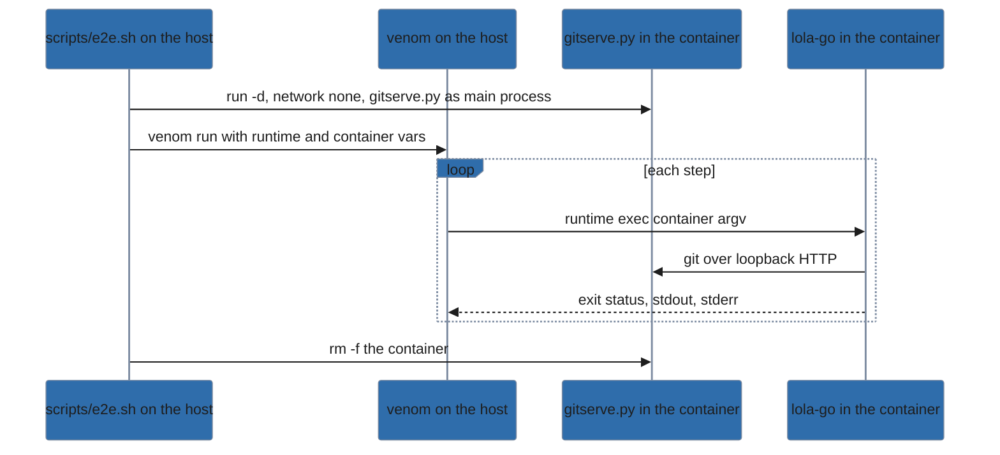

# Testing lola

For contributors: how lola is tested, how to add a spec, a suite or a case, and what is left
untested on purpose. Two layers check the code. Ginkgo specs run in-process on every
`task check`; the end-to-end suites run the release-built binary in a container, before each
release ([release.md](release.md)) and whenever you change what they cover.

| Command | Runs |
|---|---|
| `task test` | Every Ginkgo spec; `MODE=llm` prints only failures. |
| `task check` | `lint`, `test`, `cross` (build and vet, tests included, for Windows and macOS) and `vuln` (`govulncheck`): the gate every commit passes. |
| `task e2e` | Every end-to-end suite; `task e2e -- <suite>...` runs those named. Not part of `task check`. |

Artifacts go to `.test-output/` (`TEST_DIR` overrides it); the suites write theirs to
`.test-output/e2e-<suite>/`.

## Specs

Ginkgo specs, with Gomega matchers, live beside the code, one suite per package.

- **Isolation.** Every spec calls `testenv.Isolate()` (`internal/testenv`). It points `HOME`,
  every XDG directory and git's config and identity at a fresh temporary directory, sets
  `NO_COLOR=1`, clears `LOLA_COLOR`, `LOLA_HOME`, `COLUMNS`, `LINES`, `LOLA_PAGER` and
  `NO_PAGER`, and replaces `PATH` with the spec's own `bin/` (where specs put fake assistants)
  followed by a directory of symbolic links to the few tools specs need (`sh`, `git`, …), so a
  developer's real assistant is never found. Values come back after the spec. No spec uses the
  network.
- **The command tree.**
  - CLI specs (`internal/cli`) run the real cobra tree in-process with buffered, non-terminal
    streams.
  - The viewer's specs drive `viewerModel` with key and window-size messages and read `View()`;
    through `app.view` and `WithTerminals`, they type keys into a pipe that stays open, as a
    terminal does, and set `LINES` and `COLUMNS` for the size.
  - Convention specs walk the live command tree.
  - The conformance suite (`internal/target/conformance`) walks the live target registry. Its
    coaching spec (`coaching_test.go`) plans a module for every finding a target's capability
    table and its own rendering produce. It fails on a finding that has neither a hint nor a
    name in the target's `nothingToDo` list.
  - A new key, rule or finding needs a hint, or an entry there with the reason.
- **No meta tests.** A spec never tests test files, source text, docs or repository layout, and
  never tests a test helper. Convention specs that walk the live cobra tree are fine.
- **Regression names.** A spec that pins a fix keeps the name its design lists; never rename
  one. The MVP design (`docs/superpowers/specs/2026-10-08-lola-go-mvp-design.md`, §11) names
  the specs for bugs of the Python lola, [LobsterTrap/lola](https://github.com/LobsterTrap/lola),
  the tool `lola migrate` moves users from, such as `corrupt JSON config is never overwritten`.
- **Behaviour lives in `internal/engine`.** A new flow gets engine specs first; `internal/cli`
  only adapts it.

### Harnesses

- **Git.** `testenv.ServeGit(root)` serves the bare repositories below `root` over loopback HTTP
  through git's own `http-backend` and returns the base URL; `ServeGitWith` also calls a function
  with every request, so a spec counts what lola fetches; `ServeGitTLS` serves them over HTTPS at
  `https://lola.test:<port>` with a certificate made for the spec, for remote profiles, which
  refuse loopback and plain-http hosts. All three are in `internal/testenv`.
- **Archives.** Specs build archives, hostile ones included, with the standard library's
  `archive/zip` and `archive/tar` writers; `internal/source` (`archive_test.go`: `writeZip`,
  `writeTar`) holds the fetcher's, and other packages' specs write theirs the same way.

## End-to-end suites

The suites under `e2e/<suite>/` check behaviour that only a real process, file system or tool
shows. They run the release-built binary (`CGO_ENABLED=0 GOOS=linux -trimpath`). They need Go (the runner builds
the binary on the host), podman or docker, [venom](https://github.com/ovh/venom), and the network
the first time, to build the image; without a container runtime they print `skipped: the e2e suites
need podman or docker, and neither is on PATH` and exit 0.

| Suite | What it follows |
|---|---|
| `install` | One module from each kind of source through the commands a user runs, the README quickstart first. |
| `template` | A templated module rendered for two assistants and compared byte for byte. |
| `team` | A project a teammate clones: sync, trust, project, user and remote profiles. |
| `market` | Marketplaces, search and `@market/module` installs. |
| `migrate` | `lola migrate` against the real Python lola. |
| `tidy` | `lola tidy` with the trash on another file system. |

### The runner

`scripts/e2e.sh [<suite>...]` (what `task e2e` runs) discovers every `e2e/<n>/<n>.venom.yml`,
runs all suites or those named (`error: no e2e suite named <n>; suites: <list>` for another
name), continues past a failing one, and exits 1 if any failed. It refuses a `TEST_DIR` at or
above the repository or `$HOME` before it writes anything.

It builds one image once: python:3.13-slim pinned by digest, `git` and `zip`, and the Python lola
from upstream at a full-SHA commit, its packages and build backend installed from
`e2e/image/requirements.txt` with `--require-hashes`. It builds by `run` and `commit`, because
buildah cannot mount a build context where overlay mounts nest (`e2e/image/build-image.sh`).
Every pin is in `e2e/image/pins.env`, where `BASE_IMAGE` is derived from `BASE_DIGEST` and cannot
be overridden; the image is named after the commit, a hash of the Python lola's repository, the
digest and a hash of the recipe, so a change to any of them rebuilds it. The build container
alone has the network and the default capabilities. Ctrl+C during the build removes the builder
and exits 130 (143 for TERM).

The runner builds the binary into a `mktemp -d` directory it makes under the artifacts root,
with read-only copies of the suite and `e2e/common`, and removes it on exit; nothing in the
source tree, and no directory already under the artifacts root, is mounted, relabeled or built
into.

### The container



Each suite runs in a container of its own, as root (the uid owning its tmpfs mounts, so git
trusts the repositories), with `--network none`, `--cap-drop ALL` and `no-new-privileges`, and
`HOME` and every XDG directory pinned under `/home/tester`. Five tmpfs mounts hold `/work`,
`/home/tester`, `/home/tester/.local/state` (`XDG_STATE_HOME`, the trash, so moving a file to it from
`/work` crosses file systems), `/run/gitserve` and `/run/e2e-tls` (mode 0700). Git's config is
`/dev/null`, its identity `lola-e2e` and its dates fixed, so a fixture repository's commits have
the same SHAs on every run; `NO_COLOR=1`. The binary is `/opt/lola-go/lola-go`, the suite
`/e2e`, `e2e/common` `/e2e-common`. No assistant is on `PATH`.

The container's main process is `e2e/common/gitserve.py`, a git server for git's smart HTTP
protocol, on loopback port 8765, serving `/srv/git`, which logs each request as `<METHOD> <path>` to
`/run/gitserve/requests.log`: "no request" means the log's line count did not change.

### Steps run in the container

Every venom step is `{{.runtime}} exec [<options>] {{.container}} <argv>`. Any `$`, glob, `&&`,
pipe or redirection sits inside a single-quoted `sh -c '…'` or `python3 -c '…'`, so the host
shell expands nothing, and no step names a host path: the only one venom sees is
`--output-dir`. Venom runs each step as a shell string on the host, so a `$XDG_CONFIG_HOME` outside the quotes
would expand on the host and could write your real `~/.config`. The runner does not enforce
this; review does.

### Shared helpers (`e2e/common/`)

- `hint.py <file> [<index>]` runs one hint of the refusal's `--json` line held in `<file>`, as a
  user pasting it would: the first, or the one at the index given (a trust refusal's second hint
  applies what its first shows). Hints carry author text, so it runs only lola:
  - it accepts a hint only as `lola …` or `<label>: lola …` with a lowercase label;
  - splits it with `shlex` and requires the first word to be `lola`;
  - puts the binary in its place and runs it without a shell, with a 60 s timeout.

  A hint it refuses or cannot read exits 2.
- `jsoncheck.py doc <file>` checks one JSON document, and `jsoncheck.py refusal <stdout>
  <stderr>` a refusal: empty stdout and exactly one stderr line, an object with an `error`
  string and a list of string `hints`. Either way no value may be `null` but the documented
  trust values. It prints the document on one line, for venom's `result.systemoutjson`.
- `snapshot.py <out.json> <root>...` records every file and link below the roots, leaving out
  lola's cache (a refused or dry run fetches into it); `snapshot.py --compare <before> <after>
  [<ignored prefix>...]` prints `unchanged` or the changed paths: the "nothing written" check.
- `tls.sh`, for a suite that needs a git server at a host named by name, makes a test CA limited
  to `git.lola.test` (a name constraint that excludes every IP address, `pathlen:0`, one day) and
  a leaf in `/run/e2e-tls`, keys at mode 0600, maps the name to loopback in the container's
  `/etc/hosts` and starts `gitserve.py --tls` on port 8443. The CA is trusted nowhere: a step
  passes it to git with its own `-e GIT_SSL_CAINFO=/run/e2e-tls/ca.pem` (`{{.tls}}`).

### Output, budget and versions

`MODE=human` (the default) streams venom's output; `MODE=llm` prints one `ok: e2e <suite> passed
in <s>s (log: <path>)` line per suite, or its failure lines. Another value is refused before
anything is built: `error: MODE must be human or llm, not <value>`. Both end with a summary:

```
e2e: 5 passed, 1 failed in 1m12s
  ok    install    11s
  FAIL  market      6s  (log: .test-output/e2e-market/venom.log)
```

With the image cached, each suite should finish within 90 s; the summary marks one that does not
`slow` without failing the run, and the release checklist requires no `slow` mark. Each suite's
`.test-output/e2e-<suite>/versions.txt` records the runtime's version, whether it runs rootless,
and venom's version.

### The suites

The **migrate** suite has the Python lola install its fixtures, snapshots the tree, runs lola-go's
`migrate`, and `scripts/check.py` checks the result against a snapshot taken after the Python lola
installed them, one `ok` or `FAIL` line per check: every path the Python lola wrote ends up lola's, in the
trash, kept, reported, or byte-identical for an unmappable record; its G1 case pins the one-line
JSON refusal of `migrate --json` off a terminal; its C cases move a Python home and project from
another machine, with Claude Code gone, and check the `--map-root` and `--map-target` run that
`lola migrate` hints, then `lola sync --user`. The **tidy** suite runs `lola tidy` where the trash
is on another file system, which unit specs never reach: `scripts/setup.sh` builds a static fixture
(a committed `.mcp.json` and command, a module lola-go installed, residue shaped as the Python lola
leaves it with a `.gemini/skills` directory unit, an instruction file, a `.claude/skills` link out
of the project, and a dotfiles-style `~/.claude` link inside `$HOME`); `scripts/check.py` checks a
`--json` result (exactly these units moved, each crossed file systems, `manifest.txt` names every
trash path) and restores a run by `mv` from its manifest, comparing each trash copy and each
restored item, a skill directory with a subdirectory included, with a snapshot of its tree and
contents taken before the run.

The **install** suite follows one module, `kit`, from each kind of source through the commands a
user runs: the quickstart (`init`, install, edit, reinstall, uninstall), `check`,
a folder installed for three assistants, `list`, a hand-edited file `render` refuses and its
`--force` hint restores, git at a tag and on a branch that moves, archives made by the system's
`zip` and `tar`, user scope, and an accessible-mode confirmation through `script`'s
pseudo-terminal. `scripts/setup.sh` builds `kit.git` and refuses unless its commits are the SHAs
the suite records; the git and archive cases each give lola a cache of their own, since your
cache refuses a second source for a name it holds. Each refusal case reads its one JSON line
with `jsoncheck.py` and runs its first hint with `hint.py`; a trust refusal's second hint,
which applies what the first one shows, runs too. `uninstall` and `cache rm` under `--json` off a
terminal refuse in one line carrying the plan, and their hints apply it. Case I17 runs `lola info`
of a git source and then the install its next step names, as the hint runner runs hints, and
checks from the request log that info fetched and the install made no request.

The **template** suite installs a module whose command uses a var, a partial, an attribute file and
a filter in frontmatter, and compares both assistants' renders byte for byte with
`fixtures/expected/`; edits the entry's vars and re-renders after trust, reading `lock.json`'s
`rendered_with`; refuses a line break rendered into frontmatter with the file and line; and runs a
template that loops without writing (case X4), checking that the process ends with exit 1 within 7 s
and no `lola-go` process is left.

No in-process spec can probe that loop; the Ginkgo spec in
`cmd/lola/templates_test.go` runs a binary it builds on such a loop and checks exit 1 within the
render timeout plus 5 s, and X4 checks the release-built binary in the container.

The **team** suite follows a project a teammate clones: the first sync off a
terminal refuses until trusted, a dry run names the command that applies it, `-y` never trusts,
and pulled pin changes and removals are asked about again; a terminal answers the trust question
in accessible mode. A project profile committed to the repository is trusted before it installs,
`uninstall` refuses a module an active profile lists, a user profile turns on and off, a remote
profile is fetched by git over HTTPS from `git.lola.test` with the test CA, loopback and
plain-http profile sources are refused before any request, and a tracked `lock.json` stops
`render`. Through `script`'s pseudo-terminal, case T14 answers a bare `--trust` run's one receipt
No (nothing written) and then yes, and case T15 answers a hook's question yes in `sync --scope
both`'s collect pass and checks that the hook ran on that consent. Case T16 pulls a commit that
adds the project's pre-install script, checks that the sync refuses until the hint's
`--trust=scripts`, then pulls an edit of the script and checks that the next sync refuses for the
script alone and that the edited script never ran. `scripts/setup.sh` builds `kit.git`,
`lint.git`, `fmt.git`, `profiles.git` and `team.git`, refuses unless their commits are the SHAs
the suite records, and runs `tls.sh`.

The **market** suite registers a folder marketplace and a Python-lola YAML catalog over git,
searches them, installs a relative entry and a git entry, which lola maps only from `https://`
and fetches over HTTPS from `git.lola.test`, refuses another module of the entry's name in your
cache with the `cache rm` that clears it, follows a pin changed in the catalog with `sync --update`,
refuses an `@` address written into `project.yml` before any request, and removes a marketplace
through its one-line refusal's hint.

## Adding a suite or a case

**The reason rule.** An end-to-end case checks only what an in-process spec cannot. Its row in
the e2e design's case tables (`docs/superpowers/specs/2026-10-23-plan-8-e2e-docs-design.md`, the
Reason column) states which of these reasons it has:

| Reason | The case needs |
|---|---|
| **B** | a process-level property of the release-built binary: its exit status, the split between its two streams, or the process ending |
| **P** | a real pseudo-terminal |
| **G** | real git over HTTP or HTTPS from a server process, or git's own view of a work tree |
| **F** | real file systems and tools: tmpfs, cross-device moves, archives made by the system's `zip` and `tar`, root without capabilities |
| **W** | a workflow whose state crosses runs |

A case whose only claim is a CLI behaviour a Ginkgo spec already pins is not added.

**A case** goes into its suite's chain in order: cases run in the file's order and read the
state earlier ones leave, so a case whose state is missing fails rather than being skipped.

1. Name it `<id> <what it shows>` (`T4 The hint trusts and installs`). The id is a letter and a
   number; the existing suites use their own letter (`I` install, `X` template, `T` team, `M`
   market) and another letter for a group within a suite (install's `Q1`, migrate's `G1` and `C`
   cases).
2. Keep every step in the container form above, for example
   `{{.runtime}} exec {{.container}} {{.lola}} install /e2e/fixtures/tpl -C /work/proj --scope project -t claude-code -t opencode`.
3. Check JSON with `jsoncheck.py`.
4. Check a "nothing written" claim with `snapshot.py`.
5. Check a refusal by saving its JSON line to a file in the container, running its
   hint with `{{.hint}} <file> [<index>]`, and asserting the outcome: exit 0 having removed the
   refusal's cause, or exactly the next refusal.
6. Never assert a time.

**A suite** is a directory `e2e/<name>/` holding `<name>.venom.yml`, which the runner discovers;
`task e2e -- <name>` runs it alone.

1. Read the variables the runner passes with `--var`: `runtime`, the podman or docker it found,
   and `container`, the name of the suite's container. Give both a default in `vars:`, as the
   existing suites do (`runtime: podman`).
2. Declare your own variables for the paths above (`lola: /opt/lola-go/lola-go`, `hint:
   python3 /e2e-common/hint.py`, …).
3. Put fixtures in `fixtures/`.
4. If the suite needs git repositories, write a `scripts/setup.sh` that builds them under
   `/srv/git` and refuses unless each commit is the SHA the suite records, and run it in the
   first case (`{{.runtime}} exec {{.container}} bash /e2e/scripts/setup.sh …`).
5. Start the file with a header saying what runs where, as the existing suites do.
6. Keep the suite within the 90 s budget.

## Untested by design

- **Migrate's partial move** (R-6d1-8).
  - The case: `lola migrate` moves a recorded path or the Python lola's home into the trash across
    file systems, and something changes between the copy and the removal.
  - `trash.Move` leaves the changed entries in place and returns a `*trash.ChangedError`; migrate
    then reports where the copy went.
  - The code: `internal/migrate/run.go`, where `Migrate` moves the Python home and its cleanup
    moves a recorded path.
  - Why untested: no fixture can time a change between the copy and the removal, and a test seam
    was refused when the branch shipped.
  - What covers it: the trash specs pin the `Move` contract it relies on.
- **Templating's residual risks**: no in-process spec can probe any of them deterministically.
  - A path inside the liquid engine that grows memory without writing: the Plan 7 design's review
    of liquid covered `render`, `tags`, `values` conversion and range code, not all of
    `expressions` ([architecture.md](architecture.md#templates)).
  - A map nested in a list prints in Go syntax.
  - A template file swapped between `Lstat` and `Open`, which `internal/module/template.go`
    refuses with `os.SameFile`.
- **Docker.** The runner supports docker as well as podman, but the suites have been run only
  with podman (rootless); docker, rootful or rootless, is unverified. `versions.txt` records which
  runtime ran.
