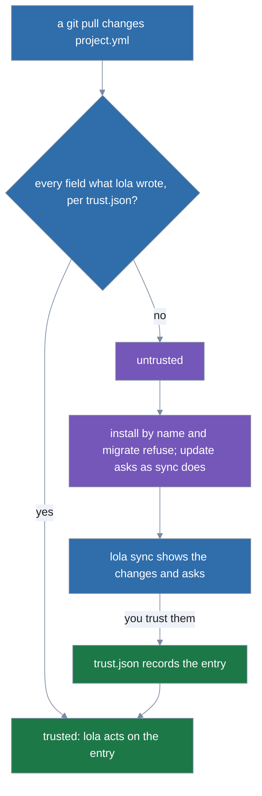

# Using lola

<!-- docs-audit decision (2026-10-28): SPLIT_CANDIDATE declined for this file.
     "Commands" is a command catalog in `lola help` order; splitting it would make lookup worse.
     "Sources and the cache" is one topic, barely over the 250-line budget, and many docs link
     into it. "Choosing what to install" already moved to guides/choosing-what-to-install.md.
     Revisit only if a section becomes a separate task a reader does on its own. -->

This is the reference: one section per command, in the order `lola help` lists them, then the
concepts the commands share. `lola help` is the always-current summary (piped, it prints the
global flags once, then every command with its aliases and own flags). This page describes this
build; changes still to come are tracked in [roadmap.md](roadmap.md).

The guides walk through one workflow each:
[choosing what to install](guides/choosing-what-to-install.md),
[authoring modules](guides/authoring-modules.md), [templating](guides/templating.md),
[sync and trust](guides/sync-and-trust.md), [profiles](guides/profiles.md),
[remote profiles](guides/remote-profiles.md), [marketplaces](guides/marketplaces.md),
[migrating from LobsterTrap/lola](guides/migrating.md) and [tidying](guides/tidying.md).

## Commands

Every command takes the global flags: `--json` and `--plain` pick the
[output](#output-contract), `--no-pager` prints without lola's [viewer](#output-contract), and
`--project`, `--user`, `-C/--root <dir>` and `-s/--scope project|user|both` pick the
[scope](guides/choosing-what-to-install.md#choosing-a-scope). Under "Refusals", each quoted
message is what follows `error:`; a hint that runs a command repeats your run's output, scope,
`-C`, `-t` and `-n` flags (the command a dry run ends with, which applies it, drops `-n`). It
keeps your `-y` only where it runs what you asked at the one scope you asked it of: the command
your dry run ends with, or your command completed with the scope or assistant it lacked, or with
an ambiguous profile name qualified. A hint that changes or narrows a scope you chose, names
another profile or command, or is a dry run (`lola sync`'s `see them: … -n`, any of `lola
tidy`'s under `-n`) leaves `-y` out. The exceptions are listed in the "Known limitations"
paragraph that ends the sections of `lola sync`, `lola profile` and
[Sources and the cache](#sources-and-the-cache).

### `lola install`

```
lola install [<source|name|@market/module>...]
```

Alias: `add`. Fetch the module (if it is a source or a
[marketplace](guides/marketplaces.md#marketplaces) entry), render it for each target, record it in
the file it writes ([Where it is written](#where-an-install-is-written)), and copy what it installs
into your cache. Where a higher layer lists the module (the scope's active
[profile](guides/profiles.md#profiles) over its base), that layer's entry keeps winning: the
install writes its entry and installs nothing of it, and when the entries differ it warns
`<module>: profile go's entry wins; this change to default (base) applies when it is off`. A
run that is cancelled, refused or `-n` leaves your cache as it was. With no argument on a terminal,
walks you through the choices
([Choosing what to install](guides/choosing-what-to-install.md)). A name installs a module already in your cache without
touching its source. Without a scope flag it uses, in order, the terminal's scope picker, the
project with `.lola/` at or above the current directory, then `default_scope` in `config.yaml`
([Choosing a scope](guides/choosing-what-to-install.md#choosing-a-scope)).

| Flag | What it does |
|---|---|
| `-t`, `--target <assistant>` | Install for these assistants (repeatable or comma-separated: `claude-code`, `gemini-cli`, `opencode`). |
| `--ref <ref>` | The git branch, tag or full commit SHA to fetch. |
| `--path <dir>` | The module root inside the source (monorepos). |
| `--profile <name>` | Write the entry into this profile instead of the profile on; `base` is the scope's base (`default` too at user scope). A profile that is off is saved and not applied. |
| `--override` | When the module comes from another layer, give the target its own entry, starting from that one. Keeps the version installed (a folder module, never pinned, installs the version your cache holds). |
| `--skip`, `--only`, `--unskip <selector>` | Each repeatable or comma-separated (`--only skill/a,skill/b`). Skip, keep only, or install again components (`kind/name` or `module:kind/name`), and save the choice in the profile entry the install writes, or, for `project.yml`, in `selections.yaml` ([Component flags](guides/choosing-what-to-install.md#component-flags)). |
| `--global` | Save `--skip`, `--only` and `--unskip` in the global section of `selections.yaml`. |
| `--exact` | With `--only`: save the selectors as an `only:` list, so components a later version adds are not installed; lola names them ([Component flags](guides/choosing-what-to-install.md#component-flags)). |
| `--with-mentions` | Also install the components your picks mention by name, one hop, saved where the picks are ([Mentions](guides/choosing-what-to-install.md#mentions)). |
| `--no-rules`, `--rules` | Leave the module's always-on rules out, remembered in the manifest; `--rules` puts them back. |
| `--strict` | Fail, writing nothing, if any target would drop, change or skip part of a module. |
| `-v`, `--verbose` | Print every notice in full, grouped, instead of one line per module for those that are not about safety ([Output contract](#output-contract)). |
| `--pre-install <path>`, `--post-install <path>` | Your own script for this run, which wraps every module copy the install writes, once per assistant, around the module's own hooks; a relative path is taken from the directory you run lola in, and the script runs from that absolute path, never a file of its name in the module copy ([Install scripts](guides/choosing-what-to-install.md#install-scripts)). No trust is asked. |
| `--trust=<kinds>` | Answer yes, without asking, to lola's questions before it runs code you did not write, of the kinds named, recorded as a yes at the prompt is: `scripts` (the project's install scripts), `hooks` (a module's install hooks), `runtime-hooks` (a module's Claude Code runtime hooks and agent MCP servers), or `all` for the three ([Trust kinds](guides/choosing-what-to-install.md#trust-kinds)). |
| `--force` | Overwrite unowned or hand-edited files and render skipped artifacts that can be, and apply without the review question ([Safety rules](#safety-rules)); it answers the question about files a pick change deletes too. |
| `-n`, `--dry-run` | Print the plan and write nothing, not even `selections.yaml`. |
| `-y`, `--yes` | Apply without the review question: the summary is printed, and the install goes on. Also confirms the files a pick change deletes (below). |

#### Where an install is written

An install writes one file per scope, the first of these that applies:

1. `--profile <name>`: that profile (`base` is the scope's base; `default` names it too at user
   scope and is refused in a project).
2. The profile on, when it is yours or the project's.
3. While a remote profile is on: the base, once you say so. A terminal asks; off one the install
   refuses, hinting `--profile base`.
4. The scope's base: `.lola/project.yml` in a project, your default profile
   (`$XDG_CONFIG_HOME/lola/profiles/default.yml`) at user scope.

A `--profile` that is off is written and nothing is applied; the notice says so (`saved to profile
rust; it is not on at user scope → lola profile --user rust --switch`). Its move hints name that
profile as the move's source (`lola profile --user rust --move kit --to base`), and a move into a
profile that is off keeps it off (`--keep-off`); nothing of the module is installed here to move.
After a write to a project's profile that is off, no move is hinted. A module the target's file
does not list but another layer does (the base under the profile on, or a remote profile as a member
of the bundle on) asks whether to change it in that layer (`--profile base`) or to override it in
the target (`--override`; under a bundle, `--profile <member> --override`). When the profile on is a
bundle, an install asks which member gets the module, and off a terminal refuses with a
`--profile <member>` per member. A read-only layer offers Override alone, and a request equal to the inherited
entry is a notice. `-y` and `--force` answer neither: off a terminal the install refuses, hinting
both flag forms. An override copies the entry without its pin and keeps the version installed, and
an install that changes only picks keeps the installed version too; `lola update` moves it. A
folder module is never pinned: it installs the version your cache holds, as a sync of a cached
folder does. An
inherited entry that is pinned installs at its own ref and pin.

lola writes a profile of yours (`default.yml` included) with no `commit:` or `digest:`: the version
installed is in `lock.json`. A project profile's entries are written with their pins and recorded
as trusted, as `project.yml`'s are. An entry that is a marketplace address (`@market/module`) in
`project.yml` or `default.yml` is replaced by `lola install @market/module`.

Each entry written prints a line naming the file:

```
✓ added mod1 to profile go  (/home/me/.config/lola/profiles/go.yml)
✓ added mod1 to default (base)  (/home/me/.config/lola/profiles/default.yml, new)
✓ changed mod1 in project.yml (base, shared: git tracks it)
```

`added`, `changed` or `removed`; a file of yours shows its path (`new` when the run created it); the
base or a project profile says `shared: git tracks it` when it does; an entry with an `only:`
list adds `only: 4 skills`. Under `-n` the lines read
`→ would add …`. [`edits`](#output-contract) in JSON and `edit` rows under `--plain` carry them.
`lola sync` and `lola update` report the re-pins they write into `project.yml` or a project
profile the same way.

An install that adds a folder or local archive inside a project (at or below a directory holding
`.lola/`, symbolic links followed; never your home directory) to a file of yours (`default.yml`, a
profile of yours) warns once, at that write: `notes (<file>) installs from <path>, inside project
<root>: changes there install without review wherever that file is on`. lola never asks about your
own entries, so a later change there (a pulled commit) installs on the next sync of every scope
that file is on in. After a
user-scope install the warning hints the two-step that keeps it in that project instead (`keep it
in the project instead: lola uninstall --user notes -y, then lola install -C <root> notes`, with
`-t` when the project names no assistants you trust there), when that runs as printed. A later
sync says nothing of it, and neither does an entry you wrote by hand.

An interactive install names the file in each component page's title
(`profile go › review-kit › skills (2)`; `default (base) › …` for your default profile,
`project.yml › …` for the project's). With `--profile`, the question about a module another layer
gives comes before the page; without it, a page whose file a later question decides (under a
bundle or a remote profile, or for such a module) leaves the file out of its title. Answering
Override with the picks unchanged writes nothing and says so (`→ nothing changed: …`). Its review
shows a re-pin as `→ review-kit: re-pinned at 1a2b3c4`, and the equivalent commands carry the
answers to the questions above (`--profile base`, `--override`).

Refusals:

- No argument off a terminal: `lola install needs a module or source`.
- No scope found: `lola install needs a scope: no .lola/ project was found in <dir> or above it,
  and <config.yaml> sets no default_scope (default_scope: project, user or both)`, with one hint
  per scope (`lola install ./my-module --target claude-code --project`, then `--user`, then
  `--scope both` in its place).
- An argument that is neither: `"./nope" is neither a module in your cache nor a source; sources
  are …`, hinting `cached modules: lola cache list`.
- No `-t` and no assistant set up in the project: `none of your installed assistants
  (claude-code, opencode) is set up here, so lola does not know where to install`, with one hint
  per assistant (`lola install ./my-module --project -t claude-code`). An unknown one: `unknown
  target "nosuch"`.
- A module another layer provides, off a terminal (or with `-y`/`--force`): `mod1 comes from
  default (base); lola install needs to know whether to change it there or override it in profile
  go, and there is no terminal to ask on`, hinting the run with `--profile base` and with
  `--override`.
- An unknown `--profile`: `no profile nosuch for user scope`, hinting the profiles the scope can
  use. A `selections.yaml` with a `user:` section: `user: is no longer used; picks for user-scope
  modules live in their profile entries`, hinting `delete the user: section from <path>`, then
  `lola install <module> --user --skip <kind/name>` to re-apply a pick.
- A cached version whose content does not match the digest an entry pins: `cached version
  my-module/1a2b3c4d does not match its digest sha256:…`, hinting `remove it from your cache, then
  install it again from its source: lola cache rm my-module`.
- Another module of that name in your cache: `a different module named "my-module" is already in
  your cache (from <its source>); this one is from <the new source>`, hinting `remove the cached
  one first: lola cache rm my-module`. When `install` finds the cached module installed at user
  scope or in the project it ran for, the hints name `lola uninstall my-module` for each of
  those first, then `then remove the cached one: lola cache rm my-module`; lola cannot see other
  projects.
- A conflict ([Safety rules](#safety-rules)), `--strict` with a finding (`--strict: 1
  finding(s); nothing was changed`), and a project whose `.lola/lock.json` git tracks.
- An install script that is missing, not a regular file or not executable, and a project's that
  is an absolute path, resolves outside the project or is a symbolic link, before anything is asked
  ([Install scripts](guides/choosing-what-to-install.md#install-scripts)); the project's pre-install script without your trust off a
  terminal.

JSON: `modules`, `steps`, `findings`, `notices`, `edits`, `scripts`, `dry_run`, `scopes` and
`equivalent_commands` ([Output contract](#output-contract)).

### `lola sync`

```
lola sync [<module>...]
```

Make the project (or `--user`) match its manifest: install every entry at the version it pins,
render the modules already installed at their installed versions, and remove the ones the manifest no longer lists. Names limit
the run to those modules. Shows and asks about changes to `project.yml` and its active [project
profiles](guides/profiles.md#project-profiles) you have not trusted yet, entry by entry, paging the
diff on a terminal ([Sync, pins and trust](guides/sync-and-trust.md#sync-pins-and-trust)). `--scope
both` syncs the project, then user scope.

| Flag | What it does |
|---|---|
| `--trust[=<kinds>]` | Answer yes, without asking, to the questions of the kinds named that the run would ask: `entries` (the changes to `project.yml`, its top-level targets, and the pins and folder content a sync would write), `profiles` (the changes to its active project profiles, and a project profile taking your profile's place), `scripts` (the project's install scripts), `hooks` (a module's install hooks), `runtime-hooks` (a module's Claude Code runtime hooks and agent MCP servers), or `all`; bare `--trust` is `entries,profiles`, which run no code. It never bypasses a refusal ([Trust kinds](guides/choosing-what-to-install.md#trust-kinds)). |
| `-y`, `--yes` | Confirm removals, and only removals: it never trusts changes. |
| `--update` | Fetch the refs again and re-pin the modules of the run. |
| `-v`, `--verbose` | Print every notice in full, grouped, instead of one line per module for those that are not about safety ([Output contract](#output-contract)). |
| `--force` | Overwrite unowned or hand-edited files, render skipped artifacts that can be, and confirm removals. |
| `-n`, `--dry-run` | Print the plan and the trust diff, ask nothing and write nothing. |

Refusals:

- Changes to trust off a terminal: `lola sync needs your trust for .lola/project.yml, which has
  not been trusted on this machine, and there is no terminal to ask on` (after a pull, `your trust
  for changes to .lola/project.yml`), hinting `see them: lola sync --project -n` and `then
  accept them: lola sync --project --trust=entries` (the kinds missing: `--trust=profiles` for a
  project profile's changes, `--trust=entries,hooks` when a module's pre-install hook would refuse
  too).
- Removals off a terminal: `lola sync needs your confirmation to remove my-module, and there is no
  terminal to ask on`, hinting `see them: lola sync --project -n` and `then confirm them: lola
  sync --project -y`.
- A local source outside the project, a pin whose content does not match, a conflict, and a
  tracked `.lola/lock.json` ([Sync, pins and trust](guides/sync-and-trust.md#sync-pins-and-trust)).
- No manifest: `no project.yml in <dir>`. No scope found: as `lola install`'s, with hints for
  `--project`, `--user` and `--scope both`.

JSON: `scope`, `root`, `dry_run`, `in_sync`, `trust`, `pins`, `removals`, `equivalent_commands`
and the plan's `modules`, `steps`, `findings`, `notices` and `scripts`; with `--scope both`, `{"scopes":
[...]}` ([Output contract](#output-contract)). When sync refuses because it needs your trust or
your yes to removals, its error line adds `trust` and `removals`.

Known limitations: when sync, or the pin it writes, meets another module of the entry's name in
your cache, the refusal hints `remove the cached one first: lola cache rm my-module` without
your run's `--json`, `--plain` or `--no-pager`, which `lola install` keeps. An entry with no targets (`my-module: project.yml gives it no targets`) hints advice,
not a command: `list the assistants in project.yml, for example targets: [claude-code]`
(`default.yml`, or the profile's file, where the entry comes from there).

### `lola uninstall`

```
lola uninstall <module>...
```

Aliases: `remove`, `rm`, `erase`, `delete`, `del`. Remove the module's entry from the layer it
comes from (the [profile](guides/profiles.md#profiles) on, or the scope's base) and everything lola
wrote for it (on the `-t` targets only, if given: the entry keeps the others). The module stays in
your cache; `lola cache rm` removes it there. A module another layer still lists stays installed:
the notice says which layer and the command that removes it there too. When a profile is on and
the module comes from the base, a terminal asks whether to remove it there; off one, `--profile
base` answers. Asks before removing files; `-y` skips the question, and so does `--force`, which
also deletes files you edited since lola wrote them. A run that removes no files asks nothing, and
still writes. Scope as `lola install`'s.

The directories those files leave empty go too, each printed as a step
(`→ delete claude-code .claude/commands/`; JSON `kind` `directory`, `path` without the slash), but
never the assistant's root (the project; at user scope your home, or OpenCode's config directory)
nor a directory directly in it, such as `.claude/`, `.gemini/` or `.opencode/`: lola looks for
those to tell which assistants are set up. Only an empty directory goes: one still holding
anything, or one the same run writes into, stays. A symbolic link is never removed, nor the
directory it leads to, nor one above it; an emptied directory below a link goes when it lies
inside the assistant's root (`~/.claude` linked to `~/dotfiles/claude`: an emptied
`~/dotfiles/claude/commands/` goes), and none a link leads out of that root to. Every run that removes files (`sync`, `update`, `profile`) does the same.

A project uninstall that removes a module whole also clears the module's entry from the project's
section of `selections.yaml` (never the `global` section), so a later plain install installs
everything. It prints `→ <module>: picks cleared: <selectors> (restore: lola install … --skip …)`:
the command, with your scope, `-t` and output flags (never `-y`: the install shows the files it deletes before it asks), saves them again
(`--skip` for `skip:`, `--unskip` for `include:`, `--only … --exact` for `only:`). `-n` writes
nothing and says `picks would be cleared`. A module that stays installed (another layer lists
it, or `-t` leaves it on another target) keeps its picks. JSON: `picks_cleared`, an array
(`[]` when none) of `module`, `section`, `skip`, `include`, `only` and `restore`.

Each entry removed prints a write line (`✓ removed mod1 from profile go  (<path>)`, see
[Where an install is written](#where-an-install-is-written)). An edit to a profile that is off
says `saved to profile rust; it is not on at user scope → lola profile --user rust --switch`.

| Flag | What it does |
|---|---|
| `-t`, `--target <assistant>` | Only uninstall from these assistants, of those it is installed on; the entry keeps the others, and writes `targets:` only when they differ from its file's. With `--profile` naming a layer the module does not come from (a lower layer, or a profile that is off), it narrows that entry's targets and removes no files. |
| `--profile <name>` | Remove the entry from this profile (`base` is the scope's base) instead of the layer the module comes from. |
| `-y`, `--yes` | Do not ask for confirmation. |
| `--force` | Also delete files edited since lola wrote them, without asking. |
| `-n`, `--dry-run` | Print the plan and write nothing. |

Refusals:

- `lola uninstall: "my-module" is not installed in this project`, hinting `installed here: lola
  list --project`. When exactly one installed module matches the name ignoring case, a first hint
  says `did you mean my-module?` with the command, scope flags kept.
- The module comes from the base while a profile is on, off a terminal: `my-module comes from
  default (base); lola uninstall needs to know whether to remove it there, and there is no
  terminal to ask on` (`change it there` under `-t`), hinting `lola uninstall my-module --user
  --profile base -y`. `-y` answers it when that is the one layer that lists the module; where
  several do, the refusal stays and its hint keeps your `-y` and adds `--profile <layer>`.
- A `--profile` that does not list it: `profile go does not list my-module`, hinting `see where it
  comes from: lola list --user`; an unknown one: `no profile nosuch for user scope`.
- `-t` naming an unknown assistant: `unknown target "nosuch"`, hinting the valid ones.
- `-t` naming no assistant the module is installed on: `my-module is not installed on gemini-cli;
  it is installed on claude-code`, hinting `uninstall it there: lola uninstall my-module -t
  claude-code` with your other flags kept. The message names where its entry lists it but it is
  not installed (`it is listed for claude-code, opencode but installed only on claude-code`;
  for an entry never synced, `it is listed for claude-code but not installed there`, hinting
  `remove its entry instead: lola uninstall my-module`). With `--profile` naming a layer the
  module does not come from, `-t` must name a target of that entry: `default (base) lists
  my-module for claude-code, not for opencode`.
- Off a terminal without `-y`, when files would be removed: `lola uninstall needs confirmation,
  and there is no terminal to ask on`, hinting the run with `-y` (`lola uninstall my-module -y`).
- A file edited since lola wrote it: `refusing to change anything: 1 conflict, which --force
  overrides`, each file on its own line, hinting `lola uninstall my-module --force`.

JSON: `modules`, `steps`, `findings`, `notices`, `edits`, `scripts` and `dry_run`; the refusal off a
terminal carries the same keys beside `error` and `hints`.

### `lola list`

```
lola list
```

Alias: `ls`. Each installed module × target with a status: `ok`, `modified` (a file lola wrote was
edited), `missing` (a file lola wrote, or the module copy, is gone), `stale` (`project.yml` pins
another version than the one installed: run `lola sync`), `unreadable` (the version installed is
cached but does not load), or `skipped` (nothing of the module could be rendered for that target),
followed by `→ update available` when your cache holds a newer version for the module's ref (`lola
sync --update <module>`); and each target of an entry `project.yml` lists that is not installed,
`not installed` (`not_installed` in `--json` and `--plain`), with a notice per scope counting them
and naming the sync that installs them (`→ 1 module in project.yml is not installed → lola sync
--project`, keeping `--json`, `--plain` and `--no-pager`); whether the module's rules are on; and,
when any module has some, how many of its components `selections.yaml` skips. `--json` adds each
row's `pin` and `update_available`. A module whose recorded source is a local folder or archive
that no longer exists shows `⚠ source gone` beside its status (`source_gone: true` in
`--json`); git and URL sources are never checked, as `list` reads no network.
`list` never reads the trust record: an entry you declined at sync's trust question shows as
`stale` or `not installed`. Entries of
[profiles](guides/profiles.md#profiles) are listed as the manifest's are, and when any module comes
from a profile a `FROM` column names its layer as the context line does: `default`, `project.yml`,
`profile go-review`, or for a member of a bundle on, `docs (bundle work)`; `--plain` and `--json`
keep `from` as `lock.json` records it (`profile:default`, `profile:user:docs`, `project.yml`).
Without a scope flag it shows the project found from here, if any, and user scope; every row names
its scope ([Choosing a scope](guides/choosing-what-to-install.md#choosing-a-scope)).
Like `lola sync`, it refuses a project whose `.lola/lock.json` git tracks, since a committed one could
turn profiles on.

| Flag | What it does |
|---|---|
| `-t`, `--target <assistant>` | Only show these assistants. |

Refusals: an unknown target, as `lola install` refuses it (`unknown target "nosuch"`, hinting `valid
targets: claude-code, gemini-cli, opencode`); a tracked lock: `.lola/lock.json is tracked by git;
lola keeps it private to your checkout, since a committed lock.json lets a pull decide what lola
deletes; if you never installed with lola in this checkout, untrack and delete it, then run lola
sync --project`, hinting `git rm --cached .lola/lock.json`; when no flag chose the scopes and both
were found, it first hints `list the other scope: lola list --user`.

JSON: `modules` (each `scope`, `name`, `from`, `target`, `status`, `rules`, `source`, `ref`
(absent when empty), `digest`, `pin`, `update_available`, `skipped`, `only` (the `only:` list in
force for the module there, `[]` when none), `only_from` (the layer that sets it: `profile go`,
`default (base)`, `selections.yaml projects[<dir>]`; `""` when none) and `market` (the
marketplace the entry says it was installed through; absent when it names none)) and `notices`.

### `lola update`

```
lola update [<module>...]
```

Alias: `upgrade`. Move every installed module (those named, if any) to the version its source holds
now and render it. The sources are the ones `project.yml` and its active
[profiles](guides/profiles.md#profiles) name; a [marketplace](guides/marketplaces.md#marketplaces)
module follows its catalog, and `update` fetches the catalogs on every run. A ref fetched less than
`cache_fresh_for` ago (`config.yaml`; one day unless it says otherwise) is served from your cache
with no network contact; `--fetch` fetches every ref now. A head with no fetch time recorded counts
as stale, and a folder source is read on every run.

`update` installs nothing and removes nothing. A module no layer lists any more is left as
installed with a `not-in-manifest` warning hinting `lola sync`, which would remove it. A module
whose entry asks for other assistants than the ones installed is left as installed, with a
`targets-differ` finding; `lola sync` applies the change. An entry that comes from a remote
profile is left too, with a notice to run `lola profile <name> --update`. A module named but not
installed in the scope is refused. To render again at the installed versions, fetching nothing,
run `lola sync`.

Trust is `lola sync`'s ([Sync, pins and trust](guides/sync-and-trust.md#sync-pins-and-trust)): a
fresh head that has not moved asks nothing, so within `cache_fresh_for` a run with nothing new
works without a terminal and without `--trust`. A stale head is asked about before it is fetched,
as `lola sync --update` does, even when the fetch will find nothing new: once a head is stale (or
with `--fetch`), `update` off a terminal without `--trust` is refused before it fetches. A pin
that moved is shown and asked about, or answered by `--trust`. In CI, pass `--trust` with the
kinds you accept (`--trust=entries` for pins alone). `--force` never answers a consent question.

| Flag | What it does |
|---|---|
| `--fetch` (alias `--refresh`) | Fetch every ref now, however recently it was fetched. |
| `--trust[=<kinds>]` | Answer yes, without asking, to the questions of the kinds named that the run would ask, as `lola sync --trust` does (bare: `entries,profiles`); it never bypasses a refusal ([Trust kinds](guides/choosing-what-to-install.md#trust-kinds)). |
| `--force` | Overwrite unowned or hand-edited files and render skipped artifacts that can be; never answers a consent question. |
| `--strict` | Fail, writing nothing, if any target would drop, change or skip part of a module. |
| `-v`, `--verbose` | Print every notice in full, grouped, instead of one line per module for those that are not about safety ([Output contract](#output-contract)). |
| `-n`, `--dry-run` | Print the plan and the trust diff, ask nothing and write nothing. At project scope nothing is written; at user scope a dry run may still publish what it fetched into your cache. |

It takes no `-y` (it removes nothing to confirm) and no `-t` (each entry says its own assistants).
Scope is `lola sync`'s: `-C`, `--user` or `--scope project|user|both`; `--scope both` updates the
project, then user scope, and stops at the first that fails or is declined.

Output says `updated <module>` for each module it moved or re-rendered, `already up to date` when
nothing changed, and `<module>: <from> → <to>` for each pin that moved. Two info notices say what
it did not fetch or install:

- `N modules served from your cache (fetched within cache_fresh_for) → lola update … --fetch`,
  when any ref was served from a fresh head instead of fetched; the command is your run with
  `--fetch`. A `--fetch` run has none.
- `N modules are listed but not installed: <names> → lola sync <names>`, for the entries a layer
  lists that are not installed, which `update` never installs; `lola sync <names>` installs them.
  A module installed but no longer listed has its `not-in-manifest` warning instead.

Both commands keep your scope and output flags, and `-n` for a dry run.

Refusals: a named module that is not installed in the scope, hinting `lola sync <name>` when
`project.yml` lists it and `lola install <name>`; a hand-edited file: `refusing to change
anything: 1 conflict, which --force overrides`, hinting the run with `--force`; a tracked
`.lola/lock.json`, as `lola list`'s; changes to trust off a terminal, as `lola sync`'s.

A module whose fetch fails stays installed, and is reported as a `fetch-failed` warning hinting
`lola update <name> --fetch`, after what the fetch itself says to fix first (the refs the
repository has, how to reach it); `update` brings up to date the modules it can reach and then
exits `1`.

A folder module whose source folder is gone is rendered at the version installed, and is not
reported as up to date: its `source-gone` warning says `<module>: source gone; not checked`, with
the folder, and hints restoring it or `lola uninstall <module>` (your scope flags kept). `update`
exits `1`, as for a failed fetch, and does not print `already up to date`.

JSON: the shape of `lola sync`'s: `scope`, `root`, `dry_run`, `in_sync`, `trust`, `pins`,
`removals`, `equivalent_commands` and the plan's `modules`, `steps`, `findings`, `notices` and
`scripts`; arrays are `[]` when empty. A failed fetch appears only as a finding with the code
`fetch-failed`, or `source-gone` for a vanished folder.

### `lola tidy`

```
lola tidy [<kind/name>...]
```

Move what lola does not manage out of the assistants' directories and MCP server lists into the
trash (`$XDG_STATE_HOME/lola/trash/`, one directory per run; tidy never deletes): what you name,
`--all`, or on a terminal what you tick in a picker. Asks first on a terminal (`-y`); `-n` lists
what would move and what is locked (never moved, whatever the flags), and why. Your keep-list,
per scope in `keep.yaml`, names what tidy stops offering ([Tidying](guides/tidying.md#tidying)).

| Flag | What it does |
|---|---|
| `--all` | Move every item that is not locked. |
| `-t`, `--target <assistant>` | Only tidy these assistants' directories. |
| `--include-tracked` | Also offer what git tracks. |
| `--keep <selector>` | Add a `kind/name` selector to this scope's keep-list (repeatable). Alias: `--protect`. |
| `--unkeep <selector>` | Remove a selector from this scope's keep-list, as written there (repeatable). Alias: `--unprotect`. |
| `-y`, `--yes` | Do not ask for confirmation. |
| `--force` | Also move what git tracks, without asking; names or `--all` are still needed. |
| `-n`, `--dry-run` | List what would move and what is locked, and change nothing. |

Refusals:

- Off a terminal (or with `--json`) without names or `--all`: `lola tidy needs names or --all
  when it cannot ask (off a terminal or with --json): 1 item can move`, hinting `lola tidy
  --project --all -y`.
- With them but without `-y`: `lola tidy would move 1 item: command/stray
  (.claude/commands/stray.md); it cannot ask (off a terminal or with --json), so it needs -y to
  move them`, hinting the run with `-y`.
- A scope with no targets and nothing installed: `project <dir> lists no targets and lola
  installed nothing there`, with one hint per installed assistant (`lola tidy --project -t
  claude-code`).
- No scope found: `lola tidy needs a scope: no .lola/ project was found in <dir> or above it, and
  <config.yaml> sets no default_scope (default_scope: project or user)`, hinting `lola tidy
  --project` and `lola tidy --user`, each with the run's other flags.

JSON: `scope`, `root`, `dry_run`, `targets`, `trash`, `size_bytes`, `candidates`, `moved`,
`protected`, `skipped`, `keep_added`, `keep_removed`, `trash_credentials`, `notices` and `hints`.

### `lola profile`

```
lola profile [<name>] [--on|--off|--switch|--add <source>|--update [--all]|--remove]
lola profile [<name>] --edit [<module>...] [--only|--skip|--unskip <kind/name>] [--override] [--new [--from <profile> | --bundle <a>,<b>...]]
lola profile <name> --edit --bundle <a>,<b>...
lola profile <name> --switch --new [--from <profile> | --bundle <a>,<b>...]
lola profile <name> --split [--to <name>]
lola profile [<from>] --move <module>... --to <name> [--switch|--keep-off]
```

Without a name, list the [profiles](guides/profiles.md#profiles) each scope can use (yours, and at
project scope the project's): kind, state (`base` for `default` at user scope, `on`, `in bundle
<the one on>` for a profile or nested bundle the bundle on reaches, `off`; `(bundle)` follows `on`
and `off` for a bundle) and its file. `--json` gives `state` (`base|on|member|off`), `bundle` and,
for a bundle, its `members`. A file that does not load, or a bundle that does not expand, is
listed all the same, with a notice. With a name, show the profile and, per scope, the layer each of
its modules comes from, the layers that entry overrides, and its picks (`only:` and `skip:` lines
under it; a `skip:` list of 10 or more that is the complement of fewer installed components, every
skip naming one component of the installed version, shows as `only (not exact): <picks>; <n> others
skipped`, which is what a non-exact `--only` saves; `--plain` adds them as two last columns, comma-separated; JSON `only` and `skip` arrays
per module); for a profile that is off, what
switching to it would give. Listing and showing never ask for a scope: without a flag they show the
project found from here, if any, and user scope. One action per run. One profile is on in a scope
at a time, over the scope's base (`default` at user scope, `project.yml` in a
project). Refuses a project whose `.lola/lock.json` git tracks.

| Flag | What it does |
|---|---|
| `--on` | Turn the named profile on, when none is. With another on, a terminal asks whether to switch; off a terminal it refuses, hinting `--switch`. `lola profile base --on` is a notice. Aliases: `--enable`, `--activate`. |
| `--off` | Turn off the profile on (name it, or give no name) and apply; asks when files go (`-y`). `--off base` is refused: the base is always loaded. Aliases: `--disable`, `--deactivate`. |
| `--switch` | Make the named profile the one on, whatever is on, and apply; never asks which. `lola profile base --switch` (at user scope also `default --switch`) turns the profile on off. With `--move`: switch to the profile the entries move to. Alias: `--use`. |
| `--edit [<module>...]` | Edit the named profile, else the one edits go to (the profile on; the base), as `lola install --profile <name>` would write it: the modules named, their picks with `--only` (skips of the rest; with `--exact` the entry's `only:` list), `--skip` and `--unskip`, applied where it is on and saved where it is off. Asks no scope (the scope flag's, else the project found here, else user scope); a profile of yours that is on in the other scope too is applied there as well, each scope with its own context line and result. A module another layer gives asks whether to change it there (`lola profile base --edit …`) or give the profile its own entry (`--override`); on a terminal it asks before the module's component page, as does the question of which member of the bundle on gets it, or whether to write the base under a remote profile, so the page is titled with the file the answers write (`profile go-review › cc-skills-golang › skills (7)`). The first name is the profile when one has it and no module does, `base`/`default`, a qualified name, or any name with `--new`; otherwise every name is a module. A name that is both a profile and a module asks on a terminal and is refused off one, hinting each qualified. On a terminal without a module it opens a page: the profile's modules ticked, then each one's components (a module you unticked is removed once asked), a bundle's members, or for a new name whether it `Lists modules` or `Bundles profiles`. Aliases: `--pick`, `--modify`. See [Editing a profile](guides/profiles.md#editing-a-profile). |
| `--new` | With `--switch` or `--edit`: make the profile first, in the same run: yours (`project:<name>` makes the project's), empty unless `--from`, `--bundle` or, with `--edit`, modules. With `--edit` nothing is switched on. See [Bundles](guides/profiles.md#bundles). Alias: `--create`. |
| `--from <profile>` | With `--switch` or `--edit`, and `--new`: copy that profile's entries and targets (a bundle's members too), never a pin. `project:<name>` copies into yours only what a `--move` would carry. |
| `--bundle <a>,<b>` | With `--new`: make a bundle of these profiles, in order (comma-separated). A bare member that does not exist is made empty; a `project:` or `remote:` one must exist. With `--edit`: set a bundle's members, in order (`''` for none), making a bare one that names no profile, and apply them where the bundle is on, or nested in the bundle on. A project's bundle is edited in place; a member list it pulled and you have not trusted is asked about first (`--trust=profiles` answers; `-y` and `--force` never do). |
| `--split` | Rewrite a profile with both `bundle:` and `modules:` into a bundle of its members then `<name>-modules`, which gets the modules and targets. Asks on a terminal (`-y`, `--force`); `-n` prints the plan. |
| `--add <source>` | Fetch a [remote profile](guides/remote-profiles.md) from a git repository or an https archive, show it and ask before keeping it. Alias: `--get`. |
| `--ref <ref>` | With `--add` or `--edit`: the branch, tag or commit to fetch. |
| `--path <dir>` | With `--add`: the directory of the source that holds `profiles/`. With `--edit`: the module root inside the source. |
| `--skip`, `--only`, `--unskip`, `--exact`, `--with-mentions`, `--override`, `-t` | With `--edit`: as `lola install`'s (repeatable or comma-separated), saved in the profile's entry: `--only` skips the rest, `--only --exact` writes its `only:` list, and `--exact` without `--only` is refused. `--override` copies another layer's entry into the profile; it is refused for a project's entry its own sync has not trusted, and for one whose folder lies inside a project, as `lola install --override` is. |
| `--move <module>…` | Move whole entries, in one transaction, from the layer each comes from (or `<from>`, named before it: a profile, `base`, `default` or `project.yml`) to `--to`, keeping the version installed and the picks (a module leaving `project.yml` takes its `selections.yaml` picks into the profile entry: `picks: carried from selections.yaml`; picks a profile entry cannot hold, such as an `include:` over a global or glob skip, refuse the move unless `--force`), and apply. Repeatable or comma-separated. Alias: `--mv`. Across scopes it prints each scope's context line: the target's, where it writes, then the source's once lola knows the entry comes from there. See [Moving a module](guides/profiles.md#moving-a-module). |
| `--to <name>` | With `--move`: a profile of yours or the project's, or `base`; a new name creates your profile. With `--split`: the new profile's name (default `<name>-modules`). |
| `--keep-off` | With `--move` into a profile that is off here: keep it off, so the modules' files are removed here (asked; `-y`, `--force`). |
| `--update` | Fetch the named remote profiles, or `--all`, again, show what changed, ask, and apply them where they are on. Alias: `--upgrade`. |
| `--all` | With `--update`: every remote profile you have. |
| `--remove` | Delete a profile of yours (`user:<name>`, or a bare name only yours has; its file goes to lola's trash) or a remote one; asks (`-y`), and is refused while it is in use (on, in the bundle on, or in a bundle the one on nests) unless `--force`. A bare name both have is refused, naming both; a project's profile is committed (`git rm` it); the base is never removed. Aliases: `--rm`, `--delete`, `--del`, `--erase`, `--uninstall`. |
| `--trust[=<kinds>]` | Answer yes, without asking, to the questions of the kinds named ([Trust kinds](guides/choosing-what-to-install.md#trust-kinds)): `entries` and `profiles` (the changes to `project.yml` and its profiles the run installs, a project profile taking your profile's place, a remote profile `--add` or `--update` shows), `scripts` (the project's install scripts), `hooks` (a module's install hooks), `runtime-hooks` (a module's Claude Code runtime hooks and agent MCP servers), or `all`. `--add` takes `profiles` only (bare `--trust` there is `profiles`); `--update` without a scope flag applies only `profiles` to the update and the other kinds to each scope's sync. |
| `-y`, `--yes` | Confirm removals, and `--remove`; it never trusts changes, nor answers `--on`'s question. |
| `--force` | With `--on`, `--off`, `--switch` or `--edit`: remove files without asking, edited ones too. With `--remove`: remove a profile in use, without asking. Never a consent question, nor `--on`'s question. |
| `-n`, `--dry-run` | Print what the action would change, ask nothing and write nothing. |
| `-v`, `--verbose` | With `--on`, `--off`, `--switch`, `--edit`, `--move`, `--split` or `--update`: print every notice in full instead of one line per module for those that are not about safety ([Output contract](#output-contract)). |

Refusals:

- An unknown name: `no profile nope for user scope` (or `for the project at <dir>`), hinting the
  run that makes it (`make it: lola profile nope --switch --new --user`, with the run's scope and
  output flags, never `-y`) and the profiles the scope can use, or where to write one.
- An action without a name: `--on needs the name of a profile`, hinting `list them: lola profile`
  (`--off` without a name turns off the profile on).
- Two names with `--switch` or `--on`: `one profile is on at a time; to combine go and docs make
  a bundle`, hinting the bundle made and switched to (`lola profile go-docs --switch --new --bundle
  go,docs`), with the run's `--trust`, `-n` and output flags, never `-y` or `--force`. With `--off`:
  `one profile is on at a time; --off takes one name`, hinting the run with each.
- `--on` while another profile is on, off a terminal (or under `-n`): `user:go is on, and --on does
  not replace it without asking; --switch does`, hinting `lola profile user:docs --switch` with the
  scope's flags and the bundle of both (`lola profile go-docs --switch --new --bundle go,docs`),
  and, when the profile on is a bundle of yours or the project's that can take another member and
  has no untrusted pulled member list, adding it to that bundle (`or add it to bundle work: lola
  profile work --edit --bundle go,docs`). On a terminal the question has up to four answers:
  switch to the named profile, make the bundle of both and switch to it, add it to the bundle on
  (which stays on; offered under the same conditions, and the run's own `--trust` applies to the
  edit), or cancel; `-y` and `--force` answer none.
- `--new` without `--switch` or `--edit`: `--new applies to --switch and --edit only`. `--from` or `--bundle` without
  `--new`: `--from makes a new profile and goes with --new`, hinting the switch to the profile that
  exists. `--from` with `--bundle`: `--from copies a profile and --bundle combines several; pick
  one`, hinting each alone. `--new` for a name that exists: `docs names user:docs (<file>); --new
  makes a profile that does not exist yet`, hinting the switch and a free name; for `project:docs` beside `user:docs` (or the reverse) it adds that a bare `docs` would then name two profiles, and the free name keeps the kind (`project:docs-2`). A name that is
  `base` or `default`: `base is reserved for the scope's base; name the profile something else`. A
  `--bundle` member that is no profile you have, or a `project:` one that does not exist, refuses
  with a hint that makes it first.
- `--edit` off a terminal without a module: `lola profile --edit edits profile go by its modules:
  name one, as in lola profile go --edit <module> --only <kind/name>`. A name no profile has: `no
  profile try for user scope; --new makes it`, hinting `lola profile try --edit --new`. `--new`
  without a name; `--from` without `--new`; `--from` with `--bundle`; `--bundle` or `--from` beside
  modules; `--edit --bundle` without a name (`name the bundle to edit`), of a profile that lists
  modules (`go lists modules; a bundle is a file of its own`), of the base, of a remote profile, or
  of a file with `targets:` beside the bundle (`<path>:<line>: targets: a bundle has none`): each
  hints a run that works. A name that is both a profile and a module, off a terminal: refused,
  naming both, hinting each qualified. A module another layer gives, off a terminal: refused,
  hinting `lola profile base --edit …` and `--override`. `--override` of a project's entry its own
  sync has not trusted, or whose folder lies inside a project, is refused as `lola install
  --override` is. An edit of a project bundle whose pulled member list you have not trusted asks
  the trust question first, showing what was pulled and every other change the run would ask about
  (off a terminal it refuses, hinting the same run with `-n`, which prints them, and with
  `--trust=profiles` (and the other kinds shown), which accepts exactly those; `-y` and `--force`
  never answer it).
- `--remove` of a bare name both a profile of yours and a remote one have (`go names your profile
  user:go and the remote profile remote:go`), hinting each qualified; of a project's profile (it is
  committed: `git rm` it); of the base; of a name nothing has (`you have no profile x and no
  remote profile x`). While the profile is in use: `user:go is on at user scope`, hinting the
  `--off` that frees it, then `or remove it anyway: … --force` (never `-y`, which would then be
  refused). `--force` of a profile that a bundle of yours lists leaves that bundle refusing to
  load; the warning prints, for each such bundle, the run that takes the member out.
- `--split` with `--switch`: `--switch and --split cannot be combined; pick one`; `--to` without
  `--move` or `--split`: `--to applies to --move and --split only`. A file without both keys:
  `<file> has not both bundle: and modules:; there is nothing to split`. A remote profile:
  `read-only; lola does not edit remote profiles, and none has a bundle: key`, hinting a copy of
  yours. A split that would trust a project bundle's member list refuses off a terminal (`lola
  profile needs your trust …`), hinting `--split -n` to see it and `--split --trust=profiles -y`.
  Any command that reads a profile with both keys refuses with its line and `lola profile <name>
  --split`; on a terminal it offers the split (`Split work now?`) and then runs again.
- A bundle with a cycle, a member that is no profile, more than 8 levels, or more than 64 profiles
  or 64 bundles after expansion refuses with the `path:line` of the member that crosses; a cycle
  has no hint.
- `--profile` or `--to` naming a bundle: `work is a bundle; it lists profiles, not modules` (an
  install) and `work is a bundle; move into one of its members` (a move), hinting each member.
- A file with `extends:`: `extends: is no longer a key; a bundle combines profiles now`, hinting
  the edit that keeps what it did (replace the key with `bundle: [remote:go]`; with `modules:`
  or `targets:`, the `--split` after it).
- `lola uninstall` of a module the base gives, while a bundle is on, asks whether to remove it
  there, as under any profile; off a terminal it hints `--profile base -y`, and `-y` alone answers
  when the base is the one layer that lists it.
- `--on base` while a profile is on: `the base is always loaded; user:go is on over it`, hinting
  `lola profile base --switch`; `--off base`: `the base is always loaded; lola profile --off turns
  off the profile over it`; `default` at project scope: `default is user scope's base; this
  project's base is project.yml`.
- `--remove` of a profile you do not have: `you have no remote profile x`.
- `--move` without `--to`: `--move needs --to, the profile the entries move to`; `--to` without
  `--move`: `--to applies to --move only`, hinting `drop it`.
- `--move` to a profile that is off, off a terminal, with neither flag: `me is not on at user
  scope; lola needs to know whether to switch to it, and there is no terminal to ask on`, hinting
  the run with `--switch` and with `--keep-off -y`. `--switch` with `--keep-off`: `--switch and
  --keep-off cannot be combined; pick one`, hinting each alone. Both flags are refused with
  `--to base`, and `--keep-off` with a target that is on.
- `--move` of a module whose entry already comes from the target: `kit is in default (base)
  already`. A target that lists the module while its entry comes from another layer asks to
  replace that entry instead (`-y` or `--force` answer it; off a terminal: `profile me lists kit
  already; lola needs to know whether to replace its entry, and there is no terminal to ask on`,
  hinting the run with `-y`). Of a module no layer lists: `kit: no layer at user scope lists it`;
  into `project.yml` from user scope: `project.yml is a project's base; lola profile --move never
  moves an entry into it from user scope`; into or out of a remote profile: refused, it is
  read-only.
- A move out of a project, or from `project.yml` or a project profile into a profile of yours, of
  an entry the project did not install as you trusted it (and an `--override` of `lola install`
  or `lola profile --edit` that would copy one there): `extra is not installed in this project as
  its files list it now; lola copies or moves out of a project only what it installed as you
  trusted it`, hinting `lola sync --project extra`. From a project profile that is off: `extra is in profile
  team, which is off in this project; …`, hinting `lola profile --project team --switch`.
- A move from `project.yml` or a project profile into a file of yours (a profile of yours, or
  `default.yml` across scopes) of an entry whose folder or local archive lies inside a project:
  `notes (<file>) installs from <path>, inside project <root>: changes there install without
  review wherever that file is on; lola keeps a project's local modules out of your files`, before
  anything is written. Moves between a project's own files are
  unaffected.
- A move between scopes whose source changed while you were asked: `extra changed in this project
  while lola was moving it; nothing was written`, hinting the move again.
- `--on`, `--off`, `--switch` or `--remove` without a scope found: `lola profile needs a scope: …
  (default_scope: project or user)`, with one hint per scope (`lola profile x --remove
  --project`, then `--user`).

A change line (`~ cc-skills-golang  897c0d803c71  …`) of `--on`, `--off` and `--switch` names the
version the run installs: for an entry of yours, the one its pin in `pins.yaml` (user scope) or
`lock.json` keeps; an unpinned entry nothing has resolved yet still shows its source.

JSON: listing and showing print `profiles` and `notices` (each profile's `shadowed_by` is the
qualified name of the profile that hides it, or `null` when none does; showing adds each profile's
`read_as` and `modules`); `--on`, `--off` and `--switch` print what `lola sync --json` prints
plus `profile` (the profile on after the run, by qualified name, or `null`) and `changes`, and,
with `--new`, `created` (one object per profile made, the members first: `profile`, `path`, `modules`
(entries copied or 0), and `bundle` (the member names) or `from` (the profile copied), when they
apply; `[]` when none; `--plain` prints a `created` row per profile, `would-create` under `-n`:
profile, path); `--split` prints `plan` (`bundle` and `profile`, each with `name`, `path`,
`members`, `targets` and `modules`), `sync` (the sync document when the split profile is on, else
`null`) and `dry_run` (`--plain` prints a `split` row for the bundle, with its members, and one for
the new profile, with its modules); `--add`
prints `remote_profiles`, `notices` and `dry_run`; `--update` adds `updates` and `scopes` (each
`scope`, `root`, `apply` and `sync`); `--remove` prints `profile`, `file`, `source`, `removed`,
`trash` (where a profile of yours went, `""` for a remote one), `notices` and `dry_run`
(`--plain` prints a `removed` row: the qualified name, the file, and the trash path, empty for a
remote profile; `would-remove` under `-n`); `--edit` with modules prints what `lola install --json`
prints; `--edit --bundle` prints `profile`, `path`, `members`, `was`, `created`, `sync`, `also` (the apply of each other scope the bundle
reaches), `trust` (under `-n` of a bundle that is off, the trust question the run would ask; `null`
otherwise), `notices` and `dry_run` (`--plain`: a `bundle` row, `would-bundle` under `-n`); `--edit --new` without modules
prints the sync document with `created`; `--move` prints `context`, `edits` (a `removed` row for
each entry that leaves a file and an `added` row for each that enters one, every removal first),
`syncs` (what `lola sync --json` prints, one per scope applied, the target's first) and `created`
(the path of the profile it made, absent when none).

Known limitations: lola checks the host of a remote profile and its entries by the URL's text and
never resolves it, so a host name that resolves to a loopback or private address (through
DNS or `/etc/hosts`) is fetched. Two refusals hint advice, not a command: a remote profile entry
on this machine (`my-module: ./my-module is on this machine; a remote profile names only git
repositories and https archives`) hints `ask the profile's author to fix it; lola did not add
it`; `--remove` of a profile `go` that is a member of the bundle on hints `turn the bundle off first:
…`, then, for a bundle of yours, the run that takes it out (`or take go out of bundle mine: lola
profile mine --edit --bundle …`), and for a project's bundle, which is the team's to edit,
`or remove go from the bundle: of <that bundle's file>` (with several files, each is named as it
spells the member).
An unknown name hints where to write a profile, a path ending in a placeholder, not a command:
`no profile nope for user scope` hints `write one: <config>/lola/profiles/<name>.yml; lola
profile --add fetches a remote one` (at project scope it adds `, or the project's:
<project>/.lola/profiles/<name>.yml`).

### `lola market`

```
lola market [<name> [<entry>] | [<name>] --add <source> [--ref <ref>] [--path <file-or-dir>] | <name>... --update | --update --all | <name> --remove]
```

Aliases: `marketplace`, `markets`. Four paths, none of which asks:

- `lola market` lists your [marketplaces](guides/marketplaces.md#marketplaces): format, entries,
  skipped entries, when each was fetched and its source.
- `lola market acme` shows one: its source, pin, every entry with the source lola maps it to, and
  every entry it skips, with why. Its last line is the next step, `→ lola info @acme/<first
  entry>`, with the run's flags.
- `lola market acme formatter` shows the entry: it is the same run as `lola info @acme/formatter`,
  with the same flags (a scope, `-t`, the output flags) and the same output, hints included.
- `lola info @acme/formatter` (see [`lola info`](#lola-info)).

`--add <source>` takes the source, so the name goes before it: `lola market acme --add <source>`,
not `lola market --add acme <source>` (the refusal that follows hints the working order). It fetches a catalog (Claude Code's `marketplace.json` or a lola YAML catalog) and
registers it. lola looks for `.claude-plugin/marketplace.json`, then `<name>.yml`, `<name>.yaml`,
`marketplace.yml` and `marketplace.yaml`, and last, only when none of those exists, the original
lola's `lola.yml` or `lola.yaml` (`name` and `modules`, each with `name`, `description`,
`version`, `repository`, `ref`, `path` and `tags`; `ref` is the branch, tag or commit of a git
`repository`, and an entry that gives one for an archive is skipped), at the root or in the
`--path` directory; `--update` fetches the named ones, or `--all`, again and reports which entries
changed; `--remove` forgets one (asks; `-y`). `--add` and `--update` ask nothing, but a name when
yours is taken and, on a terminal, which of the ssh hosts a catalog names to allow (below). Scope
flags change nothing but what `lola market <name> <entry>` plans for.
`add`, `ls`, `list`, `rm`, `remove`, `update`, `set`, `show` and `search` are not `lola market`
verbs: each is refused with the lola command to run instead.

| Flag | What it does |
|---|---|
| `--add <source>` | Fetch the catalog at this source and register it. Alias: `--get`. |
| `--ref <ref>` | With `--add`: the branch, tag or commit of a git source. |
| `--path <file-or-dir>` | With `--add`: the catalog file, or the directory to look for it in, inside the source. |
| `--update` | Fetch the named marketplaces' catalogs again and report what changed. Aliases: `--upgrade`, `--refresh`. |
| `--all` | With `--update`: every marketplace you have. |
| `--remove` | Forget the named marketplace and drop its cached catalog (asks; `-y`). Aliases: `--rm`, `--delete`, `--del`, `--erase`. |
| `--ssh-host <host>` | With `--add` or `--update` (one marketplace): let the catalog's ssh sources at this host name use your ssh keys. Repeatable. With `--remove`: stop allowing it. |
| `-y`, `--yes` | With `--remove`: forget it without asking. |
| `-n`, `--dry-run` | Report what the action would do, and write nothing. |
| `-t`, `--target <assistant>` | With `<name> <entry>`: the assistants to plan for, as `lola info`'s `-t`. |

A catalog's `ssh://` and `user@host:path` sources are skipped unless you allowed their host. The
host is a name alone (no scheme, user, port or path; lower-cased; never an IP address or
`localhost`), and the allowance is per host, whatever the user or port. On a terminal, `--add`
and `--update` list the hosts the catalog names that you have not allowed, with their entry
counts, all unticked. Off a terminal, with `-n` or under `--json`, nothing is asked: a notice
gives the command with `--ssh-host`. `--update` never widens the list on its own, and a host the
catalog stops naming stays allowed until `--ssh-host <host> --remove`, which re-applies the
cached catalog; a plain `--remove` forgets the hosts with the marketplace. `lola market <name>`
shows them (`ssh hosts`, `via ssh at <host>`). Every other source must still be `https://`.

Refusals:

- An unknown name: `you have no marketplace nope`, hinting `lola market`.
- Three or more names without an action: `lola market <name> <entry> shows one entry, and 2
  were given: formatter, linter`, hinting `lola market acme formatter` and `lola market acme
  linter` for the given entries the catalog lists and does not skip; when none is, `lola market
  acme`, or `lola market` when `acme` is not yours.
- `-t` without `<name> <entry>`: `--target applies to lola market <name> <entry> only`, hinting
  the run without it.
- `--update` without names: `name the marketplaces to update, or update every one with --all`,
  hinting `lola market --update --all`.
- A reserved word: `ls is not a lola market verb: lola market lists your marketplaces`, hinting
  `lola market`; `add` hints the `--add` it means (`lola market acme --add
  https://github.com/acme/plugins`).

JSON: listing prints `markets` and `notices`; showing prints the marketplace's `name`, `source`,
`ref`, `path`, `format`, `commit`, `fetched_at`, `description`, `file`, `owner`, `version`,
`ssh_hosts`, `entries` (each with its `ssh_host`), `skipped`, `notices` and `hints` (`lola info`
of the first entry; `[]` without entries); `<name> <entry>` prints what `lola info` prints; `--add` and `--update` print
`markets`, `changes`, `updates`, `notices` and `dry_run`; `--remove` prints `removed`, `notices`
and `dry_run`.

Known limitation: a catalog entry's host is judged by the URL's text, as a remote profile's is,
and never resolved: an entry at a host name that resolves to a loopback or private address is
mapped and fetched.

### `lola check`

```
lola check [module-or-source...]
```

Report what each assistant would drop, adapt or skip from a module, without writing anything or
adding it to your cache. A source, or `@market/module`, is fetched as `lola cache add` would;
any other argument names a cached module. Defaults to the current directory
([Findings](#findings)). It also names, per module, the components your picks leave out that the
ones you keep mention, with the `lola install … --with-mentions` that adds them
([Mentions](guides/choosing-what-to-install.md#mentions)).

| Flag | What it does |
|---|---|
| `-t`, `--target <assistant>` | Only check these assistants. |
| `--strict` | Exit with an error if any target would drop, change or skip part of a module. |

Refusals: an argument that is neither (`"nope" is neither a source nor a module in your cache;
pass a module folder or another source, e.g. lola check ./my-module; sources are …`, hinting
`cached modules: lola cache list`), an unknown target, and `--strict` with a finding.

JSON: `modules` (each `name`, `targets`, `findings`, `skipped`, and `notices`: each `level`,
`text`, `class`, `[]` when none) and `findings`.

### `lola info`

```
lola info <source|@market/module|module> [-t <assistant>…] [--ref <ref>] [--path <dir>]
```

Aliases: `show`, `view`. `lola market <name> <entry>` is the same run as `lola info
@<name>/<entry>`. Show a module before you install it, running nothing: no install hook,
runtime hook or MCP server. The argument is what `lola install` takes: a module in your cache,
`@market/module`, or a source. A source or a marketplace entry is fetched into your cache as
`lola cache add` fetches it, so installing the cached name afterwards fetches nothing. It prints:

1. The module's identity: name, version, description, source, type, path, digest, format and
   cached heads. A git source also prints `commit:`, the full 40-hex commit it resolved; each
   `head digest:` line is a ref's version digest, never a commit. `--json` has `commit`, `""`
   for a folder or an archive; `lola cache add` and `lola cache list` JSON carry it too.
2. Its contents: skills, commands, agents, MCP servers, rules, install hooks, warnings, the
   [vars](guides/templating.md#vars) it declares with their defaults, and its
   [templates](guides/templating.md#templates), [partials](guides/templating.md#partials) and
   [attribute files](guides/templating.md#attribute-files). Under `mentions:`, each component
   whose text names others of the module (`skill/golang-race → skill/golang-lint`); a mention
   is information, never a dependency. If lola cannot read the module's files to find them, a
   warning says so and the list is empty.
3. What would run code, and when:
   - each native executable (ELF, Mach-O or PE) the module installs, under `ships native
     executables:`: its path, format, kind, architecture and OS, whether it links libraries
     statically or dynamically and which, the Go version and module of a Go program, its size
     and its sha256 (`none` when there are none). See [Native executables](#native-executables).
   - each install hook with its sha256 (what consent is recorded for) and its first 5 lines,
     each cut at 200 characters;
   - the runtime hooks (hook sets, and hooks and agents' MCP servers in components' frontmatter)
     each assistant would run, as the consent question shows them;
   - each MCP server with the command line or URL the assistant would run, for each assistant
     that can express it.
   - Without a plan (no scope, no assistant, or a refusal) they are shown as the module declares
     them, `${CLAUDE_PLUGIN_ROOT}` and its kin unexpanded. Author text is shown on one line.
   - Then the install scripts that would wrap the module's install, in the order they run, each
     with its source and sha256 and whether it needs your trust (a project's): without a scope,
     only your own from `config.yaml`.
4. What installing it here would do, for each scope `lola install` would pick without asking:
   - the plan `lola install -n` prints (files per assistant, findings, `new project at <dir>`
     for a project without `.lola/`);
   - each consent the install would meet (`scripts`, `hooks`, `runtime-hooks`) and whether you
     gave it already, and the `--trust=` kinds still needed;
   - when installing there would be refused (an untrusted `project.yml` entry, a conflict, any
     refusal that coaches), that refusal with its hints instead, and no install; any other
     failure (an unreadable file) is `lola info`'s own error.
   - where a layer provides the module (it is in `project.yml`, your default or the profile on),
     each component as that layer's picks leave it, under `components of <module> here, provided
     by <layer>:` (the layer named as the component lines name theirs): `installed` (the selection takes it), `skipped in <layer>`, `not in the only: list of
     <layer>` or `rules off`, with `(new)` on one the version shown adds over the one installed
     there (nothing is new when that version is no longer in your cache), then
     `→ change it: <command>`: `lola profile <name> --edit <module>` for a profile's or your
     default's module, `lola install <module>` for `project.yml`'s while no profile is on there
     (`lola profile base --edit <module>` while one is), and for a remote profile's module the
     switch to a copy of yours (`lola profile go-mine --switch --new --from remote:go`).
   - A copy of the version already installed needs no `hooks` trust: its hooks run only with
     your consent.
5. The command that installs exactly the version shown, with `--trust=` the kinds still needed
   (none: no `--trust`), keeping your output flags, scope flags, `-C` and `-t`; there is none
   when installing at any scope would be refused, or when every scope already has that version
   installed as planned (installing it again would change nothing).
   - A git source, and a marketplace entry from git without a component selection, is named as
     its git source at the full commit SHA fetched, in place of a branch or tag you gave, since
     a branch can move before you install (`--path` as the source needs); a commit your cache
     holds installs without fetching.
   - An archive, a folder, a cached name and any other entry (one that selects components among
     them) are named by the cached name at the head shown (`--ref <ref>` for a head other than
     the default branch's), which installs from your cache without touching the source.
   - A cached git module without a component selection whose entry in the scope records another
     ref is named by its source at the commit shown instead, so that installing it pins that
     commit in the entry (to follow a branch again, install with `--ref <branch>`).
   - What stays open: if you fetch a cached head again yourself (`lola cache update`, or
     installing the source at a branch) or run `lola market --update` between `lola info` and
     the install, a hint by cached name installs the new head.

   ```
   → install it: lola install https://example.com/kit.git --ref 4f0c2a9e1b7d3c5a6e8f9012ab34cd56ef7890ab --project --trust=hooks
   ```

| Flag | What it does |
|---|---|
| `-t`, `--target <assistant>` | Plan for these assistants, as `lola install -t` would (repeatable or comma-separated). |
| `--ref <ref>` | The git branch, tag or full commit SHA to fetch. |
| `--path <dir>` | The module root inside the source (monorepos); refused with `@market/module`. |

Scope: `--scope` (`both` shows one plan per scope), `--user`, `--project` or `-C`; else the
project with `.lola/` at or above the current directory; else `default_scope` in `config.yaml`.
`lola info` never asks for a scope, on a terminal or off it, and never guesses one. With none,
it shows sections 1 to 3 and the consent it knows without a scope (`runtime-hooks` are needed
but their record is unknown, as it is kept per settings file), says why, and hints the runs that
name a scope, exiting 0:

```
no scope: no .lola/ was found in /work/x or above it, and config.yaml sets no default_scope
  hint: lola info ./kit --project
  hint: lola info ./kit --user
```

`--project` is not hinted in your home directory, where the user scope installs. Without `-t` and
with no assistant set up in the scope, it says which assistants are installed and hints the run
with `-t` and each of them (`lola info ./kit --project -t claude-code`); with none installed it
says so and hints nothing.

`--json` adds `native_executables`, always an array, each entry with `path`, `format` (`ELF`,
`Mach-O` or `PE`), `kind`, `arch` (an array), `os`, `malformed`, `size`, `libraries` (an array),
`linkage` (`static`, `dynamic` or empty), `go` (`go_version`, `module` and `module_version`, or
`null` for a program that is not Go) and `sha256`. `--plain` prints one `native` row each: path,
format, kind, architectures joined by commas, OS, linkage, sha256.

Refusals: no argument: `lola info needs a module or source`, hinting `cached modules: lola cache
list`; an argument that is neither: `"./nope" is neither a module in your cache nor a source;
sources are …`, hinting `cached modules: lola cache list`; `--path` with `@market/module`; and a
fetch failure, as `lola cache add`'s. A source whose module name your cache already holds from another
source is read without being cached, so info shows a fork beside the module it forks; installing it
is what the cache refuses.

JSON: one document. The module's identity and contents: `name`, `description`, `version`,
`digest`, `format`, `source`, `type`, `heads` (each `ref`, `digest`), `skills`, `commands`,
`agents`, `mcp_servers`, `rules`, `hooks`, `warnings`, `vars` (`[{"name", "type", "default"}]`,
`type` one of `string`, `boolean`, `number`, `list`; a number's `default` is a JSON number),
`templates`, `partials` and `attributes` (paths in the module), each `[]` when none, and `path`
(the module root inside the source) when it has one. Then `mentions`: each component that names
others in its text (`component`, `mentions`, both `kind/name`; `[]` when none), and `notices`
(each `level`, `text`, `class`; `[]` when none), a warn when the scan could not read the module. Then `runs`: `install_hooks` (each `event`,
`script`, `sha256`, `first_lines`), `runtime_hooks` (as `lola install` reports them) and
`mcp_servers` (each `name`, `target`, `command`, `args`, `url`) and `scripts` (each `event`,
`source`, `path`, `sha256`, `needs_trust`). Then `install`, one element per
scope: `scope` (`""` without one), `targets`, `steps`, `findings`, `consent` (each `kind`, `item`,
`recorded`: `yes`, `no` or `unknown`), `trust_needed` (kinds), `digest` (the version it
installs), `command` (the next step; `""` without a plan, and in every element when installing at
any scope would be refused) and, when installing there would be
refused, `refusal` (`error`, `hints`), and `new_project` (`true` when the install would create `.lola/`
at the scope's directory), `from` (the layer that provides the module there, as `lock.json` names
it; `""` where none does, and where its scope or the cache cannot be read), `components` (each `kind`, `name`, `state`: `installed`, `skipped`,
`not_in_only` or `rules_off`, `origin`: the layer of the picks that leave it out, `""` otherwise,
`new` and `mentions`; `[]` where no layer provides the module, or its scope or the cache cannot be
read) and `change` (the re-pick; `""` in those cases too). Under `--json` an unreadable scope or
cache gives `from: ""`, `components: []` and `change: ""` and no warning: the warning shows only in
human output. A runtime hook shown as declared has `status` `unknown`. Last,
`no_scope` (the sentence, only when no scope resolved), `no_assistant` (the sentence, only when a
scope lacks an assistant to plan for) and `hints` (`[]` when both a scope and an assistant
resolved).

`--plain` rows are the module's, then `mention` (component, mentioned), `notice` (level, text),
`hook` (event, script, sha256), `script` (event, source, path, sha256, needs_trust),
`runtime-hook` (as `lola install --plain` prints them), `mcp` (name, assistant, command line,
URL), `refusal` (scope, error) each followed by its `hint` rows, `consent`, `from` (scope,
layer), `component` (scope, kind/name, state, origin, new), `change` (scope, command), the steps,
`install`, `no_scope` or `no_assistant` (the sentence), and `hint` rows.

### `lola search`

```
lola search <query>
```

Alias: `find`. Search your cache, then every [marketplace](guides/marketplaces.md#marketplaces)
catalog you have fetched, case-insensitively by name, description and keyword (tags), listing each
hit by what `lola install` takes (`@acme/formatter` for a catalog entry). It never fetches. `lola
cache search` searches the cache alone. When `markets.yaml` cannot be read, it lists your cache's
hits with a warning saying why, as the install pickers offer your cache alone then.

Refusals: no query: `lola search needs a query`.

JSON: `results` (each `name`, `description`, `version`, `keywords`, `where` (`cache` or
`@<market>`) and `install`) and `warnings`. `--plain` rows are name, version, where,
description and install.

### `lola init`

```
lola init [dir] [--format agent-plugins|lola]
```

Scaffold a module named after the directory: by default an Agent Plugins package
(`plugin.json`, one skill, one `dev.getlola` command); `--format lola` writes `lola.yml`, one
skill and one command. It never overwrites a file and refuses a directory holding a module or a
symbolic link on the way to a file it would write. With no `dir` it scaffolds the current
directory, so it first lists the files it would write and asks `Create module <name> in <dir>?`
(default No). Naming the directory, `.` included, asks nothing. Its refusals (a bad name, an
unknown format, an existing module or file, a link) come before the question. Writing a module
is described in [Module layout](guides/authoring-modules.md#module-layout).

| Flag | What it does |
|---|---|
| `--format <format>` | The module format: `agent-plugins` (the default) or `lola`. |
| `-y`, `--yes` | Do not ask for confirmation. |

Refusals:

- Off a terminal, with no `dir` and without `-y`: `lola init needs confirmation, and there is no
  terminal to ask on`, hinting the run with `-y` (`lola init -y`).
- `../my-module is already a module (it has plugin.json)`.
- `lola init cannot scaffold format "nope"`.

JSON: `name`, `path`, `format` and `files`; the refusal off a terminal carries the same keys
beside `error` and `hints`.

### `lola cache`

```
lola cache
```

Manage your cache ([Sources and the cache](#sources-and-the-cache)). Bare `lola cache` lists it,
as `lola cache list` does. Removing a module from the cache does not touch installed files.

#### `lola cache add`

```
lola cache add <source|@market/module>
```

Alias: `get`. Fetch a module into your cache without installing it. `@market/module` fetches an
entry of one of your marketplaces as `lola install` would, its commit pin checked against its
ref (`--path` is refused: the catalog gives it).

| Flag | What it does |
|---|---|
| `--ref <ref>` | The git branch, tag or full commit SHA to fetch. |
| `--path <dir>` | The module root inside the source (monorepos). |

Refusals: no source: `lola cache add needs a source`; another module of that name in your cache,
as `lola install`'s.

JSON: the module's identity and contents, as [`lola info`](#lola-info) starts its document, with
`path` when `--path` gave one.

#### `lola cache rm`

```
lola cache rm <module>...
```

Aliases: `remove`, `uninstall`, `erase`, `delete`, `del`. Remove every cached version of the
modules. Installed modules keep working: each one runs from its own module copy, and `lola
sync` fetches the source again when it needs to. Asks first.

| Flag | What it does |
|---|---|
| `-y`, `--yes` | Do not ask for confirmation. |

Refusals: `nope is not in your cache`, hinting `cached modules: lola cache list`; off a terminal
without `-y`: `lola cache rm needs confirmation, and there is no terminal to ask on`, hinting the
run with `-y`.

JSON: `removed`, the names. The refusal off a terminal carries `would_remove`, the names it
would have removed, beside `error` and `hints`.

#### `lola cache clean`

```
lola cache clean [--unused-for <age>] [--all] [-n] [-y]
```

Remove what your cache no longer needs. Asks first.

| Form | Removes |
|---|---|
| bare | Superseded versions (each version no head points to: a newer fetch of its ref replaced it) and scratch: each `.staging/run-*` and `tmp/check-*` that no running lola holds, a `run-*.lock` or `check-*.lock` left without its directory, and a `.staging/clean-*` a killed clean left. Every module keeps its heads. With `cache_unused_for` set in `config.yaml`, also what `--unused-for` with that age removes. |
| `--unused-for <n>d` or `<n>w` | Also every version no run used for at least that many days (`1w` is 7 days), current heads included: a head whose version goes is dropped, and a module whose last version goes is removed whole. |
| `--unused-for never` | What bare removes, without the configured age. |
| `--all` | Every module, every marketplace catalog and all scratch, except scratch a running lola holds. The cache's lock file and `probes.json` stay. |

| Flag | What it does |
|---|---|
| `--unused-for <age>` | `<n>d` (days), `<n>w` (weeks) or `never`; not with `--all`. |
| `--all` | Remove everything but held scratch; not with `--unused-for`. |
| `-n`, `--dry-run` | Print what would be removed and remove nothing. |
| `-y`, `--yes` | Do not ask for confirmation. |

A version is used when a run installs it (`install`), fetches it (an `install` that applies, or
`info`, of a source, `cache add`, `cache update`, `sync`, `update` fetching it again, `profile
--update`) or renders the version a project records (`sync`, `update`, `profile --on`, `--switch`,
`--update`, their dry runs included); `index.yml` records the day (UTC) as `last_used`, at most
once a day. `lola info` and `install -n` of a cached name, `cache list`, `check`, `list` and
`cache clean -n` record nothing. A version cached before lola recorded uses counts as used the
day a clean first sees it, as does one whose `last_used` entry is not a day lola wrote. A cache
whose `index.yml` lola cannot write (a read-only cache) still installs and renders; the use is
not recorded.

On a terminal clean prints each item with its reason and size, and the total, then asks `Remove
these from your cache?`; under `-n` it prints the same and asks nothing. With nothing to remove it
prints `✓ nothing to clean` and asks nothing. Each item is checked again before it goes: one that
changed since the plan (a head moved onto it, a run used it, it is gone, a directory above it is no
longer a real directory) is kept and reported; when every item changed, clean prints `→ nothing
removed`. A module whose `index.yml`, or an entry, clean
cannot read, when it plans or when it checks again, is kept as `unreadable`, and the clean goes
on. `index.yml` stops naming a version
before the version is removed, and a clean that fails part way puts back the heads of the
versions it did not remove, so no head names a removed version; its error (under `--json`, with
`removed` and `bytes_freed`) says what it had removed. Clean sets items aside only in a
`.staging` that is a real directory. What a clean cannot delete after setting it aside is a
warning, `bytes_freed` counts only what was deleted, and the next `lola cache clean` retries it.

Risk: removing a version a project records makes that project's next `sync` fetch it again,
and a source that moved or is gone fails as it does after `lola cache rm`. Removing catalogs
(`--all`) leaves your marketplaces registered but not fetched: installing from one refuses with
`marketplace <name> is not fetched: its catalog is not in your cache`, hinting `lola market <name>
--update`. `lola sync --update` fetches again only the catalogs of marketplaces that entries
installed in the scope came from; for any other, run `lola market <name> --update`.

Refusals: `--all` with `--unused-for` (cobra's `if any flags in the group [all unused-for] are set
none of the others can be`); an age that is not one: `--unused-for "3x" is not an age; write a
whole number of days or weeks, such as 30d or 2w, or never` (`--unused-for ""` too, which never
falls back to the configured age; in `config.yaml`, with its file, line and key); off a terminal
without `-y`: `lola cache clean needs confirmation, and there is no terminal to ask on`, hinting
the run with `-y`.

JSON: `removed` (each `module`, `version`, `reason`, `path`, `bytes`), `kept` (each `module`,
`version`, `reason`, `path`), `bytes_freed`, `dry_run` and `notices`. `reason` is `superseded`,
`unused`, `scratch` or `all` for a removed item, `in use` (scratch a running lola holds),
`changed` or `unreadable` for a kept one; `module` and `version` are `""` for scratch and
catalogs, and `version` is `""` for a module `--all` removes; `path` is relative to
`$XDG_CACHE_HOME/lola`, as it is on disk when it is plain text, with control and format
characters replaced otherwise. The refusal off a terminal carries the keys `-n --json` prints
beside `error` and `hints`. `--plain` rows: `remove` (under `-n`), `removed` or `kept`, then the
reason, the path and the bytes, and a `notice` row per notice.

#### `lola cache list`

```
lola cache list
```

Alias: `ls`. List the modules in your cache.

JSON: `modules` (each the identity and contents of [`lola info`](#lola-info)) and `warnings`.

#### `lola cache update`

```
lola cache update [module...]
```

Fetch every ref of the named modules again, or of every module if none is named. Installed
modules keep the versions they were installed at; `lola install <module>` installs the new one.

Refusals: `nope is not in your cache`, hinting `cached modules: lola cache list`.

JSON: `updates` (each `name`, `ref`, `from`, `to`, `changed`) and `notices`.

#### `lola cache search`

```
lola cache search <query>
```

Alias: `find`. Search your cache alone, as `lola search` searches it.

Refusals: no query: `lola cache search needs a query`.

JSON: as `lola search`'s.

### `lola migrate`

```
lola migrate
```

Move from the Python lola: install what it installed, with lola, and clean up after it ([Coming from
the Python lola](guides/migrating.md#coming-from-the-python-lola)). It shows the plan and asks
(default No).

| Flag | What it does |
|---|---|
| `--keep-python` | Install, and replace with a backup, but move nothing else to the trash. |
| `-y`, `--yes` | Do not ask for confirmation. |
| `--force` | Also replace, after backing each up into the trash, unowned files outside the recorded paths, recorded files git tracks or that lie below a symbolic link, and module copies; and move files git tracks, without asking. |
| `--trust=<kinds>` | Consent without asking to the kinds named, recorded as a yes at the prompt is: `hooks` (install hooks), `runtime-hooks` (Claude Code runtime hooks), `scripts`, or `all` for the three ([Trust kinds](guides/choosing-what-to-install.md#trust-kinds)). |
| `-n`, `--dry-run` | Print the plan and write nothing. |
| `--map-root OLD=NEW` | Look for a project path or local source this machine lacks, below `OLD`, at the same place below `NEW` (repeatable; [From another machine](guides/migrating.md#from-another-machine)). A map that matches nothing is a warning. |
| `--map-target OLD=NEW[,NEW]` | Install the modules of `OLD`, an assistant this machine lacks, for the assistants `NEW` instead (repeatable; name each `OLD` once). |

On a terminal, without `-y`, it asks for each missing root and each missing assistant before it
plans. While it plans and previews, a terminal's last line says what it is
working on (`… fetching https://github.com/acme/kit`, `… planning project /home/me/proj (3 of 41)`),
and is cleared before the plan prints; with `LOLA_ACCESSIBLE=1` each step is a line of its own, and
off a terminal nothing is printed. The run ends with `next steps:`, everything you can act on, each once: the consent it skipped,
the command that maps what it left (`→ map what this machine lacks:
lola migrate --map-root /Users/alice=/home/alice --map-target claude-code=opencode`).

Refusals: off a terminal without `-y`: `lola migrate needs confirmation, and there is no
terminal to ask on`, hinting `lola migrate -y`. A map it cannot read says what is wrong:
`--map-root "alice=/home/alice": "alice" is not an absolute path`, `--map-target
"claude-code=vim": "vim" is not an assistant lola installs for; write claude-code, gemini-cli,
opencode`.

JSON: `dry_run`, `nothing_to_migrate`, `python_home`, `trash`, `destinations`, `unmappable`,
`not_migrated`, `markets`, `home`, `warnings`, `summary` and `remap` ([Output
contract](#output-contract)); the refusal off a terminal carries the `-n --json` keys beside
`error` and `hints`.

### `lola repair`

```
lola repair [-n] [-y]
```

Forget what `lock.json` records that lola could not have written: an artifact or `created` path
that leaves its target's root (`../`, an absolute path), and a target lola does not know. Every
other command that plans from it refuses such a `lock.json` and hints `lola repair` for its
scope ([Sync, pins and trust](guides/sync-and-trust.md#sync-pins-and-trust)). It lists the entries,
asks (default No), then forgets them; a module left installed on no target lola knows is
forgotten with them. It deletes and moves no file.

| Flag | What it does |
|---|---|
| `-n`, `--dry-run` | List what it would forget and write nothing. |
| `-y`, `--yes` | Do not ask for confirmation. |

It prints `will forget 2 entries in <root>/.lola/lock.json; files are not touched:` and one line
per entry: `module kit: artifact "../outside.md" on target "claude-code"`, `module kit: target
"bogus"`, `created "../settings.json" on target "claude-code"`. After a run that forgot a path
on a target lola knows, or a whole module, it ends with `→ lola sync puts back any file a module
now lacks → lola sync --project`. With nothing to forget it prints `✓ nothing to repair in
<root>/.lola/lock.json` and exits 0.

A run that applies it prints `✓ forgot 2 entries in <root>/.lola/lock.json; no file was
touched:` (`1 entry` for one) and the same entry lines, then one `module <m>: no target lola
knows is left` line for each module forgotten whole, before the `→` lines.

Refusals: off a terminal without `-y`: `lola repair needs confirmation, and there is no terminal
to ask on`, hinting the run with `-y`. When another lola run changed `lock.json` while repair
waited for it: `<root>/.lola/lock.json changed since lola listed what to forget: <entry> is new`,
hinting `lola repair` again; nothing is written. A `lock.json` lola refuses for another reason
(malformed JSON, written by a newer lola, a source, profile or member lola never writes) keeps
that refusal and its hint.

JSON: `dry_run`, `file`, `forgotten` (each `entry`, `kind`, `module`, `target`, `path` and
`key`), `forgotten_modules` and `notices`. The refusal off a terminal carries the `-n --json`
keys beside `error` and `hints`.

### `lola trash`

```
lola trash [<run>]
lola trash <run> [<original>...] --restore [--force] [-n]
lola trash [<run>...] --empty [--older-than <age>] [-n] [-y]
```

`lola tidy`, `lola migrate` and `lola profile --remove` move what they take out of place into the
trash (`$XDG_STATE_HOME/lola/trash/`), one run per command. Each run holds `manifest.txt`, one
`original<TAB>trash path` line per entry, and `run.yaml`: the command that made it, its scope,
project and time, and the copies that may hold credentials. lola never deletes what a run holds
unless you run `lola trash --empty`; a restore that empties a run removes the run.

Without a run, `lola trash` lists the runs, newest first: the id (the run's directory name), its
time, the command that made it, its scope and project, and its files and size. With no runs it
prints `✓ the trash is empty`. A run made before lola wrote `run.yaml` shows the command
`unknown`. With a run, it shows the run's line, then each entry as `<original> → <trash path>`,
and ends with `→ restore them: lola trash <run> --restore`. An entry that is a copy of an MCP or
settings file, or a directory holding one, is marked `(may hold credentials)`.

On a terminal, bare `lola trash` (without `--json` or `--plain`) opens a picker instead of the
list: each run, newest first, as a `[whole run]` row of its time, command, scope and project,
files and size, followed by its files, indented, each path relative to the run's project (whole
when the run has none), a copy that may hold credentials marked `(may hold credentials)` before its
path. `x` ticks a row; `/` filters; Enter moves on to `Do what with the ticked?`: `Restore ticked`
or `Empty ticked runs`; `q` or Ctrl+C quits, changing nothing. A ticked `[whole run]` row takes the
whole run, whatever of its files is ticked; its files' rows stay as they are. The key help under
the picker says what each key does. Nothing is written before lola shows the plan:

- `Restore ticked` shows, for each run, the plan `lola trash <run> [<original>...] --restore -n`
  prints (a run ticked whole names no original), then offers `Restore`. When an original exists,
  the only choice offered is `Restore with --force: first move what is there into a new trash
  run`, and lola asks once more before moving anything. Cancel goes back to the picker, the ticks
  kept. Two ticked runs that would restore the same path (or one inside the other) send you back
  to the picker, naming the path and both runs, before any plan is shown. When nothing ticked is
  left in the trash, lola says `nothing to restore, so nothing changed`.
- `Empty ticked runs` deletes the runs whose `[whole run]` row is ticked, as `lola trash <run>...
  --empty` does: it shows the plan and asks. Ticking only files asks the picker again.

Off a terminal, bare `lola trash` lists the runs as above.

| Flag | What it does |
|---|---|
| `--restore` | Move the run's entries back, or only the originals you name (a relative path is taken from the working directory), making the directories they were in. Aliases: `--undo`, `--recover`. |
| `--force` | With `--restore`: first move what is at an original's path into a new trash run, whose command is `lola trash <run> --restore --force`. Nothing is deleted. |
| `--empty` | Delete the named runs, or every run. It asks first; off a terminal it needs `-y`. Aliases: `--purge`, `--clear`. |
| `--older-than <age>` | With `--empty`: only the runs older than `<n>d` or `<n>w` (weeks of 7 days). A run whose time lola cannot tell, or a run you named that is newer, is kept, with a notice. |
| `-n`, `--dry-run` | With either action: print the plan and change nothing. |
| `-y`, `--yes` | With `--empty`: do not ask for confirmation. |

A restore never writes over what is there: when an original exists, the whole run is refused
(`-n` lists such paths as `⚠ … exist, so the restore is refused`). A link comes back as a link.
A credential copy comes back at mode 0600, as does a marked file inside a directory entry. The
lines of the restored entries leave `manifest.txt`, and a run that then lists nothing is removed.
When an entry is back but lola cannot make a credential copy in it private, the restore still
counts it and warns `restored <path>, but cannot make <path> private (mode 0600): …`.
`--empty` deletes only what it planned: a run whose files or size changed since the plan (a
lola still writing it) is kept, with `trash run <id> changed since the plan, so it is kept;
rerun: lola trash … --empty …`.
An entry gone from the trash is passed over with a warning, and its line is dropped. A run's
files are untrusted data: a manifest line whose trash path lies outside the run, or whose
original is not absolute, is refused with a warning, and `run.yaml` or `manifest.txt` over 1 MiB
is not read.

Refusals:

- `there is no trash run <id>`, hinting `see the runs: lola trash`.
- `trash run <id> does not hold <path>`, hinting the run's entries: `lola trash <id>`.
- `lola trash restores nothing over what is there: <paths> exist`, hinting the run with `--force`.
- `trash run <id> holds <a> and <b>, which one restore cannot both put back; restore one at a
  time`, when two entries share an original or one lies inside the other.
- `--older-than "<age>" is not an age; …`, hinting the run with `--older-than 30d` in its place and
  without `-y`: a hint never drops the age, which would delete every run.
- `--restore needs the run to restore from`; `--force applies to --restore only`; `--yes` and
  `--older-than` apply to `--empty` only; `--restore and --empty cannot be combined`. Each hints
  the run without the flag.
- Off a terminal, `--empty` without `-y`: `lola trash needs confirmation, and there is no
  terminal to ask on`, hinting the run with `-y`.

`--plain` rows: a listing prints `run`, id, time, command, scope, root, files and bytes; showing
a run adds `entry`, original, trash path and `true` or `false` (may hold credentials). A restore
prints `restore` (`-n`) or `restored` with the original and trash path, `exists` with an original
in the way, `displaced` with the new run's id, and `removed` with the run's id when it was
removed. An empty prints `delete` (`-n`) or `deleted` with the run's id and bytes.

JSON: the listing has `runs` (each `id`, `time` (RFC 3339, UTC; `""` when unknown), `command`,
`scope`, `root`, `files` and `size_bytes`) and `notices`. Showing a run gives the run's keys,
`entries` (each `original`, `trash` and `credentials`) and `notices`. A restore gives `run`,
`restored` (entries), `existing`, `displaced` (`""` for none), `run_removed`, `dry_run` and
`notices`. An empty gives `removed` (runs), `bytes_freed`, `dry_run` and `notices`, and its
refusal off a terminal carries the same keys beside `error` and `hints`. Every text a run
supplies is printed with control and format characters replaced, in JSON too.

### `lola version`

```
lola version
```

Alias: `ver`; `lola --version` prints the same. Print lola's version.

JSON: `version` and `go`.

### `lola completion`

```
lola completion bash|zsh|fish|powershell
```

Print a completion script for your shell; it completes commands, their aliases, and flags
(`source <(lola completion bash)`). Another shell is refused: `invalid argument "nope" for "lola
completion"`.

### `lola help`

```
lola help [command]
```

Show help: concise on a terminal; piped or redirected, the full command tree, with every alias. A command's own help (`lola install --help`)
starts with that command's description and usage, then the global flags and the commands below it.

| Flag | What it does |
|---|---|
| `-l`, `--long` | Print the full command tree. |
| `--short` | Print concise help. |

Refusals: `no help topic "nope"; see: lola help`.

## Sources and the cache

A **source** is where a module comes from. lola copies the module into your **cache**
(`$XDG_CACHE_HOME/lola/modules/`, normally `~/.cache/lola/modules/`), so a source can move or
disappear without breaking installs. lola recognizes these forms, first match first:

| You pass | lola reads it as |
|---|---|
| An existing directory | a folder |
| An existing file ending in `.zip`, `.tar`, `.tar.gz` or `.tgz` (any case) | an archive |
| A `file://` URL | a folder or an archive, by what the path is |
| An `https://` URL whose path ends in an archive suffix | an archive, downloaded |
| Any other `https://` or `ssh://` URL, or `user@host:path` | a git repository |
| An `http://` URL | as `https://`, but only for `localhost`, `127.0.0.0/8` or `::1` |

Anything else is not a source: a bare name means a module in your cache, and `@market/module`
an entry of one of your [marketplaces](guides/marketplaces.md#marketplaces), on the command line only (a directory of
that name is `./@market/module`). lola refuses, with a hint:

- an argument, `--ref` or recorded location that starts with `-`;
- git's `<transport>::<address>` remote-helper syntax and `git://` URLs;
- credentials in a URL:
  - any user name or password in an `http(s)` URL (GitHub and GitLab take a token as the user
    name), and any query string or fragment (presigned URLs carry secrets there). The URL is
    written to `.lola/project.yml` and your cache, where a secret would be committed.
  - For git, let a credential helper or `ssh-agent` supply credentials; for a private archive,
    download it and install the file.
  - A user name in an `ssh://` URL or in `git@host:path` is fine, but a password never is, and
    the `user:password@host:path` form is refused (git would pass the password to ssh as part
    of the remote path).
  - `file://` URLs follow the same rules, and `?` or `#` in `git@host:path` is refused like a
    URL's query or fragment.
  - No error repeats a URL's password, query or fragment, or the user name of an `http(s)` or
    `file` URL, not even for a URL that does not parse or the target of a redirect (an `ssh`
    user name is no secret and may appear);
- a source, `--ref` or `--path` that the scope's manifest (`project.yml` or a profile) or
  `lock.json` could not load again (a control or invisible character, such as a zero-width
  joiner in a folder name, a source over 4096 bytes or a ref over 256 bytes), before anything is
  fetched or written; the hint names the field to fix, or, for a module named from your cache
  whose recorded source is the problem, `lola cache rm <name>`;
- an existing file that is not an archive, and a local archive that is not a regular file once
  its links are resolved (a pipe or device named like an archive, or a link to one).

Adding a module to the cache normalizes it: the cached copy holds exactly one `lola.yml`,
generated from the module's manifest. lola reads the first manifest it finds (see
[Module formats](guides/authoring-modules.md#module-formats)) and warns about each lower-precedence one it ignores. A
plugin format is converted once, here: the generated `lola.yml` lists every artifact the plugin
declared, so a cached version means the same thing to every later lola.

For every kind of source:

- `.git`, `.venv`, `node_modules`, `.lola`, `__pycache__` and `.DS_Store` are never copied.
- A relative symlink is copied into the cache as the regular file it names, never as a link, when
  that file is inside the source you gave (the folder, the repository or the extracted archive,
  not just the module's directory) and lola would copy it. Anything else refuses the install
  with the link, the reason and a hint: an absolute link; one that leaves the source; a missing
  target (dangling); a loop or a chain of more than 8 links; a target that is a directory or goes
  through one; a target under an ignored name above, in any letter case, or a Windows short name
  (a path segment ending `~<digits>`, so a real file named like `notes~1.md` cannot be a target);
  and, in a git work tree, a target git ignores. On Windows a link git checked out inside the
  module is a plain file lola cannot tell from one, so it is refused. A link lola would refuse
  that lies outside the module's directory, off the way to it, and that no link in the module
  goes through, is left out without a refusal, such as an archive's test fixture that points to
  an absolute path. The source is the boundary:
  `lola install ~ --path mods/x` can copy a link to any file under `~` that is not ignored.
- `--path <dir>` picks the module root inside the source, for monorepos.

**Folders.** In a git work tree, lola copies the files git would track (`.gitignore` is
respected; new, unstaged files are included). A directory `module/` inside the source is the
module root unless you pass `--path`; `--path .` picks the folder itself. `--ref` is refused, even for a folder that is a git
repository (a local path is always read as a folder; lola reads no branch, tag or commit of it).

**Git.** lola runs your `git` (it must be on `PATH`) with a shallow clone of the default
branch, or of `--ref`: a branch name, a tag name, or a full 40- or 64-character commit SHA.
lola never guesses:

- A ref that names both a branch and a tag is an error, and so is an abbreviated SHA.
- A full commit SHA, in any case, is always that commit, never a branch or tag of that name.
  lola records and shows it lower-cased. A server that serves another commit for it is refused.
- The SHA of an annotated tag object is refused; the error names the commit the tag points to,
  and the hint is your run at that commit.
- Any other hex-looking name is a branch or tag.

A commit that no branch or tag points to needs a server that serves such commits (servers
speaking git protocol v2 do). Only committed files are copied; the module root is `--path`,
else `module/`, else the repository root.
`--path .` picks the repository root and names the module after the repository. lola records
the commit it fetched. A source is fetched again on every install, with one exception: installing
at a full commit SHA that your cache already holds for exactly that source (the same location,
`--path` and selection, the version lola recorded when it fetched that commit) fetches nothing;
lola hashes the cached version again and installs it. A branch, a tag or a short SHA always
fetches.

- Your git config, credential helpers and `ssh-agent` are used. Git hooks, `core.fsmonitor`,
  the `ext::` transport and Git LFS filters are switched off for the repository lola fetches.
- **Git LFS files are not fetched.** A module receives LFS pointer files as they are committed.
- git never prompts for a user name or password (`GIT_TERMINAL_PROMPT=0`). This holds for every
  fetch: modules, marketplaces, profiles and `lola migrate`.
  - A repository git may not read is refused in lola's words, never with git's output: `<url>
    was not found, or it is private and git has no credentials for it` (a server that wants
    credentials looks the same as one hiding a missing repository), `… or it is private and the
    credentials git has, if any, cannot read it`, `git's credentials for <url> were refused`,
    or `the ssh server for <url> refused every key ssh offered, or ssh had none` (hinting
    `ssh-add` when the server takes keys).
  - The hint `git ls-remote -- <url>` (with `-c http.followRedirects=false` for a source a
    catalog named) checks it with your own git, which may ask for credentials and keep them in
    your credential helper; a location too long or odd to print whole gets no hint, and a
    github.com web page or organisation page gets no such check (it would fail on it). A web
    page (`/tree/<ref>/…` or `/blob/<ref>/…`) is called one in the message, and hints your own
    command (`lola info` stays `lola info`, with your scope, `-t`, `-n` and output flags, and `-y`
    on a run that asks) on the repository with `--ref <ref>` and the `--path` it names; a path
    ending in `skills/` hints the repository root or the directory above it, and the message says
    `--path skills/<name>` takes one skill. The same holds for a `--path` naming a `skills/`
    directory: the hint is your command on the directory above it.
  - Only git's own `fatal:` lines and ssh's are read, never a server's `remote:` lines.
  - ssh still can prompt: it asks on the terminal for a key passphrase or an unknown host key.
    Load your key into `ssh-agent` and add the host to `known_hosts` first, or the fetch waits
    until it gives up after 5 minutes. A child process that keeps git's output open (ssh
    prompting, a stalled https helper) delays that stop by at most 5 more seconds.

**Archives.** zip, tar and gzip tar, chosen by the file name's suffix. `--ref` is refused.
The module root is the first of:

1. `--path`, relative to the archive's root as `tar tf` or `unzip -l` show it;
2. the shallowest directory holding `lola.yaml`, `lola.yml`, `.lola.yaml`, `.lola.yml`,
   `plugin.json` or `.claude-plugin/`;
3. the parent of the shallowest `skills/`, `commands/`, `agents/` or `rules/` directory;
4. the archive's single top-level directory, if that is all it holds;
5. the archive's root.

Two different candidates at the same depth are an error; pick one with `--path`. Without a
`lola.yml` name, the module is named after its root directory, or after the archive file
(without its suffix) when the root is the archive's root.

An archive may hold only regular files and directories. lola refuses the whole archive if any
entry is absolute, contains `..` or a backslash, is a link or device, or repeats a path. Files
keep only their execute bit (`0755` or `0644`). Limits, which are not configurable:

| Limit | Value |
|---|---|
| Entries | 20,000 |
| Zip central directory | about 19.5 MiB (1 KiB for each of 20,000 entries), checked before it is read |
| Unpacked size | 512 MiB in total |
| Compression ratio of one zip entry | 200 to 1 |
| Download size | 256 MiB |
| Download time | 2 minutes |
| Redirects | 5, never from `https` to `http`, and never to `http` off loopback |

Once a module is cached, `lola install <name>` uses the cached copy without touching the source:
the cache's newest version for the ref the project already records for it (`--ref` picks
another). `lola cache update` fetches every cached module again: a git branch (or the default
branch) may have moved, a local archive is read again, and an archive URL is downloaded again.
The content digest decides whether anything changed. Installed modules keep the versions they
were installed at: `lola list` shows `→ update available`, and `lola install <name>` installs
the new version.

**Pins.** When lola installs a git or archive module, it records the version in the module's
entry in `project.yml` or a project profile: `digest`, the sha256
of the module's content, and for git `commit`, the commit the fetch resolved. lola never writes a
pin into a profile of yours, `default.yml` included: the version installed is in `lock.json`. `ref` stays what
you asked for. A folder module is never pinned. A manifest or `lock.json` may come from someone
else, so lola checks every entry when it reads them and refuses, before running git, a source or
ref that git would read as an option, a git remote helper (`ext::…`), `git://`, a path that
leaves its source, a commit or digest lola would not write (a `commit` on an archive or a folder
included), and any control or invisible character.

A git checkout holds the bytes as committed on every machine: lola turns off line-ending
conversion and every `.gitattributes` conversion and filter for its checkouts, and refuses a
symbolic link inside the module's `--path` (anywhere in the repository when there is no
`--path`) or on the way to it, before checking anything out; a link elsewhere in the repository
is allowed. A git `--path` must name a directory of the repository in its exact letter case, so
a case-insensitive file system never checks out another one in its place. Execute bits come from
the source itself (git's file modes, an archive's entry modes, a folder's files), never from the
file system lola copied to, so the same module has the same digest on Linux, macOS and Windows.

**Trust.** `project.yml` is committed, so a `git pull` can change it. lola keeps, per project,
what it last wrote there in `$XDG_STATE_HOME/lola/trust.json`: the top-level `targets` and each
entry's `name`, `source`, `ref`, `path`, `components`, `commit`, `digest`, `targets`, `rules`,
`vars` (the entry's overrides of the module's [vars](guides/templating.md#vars)), `member` (for a
project profile's entry that comes from a remote profile that is a member of a project bundle:
that profile's name, source and pin), the member list of each project bundle (`bundle`) and `market` (the marketplace an entry says it came from; the diff shows it as `market
(as written)`, since lola never checks it).

An entry is **trusted** when every one of those fields is what lola wrote. Each write lola makes trusts
exactly the fields it changes, so after a pull adds an entry or changes one, installing another
module leaves that entry untrusted.



lola refuses to act on an untrusted entry as written:

- `lola install <name>`, a `lola uninstall -t` that keeps some of its targets, and
  `lola migrate` refuse with `<name>: project.yml changed for it since you last trusted it` (for
  an entry a pull added: `<name>: project.yml added it since you last trusted the file`; with no
  record: `<name>: project.yml has not been trusted on this machine`), and the hint
  `review and apply it: lola sync --project <name>`; the partial uninstall adds
  `or remove it: lola uninstall --project <name>`;
- an install, by name or by source, that would take its assistants from top-level `targets` you
  have not trusted (no `-t`, and no entry with `targets` of its own) refuses before fetching
  anything with `project.yml's top-level targets changed since you last trusted them`, hinting
  `lola sync` or your own install with `-t <id>` added (your `--ref` and `--path` kept); the
  install pickers ask for the assistants instead and never preselect those targets;
- the install pickers leave such modules out, with one notice per project:
  `2 modules in project.yml changed since you last trusted them: a, b → lola sync --project` (`are new or
  changed since you last trusted the file` when a pull added one). Add a
  source… in the pickers adds the module to your cache and lists it by name, so it is left out
  too; Change scope onto a project where a module you picked is untrusted stops with the refusal;
- `lola update` asks about it as `lola sync` does, and off a terminal needs `--trust`
  ([Sync, pins and trust](guides/sync-and-trust.md#sync-pins-and-trust)).

An argument that names such an entry is taken as that name, even when a folder of that name is
in the current directory: write the folder as `./<name>`.

`lola sync <name>` shows such changes and asks you to trust them
([Sync, pins and trust](guides/sync-and-trust.md#sync-pins-and-trust)), which is what every refusal hints. Every
`lola sync`, `lola update` or `lola install` command lola prints carries your scope: `--user` at
user scope, `--project` for the project found from the directory you ran lola in, and
`-C <root>` for another; so does an
install's `retry with: lola install <names>` after a failure that left fetched modules in your
cache, which these refusals and conflicts leave out, since retrying would refuse again. Installing the
module from its source still works, and writes the entry as new, keeping none of the changed
entry's `targets`, `rules`, `ref` or `path`, but it installs what the source serves now without
letting you review the change as sync does, so lola no longer suggests it. Without `-t`, such an install keeps the
module on the assistants this checkout installed it on (`lock.json`), not on targets a pull set.
Removing the module (`lola uninstall <name>`) always works. A project with no record in
`trust.json` (a fresh clone, a moved directory, a deleted state directory) has every entry
untrusted until you trust them with `lola sync`. `lola sync`, `lola update`, `lola install` and
`lola uninstall` refuse a project whose `.lola/lock.json` git tracks, before fetching anything,
since a committed `lock.json` lets a pull decide what lola deletes; lola keeps it private to each
checkout. The hint untracks it: `git rm --cached .lola/lock.json`, with `-C <project>` when you
run lola from elsewhere. If you never installed with lola in that checkout, the error says to
untrack and delete it, then run `lola sync`.

A local source is read through its symbolic links once: lola records the real path, and a source
you type relative to the project is recorded relative to the project's real root, however you
reached it. A local archive given through a symbolic link must resolve to a file with the same
archive suffix as the path you typed; otherwise lola refuses and suggests installing the target
itself (`lola install <target>`). When it is accepted, a module without its own name takes its
name from the target file.

Installing a module also gives it a **module copy**: `.lola/modules/<module>/` in the project, or
`$XDG_DATA_HOME/lola/user-modules/<module>/` at user scope. `${PLUGIN_ROOT}` ([Module
layout](guides/authoring-modules.md#module-layout)) points there, so removing a module with `lola
cache rm` never breaks an installed one; `lola sync` fetches the version it renders again if it
needs to: a git module by its commit, which must still be on its ref, and an archive whose content
must still match. When the version is the pin `project.yml` names and the fetch returns other
content or the commit is not on the ref, it suggests `lola sync --update <name>` to re-pin; when it
is the version installed of an entry that pins none (a git version with no recorded commit, say), it
suggests `lola install <source> [--ref r] [--path p]`, which installs what the source serves now, or
`lola uninstall <name>`. Hooks may build inside the copy: lola leaves its content alone, replaces
the copy only for a new version, when it is gone, or when the module gains a target `lock.json` does
not record it on (`lola install -t`, or a target added to `project.yml`), and then runs the hooks
again with your consent. Without it, a pre-install hook refuses the run and a declined post-install
hook stays pending (see [Hooks](guides/authoring-modules.md#components)). Reinstalling the version
already installed on the same targets with `lola install` replaces the copy from the cache to run
its hooks again when you consent; without consent the copy stays as it is. `lola sync` replaces it
for the same version and targets only to run a pending post-install hook, when you consent; declined
again, the copy stays as it is.

Known limitations: three refusals of a source read from a file (a manifest, profile or catalog
entry) hint advice, not a command: a ref that starts with `-` (`ref "-x" starts with '-'`) hints `a
branch, tag or commit never starts with '-'`; a folder location that is not absolute (`folder source
x is not an absolute path`) hints `give the absolute path of the folder`; and an archive location
that starts with `//` (`archive location starts with //, a URL without a scheme`) hints `give the
archive's https:// URL or its absolute path`.

## Scopes and targets

- **Project scope** (`--project`, or `-C <dir>` for another directory): files go into the
  project; state lives in `.lola/`. Which scope a command acts on without a flag is in
  [Choosing a scope](guides/choosing-what-to-install.md#choosing-a-scope).
- **User scope** (`--user`): files go into your home directory (OpenCode's into
  `$XDG_CONFIG_HOME/opencode/`); state lives under `$XDG_CONFIG_HOME/lola/` (your default
  profile `profiles/default.yml`, the base) and `$XDG_STATE_HOME/lola/` (ledger `lock.json`). Rules installed at user scope
  apply in every project.

The targets are `claude-code` (Claude Code), `gemini-cli` (Gemini CLI) and `opencode`
(OpenCode).

When you do not pass `-t`, lola uses the manifest's targets. Otherwise it offers the assistants
installed on your machine (their command, `claude`, `gemini` or `opencode`, is on your
`PATH`): on a terminal you pick from them, with those already set up in the project preselected,
or every installed assistant preselected when none is set up (with only one installed, lola
uses it without asking); off a terminal lola uses the ones both installed and set up. An assistant is set up in a project when it has `.claude/` or
`CLAUDE.md` (Claude Code), `.gemini/` or `GEMINI.md` (Gemini CLI), or `.opencode/`,
`opencode.json` or `opencode.jsonc` (OpenCode); at user scope, when `~/.claude/` or
`~/CLAUDE.md`, `~/.gemini/` or `~/GEMINI.md`, or `$XDG_CONFIG_HOME/opencode/` exists. A target
you name with `-t`, or that the manifest lists, is always rendered, installed or not, for
example in a container that only prepares files.

lola runs an installed assistant once, with `--version`, to learn which version you have, and
caches the answer in `$XDG_CACHE_HOME/lola/probes.json` until the binary changes. The version
never changes what lola writes (teammates on other versions get the same files); lola only
warns when your version lacks something the module uses.

What lands where for `claude-code`:

| Artifact | Project scope | User scope |
|---|---|---|
| Skills | `.claude/skills/<skill>/` | `~/.claude/skills/<skill>/` |
| Commands | `.claude/commands/<command>.md` | `~/.claude/commands/` |
| Agents | `.claude/agents/<agent>.md` | `~/.claude/agents/` |
| MCP servers | `.mcp.json` → `mcpServers.<name>` | `~/.claude.json` → `mcpServers.<name>` |
| Rules | `.claude/rules/lola/<module>/<rule>.md` | `~/.claude/rules/lola/<module>/<rule>.md` |

For `gemini-cli` (user scope: the same paths under `~`):

| Artifact | Project scope |
|---|---|
| Skills | `.gemini/skills/<skill>/`; `name` is added from the directory when missing; Gemini neither runs shell nor fills argument placeholders in skills, so lola warns when a skill has them |
| Commands | `.gemini/commands/<command>.toml`: `description` and `prompt`, with `$ARGUMENTS` as `{{args}}`; Gemini has no single-argument placeholders, so `$ARGUMENTS[N]`, `$N` and the names listed in `arguments:` stay as written and the prompt starts with the whole argument string; Gemini has no escape, so a Claude-escaped `\$1` becomes `$1` (only a single backslash escapes; after `\\` the placeholder is still read as one); a `commands/<command>/` directory is copied alongside, and Gemini reads every `*.toml` file inside it as a namespaced command (`<command>:<file>`) |
| Agents | `.gemini/agents/<agent>.md`, keeping only `name`, `description`, `kind` (`local` or `remote`), `display_name`, `tools` (a list of Gemini tool names such as `read_file` or `mcp_<server>_<tool>`), `model` (`gemini-…`), `temperature`, `max_turns` and `timeout_mins` (positive integers). Gemini refuses to load an agent with any other key or value of another shape, so lola drops those instead. An agent whose `tools` uses other names, such as Claude's `Read` or `mcp__server__tool`, is skipped: Gemini gives an agent without `tools` every tool, so dropping the list would lift the restriction (`--force` installs it without the list) |
| MCP servers | `.gemini/settings.json` → `mcpServers.<name>`: `command`, `args`, `env`, `cwd`; `httpUrl` for http, `url` for sse |
| Rules | `.gemini/lola/<module>/GEMINI.md` (the module's rules in name order), listed in `.gemini/settings.json` → `context.includeDirectories` (at user scope by absolute path, so every project's Gemini session can read that directory). Gemini loads these rules, and project MCP servers, only in a trusted folder, and project-scope ones only when `gemini` starts at the project root, not in a subdirectory |

For `opencode` (user scope: the same paths under `$XDG_CONFIG_HOME/opencode/`, without
`.opencode/`):

| Artifact | Project scope |
|---|---|
| Skills | `.opencode/skills/<skill>/`; names are lowercase words joined by single hyphens, and a `name` in the frontmatter must equal the directory; OpenCode neither runs shell nor fills argument placeholders in skills, so lola warns when a skill has them |
| Commands | `.opencode/commands/<command>.md`, keeping only `description`, `agent`, `model` (`provider/model`) and `subtask`; Claude counts arguments from 0 and OpenCode from 1, so `$0`, `$ARGUMENTS[0]` and the first name listed in `arguments:` become `$1`, and so on (`$ARGUMENTS` stays); OpenCode has no escape, so a Claude-escaped `\$1` or `\$ARGUMENTS` is kept but OpenCode still fills it in; OpenCode runs ``!`…` `` anywhere in a command without Claude's permission checks and never runs a ```` ```! ```` fence; a `commands/<command>/` directory is not copied, as OpenCode would read its files as commands |
| Agents | `.opencode/agents/<agent>.md` with `mode: subagent` unless the agent sets a mode; `name` is dropped and `model` is kept only as `provider/model`. OpenCode cannot express a tool list and gives an agent without one every tool, so an agent with a non-empty `tools` is skipped (`--force` installs it without the list). OpenCode refuses to start on an invalid agent value, so lola drops a `color` other than `#rrggbb` (OpenCode 1.18 also takes theme names such as `accent`, but later versions reject them), a `mode` other than `subagent`, `primary` or `all`, a non-numeric `temperature` or `top_p`, a `steps` or `maxSteps` that is not a positive integer, a non-boolean `hidden` or `disable`, a non-string `variant` and a non-map `options`. `permission` is passed through unchecked |
| MCP servers | `opencode.jsonc` if it exists, else `opencode.json` → `mcp.<name>`: `{"type": "local", "command": [...], "environment"}` or `{"type": "remote", "url", "headers"}`; `${VAR}` becomes `{env:VAR}`. OpenCode merges both files and `opencode.jsonc` wins, so a server of the same name in `opencode.json` is overridden by lola's |
| Rules | `.opencode/lola/<module>/<rule>.md`, listed as `.opencode/lola/<module>/*.md` in the same file's `instructions` (at user scope by absolute path) |

## Choosing what to install

How lola decides the scope, assistants and components for an install is in [Choosing what to install](guides/choosing-what-to-install.md).

## Findings

When a target cannot express part of a module, lola tells you instead of failing the whole
module. Each **finding** has a severity:

- **info**: a lossless adaptation, or a choice you made. Shown by `lola check` and in `--json`
  output, and by `install`, `sync` and `update` (under `-v` for a detail finding) when it
  carries a hint.
- **warn**: something is dropped or changed, but the artifact works; it is installed.
- **skip**: that artifact is left out for that target, because the assistant could not use it
  (for example an agent without a `description`); everything else is installed.

`--force` also renders skipped artifacts that can be rendered (it never invents a place for
something the assistant has no place for). `--strict` turns every remaining warn or skip into an
error before anything is written; use it in CI. A `--force` render is not remembered: a later
`lola sync` or `lola update` without `--force` skips (and removes) those artifacts again.

Each finding has a stable code, shown by `--plain` and `--json`. A forceable skip is one that
`--force` can render; a skip that `--force` rendered is reported as a warn.

A finding you can act on carries a hint (`hint:` under it, `hint` in `--json`). The hint names
the change to make to the module: usually an entry in the component's `.targets.yaml`
[attribute file](guides/templating.md), such as `gemini-cli: {hooks: null}`, or a template
branch on `target` in its `.md.liquid` file. Or the hint is a command. A forceable skip's hint
ends with your run plus `--force`, for example `or render it anyway: lola install ./kit --force`.
A hint that tells the module's author what to change in its files is printed by `lola check`
and kept in `--json`; `install`, `sync`, `update` and `lola profile` print only the rest (the
`render it anyway:` run), since you may not be able to edit the module. A safety finding that has
such a fix names first the `lola check` that prints it, for example `the module's own fix: lola
check --project kit -t gemini-cli; or render it anyway: lola install kit --force`, when a check
can name the version installed.

Each finding and notice has a **class**, `class` in `--json`. **safety** is what you need to
know about your own machine and data: runtime hooks skipped or awaiting consent, native
executables, unowned or hand-edited files, refusals, what a run did to your picks, and what an
agent may do without asking (`claude-code/allowed-tools`, `claude-code/permission-mode`,
`agent-tools-unenforceable`). **detail** is what an assistant loses or adapts from a module, and
the components your picks mention but leave out ([Mentions](guides/choosing-what-to-install.md#mentions)).
Anything lola does not class is safety. `install`, `sync`, `update` and `lola profile` print
safety in full and detail as one line per module ([Output contract](#output-contract)).
Some findings have no hint, because there is nothing to do:
- `kind-unsupported`, `mcp-cwd-dropped` and `command-sidecar-dropped`: no change gives the
  assistant a place for the item;
- lossless adaptations (`gemini-cli/arguments`, `opencode/env-reference`, an info
  `frontmatter-key-dropped`);
- the review notices `claude-code/allowed-tools` and `claude-code/permission-mode`;
- the `probe/*` notes;
- `module-warning` and template errors, whose text already says what to change.

`lola check` reports each [template](guides/templating.md#templates) error as a `skip` finding of its component for
each assistant, with the error's code: `template-too-large`, `template-invalid-utf8`,
`template-tag-unavailable`, `template-range-unavailable`, `template-too-many-assigns`,
`template-too-deep`, `template-include-name`, `template-include-missing`,
`template-include-cycle`, `template-include-too-deep`, `template-include-limit`,
`template-undeclared-var`, `template-syntax`, `template-undefined-variable`,
`template-undefined-filter`, `template-value-too-large`, `template-value-type`,
`template-output-too-large`, `template-panic`, `template-frontmatter`,
`template-frontmatter-fence`, `template-frontmatter-value`, `template-name-mismatch` and
`template-rendered-check`. Install, sync, render and profile
switches refuse on the first one instead. `template-timeout` and `template-run-budget` refuse
the run, `lola check` included: they are never skip findings.

| Code | Severity | Forceable | Meaning |
|---|---|---|---|
| `kind-unsupported` | skip | no | The target has no place for this kind of artifact (in this build, `gemini-cli` and `opencode` for a module's runtime hooks). |
| `name-rejected` | skip | yes | The target rejects the artifact's name (for `opencode`, also a skill whose `name` differs from its directory). |
| `required-key-missing` | skip | yes | A frontmatter key the target needs is absent, empty, or was dropped for having the wrong type. |
| `agent-tools-unenforceable` | skip | yes | The agent restricts its tools in a way the target cannot enforce (`gemini-cli`: names that are not Gemini's; `opencode`: any non-blank `tools` value, list or string). The assistant would give the agent every tool, so it is left out unless `--force`, which installs it without the list. |
| `frontmatter-invalid` | skip | no | The frontmatter parses but lola cannot re-encode it. |
| `frontmatter-key-dropped` | warn or info | no | The target does not support a frontmatter key, so it is left out. |
| `frontmatter-value-dropped` | warn | no | A frontmatter key has a value of the wrong type or form for the target (for example an OpenCode agent `color: red`, or a Gemini agent `max_turns: 1.5`), so it is left out. |
| `frontmatter/yaml-ambiguous` | warn | no | An unquoted frontmatter value that YAML parsers read differently; quote it. |
| `version/unsupported` | warn | no | Your installed assistant is older than the version lola renders for and ignores something the module uses. |
| `version/limited` | warn | no | Your installed assistant has a known limitation that affects this module. |
| `vars-override` | skip | no | `lola check`: the scope's entry for the module checked sets a var the module does not declare, or one of another type; the module is checked with its defaults. |
| `vars-defaults` | info | no | `lola check` could not read the scope's manifest or a profile, so every module is checked with its default vars. |
| `picks-keyed-by-path` | warn | no | `lola check`: git could not read the project's clone, so its picks in `selections.yaml` are read under its path, not its repository; the hint is the `git config --global --add safe.directory` that trusts a repository git refuses as someone else's. |
| `attrs-undefined` | warn | no | `lola check`: a template or partial reads a literal `attrs` path that no attribute file of the module defines for any assistant, so it always reads as nil; usually a typo. |
| `module-warning` | warn | no | The module itself has a problem, such as a legacy instruction file, a skipped rule entry or skill, an ignored manifest, or a plugin key lola does not install. |
| `module/native-executable` | warn | no | The module installs a native executable (ELF, Mach-O or PE) in a skill or command directory. The text names up to three, with their format and architecture, and counts the rest; the hint is `lola info <module>`, which lists each with the libraries it loads and its sha256. Module-level (no target), with no consent question; `--strict` fails it. |
| `mcp-cwd-dropped` | warn | no | The target has no working-directory setting for an MCP server, so `cwd` is dropped. |
| `command-sidecar-dropped` | warn | no | `opencode` would read a command's `commands/<command>/` files as commands, so the directory is not copied. |
| `gemini-cli/shell-injection` | skip | yes | A command runs shell with Claude's ``!`…` `` (at a line start or after whitespace) or a ```` ```! ```` fenced block, which Gemini CLI would send to the model as text; Gemini's own syntax is `!{…}`. |
| `gemini-cli/arguments` | info | no | `$ARGUMENTS` becomes Gemini's `{{args}}`. |
| `gemini-cli/positional-arguments` | warn | no | Gemini CLI has no positional or named arguments: `$ARGUMENTS[N]`, `$N` and names declared in `arguments:` stay as written and the prompt starts with the whole argument string. |
| `opencode/arguments-renumbered` | warn | no | Claude's 0-based `$N`, `$ARGUMENTS[N]` and declared names became OpenCode's 1-based `$1`, `$2`, …; check the command with a few arguments, as OpenCode may split them differently. |
| `opencode/shell-unchecked` | warn | no | A command has ``!`…` ``, which OpenCode runs wherever it appears, without Claude's permission checks (`allowed-tools` is dropped); its hint wraps the shell in a template branch that keeps it from OpenCode. |
| `opencode/shell-fence` | skip | yes | A command runs shell in a ```` ```! ```` fenced block, which OpenCode does not run and would send to the model as text; use inline ``!`…` ``. |
| `skill-shell-dropped` | warn | no | A skill runs shell with ``!`…` `` or a ```` ```! ```` block; `gemini-cli` and `opencode` do not run shell in skills, so it reaches the model as text. |
| `skill-arguments-dropped` | warn | no | A skill uses `$ARGUMENTS`, `$ARGUMENTS[N]` or `$N`; `gemini-cli` and `opencode` do not fill argument placeholders in skills, so they reach the model as written. |
| `opencode/escaped-arguments` | warn | no | A command has a Claude-escaped `\$N` or `\$ARGUMENTS`; OpenCode has no escape and still replaces it with arguments, so reword the text. |
| `opencode/env-reference` | info | no | `${VAR}` in an MCP server becomes OpenCode's `{env:VAR}`. |
| `opencode/env-default-dropped` | warn | no | OpenCode has no defaults for environment references: `${VAR:-default}` becomes `{env:VAR}`. |
| `claude-code/runtime-hooks-declined` | warn | no | You did not consent to the module's runtime hooks, so they (or the skill, command or agent whose frontmatter has hooks, or the agent with inline MCP servers) are not installed and any installed earlier are removed; its hint is your run with `--trust=` the kinds you gave and `runtime-hooks` (without `-n`: a dry run's hint is the run that installs them), or answer the prompt on a terminal. |
| `claude-code/allowed-tools` | warn | no | A skill, command or agent pre-approves tools with `allowed-tools`; Claude Code runs them without asking. Installed as written. |
| `claude-code/permission-mode` | warn | no | An agent sets the permission mode Claude Code runs it in with `permissionMode`; the finding names the mode. Claude Code v2.1.267+ ignores `bypassPermissions` in a subagent's frontmatter. Installed as written. |
| `claude-code/runtime-hook-path-unsafe` | skip | yes, unless a path holds a quote, `$`, a backquote or `\` | A shell-form hook needs the paths of the module copy and of the plugin data to hold only letters, digits and `/ . _ + -`, or an exec-form command contains `=` or starts with `-`. |
| `claude-code/runtime-hook-shell-unsupported` | skip | yes | A shell-form hook runs in PowerShell, which cannot take the `export` lola adds; give it `args`. |
| `claude-code/settings-local-not-ignored` | skip | yes | Git could commit `.claude/settings.local.json` (tracked, not ignored, or git missing or failing); add it to `.gitignore`. |
| `claude-code/runtime-hook-event-invalid` | skip | no | A hooks event name is not an identifier, so it is no event Claude Code fires. |
| `claude-code/runtime-hook-drift` | info | no | A hook group lola installed was edited or removed. On install, sync and update lola leaves it out until `--force` writes it again, and prints the finding with the hint `restore it:` and your run with `--force`; for `lola profile` (whose own `--force` run would find the profile as asked and change nothing) and for `lola update` and `lola sync --update` (whose own `--force` run would also upgrade) the hint is `lola sync <modules> --force`, naming the drifted modules; on uninstall lola leaves your edited group alone. `--strict` does not fail on it. |
| `probe/not-found` | info | no | The assistant is not on `PATH`; lola checked against the newest version it knows. |
| `probe/unknown-version` | info | no | The assistant's version could not be read. |
| `probe/cache` | info | no | The version was read but could not be cached. |

lola only reports what its own rendering loses. For general advice on writing skills, commands
and agents, use a dedicated linter such as [skillsaw](https://github.com/stbenjam/skillsaw).

### Native executables

`lola install`, `sync`, `update` and `lola check` warn with `module/native-executable` when a
module installs a compiled program: an ELF (Linux), Mach-O (macOS, thin or fat) or PE (Windows)
file. It can run outside your assistant's sandbox, so lola says so before you trust the module. The
finding is one per module, and `--force` and the consent questions do not touch it; `--strict`
fails it. `lola info <module>` lists each executable with the libraries it loads and its sha256.

- **What is scanned** is what the targets copy: for each skill its whole directory (minus
  excluded files and `SKILL.md`) and for each command its `commands/<command>/` directory. The
  rest of the source repository is not scanned, nor are agents, rules or MCP servers. A module
  whose root is itself a skill (a `SKILL.md` at the root) installs the whole module directory,
  so a binary under its `tests/` is installed and warned about.
- **How it is found**: by the file's header, confirmed by Go's own ELF, Mach-O and PE readers. A
  file with the header of one of these but that does not parse is reported as malformed. A file
  over 1 GiB is reported without being parsed. A Java class file, and text that starts with
  `MZ`, are not reported.
- **What it does not find**: scripts (a shebang is not looked at), WebAssembly, JAR files and
  other archives. A packed binary can hide the libraries it loads. No warning is not proof that a
  module runs no code, since a script runs too, and a warning is not a verdict that the program is
  malicious: lola reads headers and never runs the file. `lola info` computes the libraries and the
  sha256 when you ask, not when it caches the module.

## Files lola keeps

| File | Purpose | Commit it? |
|---|---|---|
| `.lola/project.yml` | The manifest: which modules and targets you want, and for git and archive modules the version (pin) installed. lola edits only the entries it changes and keeps your comments and order, but it writes the whole file again, so blank lines between entries are dropped and indentation becomes two spaces. | Yes |
| `.lola/lock.json` | The ledger: every file and JSON key lola wrote, with hashes, the targets each module is installed on (`targets`, including one that rendered none of its files), (`hooks_pending`) a post-install hook you have not let run yet, (`scripts_pending`) the project's post-install script you have not let run on the module yet, the active [profile](guides/profiles.md#profiles) (`profile`; a `lock.json` with a pre-release `profiles` list is refused, naming the way out), the profile each module came from (`from`) and, for a module with [templates](guides/templating.md#templates), what they rendered with (`rendered_with`: `default` and the active profile when a template reads them, and `vars`). Every command that plans from it refuses a path in it outside a target's root, or a target lola does not know, hinting [`lola repair`](#lola-repair), which forgets such entries. | No (gitignored for you) |
| `.lola/modules/` | Module copies that `${PLUGIN_ROOT}` points into. | No (gitignored) |
| `.lola/plugin-data/` | `${PLUGIN_DATA}` directories. | No (gitignored) |
| `.claude/settings.local.json` | Claude Code's per-user settings, where lola puts runtime hooks you consented to. | No: add it to `.gitignore` |
| `$XDG_CONFIG_HOME/lola/config.yaml` | Your settings: `default_scope`, `pager`, your install scripts `pre_install` and `post_install`, `cache_unused_for`, `cache_fresh_for`, and `theme`. | Yours to keep |
| `$XDG_CONFIG_HOME/lola/selections.yaml` | Components you chose not to install, globally and per project (no `user:` section: a file with one is refused, and a user-scope module's picks live in its profile entry). A project in a git clone whose `origin` is on another host is keyed by its repository (`git:<host>/<path>#<dir>`, no credential), so a re-clone keeps its picks (a project in a subdirectory of an unrelated clone, such as a home directory kept in git, is keyed by that clone and its subdirectory); any other by its absolute path ([`config.yaml` and `selections.yaml`](guides/choosing-what-to-install.md#configyaml-and-selectionsyaml)). Your teammates do not get these picks; a project profile shares picks. | Yours to keep |
| `$XDG_CONFIG_HOME/lola/profiles/` | Your [profiles](guides/profiles.md#profiles). lola writes one only on `lola install` or `lola uninstall`, never with a pin; comments and order stay. | Yours to keep |
| `$XDG_CONFIG_HOME/lola/profiles/default.yml` | User scope's base, always on: written by `lola install` and `lola uninstall` at user scope (no pins). | Yours to keep |
| `$XDG_CONFIG_HOME/lola/pins.yaml` | The versions installed from your profiles at user scope (`modules:`: source, ref, path, commit, digest) and a record of each remote profile you have (`remotes:`). Written by lola in every user-scope apply and by `lola profile --add`, `--update` and `--remove`, only when its bytes change; a header comment is kept and a link followed. [Synced with your config](guides/sync-and-trust.md#syncing-lola-between-machines); a run that needs a recorded remote profile this machine lacks restores it. | Yes, with your config |
| `$XDG_STATE_HOME/lola/locks/pins.lock` | The lock around reading, checking and writing `pins.yaml`. | No |
| `$XDG_CONFIG_HOME/lola/keep.yaml` | Your [keep-list](guides/tidying.md#tidying): per scope, what `lola tidy` never offers. Written by `--keep` and `--unkeep`; safe to edit by hand. | Yours to keep |
| `$XDG_CONFIG_HOME/lola/markets.yaml` | Your [marketplaces](guides/marketplaces.md#marketplaces): name, source, ref, the catalog file found and, optionally, the `ssh_hosts` you allowed (sorted host names, e.g. `ssh_hosts: [git.example.com]`; a value that is not a host name is refused). Written by `lola market --add`; safe to edit by hand. | Yours to keep |
| `$XDG_CACHE_HOME/lola/markets/` | Each marketplace's fetched catalog, byte for byte, with `source.json`, its pin. `lola market --update` writes it again. | No: it is cache |
| `$XDG_DATA_HOME/lola/profiles/` | [Remote profiles](guides/remote-profiles.md), one directory each with `profile.yml` and `source.json`. Only `lola profile` writes them. | Yours to keep |
| `$XDG_STATE_HOME/lola/trust.json` | Per project, the `project.yml` entries lola wrote or you trusted in `lola sync` (see **Trust** in [Sources and the cache](#sources-and-the-cache)). lola stops, and changes nothing, when it or its directory is a symbolic link or writable by others, or when it does not parse (a file a newer lola wrote asks you to upgrade lola; one from before bundles, whose records hold the field `extends`, is refused, naming the records to remove; on Windows, a directory that is a junction is refused as not a directory). Records of moved or deleted projects stay; lola refuses to grow the file past the 4 MiB it reads, and the hint says how to start over. | Never: it is yours alone |
| `$XDG_STATE_HOME/lola/consent.json` | The consents you gave, by digest: each module's install hooks, its runtime hooks per settings file, and each project's install scripts per event (`project-scripts/<sha256 of the project directory>/<event>`). A changed digest asks again. | Never: it is yours alone |
| `$XDG_STATE_HOME/lola/trash/` | What `lola migrate` backed up or moved and what `lola tidy` moved, one directory per run with `manifest.txt`. | Yours; [`lola trash`](#lola-trash) lists, restores and empties it |

lola owns `.lola/.gitignore` and rewrites it if it changes. The lock lola holds while it
changes a project lives outside the project, in `$XDG_STATE_HOME/lola/locks/`.

## Removing lola

lola has no uninstaller of its own; you remove your modules, then what lola keeps, then the
binary. Each step below was run against a throwaway `HOME`.

1. Uninstall every module in each project and at user scope. `lola uninstall` takes several
   names and has no "all" flag; `lola list` shows them. It removes the entries from
   `project.yml` (or your default profile) and the files lola wrote, then the directories that
   leaves empty, whoever made them (a `~/.claude/commands/` that held only lola's files goes, even
   one you made), but never the assistant's root nor a directory directly in it, such as
   `~/.claude/`, which stays even when empty.

   ```sh
   cd my-project && lola list && lola uninstall mod-a mod-b -y
   lola list --user && lola uninstall --user mod-a mod-b -y
   ```

2. Optionally move what lola does not manage out of the assistants' directories
   (`lola tidy --all -y`); it goes to the trash, not away ([Tidying](guides/tidying.md#tidying)).
3. Empty the cache: `lola cache clean --all -y`. Uninstalling leaves every module in the
   cache; this removes them (the `modules/` directory stays, empty).
4. Delete what is left. Uninstall, tidy and `cache clean` remove none of it:

   | Where (default) | What stays |
   |---|---|
   | `.lola/` in each project | `project.yml`, `lock.json` (empty of modules), `.gitignore`, an empty `modules/`, and `plugin-data/` with each module's data if a module used `${PLUGIN_DATA}` (uninstall keeps it and says where). `project.yml` is yours and may be committed; remove `.lola/` if you no longer want it. |
   | `$XDG_CONFIG_HOME/lola/` (`~/.config/lola/`) | Your settings (`config.yaml`), keep-list, marketplaces and profiles, including `profiles/default.yml` (no modules left in it), `selections.yaml` with your component picks, and `pins.yaml` with its record of your remote profiles. |
   | `$XDG_DATA_HOME/lola/` (`~/.local/share/lola/`) | An empty `user-modules/`; remote profiles (`profiles/`), if you added any; `plugin-data/` with each user-scope module's data, if one used `${PLUGIN_DATA}`. |
   | `$XDG_STATE_HOME/lola/` (`~/.local/state/lola/`) | `lock.json` (the user-scope ledger), `trust.json`, `consent.json` once you have consented to a hook, `locks/`, and `trash/` with every run of `lola tidy` and `lola migrate`. Look in `trash/` (`lola trash`) before deleting it: it is the only copy of what those commands moved. |
   | `$XDG_CACHE_HOME/lola/` (`~/.cache/lola/`) | Empty `modules/` and `.staging/`, a `.lock` file, and any marketplace catalogs and probe results. |

   lola honours an `XDG_*` value only when it is an absolute path; an unset, empty or relative
   one means the default under `$HOME` ([Environment](#environment)). The snippet below works
   the paths out the same way, so a relative value such as `XDG_DATA_HOME=.` never points it at
   the current directory. Look at the four paths it prints before you delete them:

   ```sh
   rm -rf .lola                                  # in each project you no longer manage
   xdg() { case $1 in /*) printf '%s/lola\n' "$1" ;; *) printf '%s/lola\n' "$HOME/$2" ;; esac; }
   set -- "$(xdg "${XDG_CONFIG_HOME-}" .config)" "$(xdg "${XDG_DATA_HOME-}" .local/share)" \
          "$(xdg "${XDG_STATE_HOME-}" .local/state)" "$(xdg "${XDG_CACHE_HOME-}" .cache)"
   printf '%s\n' "$@"                            # check these four, then:
   rm -rf -- "$@"
   ```

   The same locations apply on every platform; lola reads the `XDG_*` variables everywhere, so
   run this with them set or unset as they were when you used lola.

5. Delete the binary: `bin/lola` in your clone of lola-go (`task build` writes it there), or
   wherever you copied it. Nothing else is installed outside the directories above.

## Safety rules

- lola writes a file only if it is new, already identical, or one lola wrote and nobody edited.
  Anything else is a **conflict**: lola lists every conflict and changes nothing.
  - The refusal lists each conflicting file, by assistant and path, one per line, and why.
  - `--force` overrides conflicts and lists each overridden file in the summary; the refusal's
    hint is your run with `--force` added, keeping its other flags but `-y` and `--trust`.
  - `--force` also answers the destructive question itself (`install`'s review and the files a
    pick change deletes, `sync`'s removals, `uninstall`, `lola profile --remove`, `lola migrate`, `lola tidy`), on a terminal
    or off one, so the hint runs as it is; a `lola sync` refusal whose run also removes modules
    says which (`with --force it also removes, without asking: other (whole module)`).
  - `--force` never answers a consent question: a forced run that needs your trust for a pulled
    `project.yml`, or consent to a module's hooks, still asks, or off a terminal refuses with
    the hint that adds the `--trust=` kinds missing.
  - Every hint that repeats your run for another reason (another scope, `-t`, `--force`) drops
    `-y` and `--trust` the same way, and a flag you gave as false is never repeated as true.
  - A refusal for want of a terminal to confirm on hints your run with `-y`, which answers that
    question.
  - An install or `lola profile --edit` whose pick change (`--skip`, `--only`, a ticked-off
    component) deletes files asks first on a terminal, as `uninstall` does; off one it prints the
    files and refuses, hinting the same run with `-y`. `-n` prints the plan and writes nothing, and
    a change that only adds components asks nothing.
  - A hand-edited file lola would delete (an uninstall, or a component dropped at update or
    sync) refuses the whole run in the same way: nothing is removed, and `--force` deletes it
    with the rest.
- A destination owned by another installed module is never overridden, even with `--force`:
  - The refusal names both modules (`wanted by module "evil", owned by module "deploy-tools"`).
  - When you named the module that wants it (`lola install <source>`), it hints the owner's
    `lola uninstall`, at the scope and with the output flags of your run.
  - When `project.yml`, `default.yml` or a profile lists it, it hints nothing and says to remove it
    from that file, so a file you did not write never steers you into removing a module you
    installed.
  - Two modules of one run providing one destination, or one module providing it twice, are
    refused with what to do in the message and no hint, as no command resolves them.
- A group of runtime hooks already in your settings, identical to one a module renders, is a
  conflict: owning it would remove your hook on uninstall. `--force` takes it over.
- A JSON file that does not parse is never rewritten, even with `--force`.
- Comments and formatting in JSON files survive lola's edits; only lola's own keys change.
- lola writes through symlinked directories and shows `(via symlink → /real/path)` when a write
  leaves the project. Two destinations that resolve to the same real file are refused.
- lola refuses a project whose `.lola/`, `.lola/modules/`, `.lola/plugin-data/` or
  `.lola/project.yml` is a symlink, and replaces a module copy that is not a real directory. At
  user scope a symlinked profile of yours (`default.yml` included) is followed and edited at its
  target; a symlinked project profile is refused. A profile whose bytes changed since the run read
  it is never written: the run refuses, naming the file.
- Changes are transactional: if anything fails, every file is restored.
- `--dry-run` (`-n`) prints the plan and writes nothing (`lola sync -n` may still fetch the
  versions you trusted into your cache).
- lola never rewrites a `project.yml` entry someone else changed, never installs one by name, and
  never updates one (see **Trust** in [Sources and the cache](#sources-and-the-cache)); `lola sync` shows such changes and asks
  first, entry by entry ([Sync, pins and trust](guides/sync-and-trust.md#sync-pins-and-trust)). `sync`, `update`, `install`
  and `uninstall` refuse a `.lola/lock.json` that git tracks.
- Each command that fetches keeps its temporary files in one private directory,
  `$XDG_CACHE_HOME/lola/.staging/run-*`, removed when it ends, also when Ctrl+C or SIGTERM
  stops it.
  - `install`, `sync`, `update`, `cache update`, `info`, `lola market --add` and `--update`, `lola
    profile --add` and `--update`, and each `lola profile` change it applies with a sync (such as
    `--on`, `--switch` or `--move`) also remove those a killed lola left behind once they are a
    minute old, with their `run-*.lock` files, and a `run-*.lock` left without its directory once
    it is a minute old; they warn when they cannot remove one.
  - A dry run (`-n`) still does this: the directories are lola's own temporaries.
  - A command waiting at a prompt keeps its directory however long it waits: the sweep skips the
    directory of a lola that is still running.

## Output contract

- `--json`: one JSON document on stdout, snake_case keys, arrays always present (`[]` when empty).
- `--plain`: tab-separated lines, no color, every row starting at column 1 (its kind first), so
  `cut -f1` reads it.
- Human output merges four or more warnings that differ only in the artifact (same module,
  target, kind, code, text and hint) into one line, `⚠ ecc: opencode agent: model dropped:
  opencode needs a string matching ^[^/]+/.+$ (71 agents: a11y-architect, agent-evaluator,
  architect, …; --json lists each)`, with the artifact's name shown as `…` in the text and
  `<artifact>` in the hint. Run with `--json` to see every warning; `--plain`, `--json` and
  `--strict` are unchanged.
- `install`, `sync`, `update` and the `lola profile` actions that apply print safety findings
  and notices in full ([Findings](#findings)) and the detail ones as one line per module:
  `→ ecc: 61 notices (claude-code 20, gemini-cli 21, opencode 20) — lola check --project ecc
  -t claude-code,gemini-cli,opencode`, whose `lola check` keeps the run's scope and output flags
  and lists each with the hints for the module's author, and what the picks leave out that the
  module mentions (counted as `module`). The check names the module by its cache name, or, in a
  dry run of a version your cache lacks, by its source (the review before Apply counts as one);
  detail no `lola check` can name is printed in full: a git source with `--ref` or `--path`, a
  version that is not your cache's newest for its source (a pin behind it, or another ref), or a
  cache name that a folder or archive of that name in the current directory would stand in for. Under
  `--scope both` each scope has its own line and check. `-v`/`--verbose` prints them all, grouped
  as above, without the author's hints, in the review before Apply too; `--plain` prints a row
  each and `--json` lists each with its `class`.
- Scope commands (`install`, `uninstall`, `sync`, `update`, `list`, `info`, `check` when it reads
  the scope's entries, `tidy`, `repair`, and `lola profile` listing, showing, `--on`, `--off` and
  `--switch`) print one context line per scope on stderr in human output, once the scope is
  resolved: `project /home/me/src/acme: profile go over project.yml`, `user scope: profile go over
  default` (`user scope: default` with none on); a bundle on is named with its members: `user
  scope: bundle work (go-review, docs) over default`. Under `--json` their document starts with `context`, and their refusal carries it as
  one key among the error's fields, which are sorted by key: one object per scope with `scope`,
  `root`, `base` (`name`, `kind`, `path`), `profile` (`name`, `kind`, `path`, `bundle`, `members`,
  or `null` when only the base is loaded), `writes_to` (the file `install` and `uninstall` edit,
  as `name`, `kind`, `path`, else `null`) and, when lola could not tell the profile on, `error`.
  In each object `profile` and `writes_to` may be `null`; arrays never are. Under `--plain` each
  scope's context is a row on stderr, beside where the human line goes, so stdout keeps the
  command's rows: `context`, the scope, its root (empty at user scope), its base, the profile on
  by qualified name, `-` when none is on or `unknown` when lola could not read the scope's state,
  and a bundle's members, comma-separated
  (`context<TAB>user<TAB><TAB>default<TAB>user:work<TAB>user:go,user:docs`), one row per scope.
  After `--on`, `--off` or `--switch` changes the profile on, human output ends with `now:
  <context line>`. While the profile on is a remote profile that `pins.yaml` records and this
  machine lacks, the object's `restore` is the `lola sync` command that fetches it (absent
  otherwise) and the human line reads `profile remote:go (not on this machine yet → lola sync
  --user) over default`; a bundle with a remote member this machine lacks reads `bundle work
  (go-review, remote:x) (remote:x not on this machine yet → lola sync --user) over default`;
  while a file or link is in its place, `error` names it instead
  (`<path> is in the way of it; move it aside`).
- Errors: `error: <message>` on stderr with indented `hint:` lines; under `--json`, one line
  `{"error": "...", "hints": [...]}`, which some refusals extend:
  - A sync refused for want of an answer adds `trust` (its `status`, and `changes: []` when only
    the removals are missing) and `removals` (`[]` when only trust is missing), both always
    present, so CI gets the changes without a second run (`lola sync -n --json` adds their
    content).
  - A [template](guides/templating.md#templates) refusal adds `template`: `module`, `target`,
    `scope`, `kind`, `artifact`, `file`, `line` (0 when none applies), `code`, `reason`,
    `included_from` (the include site, `<file>:<line>`, of an error in a
    [partial](guides/templating.md#partials), whose `file` it is; else `""`) and `rendered` (true
    when the rendered output, not the template, was refused). For `template-run-budget` the
    target, kind, artifact and file are `""`.
  - A confirmation refused off a terminal (`uninstall`, `cache rm`, `cache clean`, `migrate`,
    `repair` and a bare `init` without `-y`) prints only that line, which adds the plan it would
    have asked about; its hint is the run with `-y`:
    - for `uninstall` and `migrate`, the keys their `-n --json` prints (`modules`, `steps`,
      `findings`, `notices`, `edits`, `scripts`, `picks_cleared` and `dry_run` for `uninstall`);
    - for `cache rm`, `would_remove`, the names;
    - for `init`, the keys its `-y --json` prints (`name`, `path`, `format`, `files`);
    - for `cache clean`, the keys its `-n --json` prints (`removed`, `kept`, `bytes_freed`,
      `dry_run`, `notices`);
    - for `repair`, the keys its `-n --json` prints (`dry_run`, `file`, `forgotten`,
      `forgotten_modules`, `notices`).
- Human output says a hook or install script `would run` in a dry run; `--json` and `--plain`
  keep the value `would-run`.
- The results of `install`, `uninstall`, `update` and `sync` (and so of `profile --on`, `--off`
  and `--switch`) carry `scripts`: each install script the run ran, would
  run, declined or saw fail, per module and assistant, in run order (`[]` when none; [Install
  scripts](guides/choosing-what-to-install.md#install-scripts)); its `path` is shown as configured, with control characters replaced.
- `sync`, `profile`, `install`, `update` and `migrate` under `--json` carry `trusted`: each item
  the run's `--trust` covered, `{kind, item, change}` with `change` `new` or `changed`, `[]` when
  none; under `-n`, what it would cover ([Trust kinds](guides/choosing-what-to-install.md#trust-kinds)).
- Exit status: `0` on success or when you decline a prompt (Ctrl+C included, in accessible mode
  too); `1` on any error, which includes a module whose fetch `lola update` could not make; Ctrl+C
  (SIGINT) or SIGTERM elsewhere stops the fetch, download or hook the command is waiting on, or
  its writes before they start, removes its temporary files, and lola then dies of the signal, so your shell reports `130` or `143` and a
  script running lola stops too. It prints nothing then, but for a `lola profile --update` that
  already wrote a profile: that error says what is updated but not applied, and the `lola sync`
  that applies it (under `--json`, the error document). A second Ctrl+C ends it at once.
- Color: `LOLA_COLOR=1` or `0` forces it; otherwise `NO_COLOR` disables it; otherwise it follows
  the terminal.
- Picker colors are chosen to read at a contrast of at least 4.5:1 on your terminal's
  background, which lola takes from the first of:
  - `theme: dark` or `theme: light` in `config.yaml`;
  - in accessible mode, light (lola neither queries the terminal nor asks there, and saves
    nothing);
  - what the terminal reports (a terminal that answers without a color counts as not
    answering);
  - on a terminal, your answer when lola asks once, `Is your terminal background dark or
    light?`; it saves the answer (`→ saved theme: dark in <config.yaml>`), and if it cannot save
    it, it warns, with the line to write yourself, and uses your answer for that run;
  - else light.

  Without color, pickers keep `[x]`, `[ ]` and the bold cursor `>`.
- The viewer:
  - When stdout and stderr are terminals, human output and help taller than the terminal open
    in lola's viewer, the same on every OS. Output that fits is printed as it is.
  - `↑`/`↓` or `j`/`k` scroll a line, `PgUp`/`PgDn` or `b`/space a page, `g`/`G` or
    `Home`/`End` go to the top or the end, and `q`, Esc or Ctrl+C quit; the footer shows where
    you are (`lines 41–80 of 312 · 25%`).
  - `/` searches: type a term and press Enter to jump to the first line at or below the top that
    holds it, with that line in reverse video and the footer saying which match it is
    (`/trust 2 of 7`). A term in lowercase matches any case; one with a capital matches exactly.
    `n`/`N` go to the next and previous match, wrapping at the ends; in a confirmation's plan,
    where `n` cancels, they are Ctrl+N and Ctrl+P. Esc stops typing, and Enter on an empty term
    clears the search. A term split across a wrapped line is not found.
  - On quit the full text is printed, so it stays in your scrollback.
  - The plan a confirmation question follows (`uninstall`, `cache rm`, `cache clean`,
    `migrate`, a bare `init`) opens the same way, and the question comes after you quit it.
  - In order, `--json` or `--plain`, a stream that is not a terminal, accessible mode
    (`LOLA_ACCESSIBLE=1` or `TERM=dumb`), `--no-pager`, `NO_PAGER` set to a non-empty value, and
    `pager: false` in your `config.yaml` print without it.
  - A `$LOLA_PAGER` you set runs that pager instead (`cat` prints). `$PAGER` is not read.
- Without a terminal, `uninstall`, `cache rm`, `cache clean` (when it has something to remove),
  `migrate` and a bare `init` need `-y`; `tidy`
  needs names or `--all`, and `-y`. `sync` needs `-y` to
  remove anything and `--trust` to accept changes to `project.yml` (`--trust <module>…` for some),
  including the pin it writes back for an unpinned entry you trusted before; `-y` never trusts.
- `install --json` adds `scopes` (each with `scope`, `root` and `scope_source`), and per
  module `scope`, `skipped` (component names, `[]` when none) and `saved_to` (the
  `selections.yaml` or the profile it saved the picks to, or `""`), and `equivalent_commands`
  (`[]` when the run had no review).
- `install`, `uninstall`, `sync`, `update`, `profile --on`, `--off`, `--switch` and `--move` carry `edits`
  (`[]` when the run wrote no entry): one object per entry lola wrote into a file, `{module,
  action, profile, kind, path, scope}`. `action` is `added`, `changed` or `removed`; `profile` the
  file's qualified name (`default`, `user:go`, `project:team`, or `project.yml` for a project's
  base); `kind` `base`, `user` or `project`; `path` the file; `scope` `project` or `user`.
  `module`, `profile` and `path` have control and format characters replaced. `sync` and `update` list the
  re-pins they write. A move writes `removed` and `added` rows, never `moved`. `--plain` prints each as `edit<TAB>action<TAB>module<TAB>profile<TAB>path`,
  before the steps. Under `-n`, `edits` lists what the run would write.
  `list --json` and `check --json` carry `skipped` per module; `list --json` rows carry `scope`
  (`project` or `user`) and `from` (the [layer](guides/profiles.md#profiles) the module comes from: `project.yml`,
  `profile:default`, `profile:user:<name>`), and `list --plain` rows end with the two.
  `list --json` has `notices` (`[]` when none), as `--plain` has `notice` rows.
- `sync --json`:
  - Top level: `scope`, `root`, `dry_run`, `in_sync`, `trust`, `pins`, `removals`,
    `equivalent_commands` (in a dry run that is not in sync, the command that applies it off a
    terminal, as `install --json` has; otherwise `[]`), and the plan's `modules`, `steps`,
    `findings` and `notices`.
  - `trust` has `status` (`trusted`, `new`, `changed`, or `not_applicable` at user scope),
    `recorded` (this run wrote the trust record), `targets` (the top-level targets' `field`,
    `from` and `to`; omitted when trusted), `profile_targets` (the same for a project profile's
    top-level `targets`, each with its `profile`; omitted when trusted), `changes` and
    `replacements`.
  - Each of `trust.changes` is per module:
    - `module`; `profile` (the project profile, `project:<name>`, the change is in; absent for
      `project.yml`); `change` (`added`, `changed`, `removed`); `host_changed`;
      `content_fixed`; `note` (for an entry that does not pin its content).
    - `fields` (`field`, `from`, `to`: strings, a list for `targets`, a boolean for `rules`,
      `null` for an absent value).
    - `reason`: why an entry the manifest has as trusted needs trust (the pin sync would write,
      or a folder's changed content).
    - `files` (`path`, `change`; every file, `lola.yml` only when it changed or went) and
      `files_note`.
    - `mcp_servers`: `name`, `transport`, `change` (`added`, `changed`, `unchanged`, `removed`,
      against the version installed), `runs`, `env` as `NAME=value` strings and `headers` as
      `Name: value` strings (each sorted and `[]` when none), `cwd` (`""` when unset), and, only
      for a `changed` one, `previous`: its installed form with the same keys but `change`.
    - `hooks`: `kind` (`install`, `runtime` or `mcp_server`), `target`, `event`, `detail` and
      `change`: `added`, `changed` (an install hook whose script file changed), `unchanged` or
      `removed`.
  - `trust.replacements` (`[]` when none): per project profile an activation puts in place of
    your active namesake, `profile`, `replaces` (the profile it replaces) and `modules` (those it
    changes); `status` is `changed` when only a replacement needs trust.
  - `pins`: `module`, `profile` (the project profile the pin is written into; absent for the
    manifest's), `ref`, `commit`, `digest`, `previous_digest`, `reason` (`unpinned` or
    `update`), `written` (false in a dry run).
  - `removals`: `module`, `targets`, `whole_module`, `paths` (each `target` and `path`).
  - Commits and digests are full.
  - With two scopes (`--scope both`), `sync --json` prints `{"scopes": [...]}`, one such
    document per scope in order; when a scope fails, the error document carries the scopes
    synced before it in `scopes` (`[]` when the first failed).
  - A refusal for lack of a terminal prints the changes on stderr first, except under `--json`.
  - `--plain` adds `pin` (module, digest, reason) and `remove` (module, target, path) rows after
    the plan's.
  - In a dry run, `--plain` prints `trust` rows (module, change, and the project profile the
    change is in, empty for `project.yml`; the top-level targets' row has an empty module and
    the change `targets`) before the plan's, after a `replace` row (profile, the profile it
    replaces) for an activation that puts a project profile in place of yours.
- Text a module or a manifest chose shows control and invisible characters as `?`, in JSON as on
  a terminal:
  - It covers names, paths, hook scripts such as `modules[].hooks[].script` and the scripts of
    install hooks, `mcp_servers[].runs`, module warnings, the trust diff, and the names of the
    module's files in `lola info`, human or `--json`.
  - `runs` and a hook's `script` are for reading, not an exact command line to run.
  - A step's `path`, `member` and `value` are the exception: they are what lola wrote, raw but
    for JSON's escaping.
  - So are `lola tidy`'s `path` and `trash`, the paths it found, moved or wrote, which may hold
    Unicode format characters a terminal would not show.
- `migrate --json`:
  - `dry_run`, `nothing_to_migrate`, `python_home`, and `trash` (`""` when nothing was put
    there).
  - `home`: `action` `move`, `keep` or `none`, with `reason`, `trash` and `hints`.
  - `unmappable` and `not_migrated`: each entry with its `hints`.
  - `markets`: the Python lola's marketplaces as lola registers them, each `name`, `url`,
    `market`, `source`, `path`, `status`, `reason` and `hints`.
  - `warnings`.
  - `summary`: the Python lola's records by outcome: `migrated` (on a dry run, those that
    would), `already`, `left` and `failed`.
  - `remap`: the run that maps what this machine lacks, `""` when no flag would.
  - `destinations`, each with its `status`: `planned`, `migrated`, `unchanged`, `nothing` when
    every record there is left as it is, or `failed`, with `error` and `hints`.
  - Per destination also `installs`, `replaced` and `moved` (each `path`, `key`, `kind`,
    `trash`), `kept` (`path`, `reason`), its own `unmappable` and `not_migrated`, and the
    install's `steps`, `modules`, `findings` and `notices`.
  - A step that replaces a recorded file has `"replaced": true`; so does an `adopt` step on a
    recorded file that is already identical to what lola writes, which lola keeps and does not
    rewrite. The human plan line says which: `[replaces a file lola did not write]` for the
    first, `[identical to a file lola did not write; kept, not rewritten]` for `adopt`.

## Environment

| Variable | Used for |
|---|---|
| `HOME` | User-scope root; base of the XDG defaults |
| `PATH` | Where lola looks for installed assistants; relative entries are ignored |
| `XDG_CONFIG_HOME` | User-scope manifest, `config.yaml`, `selections.yaml`, `markets.yaml`, `keep.yaml`, and OpenCode's user-scope directory (default `~/.config`) |
| `LOLA_HOME` | The directory `lola migrate` reads (default `~/.lola`; must be absolute) |
| `LOLA_ACCESSIBLE` | `1` draws the install flow and sync's questions as numbered line prompts (screen readers), and prints output without the viewer; Ctrl+C cancels them as it does a full-screen form |
| `TERM` | `dumb` does the same as `LOLA_ACCESSIBLE=1` |
| `LOLA_COLOR`, `NO_COLOR` | Color of output and of the install flow's forms (see the output contract) |
| `LOLA_PAGER` | A pager to use instead of lola's viewer, for all human output and help, split on whitespace and run without a shell; `cat` prints ([Output contract](#output-contract)) |
| `NO_PAGER` | Set to a non-empty value, prints without the viewer or a pager, as `--no-pager` does |
| `COLUMNS` | The width `lola market <name>` fits its lines to when stdout is not a terminal; unset, nothing is cut or wrapped |
| `LINES` | The height the viewer takes the terminal to have when it cannot ask the terminal |
| `LESS` | Passed to `$LOLA_PAGER`; set to `FRX` when unset |
| `XDG_DATA_HOME` | User-scope module copies, plugin data and [remote profiles](guides/profiles.md#remote-profiles) (default `~/.local/share`) |
| `XDG_STATE_HOME` | The ledger at user scope, your consent to hooks and runtime hooks, the trust record, lock files and the trash of `lola migrate` and `lola tidy` (default `~/.local/state`) |
| `XDG_CACHE_HOME` | The cache, [marketplace](guides/marketplaces.md#marketplaces) catalogs, scratch space for downloads and the cache of assistant versions (default `~/.cache`) |
| `HTTPS_PROXY`, `HTTP_PROXY`, `NO_PROXY` | Archive and catalog downloads (git reads them itself) |
| `GIT_*`, `SSH_AUTH_SOCK` | Passed to git, except the variables that pick a repository or add config behind lola's back (`GIT_DIR`, `GIT_WORK_TREE`, `GIT_CONFIG_PARAMETERS`, `GIT_CONFIG_COUNT`, …) |

Relative XDG values are ignored, as the XDG specification requires.
