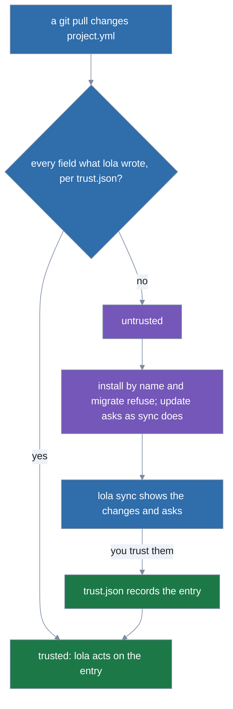

# Using lola

<!-- Each command's reference lives in reference/<command>.md (`lola cache add` etc. are
     sections of reference/cache.md). This page keeps what the commands share. -->

This is the reference: one page per command under [reference/](reference/), indexed under
"Commands" below in the order `lola help` lists them, then the concepts the commands share.
`lola help` is the always-current summary (piped, it prints the global flags once, then every
command with its aliases and own flags). This page describes this
build; changes still to come are tracked in [roadmap.md](roadmap.md).

The guides walk through one workflow each:
[choosing what to install](guides/choosing-what-to-install.md),
[authoring modules](guides/authoring-modules.md), [templating](guides/templating.md),
[sync and trust](guides/sync-and-trust.md), [profiles](guides/profiles.md),
[remote profiles](guides/remote-profiles.md), [marketplaces](guides/marketplaces.md),
[migrating from LobsterTrap/lola](guides/migrating.md) and [tidying](guides/tidying.md).

## Commands

Every command takes the global flags: `--json` and `--plain` pick the
[output](#output-contract), `--no-pager` prints without lola's [viewer](#output-contract), and
`--project`, `--user`, `-C/--root <dir>` and `-s/--scope project|user|both` pick the
[scope](guides/choosing-what-to-install.md#choosing-a-scope). Under "Refusals", each quoted
message is what follows `error:`; a hint that runs a command repeats your run's output, scope,
`-C`, `-t` and `-n` flags (the command a dry run ends with, which applies it, drops `-n`). It
keeps your `-y` only where it runs what you asked at the one scope you asked it of: the command
your dry run ends with, or your command completed with the scope or assistant it lacked, or with
an ambiguous profile name qualified. A hint that changes or narrows a scope you chose, names
another profile or command, or is a dry run (`lola sync`'s `see them: … -n`, any of `lola
tidy`'s under `-n`) leaves `-y` out. The exceptions are listed in the "Known limitations"
paragraph that ends the pages of [`lola sync`](reference/sync.md#lola-sync),
[`lola profile`](reference/profile.md#lola-profile) and [Sources and the cache](#sources-and-the-cache).

Each command has its own page, in the order `lola help` lists them:

- [`lola install`](reference/install.md#lola-install): Install modules into this project (or `--user`).
- [`lola sync`](reference/sync.md#lola-sync): Make this project (or `--user`) match its manifest.
- [`lola uninstall`](reference/uninstall.md#lola-uninstall): Remove modules from this project (or `--user`).
- [`lola list`](reference/list.md#lola-list): List installed modules and their status per target.
- [`lola update`](reference/update.md#lola-update): Update the installed modules from their sources.
- [`lola tidy`](reference/tidy.md#lola-tidy): Move what lola does not manage to the trash.
- [`lola profile`](reference/profile.md#lola-profile): List your profiles, show one, or turn them on and off.
- [`lola market`](reference/market.md#lola-market): List, add and update the marketplaces whose catalogs you browse.
- [`lola check`](reference/check.md#lola-check): Report what each assistant would lose, change or skip from a module.
- [`lola info`](reference/info.md#lola-info): Show a module, the code it runs and what installing it here would do.
- [`lola search`](reference/search.md#lola-search): Search for modules by name, description or keyword.
- [`lola init`](reference/init.md#lola-init): Create a new module in a directory.
- [`lola cache`](reference/cache.md#lola-cache): Manage your module cache (`add`, `rm`, `clean`, `list`, `update`, `search`).
- [`lola migrate`](reference/migrate.md#lola-migrate): Move from the Python lola: install its modules with lola and clean up.
- [`lola repair`](reference/repair.md#lola-repair): Forget lock.json entries lola could not have written.
- [`lola trash`](reference/trash.md#lola-trash): List, restore and empty lola's trash.
- [`lola version`](reference/version.md#lola-version): Print lola's version.
- [`lola completion`](reference/completion.md#lola-completion): Print a shell completion script.
- [`lola help`](reference/help.md#lola-help): Show help for lola or a command.

## Sources and the cache

A **source** is where a module comes from. lola copies the module into your **cache**
(`$XDG_CACHE_HOME/lola/modules/`, normally `~/.cache/lola/modules/`), so a source can move or
disappear without breaking installs. lola recognizes these forms, first match first:

| You pass | lola reads it as |
|---|---|
| An existing directory | a folder |
| An existing file ending in `.zip`, `.tar`, `.tar.gz` or `.tgz` (any case) | an archive |
| A `file://` URL | a folder or an archive, by what the path is |
| An `https://` URL whose path ends in an archive suffix | an archive, downloaded |
| Any other `https://` or `ssh://` URL, or `user@host:path` | a git repository |
| An `http://` URL | as `https://`, but only for `localhost`, `127.0.0.0/8` or `::1` |

Anything else is not a source: a bare name means a module in your cache, and `@market/module`
an entry of one of your [marketplaces](guides/marketplaces.md#marketplaces), on the command line only (a directory of
that name is `./@market/module`). lola refuses, with a hint:

- an argument, `--ref` or recorded location that starts with `-`;
- git's `<transport>::<address>` remote-helper syntax and `git://` URLs;
- credentials in a URL:
  - any user name or password in an `http(s)` URL (GitHub and GitLab take a token as the user
    name), and any query string or fragment (presigned URLs carry secrets there). The URL is
    written to `.lola/project.yml` and your cache, where a secret would be committed.
  - For git, let a credential helper or `ssh-agent` supply credentials; for a private archive,
    download it and install the file.
  - A user name in an `ssh://` URL or in `git@host:path` is fine, but a password never is, and
    the `user:password@host:path` form is refused (git would pass the password to ssh as part
    of the remote path).
  - `file://` URLs follow the same rules, and `?` or `#` in `git@host:path` is refused like a
    URL's query or fragment.
  - No error repeats a URL's password, query or fragment, or the user name of an `http(s)` or
    `file` URL, not even for a URL that does not parse or the target of a redirect (an `ssh`
    user name is no secret and may appear);
- a source, `--ref` or `--path` that the scope's manifest (`project.yml` or a profile) or
  `lock.json` could not load again (a control or invisible character, such as a zero-width
  joiner in a folder name, a source over 4096 bytes or a ref over 256 bytes), before anything is
  fetched or written; the hint names the field to fix, or, for a module named from your cache
  whose recorded source is the problem, `lola cache rm <name>`;
- an existing file that is not an archive, and a local archive that is not a regular file once
  its links are resolved (a pipe or device named like an archive, or a link to one).

Adding a module to the cache normalizes it: the cached copy holds exactly one `lola.yml`,
generated from the module's manifest. lola reads the first manifest it finds (see
[Module formats](guides/authoring-modules.md#module-formats)) and warns about each lower-precedence one it ignores. A
plugin format is converted once, here: the generated `lola.yml` lists every artifact the plugin
declared, so a cached version means the same thing to every later lola.

For every kind of source:

- `.git`, `.venv`, `node_modules`, `.lola`, `__pycache__` and `.DS_Store` are never copied.
- A relative symlink is copied into the cache as the regular file it names, never as a link, when
  that file is inside the source you gave (the folder, the repository or the extracted archive,
  not just the module's directory) and lola would copy it. Anything else refuses the install
  with the link, the reason and a hint: an absolute link; one that leaves the source; a missing
  target (dangling); a loop or a chain of more than 8 links; a target that is a directory or goes
  through one; a target under an ignored name above, in any letter case, or a Windows short name
  (a path segment ending `~<digits>`, so a real file named like `notes~1.md` cannot be a target);
  and, in a git work tree, a target git ignores. On Windows a link git checked out inside the
  module is a plain file lola cannot tell from one, so it is refused. A link lola would refuse
  that lies outside the module's directory, off the way to it, and that no link in the module
  goes through, is left out without a refusal, such as an archive's test fixture that points to
  an absolute path. The source is the boundary:
  `lola install ~ --path mods/x` can copy a link to any file under `~` that is not ignored.
- `--path <dir>` picks the module root inside the source, for monorepos.

**Folders.** In a git work tree, lola copies the files git would track (`.gitignore` is
respected; new, unstaged files are included). A directory `module/` inside the source is the
module root unless you pass `--path`; `--path .` picks the folder itself. `--ref` is refused, even for a folder that is a git
repository (a local path is always read as a folder; lola reads no branch, tag or commit of it).

**Git.** lola runs your `git` (it must be on `PATH`) with a shallow clone of the default
branch, or of `--ref`: a branch name, a tag name, or a full 40- or 64-character commit SHA.
lola never guesses:

- A ref that names both a branch and a tag is an error, and so is an abbreviated SHA.
- A full commit SHA, in any case, is always that commit, never a branch or tag of that name.
  lola records and shows it lower-cased. A server that serves another commit for it is refused.
- The SHA of an annotated tag object is refused; the error names the commit the tag points to,
  and the hint is your run at that commit.
- Any other hex-looking name is a branch or tag.

A commit that no branch or tag points to needs a server that serves such commits (servers
speaking git protocol v2 do). Only committed files are copied; the module root is `--path`,
else `module/`, else the repository root.
`--path .` picks the repository root and names the module after the repository. lola records
the commit it fetched. A source is fetched again on every install, with one exception: installing
at a full commit SHA that your cache already holds for exactly that source (the same location,
`--path` and selection, the version lola recorded when it fetched that commit) fetches nothing;
lola hashes the cached version again and installs it. A branch, a tag or a short SHA always
fetches.

- Your git config, credential helpers and `ssh-agent` are used. Git hooks, `core.fsmonitor`,
  the `ext::` transport and Git LFS filters are switched off for the repository lola fetches.
- **Git LFS files are not fetched.** A module receives LFS pointer files as they are committed.
- git never prompts for a user name or password (`GIT_TERMINAL_PROMPT=0`). This holds for every
  fetch: modules, marketplaces, profiles and `lola migrate`.
  - A repository git may not read is refused in lola's words, never with git's output: `<url>
    was not found, or it is private and git has no credentials for it` (a server that wants
    credentials looks the same as one hiding a missing repository), `… or it is private and the
    credentials git has, if any, cannot read it`, `git's credentials for <url> were refused`,
    or `the ssh server for <url> refused every key ssh offered, or ssh had none` (hinting
    `ssh-add` when the server takes keys).
  - The hint `git ls-remote -- <url>` (with `-c http.followRedirects=false` for a source a
    catalog named) checks it with your own git, which may ask for credentials and keep them in
    your credential helper; a location too long or odd to print whole gets no hint, and a
    github.com web page or organisation page gets no such check (it would fail on it). A web
    page (`/tree/<ref>/…` or `/blob/<ref>/…`) is called one in the message, and hints your own
    command (`lola info` stays `lola info`, with your scope, `-t`, `-n` and output flags, and `-y`
    on a run that asks) on the repository with `--ref <ref>` and the `--path` it names; a path
    ending in `skills/` hints the repository root or the directory above it, and the message says
    `--path skills/<name>` takes one skill. The same holds for a `--path` naming a `skills/`
    directory: the hint is your command on the directory above it.
  - Only git's own `fatal:` lines and ssh's are read, never a server's `remote:` lines.
  - ssh still can prompt: it asks on the terminal for a key passphrase or an unknown host key.
    Load your key into `ssh-agent` and add the host to `known_hosts` first, or the fetch waits
    until it gives up after 5 minutes. A child process that keeps git's output open (ssh
    prompting, a stalled https helper) delays that stop by at most 5 more seconds.

**Archives.** zip, tar and gzip tar, chosen by the file name's suffix. `--ref` is refused.
The module root is the first of:

1. `--path`, relative to the archive's root as `tar tf` or `unzip -l` show it;
2. the shallowest directory holding `lola.yaml`, `lola.yml`, `.lola.yaml`, `.lola.yml`,
   `plugin.json` or `.claude-plugin/`;
3. the parent of the shallowest `skills/`, `commands/`, `agents/` or `rules/` directory;
4. the archive's single top-level directory, if that is all it holds;
5. the archive's root.

Two different candidates at the same depth are an error; pick one with `--path`. Without a
`lola.yml` name, the module is named after its root directory, or after the archive file
(without its suffix) when the root is the archive's root.

An archive may hold only regular files and directories. lola refuses the whole archive if any
entry is absolute, contains `..` or a backslash, is a link or device, or repeats a path. Files
keep only their execute bit (`0755` or `0644`). Limits, which are not configurable:

| Limit | Value |
|---|---|
| Entries | 20,000 |
| Zip central directory | about 19.5 MiB (1 KiB for each of 20,000 entries), checked before it is read |
| Unpacked size | 512 MiB in total |
| Compression ratio of one zip entry | 200 to 1 |
| Download size | 256 MiB |
| Download time | 2 minutes |
| Redirects | 5, never from `https` to `http`, and never to `http` off loopback |

Once a module is cached, `lola install <name>` uses the cached copy without touching the source:
the cache's newest version for the ref the project already records for it (`--ref` picks
another). `lola cache update` fetches every cached module again: a git branch (or the default
branch) may have moved, a local archive is read again, and an archive URL is downloaded again.
The content digest decides whether anything changed. Installed modules keep the versions they
were installed at: `lola list` shows `→ update available`, and `lola install <name>` installs
the new version.

**Pins.** When lola installs a git or archive module, it records the version in the module's
entry in `project.yml` or a project profile: `digest`, the sha256
of the module's content, and for git `commit`, the commit the fetch resolved. lola never writes a
pin into a profile of yours, `default.yml` included: the version installed is in `lock.json`. `ref` stays what
you asked for. A folder module is never pinned. A manifest or `lock.json` may come from someone
else, so lola checks every entry when it reads them and refuses, before running git, a source or
ref that git would read as an option, a git remote helper (`ext::…`), `git://`, a path that
leaves its source, a commit or digest lola would not write (a `commit` on an archive or a folder
included), and any control or invisible character.

A git checkout holds the bytes as committed on every machine: lola turns off line-ending
conversion and every `.gitattributes` conversion and filter for its checkouts, and refuses a
symbolic link on the way to the module's `--path` before checking anything out. A link inside the
module (anywhere in the repository when there is no `--path`) is copied as the file or directory
it names, and refused when it leaves the source, dangles, loops, is absolute or names `.git`; a
link elsewhere in the repository is allowed, and so is a refused link outside every component a
marketplace entry selects. A git `--path` must name a directory of the repository in its exact letter case, so
a case-insensitive file system never checks out another one in its place. Execute bits come from
the source itself (git's file modes, an archive's entry modes, a folder's files), never from the
file system lola copied to, so the same module has the same digest on Linux, macOS and Windows.

**Trust.** `project.yml` is committed, so a `git pull` can change it. lola keeps, per project,
what it last wrote there in `$XDG_STATE_HOME/lola/trust.json`: the top-level `targets` and each
entry's `name`, `source`, `ref`, `path`, `components`, `commit`, `digest`, `targets`, `rules`,
`vars` (the entry's overrides of the module's [vars](guides/templating.md#vars)), `member` (for a
project profile's entry that comes from a remote profile that is a member of a project bundle:
that profile's name, source and pin), the member list of each project bundle (`bundle`) and `market` (the marketplace an entry says it came from; the diff shows it as `market
(as written)`, since lola never checks it).

An entry is **trusted** when every one of those fields is what lola wrote. Each write lola makes trusts
exactly the fields it changes, so after a pull adds an entry or changes one, installing another
module leaves that entry untrusted.



lola refuses to act on an untrusted entry as written:

- `lola install <name>`, a `lola uninstall -t` that keeps some of its targets, and
  `lola migrate` refuse with `<name>: project.yml changed for it since you last trusted it` (for
  an entry a pull added: `<name>: project.yml added it since you last trusted the file`; with no
  record: `<name>: project.yml has not been trusted on this machine`), and the hint
  `review and apply it: lola sync --project <name>`; the partial uninstall adds
  `or remove it: lola uninstall --project <name>`;
- an install, by name or by source, that would take its assistants from top-level `targets` you
  have not trusted (no `-t`, and no entry with `targets` of its own) refuses before fetching
  anything with `project.yml's top-level targets changed since you last trusted them`, hinting
  `lola sync` or your own install with `-t <id>` added (your `--ref` and `--path` kept); the
  install pickers ask for the assistants instead and never preselect those targets;
- the install pickers leave such modules out, with one notice per project:
  `2 modules in project.yml changed since you last trusted them: a, b → lola sync --project` (`are new or
  changed since you last trusted the file` when a pull added one). Add a
  source… in the pickers adds the module to your cache and lists it by name, so it is left out
  too; Change scope onto a project where a module you picked is untrusted stops with the refusal;
- `lola update` asks about it as `lola sync` does, and off a terminal needs `--trust`
  ([Sync, pins and trust](guides/sync-and-trust.md#sync-pins-and-trust)).

An argument that names such an entry is taken as that name, even when a folder of that name is
in the current directory: write the folder as `./<name>`.

`lola sync <name>` shows such changes and asks you to trust them
([Sync, pins and trust](guides/sync-and-trust.md#sync-pins-and-trust)), which is what every refusal hints. Every
`lola sync`, `lola update` or `lola install` command lola prints carries your scope: `--user` at
user scope, `--project` for the project found from the directory you ran lola in, and
`-C <root>` for another; so does an
install's `retry with: lola install <names>` after a failure that left fetched modules in your
cache, which these refusals and conflicts leave out, since retrying would refuse again. Installing the
module from its source still works, and writes the entry as new, keeping none of the changed
entry's `targets`, `rules`, `ref` or `path`, but it installs what the source serves now without
letting you review the change as sync does, so lola no longer suggests it. Without `-t`, such an install keeps the
module on the assistants this checkout installed it on (`lock.json`), not on targets a pull set.
Removing the module (`lola uninstall <name>`) always works. A project with no record in
`trust.json` (a fresh clone, a moved directory, a deleted state directory) has every entry
untrusted until you trust them with `lola sync`. `lola sync`, `lola update`, `lola install` and
`lola uninstall` refuse a project whose `.lola/lock.json` git tracks, before fetching anything,
since a committed `lock.json` lets a pull decide what lola deletes; lola keeps it private to each
checkout. The hint untracks it: `git rm --cached .lola/lock.json`, with `-C <project>` when you
run lola from elsewhere. If you never installed with lola in that checkout, the error says to
untrack and delete it, then run `lola sync`.

A local source is read through its symbolic links once: lola records the real path, and a source
you type relative to the project is recorded relative to the project's real root, however you
reached it. A local archive given through a symbolic link must resolve to a file with the same
archive suffix as the path you typed; otherwise lola refuses and suggests installing the target
itself (`lola install <target>`). When it is accepted, a module without its own name takes its
name from the target file.

Installing a module also gives it a **module copy**: `.lola/modules/<module>/` in the project, or
`$XDG_DATA_HOME/lola/user-modules/<module>/` at user scope. `${PLUGIN_ROOT}` ([Module
layout](guides/authoring-modules.md#module-layout)) points there, so removing a module with `lola
cache rm` never breaks an installed one; `lola sync` fetches the version it renders again if it
needs to: a git module by its commit, which must still be on its ref, and an archive whose content
must still match. When the version is the pin `project.yml` names and the fetch returns other
content or the commit is not on the ref, it suggests `lola sync --update <name>` to re-pin; when it
is the version installed of an entry that pins none (a git version with no recorded commit, say), it
suggests `lola install <source> [--ref r] [--path p]`, which installs what the source serves now, or
`lola uninstall <name>`. Hooks may build inside the copy: lola leaves its content alone, replaces
the copy only for a new version, when it is gone, or when the module gains a target `lock.json` does
not record it on (`lola install -t`, or a target added to `project.yml`), and then runs the hooks
again with your consent. Without it, a pre-install hook refuses the run and a declined post-install
hook stays pending (see [Hooks](guides/authoring-modules.md#components)). Reinstalling the version
already installed on the same targets with `lola install` replaces the copy from the cache to run
its hooks again when you consent; without consent the copy stays as it is. `lola sync` replaces it
for the same version and targets only to run a pending post-install hook, when you consent; declined
again, the copy stays as it is.

Known limitations: three refusals of a source read from a file (a manifest, profile or catalog
entry) hint advice, not a command: a ref that starts with `-` (`ref "-x" starts with '-'`) hints `a
branch, tag or commit never starts with '-'`; a folder location that is not absolute (`folder source
x is not an absolute path`) hints `give the absolute path of the folder`; and an archive location
that starts with `//` (`archive location starts with //, a URL without a scheme`) hints `give the
archive's https:// URL or its absolute path`.

## Scopes and targets

- **Project scope** (`--project`, or `-C <dir>` for another directory): files go into the
  project; state lives in `.lola/`. Which scope a command acts on without a flag is in
  [Choosing a scope](guides/choosing-what-to-install.md#choosing-a-scope).
- **User scope** (`--user`): files go into your home directory (OpenCode's into
  `$XDG_CONFIG_HOME/opencode/`); state lives under `$XDG_CONFIG_HOME/lola/` (your default
  profile `profiles/default.yml`, the base) and `$XDG_STATE_HOME/lola/` (ledger `lock.json`). Rules installed at user scope
  apply in every project.

The targets are `claude-code` (Claude Code), `gemini-cli` (Gemini CLI), `opencode`
(OpenCode) and `agents` (skills only, into `.agents/skills`, which Codex, Cursor, Copilot, Amp,
Gemini CLI and OpenCode read; see [the agents target](guides/choosing-what-to-install.md#skills-for-every-tool-the-agents-target)).
`agents` has no command to look for: it is set up where `.agents/skills/` exists, lola offers it
only there, and never beside an assistant that is set up.

When you do not pass `-t`, lola uses the manifest's targets. Otherwise it offers the assistants
installed on your machine (their command, `claude`, `gemini` or `opencode`, is on your
`PATH`): on a terminal you pick from them, with those already set up in the project preselected,
or every installed assistant preselected when none is set up (with only one installed, lola
uses it without asking); off a terminal lola uses the ones both installed and set up. An assistant is set up in a project when it has `.claude/` or
`CLAUDE.md` (Claude Code), `.gemini/` or `GEMINI.md` (Gemini CLI), or `.opencode/`,
`opencode.json` or `opencode.jsonc` (OpenCode); at user scope, when `~/.claude/` or
`~/CLAUDE.md`, `~/.gemini/` or `~/GEMINI.md`, or `$XDG_CONFIG_HOME/opencode/` exists. A target
you name with `-t`, or that the manifest lists, is always rendered, installed or not, for
example in a container that only prepares files.

lola runs an installed assistant once, with `--version`, to learn which version you have, and
caches the answer in `$XDG_CACHE_HOME/lola/probes.json` until the binary changes. The version
never changes what lola writes (teammates on other versions get the same files); lola only
warns when your version lacks something the module uses.

What lands where for `claude-code`:

| Artifact | Project scope | User scope |
|---|---|---|
| Skills | `.claude/skills/<skill>/` | `~/.claude/skills/<skill>/` |
| Commands | `.claude/commands/<command>.md` | `~/.claude/commands/` |
| Agents | `.claude/agents/<agent>.md` | `~/.claude/agents/` |
| MCP servers | `.mcp.json` → `mcpServers.<name>` | `~/.claude.json` → `mcpServers.<name>` |
| Rules | `.claude/rules/lola/<module>/<rule>.md` | `~/.claude/rules/lola/<module>/<rule>.md` |

For `gemini-cli` (user scope: the same paths under `~`):

| Artifact | Project scope |
|---|---|
| Skills | `.gemini/skills/<skill>/`; `name` is added from the directory when missing; Gemini neither runs shell nor fills argument placeholders in skills, so lola warns when a skill has them |
| Commands | `.gemini/commands/<command>.toml`: `description` and `prompt`, with `$ARGUMENTS` as `{{args}}`; Gemini has no single-argument placeholders, so `$ARGUMENTS[N]`, `$N` and the names listed in `arguments:` stay as written and the prompt starts with the whole argument string; Gemini has no escape, so a Claude-escaped `\$1` becomes `$1` (only a single backslash escapes; after `\\` the placeholder is still read as one); a `commands/<command>/` directory is copied alongside, and Gemini reads every `*.toml` file inside it as a namespaced command (`<command>:<file>`) |
| Agents | `.gemini/agents/<agent>.md`, keeping only `name`, `description`, `kind` (`local` or `remote`), `display_name`, `tools` (a list of Gemini tool names such as `read_file` or `mcp_<server>_<tool>`), `model` (`gemini-…`), `temperature`, `max_turns` and `timeout_mins` (positive integers). Gemini refuses to load an agent with any other key or value of another shape, so lola drops those instead. An agent whose `tools` uses other names, such as Claude's `Read` or `mcp__server__tool`, is skipped: Gemini gives an agent without `tools` every tool, so dropping the list would lift the restriction (`--force` installs it without the list) |
| MCP servers | `.gemini/settings.json` → `mcpServers.<name>`: `command`, `args`, `env`, `cwd`; `httpUrl` for http, `url` for sse |
| Rules | `.gemini/lola/<module>/GEMINI.md` (the module's rules in name order), listed in `.gemini/settings.json` → `context.includeDirectories` (at user scope by absolute path, so every project's Gemini session can read that directory). Gemini loads these rules, and project MCP servers, only in a trusted folder, and project-scope ones only when `gemini` starts at the project root, not in a subdirectory |

For `opencode` (user scope: the same paths under `$XDG_CONFIG_HOME/opencode/`, without
`.opencode/`):

| Artifact | Project scope |
|---|---|
| Skills | `.opencode/skills/<skill>/`; names are lowercase words joined by single hyphens, and a `name` in the frontmatter must equal the directory; OpenCode neither runs shell nor fills argument placeholders in skills, so lola warns when a skill has them |
| Commands | `.opencode/commands/<command>.md`, keeping only `description`, `agent`, `model` (`provider/model`) and `subtask`; Claude counts arguments from 0 and OpenCode from 1, so `$0`, `$ARGUMENTS[0]` and the first name listed in `arguments:` become `$1`, and so on (`$ARGUMENTS` stays); OpenCode has no escape, so a Claude-escaped `\$1` or `\$ARGUMENTS` is kept but OpenCode still fills it in; OpenCode runs ``!`…` `` anywhere in a command without Claude's permission checks and never runs a ```` ```! ```` fence; a `commands/<command>/` directory is not copied, as OpenCode would read its files as commands |
| Agents | `.opencode/agents/<agent>.md` with `mode: subagent` unless the agent sets a mode; `name` is dropped and `model` is kept only as `provider/model`. OpenCode cannot express a tool list and gives an agent without one every tool, so an agent with a non-empty `tools` is skipped (`--force` installs it without the list). OpenCode refuses to start on an invalid agent value, so lola drops a `color` other than `#rrggbb` (OpenCode 1.18 also takes theme names such as `accent`, but later versions reject them), a `mode` other than `subagent`, `primary` or `all`, a non-numeric `temperature` or `top_p`, a `steps` or `maxSteps` that is not a positive integer, a non-boolean `hidden` or `disable`, a non-string `variant` and a non-map `options`. `permission` is passed through unchecked |
| MCP servers | `opencode.jsonc` if it exists, else `opencode.json` → `mcp.<name>`: `{"type": "local", "command": [...], "environment"}` or `{"type": "remote", "url", "headers"}`; `${VAR}` becomes `{env:VAR}`. OpenCode merges both files and `opencode.jsonc` wins, so a server of the same name in `opencode.json` is overridden by lola's |
| Rules | `.opencode/lola/<module>/<rule>.md`, listed as `.opencode/lola/<module>/*.md` in the same file's `instructions` (at user scope by absolute path) |

For `agents` (user scope: the same paths under `~`):

| Artifact | Project scope |
|---|---|
| Skills | `.agents/skills/<skill>/`; agentskills.io rules: a name of lowercase words joined by single hyphens, at most 64 characters and equal to the directory (added from the directory when missing), and a description of at most 1024 characters (a skill without one is never written); `hooks`, `mcpServers` and `mcp_servers` are dropped; no shell or argument placeholders in skills, so lola warns |
| Commands, agents, MCP servers, rules, runtime hooks | Not written: `kind-unsupported` (`.agents` holds skills only) |

When a module targets `agents`, `gemini-cli` and `opencode` leave the skills `agents` writes to it
(`skill-via-agents`), so each tool loads a skill once.

## Choosing what to install

How lola decides the scope, assistants and components for an install is in [Choosing what to install](guides/choosing-what-to-install.md).

## Findings

When a target cannot express part of a module, lola tells you instead of failing the whole
module. Each **finding** has a severity:

- **info**: a lossless adaptation, or a choice you made. Shown by `lola check` and in `--json`
  output, and by `install`, `sync` and `update` (under `-v` for a detail finding) when it
  carries a hint.
- **warn**: something is dropped or changed, but the artifact works; it is installed.
- **skip**: that artifact is left out for that target, because the assistant could not use it
  (for example an agent without a `description`); everything else is installed.

`--force` also renders skipped artifacts that can be rendered (it never invents a place for
something the assistant has no place for). `--strict` turns every remaining warn or skip into an
error before anything is written; use it in CI. A `--force` render is not remembered: a later
`lola sync` or `lola update` without `--force` skips (and removes) those artifacts again.

Each finding has a stable code, shown by `--plain` and `--json`. A forceable skip is one that
`--force` can render; a skip that `--force` rendered is reported as a warn.

A finding you can act on carries a hint (`hint:` under it, `hint` in `--json`). The hint names
the change to make to the module: usually an entry in the component's `.targets.yaml`
[attribute file](guides/templating.md), such as `gemini-cli: {hooks: null}`, or a template
branch on `target` in its `.md.liquid` file. Or the hint is a command. A forceable skip's hint
ends with your run plus `--force`, for example `or render it anyway: lola install ./kit --force`.
A hint that tells the module's author what to change in its files is printed by `lola check`
and kept in `--json`; `install`, `sync`, `update` and `lola profile` print only the rest (the
`render it anyway:` run), since you may not be able to edit the module. A safety finding that has
such a fix names first the `lola check` that prints it, for example `the module's own fix: lola
check --project kit -t gemini-cli; or render it anyway: lola install kit --force`, when a check
can name the version installed.

Each finding and notice has a **class**, `class` in `--json`. **safety** is what you need to
know about your own machine and data: runtime hooks skipped or awaiting consent, native
executables, unowned or hand-edited files, refusals, what a run did to your picks, and what an
agent may do without asking (`claude-code/allowed-tools`, `claude-code/permission-mode`,
`agent-tools-unenforceable`). **detail** is what an assistant loses or adapts from a module, and
the components your picks mention but leave out ([Mentions](guides/choosing-what-to-install.md#mentions)).
Anything lola does not class is safety. `install`, `sync`, `update` and `lola profile` print
safety in full and detail as one line per module ([Output contract](#output-contract)).
Some findings have no hint, because there is nothing to do:
- `kind-unsupported`, `mcp-cwd-dropped` and `command-sidecar-dropped`: no change gives the
  assistant a place for the item;
- lossless adaptations (`gemini-cli/arguments`, `opencode/env-reference`, an info
  `frontmatter-key-dropped`);
- the review notices `claude-code/allowed-tools` and `claude-code/permission-mode`;
- the `probe/*` notes;
- `module-warning` and template errors, whose text already says what to change.

`lola check` reports each [template](guides/templating.md#templates) error as a `skip` finding of its component for
each assistant, with the error's code: `template-too-large`, `template-invalid-utf8`,
`template-tag-unavailable`, `template-range-unavailable`, `template-too-many-assigns`,
`template-too-deep`, `template-include-name`, `template-include-missing`,
`template-include-cycle`, `template-include-too-deep`, `template-include-limit`,
`template-undeclared-var`, `template-syntax`, `template-undefined-variable`,
`template-undefined-filter`, `template-value-too-large`, `template-value-type`,
`template-output-too-large`, `template-panic`, `template-frontmatter`,
`template-frontmatter-fence`, `template-frontmatter-value`, `template-name-mismatch` and
`template-rendered-check`. Install, sync, render and profile
switches refuse on the first one instead. `template-timeout` and `template-run-budget` refuse
the run, `lola check` included: they are never skip findings.

| Code | Severity | Forceable | Meaning |
|---|---|---|---|
| `kind-unsupported` | skip | no | The target has no place for this kind of artifact (in this build, `gemini-cli` and `opencode` for a module's runtime hooks, and `agents` for commands, agents, MCP servers, rules and runtime hooks). |
| `name-rejected` | skip | yes | The target rejects the artifact's name (for `opencode`, also a skill whose `name` differs from its directory). |
| `required-key-missing` | skip | yes | A frontmatter key the target needs is absent, empty, or was dropped for having the wrong type. |
| `agent-tools-unenforceable` | skip | yes | The agent restricts its tools in a way the target cannot enforce (`gemini-cli`: names that are not Gemini's; `opencode`: any non-blank `tools` value, list or string). The assistant would give the agent every tool, so it is left out unless `--force`, which installs it without the list. |
| `frontmatter-invalid` | skip | no | The frontmatter parses but lola cannot re-encode it. |
| `frontmatter-key-dropped` | warn or info | no | The target does not support a frontmatter key, so it is left out. |
| `frontmatter-value-dropped` | warn | no | A frontmatter key has a value of the wrong type or form for the target (for example an OpenCode agent `color: red`, or a Gemini agent `max_turns: 1.5`), so it is left out. |
| `frontmatter/yaml-ambiguous` | warn | no | An unquoted frontmatter value that YAML parsers read differently; quote it. |
| `version/unsupported` | warn | no | Your installed assistant is older than the version lola renders for and ignores something the module uses. |
| `version/limited` | warn | no | Your installed assistant has a known limitation that affects this module. |
| `vars-override` | skip | no | `lola check`: the scope's entry for the module checked sets a var the module does not declare, or one of another type; the module is checked with its defaults. |
| `vars-defaults` | info | no | `lola check` could not read the scope's manifest or a profile, so every module is checked with its default vars. |
| `picks-keyed-by-path` | warn | no | `lola check`: git could not read the project's clone, so its picks in `selections.yaml` are read under its path, not its repository; the hint is the `git config --global --add safe.directory` that trusts a repository git refuses as someone else's. |
| `attrs-undefined` | warn | no | `lola check`: a template or partial reads a literal `attrs` path that no attribute file of the module defines for any assistant, so it always reads as nil; usually a typo. |
| `module-warning` | warn | no | The module itself has a problem, such as a legacy instruction file, a skipped rule entry or skill, an ignored manifest, or a plugin key lola does not install. |
| `module/native-executable` | warn | no | The module installs a native executable (ELF, Mach-O or PE) in a skill or command directory. The text names up to three, with their format and architecture, and counts the rest; the hint is `lola info <module>`, which lists each with the libraries it loads and its sha256. Module-level (no target), with no consent question; `--strict` fails it. |
| `mcp-cwd-dropped` | warn | no | The target has no working-directory setting for an MCP server, so `cwd` is dropped. |
| `command-sidecar-dropped` | warn | no | `opencode` would read a command's `commands/<command>/` files as commands, so the directory is not copied. |
| `gemini-cli/shell-injection` | skip | yes | A command runs shell with Claude's ``!`…` `` (at a line start or after whitespace) or a ```` ```! ```` fenced block, which Gemini CLI would send to the model as text; Gemini's own syntax is `!{…}`. |
| `gemini-cli/arguments` | info | no | `$ARGUMENTS` becomes Gemini's `{{args}}`. |
| `gemini-cli/positional-arguments` | warn | no | Gemini CLI has no positional or named arguments: `$ARGUMENTS[N]`, `$N` and names declared in `arguments:` stay as written and the prompt starts with the whole argument string. |
| `opencode/arguments-renumbered` | warn | no | Claude's 0-based `$N`, `$ARGUMENTS[N]` and declared names became OpenCode's 1-based `$1`, `$2`, …; check the command with a few arguments, as OpenCode may split them differently. |
| `opencode/shell-unchecked` | warn | no | A command has ``!`…` ``, which OpenCode runs wherever it appears, without Claude's permission checks (`allowed-tools` is dropped); its hint wraps the shell in a template branch that keeps it from OpenCode. |
| `opencode/shell-fence` | skip | yes | A command runs shell in a ```` ```! ```` fenced block, which OpenCode does not run and would send to the model as text; use inline ``!`…` ``. |
| `skill-via-agents` | info (detail) | no | `gemini-cli` or `opencode` did not write its own copy of a skill, because the `agents` target writes it to `.agents/skills`, which they read. Shown with `-v` and always by `lola check`. |
| `skill-shell-dropped` | warn | no | A skill runs shell with ``!`…` `` or a ```` ```! ```` block; `gemini-cli`, `opencode` and `agents` do not run shell in skills, so it reaches the model as text. |
| `skill-arguments-dropped` | warn | no | A skill uses `$ARGUMENTS`, `$ARGUMENTS[N]` or `$N`; `gemini-cli`, `opencode` and `agents` do not fill argument placeholders in skills, so they reach the model as written. |
| `opencode/escaped-arguments` | warn | no | A command has a Claude-escaped `\$N` or `\$ARGUMENTS`; OpenCode has no escape and still replaces it with arguments, so reword the text. |
| `opencode/env-reference` | info | no | `${VAR}` in an MCP server becomes OpenCode's `{env:VAR}`. |
| `opencode/env-default-dropped` | warn | no | OpenCode has no defaults for environment references: `${VAR:-default}` becomes `{env:VAR}`. |
| `claude-code/runtime-hooks-declined` | warn | no | You did not consent to the module's runtime hooks, so they (or the skill, command or agent whose frontmatter has hooks, or the agent with inline MCP servers) are not installed and any installed earlier are removed; its hint is your run with `--trust=` the kinds you gave and `runtime-hooks` (without `-n`: a dry run's hint is the run that installs them), or answer the prompt on a terminal. |
| `claude-code/allowed-tools` | warn | no | A skill, command or agent pre-approves tools with `allowed-tools`; Claude Code runs them without asking. Installed as written. |
| `claude-code/permission-mode` | warn | no | An agent sets the permission mode Claude Code runs it in with `permissionMode`; the finding names the mode. Claude Code v2.1.267+ ignores `bypassPermissions` in a subagent's frontmatter. Installed as written. |
| `claude-code/runtime-hook-path-unsafe` | skip | yes, unless a path holds a quote, `$`, a backquote or `\` | A shell-form hook needs the paths of the module copy and of the plugin data to hold only letters, digits and `/ . _ + -`, or an exec-form command contains `=` or starts with `-`. |
| `claude-code/runtime-hook-shell-unsupported` | skip | yes | A shell-form hook runs in PowerShell, which cannot take the `export` lola adds; give it `args`. |
| `claude-code/settings-local-not-ignored` | skip | yes | Git could commit `.claude/settings.local.json` (tracked, not ignored, or git missing or failing); add it to `.gitignore`. |
| `claude-code/runtime-hook-event-invalid` | skip | no | A hooks event name is not an identifier, so it is no event Claude Code fires. |
| `claude-code/runtime-hook-drift` | info | no | A hook group lola installed was edited or removed. On install, sync and update lola leaves it out until `--force` writes it again, and prints the finding with the hint `restore it:` and your run with `--force`; for `lola profile` (whose own `--force` run would find the profile as asked and change nothing) and for `lola update` and `lola sync --update` (whose own `--force` run would also upgrade) the hint is `lola sync <modules> --force`, naming the drifted modules; on uninstall lola leaves your edited group alone. `--strict` does not fail on it. |
| `probe/not-found` | info | no | The assistant is not on `PATH`; lola checked against the newest version it knows. |
| `probe/unknown-version` | info | no | The assistant's version could not be read. |
| `probe/cache` | info | no | The version was read but could not be cached. |

lola only reports what its own rendering loses. For general advice on writing skills, commands
and agents, use a dedicated linter such as [skillsaw](https://github.com/stbenjam/skillsaw).

### Native executables

`lola install`, `sync`, `update` and `lola check` warn with `module/native-executable` when a
module installs a compiled program: an ELF (Linux), Mach-O (macOS, thin or fat) or PE (Windows)
file. It can run outside your assistant's sandbox, so lola says so before you trust the module. The
finding is one per module, and `--force` and the consent questions do not touch it; `--strict`
fails it. `lola info <module>` lists each executable with the libraries it loads and its sha256.

- **What is scanned** is what the targets copy: for each skill its whole directory (minus
  excluded files and `SKILL.md`) and for each command its `commands/<command>/` directory. The
  rest of the source repository is not scanned, nor are agents, rules or MCP servers. A module
  whose root is itself a skill (a `SKILL.md` at the root) installs the whole module directory,
  so a binary under its `tests/` is installed and warned about.
- **How it is found**: by the file's header, confirmed by Go's own ELF, Mach-O and PE readers. A
  file with the header of one of these but that does not parse is reported as malformed. A file
  over 1 GiB is reported without being parsed. A Java class file, and text that starts with
  `MZ`, are not reported.
- **What it does not find**: scripts (a shebang is not looked at), WebAssembly, JAR files and
  other archives. A packed binary can hide the libraries it loads. No warning is not proof that a
  module runs no code, since a script runs too, and a warning is not a verdict that the program is
  malicious: lola reads headers and never runs the file. `lola info` computes the libraries and the
  sha256 when you ask, not when it caches the module.

## Files lola keeps

| File | Purpose | Commit it? |
|---|---|---|
| `.lola/project.yml` | The manifest: which modules and targets you want, and for git and archive modules the version (pin) installed. lola edits only the entries it changes and keeps your comments and order, but it writes the whole file again, so blank lines between entries are dropped and indentation becomes two spaces. | Yes |
| `.lola/lock.json` | The ledger: every file and JSON key lola wrote, with hashes, the targets each module is installed on (`targets`, including one that rendered none of its files), (`hooks_pending`) a post-install hook you have not let run yet, (`scripts_pending`) the project's post-install script you have not let run on the module yet, the active [profile](guides/profiles.md#profiles) (`profile`; a `lock.json` with a pre-release `profiles` list is refused, naming the way out), the profile each module came from (`from`) and, for a module with [templates](guides/templating.md#templates), what they rendered with (`rendered_with`: `default` and the active profile when a template reads them, and `vars`). Every command that plans from it refuses a path in it outside a target's root, or a target lola does not know, hinting [`lola repair`](reference/repair.md#lola-repair), which forgets such entries. | No (gitignored for you) |
| `.lola/modules/` | Module copies that `${PLUGIN_ROOT}` points into. | No (gitignored) |
| `.lola/plugin-data/` | `${PLUGIN_DATA}` directories. | No (gitignored) |
| `.claude/settings.local.json` | Claude Code's per-user settings, where lola puts runtime hooks you consented to. | No: add it to `.gitignore` |
| `$XDG_CONFIG_HOME/lola/config.yaml` | Your settings: `default_scope`, `pager`, your install scripts `pre_install` and `post_install`, `cache_unused_for`, `cache_fresh_for`, and `theme`. | Yours to keep |
| `$XDG_CONFIG_HOME/lola/selections.yaml` | Components you chose not to install, globally and per project (no `user:` section: a file with one is refused, and a user-scope module's picks live in its profile entry). A project in a git clone whose `origin` is on another host is keyed by its repository (`git:<host>/<path>#<dir>`, no credential), so a re-clone keeps its picks (a project in a subdirectory of an unrelated clone, such as a home directory kept in git, is keyed by that clone and its subdirectory); any other by its absolute path ([`config.yaml` and `selections.yaml`](guides/choosing-what-to-install.md#configyaml-and-selectionsyaml)). Your teammates do not get these picks; a project profile shares picks. | Yours to keep |
| `$XDG_CONFIG_HOME/lola/profiles/` | Your [profiles](guides/profiles.md#profiles). lola writes one only on `lola install` or `lola uninstall`, never with a pin; comments and order stay. | Yours to keep |
| `$XDG_CONFIG_HOME/lola/profiles/default.yml` | User scope's base, always on: written by `lola install` and `lola uninstall` at user scope (no pins). | Yours to keep |
| `$XDG_CONFIG_HOME/lola/pins.yaml` | The versions installed from your profiles at user scope (`modules:`: source, ref, path, commit, digest) and a record of each remote profile you have (`remotes:`). Written by lola in every user-scope apply and by `lola profile --add`, `--update` and `--remove`, only when its bytes change; a header comment is kept and a link followed. [Synced with your config](guides/sync-and-trust.md#syncing-lola-between-machines); a run that needs a recorded remote profile this machine lacks restores it. | Yes, with your config |
| `$XDG_STATE_HOME/lola/locks/pins.lock` | The lock around reading, checking and writing `pins.yaml`. | No |
| `$XDG_CONFIG_HOME/lola/keep.yaml` | Your [keep-list](guides/tidying.md#tidying): per scope, what `lola tidy` never offers. Written by `--keep` and `--unkeep`; safe to edit by hand. | Yours to keep |
| `$XDG_CONFIG_HOME/lola/markets.yaml` | Your [marketplaces](guides/marketplaces.md#marketplaces): name, source, ref, the catalog file found and, optionally, the `ssh_hosts` you allowed (sorted host names, e.g. `ssh_hosts: [git.example.com]`; a value that is not a host name is refused). Written by `lola market --add`; safe to edit by hand. | Yours to keep |
| `$XDG_CACHE_HOME/lola/markets/` | Each marketplace's fetched catalog, byte for byte, with `source.json`, its pin. `lola market --update` writes it again. | No: it is cache |
| `$XDG_DATA_HOME/lola/profiles/` | [Remote profiles](guides/remote-profiles.md), one directory each with `profile.yml` and `source.json`. Only `lola profile` writes them. | Yours to keep |
| `$XDG_STATE_HOME/lola/trust.json` | Per project, the `project.yml` entries lola wrote or you trusted in `lola sync` (see **Trust** in [Sources and the cache](#sources-and-the-cache)). lola stops, and changes nothing, when it or its directory is a symbolic link or writable by others, or when it does not parse (a file a newer lola wrote asks you to upgrade lola; one from before bundles, whose records hold the field `extends`, is refused, naming the records to remove; on Windows, a directory that is a junction is refused as not a directory). Records of moved or deleted projects stay; lola refuses to grow the file past the 4 MiB it reads, and the hint says how to start over. | Never: it is yours alone |
| `$XDG_STATE_HOME/lola/consent.json` | The consents you gave, by digest: each module's install hooks, its runtime hooks per settings file, and each project's install scripts per event (`project-scripts/<sha256 of the project directory>/<event>`). A changed digest asks again. | Never: it is yours alone |
| `$XDG_STATE_HOME/lola/trash/` | What `lola migrate` backed up or moved and what `lola tidy` moved, one directory per run with `manifest.txt`. | Yours; [`lola trash`](reference/trash.md#lola-trash) lists, restores and empties it |

lola owns `.lola/.gitignore` and rewrites it if it changes. The lock lola holds while it
changes a project lives outside the project, in `$XDG_STATE_HOME/lola/locks/`.

## Removing lola

lola has no uninstaller of its own; you remove your modules, then what lola keeps, then the
binary. Each step below was run against a throwaway `HOME`.

1. Uninstall every module in each project and at user scope. `lola uninstall` takes several
   names and has no "all" flag; `lola list` shows them. It removes the entries from
   `project.yml` (or your default profile) and the files lola wrote, then the directories that
   leaves empty, whoever made them (a `~/.claude/commands/` that held only lola's files goes, even
   one you made), but never the assistant's root nor a directory directly in it, such as
   `~/.claude/`, which stays even when empty.

   ```sh
   cd my-project && lola list && lola uninstall mod-a mod-b -y
   lola list --user && lola uninstall --user mod-a mod-b -y
   ```

2. Optionally move what lola does not manage out of the assistants' directories
   (`lola tidy --all -y`); it goes to the trash, not away ([Tidying](guides/tidying.md#tidying)).
3. Empty the cache: `lola cache clean --all -y`. Uninstalling leaves every module in the
   cache; this removes them (the `modules/` directory stays, empty).
4. Delete what is left. Uninstall, tidy and `cache clean` remove none of it:

   | Where (default) | What stays |
   |---|---|
   | `.lola/` in each project | `project.yml`, `lock.json` (empty of modules), `.gitignore`, an empty `modules/`, and `plugin-data/` with each module's data if a module used `${PLUGIN_DATA}` (uninstall keeps it and says where). `project.yml` is yours and may be committed; remove `.lola/` if you no longer want it. |
   | `$XDG_CONFIG_HOME/lola/` (`~/.config/lola/`) | Your settings (`config.yaml`), keep-list, marketplaces and profiles, including `profiles/default.yml` (no modules left in it), `selections.yaml` with your component picks, and `pins.yaml` with its record of your remote profiles. |
   | `$XDG_DATA_HOME/lola/` (`~/.local/share/lola/`) | An empty `user-modules/`; remote profiles (`profiles/`), if you added any; `plugin-data/` with each user-scope module's data, if one used `${PLUGIN_DATA}`. |
   | `$XDG_STATE_HOME/lola/` (`~/.local/state/lola/`) | `lock.json` (the user-scope ledger), `trust.json`, `consent.json` once you have consented to a hook, `locks/`, and `trash/` with every run of `lola tidy` and `lola migrate`. Look in `trash/` (`lola trash`) before deleting it: it is the only copy of what those commands moved. |
   | `$XDG_CACHE_HOME/lola/` (`~/.cache/lola/`) | Empty `modules/` and `.staging/`, a `.lock` file, and any marketplace catalogs and probe results. |

   lola honours an `XDG_*` value only when it is an absolute path; an unset, empty or relative
   one means the default under `$HOME` ([Environment](#environment)). The snippet below works
   the paths out the same way, so a relative value such as `XDG_DATA_HOME=.` never points it at
   the current directory. Look at the four paths it prints before you delete them:

   ```sh
   rm -rf .lola                                  # in each project you no longer manage
   xdg() { case $1 in /*) printf '%s/lola\n' "$1" ;; *) printf '%s/lola\n' "$HOME/$2" ;; esac; }
   set -- "$(xdg "${XDG_CONFIG_HOME-}" .config)" "$(xdg "${XDG_DATA_HOME-}" .local/share)" \
          "$(xdg "${XDG_STATE_HOME-}" .local/state)" "$(xdg "${XDG_CACHE_HOME-}" .cache)"
   printf '%s\n' "$@"                            # check these four, then:
   rm -rf -- "$@"
   ```

   The same locations apply on every platform; lola reads the `XDG_*` variables everywhere, so
   run this with them set or unset as they were when you used lola.

5. Delete the binary: `bin/lola` in your clone of lola-go (`task build` writes it there), or
   wherever you copied it. Nothing else is installed outside the directories above.

## Safety rules

- lola writes a file only if it is new, already identical, or one lola wrote and nobody edited.
  Anything else is a **conflict**: lola lists every conflict and changes nothing.
  - The refusal lists each conflicting file, by assistant and path, one per line, and why.
  - `--force` overrides conflicts and lists each overridden file in the summary; the refusal's
    hint is your run with `--force` added, keeping its other flags but `-y` and `--trust`; for
    `lola sync` and `lola update` it completes your own run, so it keeps the `--trust`, `--at`
    and `-y` you gave, and runs as printed.
  - `--force` also answers the destructive question itself (`install`'s review and the files a
    pick change deletes, `sync`'s removals, `uninstall`, `lola profile --remove`, `lola migrate`, `lola tidy`), on a terminal
    or off one, so the hint runs as it is; a `lola sync` refusal whose run also removes modules
    says which (`with --force it also removes, without asking: other (whole module)`).
  - `--force` never answers a consent question: a forced run that needs your trust for a pulled
    `project.yml`, or consent to a module's hooks, still asks, or off a terminal refuses with
    the hint that adds the `--trust=` kinds missing.
  - Every other hint that repeats your run for another reason (another scope, `-t`, `--force`) drops
    `-y` and `--trust` the same way, and a flag you gave as false is never repeated as true.
  - A refusal for want of a terminal to confirm on hints your run with `-y`, which answers that
    question.
  - An install or `lola profile --edit` whose pick change (`--skip`, `--only`, a ticked-off
    component) deletes files asks first on a terminal, as `uninstall` does; off one it prints the
    files and refuses, hinting the same run with `-y`. `-n` prints the plan and writes nothing, and
    a change that only adds components asks nothing. An install whose `-t` leaves out an assistant
    the module is installed on in that scope does the same: it writes the narrower targets and
    removes that assistant's files in the same run (`✗ my-module: gemini-cli (target dropped by
    -t)`), so `lola list` and the next `lola sync` agree with it.
  - A hand-edited file lola would delete (an uninstall, or a component dropped at update or
    sync) refuses the whole run in the same way: nothing is removed, and `--force` deletes it
    with the rest.
  - Two kinds of deletion are **not confirmed**. Both are deleted, not moved to the trash, and
    both are in the run's plan (`→ delete …`) and in `-n`:
    - A JSON member (an MCP server, or a runtime hook entry in a settings file) that a module's new
      version no longer ships is removed by `sync` and `update` without asking, with no `-y` off a
      terminal: lola cannot yet tell a member the version dropped from one it moved or re-keyed.
      When the run shows a trust diff, it lists a dropped MCP server as `removed`.
    - Files dropped by your own edit, a pick you changed by hand in `selections.yaml` or a
      module's rules turned off (`rules: false`), are removed by the next `sync` without asking:
      the edit is your decision. In a project's `project.yml`, `rules: false` is still a trust
      change, asked about or answered by `--trust` like any other field.
- A destination owned by another installed module is never overridden, even with `--force`:
  - The refusal names both modules (`wanted by module "evil", owned by module "deploy-tools"`).
  - When you named the module that wants it (`lola install <source>`), it hints the owner's
    `lola uninstall`, at the scope and with the output flags of your run.
  - When `project.yml`, `default.yml` or a profile lists it, it hints nothing and says to remove it
    from that file, so a file you did not write never steers you into removing a module you
    installed.
  - Two modules of one run providing one destination, or one module providing it twice, are
    refused with what to do in the message and no hint, as no command resolves them.
- A group of runtime hooks already in your settings, identical to one a module renders, is a
  conflict: owning it would remove your hook on uninstall. `--force` takes it over.
- A JSON file that does not parse is never rewritten, even with `--force`.
- Comments and formatting in JSON files survive lola's edits; only lola's own keys change.
- lola writes through symlinked directories and shows `(via symlink → /real/path)` when a write
  leaves the project. Two destinations that resolve to the same real file are refused.
- lola refuses a project whose `.lola/`, `.lola/modules/`, `.lola/plugin-data/` or
  `.lola/project.yml` is a symlink, and replaces a module copy that is not a real directory. At
  user scope a symlinked profile of yours (`default.yml` included) is followed and edited at its
  target; a symlinked project profile is refused. A profile whose bytes changed since the run read
  it is never written: the run refuses, naming the file.
- Changes are transactional: if anything fails, every file is restored.
- `--dry-run` (`-n`) prints the plan and writes nothing (`lola sync -n` may still fetch the
  versions you trusted into your cache).
- lola never rewrites a `project.yml` entry someone else changed, never installs one by name, and
  never updates one (see **Trust** in [Sources and the cache](#sources-and-the-cache)); `lola sync` shows such changes and asks
  first, entry by entry ([Sync, pins and trust](guides/sync-and-trust.md#sync-pins-and-trust)). `sync`, `update`, `install`
  and `uninstall` refuse a `.lola/lock.json` that git tracks.
- Each command that fetches keeps its temporary files in one private directory,
  `$XDG_CACHE_HOME/lola/.staging/run-*`, removed when it ends, also when Ctrl+C or SIGTERM
  stops it.
  - `install`, `sync`, `update`, `cache update`, `info`, `lola market --add` and `--update`, `lola
    profile --add` and `--update`, and each `lola profile` change it applies with a sync (such as
    `--on`, `--switch` or `--move`) also remove those a killed lola left behind once they are a
    minute old, with their `run-*.lock` files, and a `run-*.lock` left without its directory once
    it is a minute old; they warn when they cannot remove one.
  - A dry run (`-n`) still does this: the directories are lola's own temporaries.
  - A command waiting at a prompt keeps its directory however long it waits: the sweep skips the
    directory of a lola that is still running.

## Output contract

- `--json`: one JSON document on stdout, snake_case keys, arrays always present (`[]` when empty).
- `--plain`: tab-separated lines, no color, every row starting at column 1 (its kind first), so
  `cut -f1` reads it.
- Human output merges four or more warnings that differ only in the artifact (same module,
  target, kind, code, text and hint) into one line, `⚠ ecc: opencode agent: model dropped:
  opencode needs a string matching ^[^/]+/.+$ (71 agents: a11y-architect, agent-evaluator,
  architect, …; --json lists each)`, with the artifact's name shown as `…` in the text and
  `<artifact>` in the hint. Run with `--json` to see every warning; `--plain`, `--json` and
  `--strict` are unchanged.
- `install`, `sync`, `update` and the `lola profile` actions that apply print safety findings
  and notices in full ([Findings](#findings)) and the detail ones as one line per module:
  `→ ecc: 61 notices (claude-code 20, gemini-cli 21, opencode 20) — lola check --project ecc
  -t claude-code,gemini-cli,opencode`, whose `lola check` keeps the run's scope and output flags
  and lists each with the hints for the module's author, and what the picks leave out that the
  module mentions (counted as `module`). The check names the module by its cache name, or, in a
  dry run of a version your cache lacks, by its source (the review before Apply counts as one);
  detail no `lola check` can name is printed in full: a git source with `--ref` or `--path`, a
  version that is not your cache's newest for its source (a pin behind it, or another ref), or a
  cache name that a folder or archive of that name in the current directory would stand in for. Under
  `--scope both` each scope has its own line and check. `-v`/`--verbose` prints them all, grouped
  as above, without the author's hints, in the review before Apply too; `--plain` prints a row
  each and `--json` lists each with its `class`.
- Scope commands (`install`, `uninstall`, `sync`, `update`, `list`, `info`, `check` when it reads
  the scope's entries, `tidy`, `repair`, and `lola profile` listing, showing, `--on`, `--off` and
  `--switch`) print one context line per scope on stderr in human output, once the scope is
  resolved: `project /home/me/src/acme: profile go over project.yml`, `user scope: profile go over
  default` (`user scope: default` with none on); a bundle on is named with its members: `user
  scope: bundle work (go-review, docs) over default`. Under `--json` their document starts with `context`, and their refusal carries it as
  one key among the error's fields, which are sorted by key: one object per scope with `scope`,
  `root`, `base` (`name`, `kind`, `path`), `profile` (`name`, `kind`, `path`, `bundle`, `members`,
  or `null` when only the base is loaded), `writes_to` (the file `install` and `uninstall` edit,
  as `name`, `kind`, `path`, else `null`) and, when lola could not tell the profile on, `error`.
  In each object `profile` and `writes_to` may be `null`; arrays never are. Under `--plain` each
  scope's context is a row on stderr, beside where the human line goes, so stdout keeps the
  command's rows: `context`, the scope, its root (empty at user scope), its base, the profile on
  by qualified name, `-` when none is on or `unknown` when lola could not read the scope's state,
  and a bundle's members, comma-separated
  (`context<TAB>user<TAB><TAB>default<TAB>user:work<TAB>user:go,user:docs`), one row per scope.
  After `--on`, `--off` or `--switch` changes the profile on, human output ends with `now:
  <context line>`. While the profile on is a remote profile that `pins.yaml` records and this
  machine lacks, the object's `restore` is the `lola sync` command that fetches it (absent
  otherwise) and the human line reads `profile remote:go (not on this machine yet → lola sync
  --user) over default`; a bundle with a remote member this machine lacks reads `bundle work
  (go-review, remote:x) (remote:x not on this machine yet → lola sync --user) over default`;
  while a file or link is in its place, `error` names it instead
  (`<path> is in the way of it; move it aside`).
- Errors: `error: <message>` on stderr with indented `hint:` lines; under `--json`, one line
  `{"error": "...", "hints": [...]}`, which some refusals extend:
  - A sync refused for want of an answer adds `trust` (its `status`, and `changes: []` when only
    the removals are missing) and `removals` (`[]` when only trust is missing), both always
    present, so CI gets the changes without a second run (`lola sync -n --json` adds their
    content).
  - A [template](guides/templating.md#templates) refusal adds `template`: `module`, `target`,
    `scope`, `kind`, `artifact`, `file`, `line` (0 when none applies), `code`, `reason`,
    `included_from` (the include site, `<file>:<line>`, of an error in a
    [partial](guides/templating.md#partials), whose `file` it is; else `""`) and `rendered` (true
    when the rendered output, not the template, was refused). For `template-run-budget` the
    target, kind, artifact and file are `""`.
  - A confirmation refused off a terminal (`uninstall`, `cache rm`, `cache clean`, `migrate`,
    `repair` and a bare `init` without `-y`) prints only that line, which adds the plan it would
    have asked about; its hint is the run with `-y`:
    - for `uninstall` and `migrate`, the keys their `-n --json` prints (`modules`, `steps`,
      `findings`, `notices`, `edits`, `scripts`, `picks_cleared` and `dry_run` for `uninstall`);
    - for `cache rm`, `would_remove`, the names;
    - for `init`, the keys its `-y --json` prints (`name`, `path`, `format`, `files`);
    - for `cache clean`, the keys its `-n --json` prints (`removed`, `kept`, `bytes_freed`,
      `dry_run`, `notices`);
    - for `repair`, the keys its `-n --json` prints (`dry_run`, `file`, `forgotten`,
      `forgotten_modules`, `notices`).
- Human output says a hook or install script `would run` in a dry run; `--json` and `--plain`
  keep the value `would-run`.
- The results of `install`, `uninstall`, `update` and `sync` (and so of `profile --on`, `--off`
  and `--switch`) carry `scripts`: each install script the run ran, would
  run, declined or saw fail, per module and assistant, in run order (`[]` when none; [Install
  scripts](guides/choosing-what-to-install.md#install-scripts)); its `path` is shown as configured, with control characters replaced.
- `sync`, `profile`, `install`, `update` and `migrate` under `--json` carry `trusted`: each item
  the run's `--trust` covered, `{kind, item, change}` with `change` `new` or `changed`, `[]` when
  none; under `-n`, what it would cover ([Trust kinds](guides/choosing-what-to-install.md#trust-kinds)).
- Exit status: `0` on success or when you decline a prompt (Ctrl+C included, in accessible mode
  too); `1` on any error, which includes a module whose fetch `lola update` could not make; Ctrl+C
  (SIGINT) or SIGTERM elsewhere stops the fetch, download or hook the command is waiting on, or
  its writes before they start, removes its temporary files, and lola then dies of the signal, so your shell reports `130` or `143` and a
  script running lola stops too. It prints nothing then, but for a `lola profile --update` that
  already wrote a profile: that error says what is updated but not applied, and the `lola sync`
  that applies it (under `--json`, the error document). A second Ctrl+C ends it at once.
- Color: `LOLA_COLOR=1` or `0` forces it; otherwise `NO_COLOR` disables it; otherwise it follows
  the terminal.
- Picker colors are chosen to read at a contrast of at least 4.5:1 on your terminal's
  background, which lola takes from the first of:
  - `theme: dark` or `theme: light` in `config.yaml`;
  - in accessible mode, light (lola neither queries the terminal nor asks there, and saves
    nothing);
  - what the terminal reports (a terminal that answers without a color counts as not
    answering);
  - on a terminal, your answer when lola asks once, `Is your terminal background dark or
    light?`; it saves the answer (`→ saved theme: dark in <config.yaml>`), and if it cannot save
    it, it warns, with the line to write yourself, and uses your answer for that run;
  - else light.

  Without color, pickers keep `[x]`, `[ ]` and the bold cursor `>`.
- The viewer:
  - When stdout and stderr are terminals, human output and help taller than the terminal open
    in lola's viewer, the same on every OS. Output that fits is printed as it is.
  - `↑`/`↓` or `j`/`k` scroll a line, `PgUp`/`PgDn` or `b`/space a page, `g`/`G` or
    `Home`/`End` go to the top or the end, and `q`, Esc or Ctrl+C quit; the footer shows where
    you are (`lines 41–80 of 312 · 25%`).
  - `/` searches: type a term and press Enter to jump to the first line at or below the top that
    holds it, with that line in reverse video and the footer saying which match it is
    (`/trust 2 of 7`). A term in lowercase matches any case; one with a capital matches exactly.
    `n`/`N` go to the next and previous match, wrapping at the ends; in a confirmation's plan,
    where `n` cancels, they are Ctrl+N and Ctrl+P. Esc stops typing, and Enter on an empty term
    clears the search. A term split across a wrapped line is not found.
  - On quit the full text is printed, so it stays in your scrollback.
  - The plan a confirmation question follows (`uninstall`, `cache rm`, `cache clean`,
    `migrate`, a bare `init`) opens the same way, and the question comes after you quit it.
  - In order, `--json` or `--plain`, a stream that is not a terminal, accessible mode
    (`LOLA_ACCESSIBLE=1` or `TERM=dumb`), `--no-pager`, `NO_PAGER` set to a non-empty value, and
    `pager: false` in your `config.yaml` print without it.
  - A `$LOLA_PAGER` you set runs that pager instead (`cat` prints). `$PAGER` is not read.
- Without a terminal, `uninstall`, `cache rm`, `cache clean` (when it has something to remove),
  `migrate` and a bare `init` need `-y`; `tidy`
  needs names or `--all`, and `-y`. `sync` needs `-y` to
  remove anything and `--trust` to accept changes to `project.yml` (`--trust <module>…` for some),
  including the pin it writes back for an unpinned entry you trusted before; `-y` never trusts.
- `install --json` adds `scopes` (each with `scope`, `root` and `scope_source`), and per
  module `scope`, `skipped` (component names, `[]` when none) and `saved_to` (the
  `selections.yaml` or the profile it saved the picks to, or `""`), and `equivalent_commands`
  (`[]` when the run had no review).
- `install`, `uninstall`, `sync`, `update`, `profile --on`, `--off`, `--switch` and `--move` carry `edits`
  (`[]` when the run wrote no entry): one object per entry lola wrote into a file, `{module,
  action, profile, kind, path, scope}`. `action` is `added`, `changed` or `removed`; `profile` the
  file's qualified name (`default`, `user:go`, `project:team`, or `project.yml` for a project's
  base); `kind` `base`, `user` or `project`; `path` the file; `scope` `project` or `user`.
  `module`, `profile` and `path` have control and format characters replaced. `sync` and `update` list the
  re-pins they write. A move writes `removed` and `added` rows, never `moved`. `--plain` prints each as `edit<TAB>action<TAB>module<TAB>profile<TAB>path`,
  before the steps. Under `-n`, `edits` lists what the run would write.
  `list --json` and `check --json` carry `skipped` per module; `list --json` rows carry `scope`
  (`project` or `user`) and `from` (the [layer](guides/profiles.md#profiles) the module comes from: `project.yml`,
  `profile:default`, `profile:user:<name>`), and `list --plain` rows end with the two.
  `list --json` has `notices` (`[]` when none), as `--plain` has `notice` rows.
- `sync --json`:
  - Top level: `scope`, `root`, `dry_run`, `in_sync`, `trust`, `pins`, `removals`,
    `equivalent_commands` (in a dry run that is not in sync, the command that applies the plan,
    with the `--trust=` kinds it needs off a terminal; when the plan removes files, off a terminal
    that command is refused until you add `-y`, which it carries only when you gave it; otherwise
    `[]`), and the plan's `modules`, `steps`,
    `findings` and `notices`.
  - `trust` has `status` (`trusted`, `new`, `changed`, or `not_applicable` at user scope),
    `recorded` (this run wrote the trust record), `targets` (the top-level targets' `field`,
    `from` and `to`; omitted when trusted), `profile_targets` (the same for a project profile's
    top-level `targets`, each with its `profile`; omitted when trusted), `changes` and
    `replacements`.
  - Each of `trust.changes` is per module:
    - `module`; `profile` (the project profile, `project:<name>`, the change is in; absent for
      `project.yml`); `change` (`added`, `changed`, `removed`); `host_changed`;
      `content_fixed`; `note` (for an entry that does not pin its content).
    - `fields` (`field`, `from`, `to`: strings, a list for `targets`, a boolean for `rules`,
      `null` for an absent value).
    - `reason`: why an entry the manifest has as trusted needs trust (the pin sync would write,
      or a folder's changed content).
    - `files` (`path`, `change`; every file, `lola.yml` only when it changed or went) and
      `files_note`.
    - `mcp_servers`: `name`, `transport`, `change` (`added`, `changed`, `unchanged`, `removed`,
      against the version installed), `runs`, `env` as `NAME=value` strings and `headers` as
      `Name: value` strings (each sorted and `[]` when none), `cwd` (`""` when unset), and, only
      for a `changed` one, `previous`: its installed form with the same keys but `change`.
    - `hooks`: `kind` (`install`, `runtime` or `mcp_server`), `target`, `event`, `detail` and
      `change`: `added`, `changed` (an install hook whose script file changed), `unchanged` or
      `removed`.
  - `trust.replacements` (`[]` when none): per project profile an activation puts in place of
    your active namesake, `profile`, `replaces` (the profile it replaces) and `modules` (those it
    changes); `status` is `changed` when only a replacement needs trust.
  - `pins`: `module`, `profile` (the project profile the pin is written into; absent for the
    manifest's), `ref`, `commit`, `digest`, `previous_digest`, `reason` (`unpinned` or
    `update`), `written` (false in a dry run).
  - `removals`: `module`, `targets`, `whole_module`, `paths` (each `target` and `path`), `scope`
    (`project` or `user`), and `why` when the run itself is not the reason. An install's removals
    at two scopes (`--scope both`) add `where` (`project <root>` or `user scope (<home>)`), which
    the human list prints after each block's reason.
  - Commits and digests are full.
  - With two scopes (`--scope both`), `sync --json` prints `{"scopes": [...]}`, one such
    document per scope in order; when a scope fails, the error document carries the scopes
    synced before it in `scopes` (`[]` when the first failed).
  - A refusal for lack of a terminal prints the changes on stderr first, except under `--json`.
  - `--plain` adds `pin` (module, digest, reason) and `remove` (module, target, path, scope) rows
    after the plan's; every `remove` row has the scope column (`project` or `user`), one scope or
    two, and a refusal that lists removals (`install`, `sync`, `update`, `lola profile`) prints the
    same rows on stderr.
  - In a dry run, `--plain` prints `trust` rows (module, change, and the project profile the
    change is in, empty for `project.yml`; the top-level targets' row has an empty module and
    the change `targets`) before the plan's, after a `replace` row (profile, the profile it
    replaces) for an activation that puts a project profile in place of yours.
- Text a module or a manifest chose shows control and invisible characters as `?`, in JSON as on
  a terminal:
  - It covers names, paths, hook scripts such as `modules[].hooks[].script` and the scripts of
    install hooks, `mcp_servers[].runs`, module warnings, the trust diff, and the names of the
    module's files in `lola info`, human or `--json`.
  - `runs` and a hook's `script` are for reading, not an exact command line to run.
  - A step's `path`, `member` and `value` are the exception: they are what lola wrote, raw but
    for JSON's escaping.
  - So are `lola tidy`'s `path` and `trash`, the paths it found, moved or wrote, which may hold
    Unicode format characters a terminal would not show.
- `migrate --json`:
  - `dry_run`, `nothing_to_migrate`, `python_home`, and `trash` (`""` when nothing was put
    there).
  - `home`: `action` `move`, `keep` or `none`, with `reason`, `trash` and `hints`.
  - `unmappable` and `not_migrated`: each entry with its `hints`.
  - `markets`: the Python lola's marketplaces as lola registers them, each `name`, `url`,
    `market`, `source`, `path`, `status`, `reason` and `hints`.
  - `warnings`.
  - `summary`: the Python lola's records by outcome: `migrated` (on a dry run, those that
    would), `already`, `left` and `failed`.
  - `remap`: the run that maps what this machine lacks, `""` when no flag would.
  - `destinations`, each with its `status`: `planned`, `migrated`, `unchanged`, `nothing` when
    every record there is left as it is, or `failed`, with `error` and `hints`.
  - Per destination also `installs`, `replaced` and `moved` (each `path`, `key`, `kind`,
    `trash`), `kept` (`path`, `reason`), its own `unmappable` and `not_migrated`, and the
    install's `steps`, `modules`, `findings` and `notices`.
  - A step that replaces a recorded file has `"replaced": true`; so does an `adopt` step on a
    recorded file that is already identical to what lola writes, which lola keeps and does not
    rewrite. The human plan line says which: `[replaces a file lola did not write]` for the
    first, `[identical to a file lola did not write; kept, not rewritten]` for `adopt`.

## Environment

| Variable | Used for |
|---|---|
| `HOME` | User-scope root; base of the XDG defaults |
| `USERPROFILE` | Used in place of `HOME` when `HOME` is unset, as on stock Windows; must be absolute |
| `PATH` | Where lola looks for installed assistants; relative entries are ignored |
| `XDG_CONFIG_HOME` | User-scope manifest, `config.yaml`, `selections.yaml`, `markets.yaml`, `keep.yaml`, and OpenCode's user-scope directory (default `~/.config`) |
| `LOLA_HOME` | The directory `lola migrate` reads (default `~/.lola`; must be absolute) |
| `LOLA_ACCESSIBLE` | `1` draws the install flow and sync's questions as numbered line prompts (screen readers), and prints output without the viewer; Ctrl+C cancels them as it does a full-screen form |
| `TERM` | `dumb` does the same as `LOLA_ACCESSIBLE=1` |
| `LOLA_COLOR`, `NO_COLOR` | Color of output and of the install flow's forms (see the output contract) |
| `LOLA_PAGER` | A pager to use instead of lola's viewer, for all human output and help, split on whitespace and run without a shell; `cat` prints ([Output contract](#output-contract)) |
| `NO_PAGER` | Set to a non-empty value, prints without the viewer or a pager, as `--no-pager` does |
| `COLUMNS` | The width `lola market <name>` fits its lines to when stdout is not a terminal; unset, nothing is cut or wrapped |
| `LINES` | The height the viewer takes the terminal to have when it cannot ask the terminal |
| `LESS` | Passed to `$LOLA_PAGER`; set to `FRX` when unset |
| `XDG_DATA_HOME` | User-scope module copies, plugin data and [remote profiles](guides/profiles.md#remote-profiles) (default `~/.local/share`) |
| `XDG_STATE_HOME` | The ledger at user scope, your consent to hooks and runtime hooks, the trust record, lock files and the trash of `lola migrate` and `lola tidy` (default `~/.local/state`) |
| `XDG_CACHE_HOME` | The cache, [marketplace](guides/marketplaces.md#marketplaces) catalogs, scratch space for downloads and the cache of assistant versions (default `~/.cache`) |
| `HTTPS_PROXY`, `HTTP_PROXY`, `NO_PROXY` | Archive and catalog downloads (git reads them itself) |
| `GIT_*`, `SSH_AUTH_SOCK` | Passed to git, except the variables that pick a repository or add config behind lola's back (`GIT_DIR`, `GIT_WORK_TREE`, `GIT_CONFIG_PARAMETERS`, `GIT_CONFIG_COUNT`, …) |

Relative XDG values are ignored, as the XDG specification requires.
