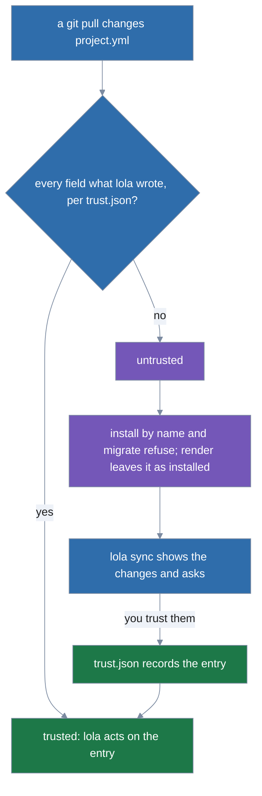

# Using lola

<!-- docs-audit decision (2026-10-28): SPLIT_CANDIDATE declined for this file.
     "Commands" is a command catalog in `lola help` order; splitting it would make lookup worse.
     "Sources and the cache" is one topic, barely over the 250-line budget, and many docs link
     into it. "Choosing what to install" already moved to guides/choosing-what-to-install.md.
     Revisit only if a section becomes a separate task a reader does on its own. -->

This is the reference: one section per command, in the order `lola help` lists them, then the
concepts the commands share. `lola help` is the always-current summary (piped, it prints the
global flags once, then every command with its aliases and own flags). This page describes this
build; changes still to come are tracked in [roadmap.md](roadmap.md).

The guides walk through one workflow each:
[choosing what to install](guides/choosing-what-to-install.md),
[authoring modules](guides/authoring-modules.md), [templating](guides/templating.md),
[sync and trust](guides/sync-and-trust.md), [profiles](guides/profiles.md),
[remote profiles](guides/remote-profiles.md), [marketplaces](guides/marketplaces.md),
[migrating from LobsterTrap/lola](guides/migrating.md) and [tidying](guides/tidying.md).

## Commands

Every command takes the global flags: `--json` and `--plain` pick the
[output](#output-contract), `--no-pager` prints without lola's [viewer](#output-contract), and
`--project`, `--user`, `-C/--root <dir>` and `--scope project|user|both` pick the
[scope](guides/choosing-what-to-install.md#choosing-a-scope). Under "Refusals", each quoted message is what follows `error:`; a
hint that runs a command repeats your run's output, scope and `-C` flags; the exceptions are
listed in the "Known limitations" paragraph that ends the sections of `lola sync`, `lola render`,
`lola profile` and [Sources and the cache](#sources-and-the-cache).

### `lola install`

```
lola install [<source|name|@market/module>...]
```

Alias: `add`. Copy the module into your cache (if it is a source or a
[marketplace](guides/marketplaces.md#marketplaces) entry), render it for each target, record it in
the manifest. With no argument on a terminal, walks you through the choices ([Choosing what to
install](guides/choosing-what-to-install.md)). A name installs a module already in your cache without
touching its source. Without a scope flag it uses, in order, the terminal's scope picker, the
project with `.lola/` at or above the current directory, then `default_scope` in `config.yaml`
([Choosing a scope](guides/choosing-what-to-install.md#choosing-a-scope)).

| Flag | What it does |
|---|---|
| `-t`, `--target <assistant>` | Install for these assistants (repeatable or comma-separated: `claude-code`, `gemini-cli`, `opencode`). |
| `--ref <ref>` | The git branch, tag or full commit SHA to fetch. |
| `--path <dir>` | The module root inside the source (monorepos). |
| `--skip`, `--only`, `--unskip <selector>` | Skip, keep only, or install again components (`kind/name` or `module:kind/name`), and save the choice in `selections.yaml` ([Component flags](guides/choosing-what-to-install.md#component-flags)). |
| `--global` | Save `--skip`, `--only` and `--unskip` in the global section of `selections.yaml`. |
| `--no-rules`, `--rules` | Leave the module's always-on rules out, remembered in the manifest; `--rules` puts them back. |
| `--strict` | Fail, writing nothing, if any target would drop, change or skip part of a module. |
| `--pre-install <path>`, `--post-install <path>` | Your own script for this run, which wraps every module copy the install writes, once per assistant, around the module's own hooks; a relative path is taken from the directory you run lola in, and the script runs from that absolute path, never a file of its name in the module copy ([Install scripts](guides/choosing-what-to-install.md#install-scripts)). No trust is asked. |
| `--trust=<kinds>` | Answer yes, without asking, to lola's questions before it runs code you did not write, of the kinds named, recorded as a yes at the prompt is: `scripts` (the project's install scripts), `hooks` (a module's install hooks), `runtime-hooks` (a module's Claude Code runtime hooks and agent MCP servers), or `all` for the three ([Trust kinds](guides/choosing-what-to-install.md#trust-kinds)). |
| `--force` | Overwrite unowned or hand-edited files and render skipped artifacts that can be, and apply without the review question ([Safety rules](#safety-rules)). |
| `-n`, `--dry-run` | Print the plan and write nothing, not even `selections.yaml`. |
| `-y`, `--yes` | Apply without the review question: the summary is printed, and the install goes on. |

Refusals:

- No argument off a terminal: `lola install needs a module or source`.
- No scope found: `lola install needs a scope: no .lola/ project was found in <dir> or above it,
  and <config.yaml> sets no default_scope (default_scope: project, user or both)`, with one hint
  per scope (`lola install ./my-module --target claude-code --project`, then `--user`, then
  `--scope both` in its place).
- An argument that is neither: `"./nope" is neither a module in your cache nor a source; sources
  are …`, hinting `cached modules: lola cache list`.
- No `-t` and no assistant set up in the project: `none of your installed assistants
  (claude-code, opencode) is set up here, so lola does not know where to install`, with one hint
  per assistant (`lola install ./my-module --project -t claude-code`). An unknown one: `unknown
  target "nosuch"`.
- Another module of that name in your cache: `a different module named "my-module" is already in
  your cache (from <its source>); this one is from <the new source>`, hinting `remove the cached
  one first: lola cache rm my-module`.
- A conflict ([Safety rules](#safety-rules)), `--strict` with a finding (`--strict: 1
  finding(s); nothing was changed`), and a project whose `.lola/lock.json` git tracks.
- An install script that is missing, not a regular file or not executable, and a project's that
  is an absolute path, resolves outside the project or is a symbolic link, before anything is asked
  ([Install scripts](guides/choosing-what-to-install.md#install-scripts)); the project's pre-install script without your trust off a
  terminal.

JSON: `modules`, `steps`, `findings`, `notices`, `scripts`, `dry_run`, `scopes` and
`equivalent_commands` ([Output contract](#output-contract)).

### `lola sync`

```
lola sync [<module>...]
```

Make the project (or `--user`) match its manifest: install every entry at the version it pins,
render the modules already installed, and remove the ones the manifest no longer lists. Names limit
the run to those modules. Shows and asks about changes to `project.yml` and its active [project
profiles](guides/profiles.md#project-profiles) you have not trusted yet, entry by entry, paging the
diff on a terminal ([Sync, pins and trust](guides/sync-and-trust.md#sync-pins-and-trust)). `--scope
both` syncs the project, then user scope.

| Flag | What it does |
|---|---|
| `--trust[=<kinds>]` | Answer yes, without asking, to the questions of the kinds named that the run would ask: `entries` (the changes to `project.yml`, its top-level targets, and the pins and folder content a sync would write), `profiles` (the changes to its active project profiles, and a project profile taking your profile's place), `scripts` (the project's install scripts), `hooks` (a module's install hooks), `runtime-hooks` (a module's Claude Code runtime hooks and agent MCP servers), or `all`; bare `--trust` is `entries,profiles`, which run no code. It never bypasses a refusal ([Trust kinds](guides/choosing-what-to-install.md#trust-kinds)). |
| `-y`, `--yes` | Confirm removals, and only removals: it never trusts changes. |
| `--update` | Fetch the refs again and re-pin the modules of the run. |
| `--force` | Overwrite unowned or hand-edited files, render skipped artifacts that can be, and confirm removals. |
| `-n`, `--dry-run` | Print the plan and the trust diff, ask nothing and write nothing. |

Refusals:

- Changes to trust off a terminal: `lola sync needs your trust for .lola/project.yml, which has
  not been trusted on this machine, and there is no terminal to ask on` (after a pull, `your trust
  for changes to .lola/project.yml`), hinting `see them: lola sync --project -n` and `then
  accept them: lola sync --project --trust=entries` (the kinds missing: `--trust=profiles` for a
  project profile's changes, `--trust=entries,hooks` when a module's pre-install hook would refuse
  too).
- Removals off a terminal: `lola sync needs your confirmation to remove my-module, and there is no
  terminal to ask on`, hinting `see them: lola sync --project -n` and `then confirm them: lola
  sync --project -y`.
- A local source outside the project, a pin whose content does not match, a conflict, and a
  tracked `.lola/lock.json` ([Sync, pins and trust](guides/sync-and-trust.md#sync-pins-and-trust)).
- No manifest: `no project.yml in <dir>`. No scope found: as `lola install`'s, with hints for
  `--project`, `--user` and `--scope both`.

JSON: `scope`, `root`, `dry_run`, `in_sync`, `trust`, `pins`, `removals`, `equivalent_commands`
and the plan's `modules`, `steps`, `findings`, `notices` and `scripts`; with `--scope both`, `{"scopes":
[...]}` ([Output contract](#output-contract)). When sync refuses because it needs your trust or
your yes to removals, its error line adds `trust` and `removals`.

Known limitations: when sync, or the pin it writes, meets another module of the entry's name in
your cache, the refusal hints `remove the cached one first: lola cache rm my-module` without
your run's `--json`, `--plain` or `--no-pager`, which `lola install` keeps; `lola render` does
the same. An entry with no targets (`my-module: project.yml gives it no targets`) hints advice,
not a command: `list the assistants in project.yml, for example targets: [claude-code]`
(`user.yml`, or the profile's file, where the entry comes from there).

### `lola uninstall`

```
lola uninstall <module>...
```

Aliases: `remove`, `rm`, `erase`, `delete`, `del`. Remove everything lola wrote for the module (on
the `-t` targets only, if given). The module stays in your cache; `lola cache rm` removes it there.
Asks first; `-y` skips the question, and so does `--force`, which also deletes files you edited
since lola wrote them. Refuses a module an active [profile](guides/profiles.md#profiles) or
`default.yml` lists, naming it: the next sync would install it again. Scope as `lola install`'s.

| Flag | What it does |
|---|---|
| `-t`, `--target <assistant>` | Only uninstall from these assistants. |
| `-y`, `--yes` | Do not ask for confirmation. |
| `--force` | Also delete files edited since lola wrote them, without asking. |
| `-n`, `--dry-run` | Print the plan and write nothing. |

Refusals:

- `lola uninstall: "my-module" is not installed in this project`, hinting `installed here: lola
  list --project`.
- An active profile lists it: `my-module is wanted by profile user:go`, hinting `turn the profile
  off: lola profile --project user:go --off`; `default.yml` lists it: `my-module is wanted by
  profile default; remove it from <path>/default.yml, which is always on at user scope`.
- Off a terminal without `-y`: `lola uninstall needs confirmation, and there is no terminal to ask
  on`, hinting the run with `-y` (`lola uninstall my-module -y`).
- A file edited since lola wrote it: `refusing to change anything: 1 conflict, which --force
  overrides`, each file on its own line, hinting `lola uninstall my-module --force`.

JSON: `modules`, `steps`, `findings`, `notices`, `scripts` and `dry_run`; the refusal off a
terminal carries the same keys beside `error` and `hints`.

### `lola list`

```
lola list
```

Alias: `ls`. Each installed module × target with a status: `ok`, `modified` (a file lola wrote was
edited), `missing` (a file lola wrote, or the module copy, is gone), `stale` (`project.yml` pins
another version than the one installed: run `lola sync`), `unreadable` (the version installed is
cached but does not load), or `skipped` (nothing of the module could be rendered for that target),
followed by `→ update available` when your cache holds a newer version for the module's ref (`lola
sync --update <module>`); and each target of an entry `project.yml` lists that is not installed,
`not installed` (`not_installed` in `--json` and `--plain`), with a notice per scope counting them
and naming the sync that installs them (`→ 1 module in project.yml is not installed → lola sync
--project`, keeping `--json`, `--plain` and `--no-pager`); whether the module's rules are on; and,
when any module has some, how many of its components `selections.yaml` skips. `--json` adds each
row's `pin` and `update_available`. `list` never reads the trust record: an entry you declined at
sync's trust question shows as `stale` or `not installed`. Entries of
[profiles](guides/profiles.md#profiles) are listed as the manifest's are, and when any module comes
from a profile a `FROM` column names its layer. Without a scope flag it shows the project found from
here, if any, and user scope; every row names its scope ([Choosing a scope](guides/choosing-what-to-install.md#choosing-a-scope)).
Like `render`, it refuses a project whose `.lola/lock.json` git tracks, since a committed one could
turn profiles on.

| Flag | What it does |
|---|---|
| `-t`, `--target <assistant>` | Only show these assistants. |

Refusals: an unknown target, as `lola install` refuses it (`unknown target "nosuch"`, hinting `valid
targets: claude-code, gemini-cli, opencode`); a tracked lock: `.lola/lock.json is tracked by git;
lola keeps it private to your checkout, since a committed lock.json lets a pull decide what lola
deletes; if you never installed with lola in this checkout, untrack and delete it, then run lola
sync --project`, hinting `git rm --cached .lola/lock.json`; when no flag chose the scopes and both
were found, it first hints `list the other scope: lola list --user`.

JSON: `modules` (each `scope`, `name`, `from`, `target`, `status`, `rules`, `source`, `ref`
(absent when empty), `digest`, `pin`, `update_available`, `skipped` and `market`
(the marketplace the entry says it was installed through; absent when it names none)) and
`notices`.

### `lola render`

```
lola render
```

Alias: `update`. Render every installed module again at the version `project.yml` pins (the one
installed when it pins none; a folder module from its folder). A module a
[profile](guides/profiles.md#profiles) lists renders at the profile's pin, else at the version
`lock.json` records; one no layer lists any more is left as installed at project scope. Removes
files a module no longer ships. Leaves as installed, with a warning, a module it may not act on
([Sync, pins and trust](guides/sync-and-trust.md#sync-pins-and-trust)), and exits `0` unless
`--strict`.

| Flag | What it does |
|---|---|
| `-t`, `--target <assistant>` | Only render for these assistants. |
| `--strict` | Fail, writing nothing, if any target would drop, change or skip part of a module. |
| `--trust=<kinds>` | Consent without asking to the project's install scripts around a replaced copy (`scripts`), the install hooks of updated modules (`hooks`), the runtime hooks that need it (`runtime-hooks`), or `all`; recorded as a yes is ([Trust kinds](guides/choosing-what-to-install.md#trust-kinds)). |
| `--force` | Overwrite or delete hand-edited files and render skipped artifacts that can be. |
| `-n`, `--dry-run` | Print the plan and write nothing. |

Refusals: a hand-edited file: `refusing to change anything: 1 conflict, which --force
overrides`, then `claude-code: .claude/commands/hello.md: hand-edited since lola wrote it`,
hinting `lola render --force`; a tracked `.lola/lock.json`, as `lola list`'s.

JSON: `modules`, `steps`, `findings`, `notices`, `scripts` and `dry_run`.

Known limitations: when render leaves out a module whose content has changed, the finding's hints
are `review it: lola sync --project my-module`, then, when the entry selects no components, `edited
it yourself? lola install --project ../my-module`; when it no longer loads, `review it: lola
sync --project my-module; or remove it: lola uninstall --project my-module`, followed by the
error's own hints.

When your cache holds a folder module's name from another folder, render
leaves the module as installed, with a `source-differs` warning hinting `review and apply it:
lola sync --project my-module`; when render must fetch a module's pinned version again and your
cache holds another module of that name, it is refused as `lola sync` refuses it, with the same
hint. When render must fetch a module's pinned version again and cannot, it
hints `if you no longer want my-module, remove it: lola uninstall my-module`, or `remove it: lola
uninstall my-module` when the module is no longer in your cache and its source folder is gone,
both without the run's scope or output flags.

### `lola tidy`

```
lola tidy [<kind/name>...]
```

Move what lola does not manage out of the assistants' directories and MCP server lists into the
trash (`$XDG_STATE_HOME/lola/trash/`, one directory per run; tidy never deletes): what you name,
`--all`, or on a terminal what you tick in a picker. Asks first on a terminal (`-y`); `-n` lists
what would move and what is locked (never moved, whatever the flags), and why. Your keep-list,
per scope in `keep.yaml`, names what tidy stops offering ([Tidying](guides/tidying.md#tidying)).

| Flag | What it does |
|---|---|
| `--all` | Move every item that is not locked. |
| `-t`, `--target <assistant>` | Only tidy these assistants' directories. |
| `--include-tracked` | Also offer what git tracks. |
| `--keep <selector>` | Add a `kind/name` selector to this scope's keep-list (repeatable). Alias: `--protect`. |
| `--unkeep <selector>` | Remove a selector from this scope's keep-list, as written there (repeatable). Alias: `--unprotect`. |
| `-y`, `--yes` | Do not ask for confirmation. |
| `--force` | Also move what git tracks, without asking; names or `--all` are still needed. |
| `-n`, `--dry-run` | List what would move and what is locked, and change nothing. |

Refusals:

- Off a terminal (or with `--json`) without names or `--all`: `lola tidy needs names or --all
  when it cannot ask (off a terminal or with --json): 1 item can move`, hinting `lola tidy
  --project --all -y`.
- With them but without `-y`: `lola tidy would move 1 item: command/stray
  (.claude/commands/stray.md); it cannot ask (off a terminal or with --json), so it needs -y to
  move them`, hinting the run with `-y`.
- A scope with no targets and nothing installed: `project <dir> lists no targets and lola
  installed nothing there`, with one hint per installed assistant (`lola tidy --project -t
  claude-code`).
- No scope found: `lola tidy needs a scope: no .lola/ project was found in <dir> or above it, and
  <config.yaml> sets no default_scope (default_scope: project or user)`, hinting `lola tidy
  --project` and `lola tidy --user`, each with the run's other flags.

JSON: `scope`, `root`, `dry_run`, `targets`, `trash`, `size_bytes`, `candidates`, `moved`,
`protected`, `skipped`, `keep_added`, `keep_removed`, `trash_credentials`, `notices` and `hints`.

### `lola profile`

```
lola profile [<name>...] [--on|--off|--switch|--add <source>|--update [--all]|--remove]
```

Without a name, list the [profiles](guides/profiles.md#profiles) each scope can use (yours, and at
project scope the project's): kind, where each stands in the scope's active list (`1st of 2`,
`always on` for `default`, `off`) and its file. With a name, show the profile and, per scope, the
layer each of its modules comes from and the layers that entry overrides; for a profile that is off,
what turning it on would give. Listing and showing never ask for a scope: without a flag they show
the project found from here, if any, and user scope. One action per run. Refuses a project whose
`.lola/lock.json` git tracks.

| Flag | What it does |
|---|---|
| `--on` | Turn the named profiles on, appended to the active list in order, and apply. Aliases: `--enable`, `--activate`. |
| `--off` | Turn the named profiles off and apply; asks when files go (`-y`). Aliases: `--disable`, `--deactivate`. |
| `--switch` | Make the named profiles the active list, in order, and apply (`default` stays on). Alias: `--use`. |
| `--add <source>` | Fetch a [remote profile](guides/remote-profiles.md) from a git repository or an https archive, show it and ask before keeping it. Alias: `--get`. |
| `--ref <ref>` | With `--add`: the branch, tag or commit to fetch. |
| `--path <dir>` | With `--add`: the directory of the source that holds `profiles/`. |
| `--update` | Fetch the named remote profiles, or `--all`, again, show what changed, ask, and apply them where they are on. Alias: `--upgrade`. |
| `--all` | With `--update`: every remote profile you have. |
| `--remove` | Delete a remote profile; asks (`-y`), and is refused while it is in use unless `--force`. Aliases: `--rm`, `--delete`, `--del`, `--erase`, `--uninstall`. |
| `--trust[=<kinds>]` | Answer yes, without asking, to the questions of the kinds named ([Trust kinds](guides/choosing-what-to-install.md#trust-kinds)): `entries` and `profiles` (the changes to `project.yml` and its profiles the run installs, a project profile taking your profile's place, a remote profile `--add` or `--update` shows), `scripts` (the project's install scripts), `hooks` (a module's install hooks), `runtime-hooks` (a module's Claude Code runtime hooks and agent MCP servers), or `all`. `--add` takes `profiles` only (bare `--trust` there is `profiles`); `--update` without a scope flag applies only `profiles` to the update and the other kinds to each scope's sync. |
| `-y`, `--yes` | Confirm removals, and `--remove`; it never trusts changes. |
| `--force` | With `--remove`: remove a remote profile in use, without asking. |
| `-n`, `--dry-run` | Print what the action would change, ask nothing and write nothing. |

Refusals:

- An unknown name: `no profile nope for user scope` (or `for the project at <dir>`), hinting
  where to write one.
- An action without a name: `--on needs the names of the profiles`, hinting `list them: lola
  profile`.
- `--remove` of a profile you do not have: `you have no remote profile x`.
- `--on`, `--off`, `--switch` or `--remove` without a scope found: `lola profile needs a scope: …
  (default_scope: project or user)`, with one hint per scope (`lola profile x --remove
  --project`, then `--user`).

JSON: listing and showing print `profiles` and `notices` (showing adds each profile's
`read_as` and `modules`); `--on`, `--off` and `--switch` print what `lola sync --json` prints
plus `profiles` and `changes`; `--add` prints `remote_profiles`, `notices` and `dry_run`;
`--update` adds `updates` and `scopes` (each `scope`, `root`, `apply` and `sync`); `--remove`
prints `profile`, `file`, `source`, `removed`, `notices` and `dry_run`.

Known limitations: lola checks the host of a remote profile and its entries by the URL's text and
never resolves it, so a host name that resolves to a loopback or private address (through
DNS or `/etc/hosts`) is fetched. Two refusals hint advice, not a command: a remote profile entry
on this machine (`my-module: ./my-module is on this machine; a remote profile names only git
repositories and https archives`) hints `ask the profile's author to fix it; lola did not add
it`; `--remove` of a remote profile `go` that `default.yml` extends hints `remove go from the
extends: of <path>/default.yml first`, and one another active profile extends hints, after
`turn the profile off first: …`, `or remove go from the extends: of <that profile's file>`.
An unknown name hints where to write a profile, a path ending in a placeholder, not a command:
`no profile nope for user scope` hints `write one: <config>/lola/profiles/<name>.yml; lola
profile --add fetches a remote one` (at project scope it adds `, or the project's:
<project>/.lola/profiles/<name>.yml`).

### `lola market`

```
lola market [<name> [<entry>] | [<name>] --add <source> [--ref <ref>] [--path <file-or-dir>] | <name>... --update | --update --all | <name> --remove]
```

Aliases: `marketplace`, `markets`. Four paths, none of which asks:

- `lola market` lists your [marketplaces](guides/marketplaces.md#marketplaces): format, entries,
  skipped entries, when each was fetched and its source.
- `lola market acme` shows one: its source, pin, every entry with the source lola maps it to, and
  every entry it skips, with why. Its last line is the next step, `→ lola info @acme/<first
  entry>`, with the run's flags.
- `lola market acme formatter` shows the entry: it is the same run as `lola info @acme/formatter`,
  with the same flags (a scope, `-t`, the output flags) and the same output, hints included.
- `lola info @acme/formatter` (see [`lola info`](#lola-info)).

`--add <source>` fetches a catalog (Claude Code's `marketplace.json` or a lola YAML catalog) and
registers it; `--update` fetches the named ones, or `--all`, again and reports which entries
changed; `--remove` forgets one (asks; `-y`). `--add` and `--update` ask nothing, but a name when
yours is taken. Scope flags change nothing but what `lola market <name> <entry>` plans for.
`add`, `ls`, `list`, `rm`, `remove`, `update`, `set`, `show` and `search` are not `lola market`
verbs: each is refused with the lola command to run instead.

| Flag | What it does |
|---|---|
| `--add <source>` | Fetch the catalog at this source and register it. Alias: `--get`. |
| `--ref <ref>` | With `--add`: the branch, tag or commit of a git source. |
| `--path <file-or-dir>` | With `--add`: the catalog file, or the directory to look for it in, inside the source. |
| `--update` | Fetch the named marketplaces' catalogs again and report what changed. Aliases: `--upgrade`, `--refresh`. |
| `--all` | With `--update`: every marketplace you have. |
| `--remove` | Forget the named marketplace and drop its cached catalog (asks; `-y`). Aliases: `--rm`, `--delete`, `--del`, `--erase`. |
| `-y`, `--yes` | With `--remove`: forget it without asking. |
| `-n`, `--dry-run` | Report what the action would do, and write nothing. |
| `-t`, `--target <assistant>` | With `<name> <entry>`: the assistants to plan for, as `lola info`'s `-t`. |

Refusals:

- An unknown name: `you have no marketplace nope`, hinting `lola market`.
- Three or more names without an action: `lola market <name> <entry> shows one entry, and 2
  were given: formatter, linter`, hinting `lola market acme formatter` and `lola market acme
  linter` for the given entries the catalog lists and does not skip; when none is, `lola market
  acme`, or `lola market` when `acme` is not yours.
- `-t` without `<name> <entry>`: `--target applies to lola market <name> <entry> only`, hinting
  the run without it.
- `--update` without names: `name the marketplaces to update, or update every one with --all`,
  hinting `lola market --update --all`.
- A reserved word: `ls is not a lola market verb: lola market lists your marketplaces`, hinting
  `lola market`; `add` hints the `--add` it means (`lola market acme --add
  https://github.com/acme/plugins`).

JSON: listing prints `markets` and `notices`; showing prints the marketplace's `name`, `source`,
`ref`, `path`, `format`, `commit`, `fetched_at`, `description`, `file`, `owner`, `version`,
`entries`, `skipped`, `notices` and `hints` (`lola info` of the first entry; `[]` without
entries); `<name> <entry>` prints what `lola info` prints; `--add` and `--update` print
`markets`, `changes`, `updates`, `notices` and `dry_run`; `--remove` prints `removed`, `notices`
and `dry_run`.

Known limitation: a catalog entry's host is judged by the URL's text, as a remote profile's is,
and never resolved: an entry at a host name that resolves to a loopback or private address is
mapped and fetched.

### `lola check`

```
lola check [module-or-source...]
```

Report what each assistant would drop, adapt or skip from a module, without writing anything or
adding it to your cache. A source, or `@market/module`, is fetched as `lola cache add` would;
any other argument names a cached module. Defaults to the current directory
([Findings](#findings)).

| Flag | What it does |
|---|---|
| `-t`, `--target <assistant>` | Only check these assistants. |
| `--strict` | Exit with an error if any target would drop, change or skip part of a module. |

Refusals: an argument that is neither (`"nope" is neither a source nor a module in your cache;
pass a module folder or another source, e.g. lola check ./my-module; sources are …`, hinting
`cached modules: lola cache list`), an unknown target, and `--strict` with a finding.

JSON: `modules` (each `name`, `targets`, `findings`, `skipped`) and `findings`.

### `lola info`

```
lola info <source|@market/module|module> [-t <assistant>…] [--ref <ref>] [--path <dir>]
```

Aliases: `show`, `view`. `lola market <name> <entry>` is the same run as `lola info
@<name>/<entry>`. Show a module before you install it, running nothing: no install hook,
runtime hook or MCP server. The argument is what `lola install` takes: a module in your cache,
`@market/module`, or a source. A source or a marketplace entry is fetched into your cache as
`lola cache add` fetches it, so installing the cached name afterwards fetches nothing. It prints:

1. The module's identity: name, version, description, source, type, path, digest, format and
   cached heads.
2. Its contents: skills, commands, agents, MCP servers, rules, install hooks, warnings, the
   [vars](guides/templating.md#vars) it declares with their defaults, and its
   [templates](guides/templating.md#templates), [partials](guides/templating.md#partials) and
   [attribute files](guides/templating.md#attribute-files).
3. What would run code, and when:
   - each install hook with its sha256 (what consent is recorded for) and its first 5 lines,
     each cut at 200 characters;
   - the runtime hooks (hook sets, and hooks and agents' MCP servers in components' frontmatter)
     each assistant would run, as the consent question shows them;
   - each MCP server with the command line or URL the assistant would run, for each assistant
     that can express it.
   - Without a plan (no scope, no assistant, or a refusal) they are shown as the module declares
     them, `${CLAUDE_PLUGIN_ROOT}` and its kin unexpanded. Author text is shown on one line.
   - Then the install scripts that would wrap the module's install, in the order they run, each
     with its source and sha256 and whether it needs your trust (a project's): without a scope,
     only your own from `config.yaml`.
4. What installing it here would do, for each scope `lola install` would pick without asking:
   - the plan `lola install -n` prints (files per assistant, findings, `new project at <dir>`
     for a project without `.lola/`);
   - each consent the install would meet (`scripts`, `hooks`, `runtime-hooks`) and whether you
     gave it already, and the `--trust=` kinds still needed;
   - when installing there would be refused (an untrusted `project.yml` entry, a conflict, any
     refusal that coaches), that refusal with its hints instead, and no install; any other
     failure (an unreadable file) is `lola info`'s own error.
   - A copy of the version already installed needs no `hooks` trust: its hooks run only with
     your consent.
5. The command that installs exactly the version shown, with `--trust=` the kinds still needed
   (none: no `--trust`), keeping your output flags, scope flags, `-C` and `-t`; there is none
   when installing at any scope would be refused.
   - A git source, and a marketplace entry from git without a component selection, is named as
     its git source at the full commit SHA fetched, in place of a branch or tag you gave, since
     a branch can move before you install (`--path` as the source needs); a commit your cache
     holds installs without fetching.
   - An archive, a folder, a cached name and any other entry (one that selects components among
     them) are named by the cached name at the head shown (`--ref <ref>` for a head other than
     the default branch's), which installs from your cache without touching the source.
   - A cached git module without a component selection whose entry in the scope records another
     ref is named by its source at the commit shown instead, so that installing it pins that
     commit in the entry (to follow a branch again, install with `--ref <branch>`).
   - What stays open: if you fetch a cached head again yourself (`lola cache update`, or
     installing the source at a branch) or run `lola market --update` between `lola info` and
     the install, a hint by cached name installs the new head.

   ```
   → install it: lola install https://example.com/kit.git --ref 4f0c2a9e1b7d3c5a6e8f9012ab34cd56ef7890ab --project --trust=hooks
   ```

| Flag | What it does |
|---|---|
| `-t`, `--target <assistant>` | Plan for these assistants, as `lola install -t` would (repeatable or comma-separated). |
| `--ref <ref>` | The git branch, tag or full commit SHA to fetch. |
| `--path <dir>` | The module root inside the source (monorepos); refused with `@market/module`. |

Scope: `--scope` (`both` shows one plan per scope), `--user`, `--project` or `-C`; else the
project with `.lola/` at or above the current directory; else `default_scope` in `config.yaml`.
`lola info` never asks for a scope, on a terminal or off it, and never guesses one. With none,
it shows sections 1 to 3 and the consent it knows without a scope (`runtime-hooks` are needed
but their record is unknown, as it is kept per settings file), says why, and hints the runs that
name a scope, exiting 0:

```
no scope: no .lola/ was found in /work/x or above it, and config.yaml sets no default_scope
  hint: lola info ./kit --project
  hint: lola info ./kit --user
```

`--project` is not hinted in your home directory, where the user scope installs. Without `-t` and
with no assistant set up in the scope, it says which assistants are installed and hints the run
with `-t` and each of them (`lola info ./kit --project -t claude-code`); with none installed it
says so and hints nothing.

Refusals: no argument: `lola info needs a module or source`, hinting `cached modules: lola cache
list`; an argument that is neither: `"./nope" is neither a module in your cache nor a source;
sources are …`, hinting `cached modules: lola cache list`; `--path` with `@market/module`; and a
fetch failure or another module of that name in your cache, as `lola cache add`'s.

JSON: one document. The module's identity and contents: `name`, `description`, `version`,
`digest`, `format`, `source`, `type`, `heads` (each `ref`, `digest`), `skills`, `commands`,
`agents`, `mcp_servers`, `rules`, `hooks`, `warnings`, `vars` (`[{"name", "type", "default"}]`,
`type` one of `string`, `boolean`, `number`, `list`; a number's `default` is a JSON number),
`templates`, `partials` and `attributes` (paths in the module), each `[]` when none, and `path`
(the module root inside the source) when it has one. Then `runs`: `install_hooks` (each `event`,
`script`, `sha256`, `first_lines`), `runtime_hooks` (as `lola install` reports them) and
`mcp_servers` (each `name`, `target`, `command`, `args`, `url`) and `scripts` (each `event`,
`source`, `path`, `sha256`, `needs_trust`). Then `install`, one element per
scope: `scope` (`""` without one), `targets`, `steps`, `findings`, `consent` (each `kind`, `item`,
`recorded`: `yes`, `no` or `unknown`), `trust_needed` (kinds), `digest` (the version it
installs), `command` (the next step; `""` without a plan, and in every element when installing at
any scope would be refused) and, when installing there would be
refused, `refusal` (`error`, `hints`), and `new_project` (`true` when the install would create `.lola/`
at the scope's directory). A runtime hook shown as declared has `status` `unknown`. Last,
`no_scope` (the sentence, only when no scope resolved), `no_assistant` (the sentence, only when a
scope lacks an assistant to plan for) and `hints` (`[]` when both a scope and an assistant
resolved).

`--plain` rows are the module's, then `hook` (event, script, sha256), `script` (event, source,
path, sha256, needs_trust), `runtime-hook` (as `lola install --plain` prints them), `mcp` (name,
assistant, command line, URL), `refusal`
(scope, error) each followed by its `hint` rows, `consent`, the steps, `install`, `no_scope` or
`no_assistant` (the sentence), and `hint` rows.

### `lola search`

```
lola search <query>
```

Alias: `find`. Search your cache, then every [marketplace](guides/marketplaces.md#marketplaces)
catalog you have fetched, case-insensitively by name, description and keyword (tags), listing each
hit by what `lola install` takes (`@acme/formatter` for a catalog entry). It never fetches. `lola
cache search` searches the cache alone. When `markets.yaml` cannot be read, it lists your cache's
hits with a warning saying why, as the install pickers offer your cache alone then.

Refusals: no query: `lola search needs a query`.

JSON: `results` (each `name`, `description`, `version`, `keywords`, `where` (`cache` or
`@<market>`) and `install`) and `warnings`. `--plain` rows are name, version, where,
description and install.

### `lola init`

```
lola init [dir] [--format agent-plugins|lola]
```

Scaffold a module named after the directory: by default an Agent Plugins package
(`plugin.json`, one skill, one `dev.getlola` command); `--format lola` writes `lola.yml`, one
skill and one command. It never overwrites a file and refuses a directory holding a module or a
symbolic link on the way to a file it would write. With no `dir` it scaffolds the current
directory, so it first lists the files it would write and asks `Create module <name> in <dir>?`
(default No). Naming the directory, `.` included, asks nothing. Its refusals (a bad name, an
unknown format, an existing module or file, a link) come before the question. Writing a module
is described in [Module layout](guides/authoring-modules.md#module-layout).

| Flag | What it does |
|---|---|
| `--format <format>` | The module format: `agent-plugins` (the default) or `lola`. |
| `-y`, `--yes` | Do not ask for confirmation. |

Refusals:

- Off a terminal, with no `dir` and without `-y`: `lola init needs confirmation, and there is no
  terminal to ask on`, hinting the run with `-y` (`lola init -y`).
- `../my-module is already a module (it has plugin.json)`.
- `lola init cannot scaffold format "nope"`.

JSON: `name`, `path`, `format` and `files`; the refusal off a terminal carries the same keys
beside `error` and `hints`.

### `lola cache`

```
lola cache
```

Manage your cache ([Sources and the cache](#sources-and-the-cache)). Bare `lola cache` lists it,
as `lola cache list` does. Removing a module from the cache does not touch installed files.

#### `lola cache add`

```
lola cache add <source|@market/module>
```

Alias: `get`. Fetch a module into your cache without installing it. `@market/module` fetches an
entry of one of your marketplaces as `lola install` would, its commit pin checked against its
ref (`--path` is refused: the catalog gives it).

| Flag | What it does |
|---|---|
| `--ref <ref>` | The git branch, tag or full commit SHA to fetch. |
| `--path <dir>` | The module root inside the source (monorepos). |

Refusals: no source: `lola cache add needs a source`; another module of that name in your cache,
as `lola install`'s.

JSON: the module's identity and contents, as [`lola info`](#lola-info) starts its document, with
`path` when `--path` gave one.

#### `lola cache rm`

```
lola cache rm <module>...
```

Aliases: `remove`, `uninstall`, `erase`, `delete`, `del`. Remove every cached version of the
modules. Installed modules keep working: each one runs from its own module copy, and `lola
render` fetches the source again when it needs to. Asks first.

| Flag | What it does |
|---|---|
| `-y`, `--yes` | Do not ask for confirmation. |

Refusals: `nope is not in your cache`, hinting `cached modules: lola cache list`; off a terminal
without `-y`: `lola cache rm needs confirmation, and there is no terminal to ask on`, hinting the
run with `-y`.

JSON: `removed`, the names. The refusal off a terminal carries `would_remove`, the names it
would have removed, beside `error` and `hints`.

#### `lola cache clean`

```
lola cache clean [--unused-for <age>] [--all] [-n] [-y]
```

Remove what your cache no longer needs. Asks first.

| Form | Removes |
|---|---|
| bare | Superseded versions (each version no head points to: a newer fetch of its ref replaced it) and scratch: each `.staging/run-*` and `tmp/check-*` that no running lola holds, a `run-*.lock` or `check-*.lock` left without its directory, and a `.staging/clean-*` a killed clean left. Every module keeps its heads. With `cache_unused_for` set in `config.yaml`, also what `--unused-for` with that age removes. |
| `--unused-for <n>d` or `<n>w` | Also every version no run used for at least that many days (`1w` is 7 days), current heads included: a head whose version goes is dropped, and a module whose last version goes is removed whole. |
| `--unused-for never` | What bare removes, without the configured age. |
| `--all` | Every module, every marketplace catalog and all scratch, except scratch a running lola holds. The cache's lock file and `probes.json` stay. |

| Flag | What it does |
|---|---|
| `--unused-for <age>` | `<n>d` (days), `<n>w` (weeks) or `never`; not with `--all`. |
| `--all` | Remove everything but held scratch; not with `--unused-for`. |
| `-n`, `--dry-run` | Print what would be removed and remove nothing. |
| `-y`, `--yes` | Do not ask for confirmation. |

A version is used when a run installs it (`install`), fetches it (`install` or `info` of a
source, `cache add`, `cache update`, `sync`, `render` fetching it again, `profile --update`) or
renders the version a project records (`render`, `sync`, `profile --on`, `--switch`,
`--update`, their dry runs included); `index.yml` records the day (UTC) as `last_used`, at most
once a day. `lola info` and `install -n` of a cached name, `cache list`, `check`, `list` and
`cache clean -n` record nothing. A version cached before lola recorded uses counts as used the
day a clean first sees it, as does one whose `last_used` entry is not a day lola wrote. A cache
whose `index.yml` lola cannot write (a read-only cache) still installs and renders; the use is
not recorded.

On a terminal clean prints each item with its reason and size, and the total, then asks `Remove
these from your cache?`; under `-n` it prints the same and asks nothing. With nothing to remove it
prints `✓ nothing to clean` and asks nothing. Each item is checked again before it goes: one that
changed since the plan (a head moved onto it, a run used it, it is gone, a directory above it is no
longer a real directory) is kept and reported; when every item changed, clean prints `→ nothing
removed`. A module whose `index.yml`, or an entry, clean
cannot read, when it plans or when it checks again, is kept as `unreadable`, and the clean goes
on. `index.yml` stops naming a version
before the version is removed, and a clean that fails part way puts back the heads of the
versions it did not remove, so no head names a removed version; its error (under `--json`, with
`removed` and `bytes_freed`) says what it had removed. Clean sets items aside only in a
`.staging` that is a real directory. What a clean cannot delete after setting it aside is a
warning, `bytes_freed` counts only what was deleted, and the next `lola cache clean` retries it.

Risk: removing a version a project records makes that project's next `render` fetch it again,
and a source that moved or is gone fails as it does after `lola cache rm`. Removing catalogs
(`--all`) leaves your marketplaces registered but not fetched: installing from one refuses with
`marketplace <name> is not fetched: its catalog is not in your cache`, hinting `lola market <name>
--update`. `lola sync --update` fetches again only the catalogs of marketplaces that entries
installed in the scope came from; for any other, run `lola market <name> --update`.

Refusals: `--all` with `--unused-for` (cobra's `if any flags in the group [all unused-for] are set
none of the others can be`); an age that is not one: `--unused-for "3x" is not an age; write a
whole number of days or weeks, such as 30d or 2w, or never` (`--unused-for ""` too, which never
falls back to the configured age; in `config.yaml`, with its file, line and key); off a terminal
without `-y`: `lola cache clean needs confirmation, and there is no terminal to ask on`, hinting
the run with `-y`.

JSON: `removed` (each `module`, `version`, `reason`, `path`, `bytes`), `kept` (each `module`,
`version`, `reason`, `path`), `bytes_freed`, `dry_run` and `notices`. `reason` is `superseded`,
`unused`, `scratch` or `all` for a removed item, `in use` (scratch a running lola holds),
`changed` or `unreadable` for a kept one; `module` and `version` are `""` for scratch and
catalogs, and `version` is `""` for a module `--all` removes; `path` is relative to
`$XDG_CACHE_HOME/lola`, as it is on disk when it is plain text, with control and format
characters replaced otherwise. The refusal off a terminal carries the keys `-n --json` prints
beside `error` and `hints`. `--plain` rows: `remove` (under `-n`), `removed` or `kept`, then the
reason, the path and the bytes, and a `notice` row per notice.

#### `lola cache list`

```
lola cache list
```

Alias: `ls`. List the modules in your cache.

JSON: `modules` (each the identity and contents of [`lola info`](#lola-info)) and `warnings`.

#### `lola cache update`

```
lola cache update [module...]
```

Fetch every ref of the named modules again, or of every module if none is named. Installed
modules keep the versions they were installed at; `lola install <module>` installs the new one.

Refusals: `nope is not in your cache`, hinting `cached modules: lola cache list`.

JSON: `updates` (each `name`, `ref`, `from`, `to`, `changed`) and `notices`.

#### `lola cache search`

```
lola cache search <query>
```

Alias: `find`. Search your cache alone, as `lola search` searches it.

Refusals: no query: `lola cache search needs a query`.

JSON: as `lola search`'s.

### `lola migrate`

```
lola migrate
```

Move from the Python lola: install what it installed, with lola, and clean up after it ([Coming from
the Python lola](guides/migrating.md#coming-from-the-python-lola)). It shows the plan and asks
(default No).

| Flag | What it does |
|---|---|
| `--keep-python` | Install, and replace with a backup, but move nothing else to the trash. |
| `-y`, `--yes` | Do not ask for confirmation. |
| `--force` | Also replace, after backing each up into the trash, unowned files outside the recorded paths, recorded files git tracks or that lie below a symbolic link, and module copies; and move files git tracks, without asking. |
| `--trust=<kinds>` | Consent without asking to the kinds named, recorded as a yes at the prompt is: `hooks` (install hooks), `runtime-hooks` (Claude Code runtime hooks), `scripts`, or `all` for the three ([Trust kinds](guides/choosing-what-to-install.md#trust-kinds)). |
| `-n`, `--dry-run` | Print the plan and write nothing. |
| `--map-root OLD=NEW` | Look for a project path or local source this machine lacks, below `OLD`, at the same place below `NEW` (repeatable; [From another machine](guides/migrating.md#from-another-machine)). A map that matches nothing is a warning. |
| `--map-target OLD=NEW[,NEW]` | Install the modules of `OLD`, an assistant this machine lacks, for the assistants `NEW` instead (repeatable; name each `OLD` once). |

On a terminal, without `-y`, it asks for each missing root and each missing assistant before it
plans. The run ends with the command that maps what it left (`→ map what this machine lacks:
lola migrate --map-root /Users/alice=/home/alice --map-target claude-code=opencode`).

Refusals: off a terminal without `-y`: `lola migrate needs confirmation, and there is no
terminal to ask on`, hinting `lola migrate -y`. A map it cannot read says what is wrong:
`--map-root "alice=/home/alice": "alice" is not an absolute path`, `--map-target
"claude-code=vim": "vim" is not an assistant lola installs for; write claude-code, gemini-cli,
opencode`.

JSON: `dry_run`, `nothing_to_migrate`, `python_home`, `trash`, `destinations`, `unmappable`,
`not_migrated`, `markets`, `home`, `warnings`, `summary` and `remap` ([Output
contract](#output-contract)); the refusal off a terminal carries the `-n --json` keys beside
`error` and `hints`.

### `lola version`

```
lola version
```

Alias: `ver`; `lola --version` prints the same. Print lola's version.

JSON: `version` and `go`.

### `lola completion`

```
lola completion bash|zsh|fish|powershell
```

Print a completion script for your shell; it completes commands, their aliases, and flags
(`source <(lola completion bash)`). Another shell is refused: `invalid argument "nope" for "lola
completion"`.

### `lola help`

```
lola help [command]
```

Show help: concise on a terminal; piped or redirected, the full command tree, with every alias.

| Flag | What it does |
|---|---|
| `-l`, `--long` | Print the full command tree. |
| `-s`, `--short` | Print concise help. |

Refusals: `no help topic "nope"; see: lola help`.

## Sources and the cache

A **source** is where a module comes from. lola copies the module into your **cache**
(`$XDG_CACHE_HOME/lola/modules/`, normally `~/.cache/lola/modules/`), so a source can move or
disappear without breaking installs. lola recognizes these forms, first match first:

| You pass | lola reads it as |
|---|---|
| An existing directory | a folder |
| An existing file ending in `.zip`, `.tar`, `.tar.gz` or `.tgz` (any case) | an archive |
| A `file://` URL | a folder or an archive, by what the path is |
| An `https://` URL whose path ends in an archive suffix | an archive, downloaded |
| Any other `https://` or `ssh://` URL, or `user@host:path` | a git repository |
| An `http://` URL | as `https://`, but only for `localhost`, `127.0.0.0/8` or `::1` |

Anything else is not a source: a bare name means a module in your cache, and `@market/module`
an entry of one of your [marketplaces](guides/marketplaces.md#marketplaces), on the command line only (a directory of
that name is `./@market/module`). lola refuses, with a hint:

- an argument, `--ref` or recorded location that starts with `-`;
- git's `<transport>::<address>` remote-helper syntax and `git://` URLs;
- credentials in a URL:
  - any user name or password in an `http(s)` URL (GitHub and GitLab take a token as the user
    name), and any query string or fragment (presigned URLs carry secrets there). The URL is
    written to `.lola/project.yml` and your cache, where a secret would be committed.
  - For git, let a credential helper or `ssh-agent` supply credentials; for a private archive,
    download it and install the file.
  - A user name in an `ssh://` URL or in `git@host:path` is fine, but a password never is, and
    the `user:password@host:path` form is refused (git would pass the password to ssh as part
    of the remote path).
  - `file://` URLs follow the same rules, and `?` or `#` in `git@host:path` is refused like a
    URL's query or fragment.
  - No error repeats a URL's password, query or fragment, or the user name of an `http(s)` or
    `file` URL, not even for a URL that does not parse or the target of a redirect (an `ssh`
    user name is no secret and may appear);
- a source, `--ref` or `--path` that the scope's manifest (`project.yml` or `user.yml`) or
  `lock.json` could not load again (a control or invisible character, such as a zero-width
  joiner in a folder name, a source over 4096 bytes or a ref over 256 bytes), before anything is
  fetched or written; the hint names the field to fix, or, for a module named from your cache
  whose recorded source is the problem, `lola cache rm <name>`;
- an existing file that is not an archive, and a local archive that is not a regular file once
  its links are resolved (a pipe or device named like an archive, or a link to one).

Adding a module to the cache normalizes it: the cached copy holds exactly one `lola.yml`,
generated from the module's manifest. lola reads the first manifest it finds (see
[Module formats](guides/authoring-modules.md#module-formats)) and warns about each lower-precedence one it ignores. A
plugin format is converted once, here: the generated `lola.yml` lists every artifact the plugin
declared, so a cached version means the same thing to every later lola.

For every kind of source:

- `.git`, `.venv`, `node_modules`, `.lola`, `__pycache__` and `.DS_Store` are never copied.
- Symlinks inside a module are refused.
- `--path <dir>` picks the module root inside the source, for monorepos.

**Folders.** In a git work tree, lola copies the files git would track (`.gitignore` is
respected; new, unstaged files are included). A directory `module/` inside the source is the
module root unless you pass `--path`; `--path .` picks the folder itself. `--ref` is refused.

**Git.** lola runs your `git` (it must be on `PATH`) with a shallow clone of the default
branch, or of `--ref`: a branch name, a tag name, or a full 40- or 64-character commit SHA.
lola never guesses:

- A ref that names both a branch and a tag is an error, and so is an abbreviated SHA.
- A full commit SHA, in any case, is always that commit, never a branch or tag of that name.
  lola records and shows it lower-cased. A server that serves another commit for it is refused.
- The SHA of an annotated tag object is refused; the error names the commit the tag points to,
  and the hint is your run at that commit.
- Any other hex-looking name is a branch or tag.

A commit that no branch or tag points to needs a server that serves such commits (servers
speaking git protocol v2 do). Only committed files are copied; the module root is `--path`,
else `module/`, else the repository root.
`--path .` picks the repository root and names the module after the repository. lola records
the commit it fetched. A source is fetched again on every install, with one exception: installing
at a full commit SHA that your cache already holds for exactly that source (the same location,
`--path` and selection, the version lola recorded when it fetched that commit) fetches nothing;
lola hashes the cached version again and installs it. A branch, a tag or a short SHA always
fetches.

- Your git config, credential helpers and `ssh-agent` are used. Git hooks, `core.fsmonitor`,
  the `ext::` transport and Git LFS filters are switched off for the repository lola fetches.
- **Git LFS files are not fetched.** A module receives LFS pointer files as they are committed.
- git never prompts for a user name or password (`GIT_TERMINAL_PROMPT=0`). This holds for every
  fetch: modules, marketplaces, profiles and `lola migrate`.
  - A repository git may not read is refused in lola's words, never with git's output: `<url>
    was not found, or it is private and git has no credentials for it` (a server that wants
    credentials looks the same as one hiding a missing repository), `… or it is private and the
    credentials git has, if any, cannot read it`, `git's credentials for <url> were refused`,
    or `the ssh server for <url> refused every key ssh offered, or ssh had none` (hinting
    `ssh-add` when the server takes keys).
  - The hint `git ls-remote -- <url>` (with `-c http.followRedirects=false` for a source a
    catalog named) checks it with your own git, which may ask for credentials and keep them in
    your credential helper; a location too long or odd to print whole gets no hint.
  - Only git's own `fatal:` lines and ssh's are read, never a server's `remote:` lines.
  - ssh still can prompt: it asks on the terminal for a key passphrase or an unknown host key.
    Load your key into `ssh-agent` and add the host to `known_hosts` first, or the fetch waits
    until it gives up after 5 minutes. A child process that keeps git's output open (ssh
    prompting, a stalled https helper) delays that stop by at most 5 more seconds.

**Archives.** zip, tar and gzip tar, chosen by the file name's suffix. `--ref` is refused.
The module root is the first of:

1. `--path`, relative to the archive's root as `tar tf` or `unzip -l` show it;
2. the shallowest directory holding `lola.yaml`, `lola.yml`, `.lola.yaml`, `.lola.yml`,
   `plugin.json` or `.claude-plugin/`;
3. the parent of the shallowest `skills/`, `commands/`, `agents/` or `rules/` directory;
4. the archive's single top-level directory, if that is all it holds;
5. the archive's root.

Two different candidates at the same depth are an error; pick one with `--path`. Without a
`lola.yml` name, the module is named after its root directory, or after the archive file
(without its suffix) when the root is the archive's root.

An archive may hold only regular files and directories. lola refuses the whole archive if any
entry is absolute, contains `..` or a backslash, is a link or device, or repeats a path. Files
keep only their execute bit (`0755` or `0644`). Limits, which are not configurable:

| Limit | Value |
|---|---|
| Entries | 20,000 |
| Zip central directory | about 19.5 MiB (1 KiB for each of 20,000 entries), checked before it is read |
| Unpacked size | 512 MiB in total |
| Compression ratio of one zip entry | 200 to 1 |
| Download size | 256 MiB |
| Download time | 2 minutes |
| Redirects | 5, never from `https` to `http`, and never to `http` off loopback |

Once a module is cached, `lola install <name>` uses the cached copy without touching the source:
the cache's newest version for the ref the project already records for it (`--ref` picks
another). `lola cache update` fetches every cached module again: a git branch (or the default
branch) may have moved, a local archive is read again, and an archive URL is downloaded again.
The content digest decides whether anything changed. Installed modules keep the versions they
were installed at: `lola list` shows `→ update available`, and `lola install <name>` installs
the new version.

**Pins.** When lola installs a git or archive module, it records the version in the module's
entry in the scope's manifest (`project.yml`, or `user.yml` at user scope): `digest`, the sha256
of the module's content, and for git `commit`, the commit the fetch resolved. `ref` stays what
you asked for. A folder module is never pinned. A manifest or `lock.json` may come from someone
else, so lola checks every entry when it reads them and refuses, before running git, a source or
ref that git would read as an option, a git remote helper (`ext::…`), `git://`, a path that
leaves its source, a commit or digest lola would not write (a `commit` on an archive or a folder
included), and any control or invisible character.

A git checkout holds the bytes as committed on every machine: lola turns off line-ending
conversion and every `.gitattributes` conversion and filter for its checkouts, and refuses a
symbolic link inside the module's `--path` (anywhere in the repository when there is no
`--path`) or on the way to it, before checking anything out; a link elsewhere in the repository
is allowed. A git `--path` must name a directory of the repository in its exact letter case, so
a case-insensitive file system never checks out another one in its place. Execute bits come from
the source itself (git's file modes, an archive's entry modes, a folder's files), never from the
file system lola copied to, so the same module has the same digest on Linux, macOS and Windows.

**Trust.** `project.yml` is committed, so a `git pull` can change it. lola keeps, per project,
what it last wrote there in `$XDG_STATE_HOME/lola/trust.json`: the top-level `targets` and each
entry's `name`, `source`, `ref`, `path`, `components`, `commit`, `digest`, `targets`, `rules`,
`vars` (the entry's overrides of the module's [vars](guides/templating.md#vars)), `extends` (for a
project profile's entry that comes from a remote profile it extends: that profile's name, source
and pin) and `market` (the marketplace an entry says it came from; the diff shows it as `market
(as written)`, since lola never checks it).

An entry is **trusted** when every one of those fields is what lola wrote. Each write lola makes trusts
exactly the fields it changes, so after a pull adds an entry or changes one, installing another
module leaves that entry untrusted.



lola refuses to act on an untrusted entry as written:

- `lola install <name>`, a `lola uninstall -t` that keeps some of its targets, and
  `lola migrate` refuse with `<name>: project.yml changed for it since you last trusted it` (for
  an entry a pull added: `<name>: project.yml added it since you last trusted the file`; with no
  record: `<name>: project.yml has not been trusted on this machine`), and the hint
  `review and apply it: lola sync --project <name>`; the partial uninstall adds
  `or remove it: lola uninstall --project <name>`;
- an install, by name or by source, that would take its assistants from top-level `targets` you
  have not trusted (no `-t`, and no entry with `targets` of its own) refuses before fetching
  anything with `project.yml's top-level targets changed since you last trusted them`, hinting
  `lola sync` or your own install with `-t <id>` added (your `--ref` and `--path` kept); the
  install pickers ask for the assistants instead and never preselect those targets;
- the install pickers leave such modules out, with one notice per project:
  `2 modules in project.yml changed since you last trusted them: a, b → lola sync --project` (`are new or
  changed since you last trusted the file` when a pull added one). Add a
  source… in the pickers adds the module to your cache and lists it by name, so it is left out
  too; Change scope onto a project where a module you picked is untrusted stops with the refusal;
- `lola render` leaves the module as installed, with a warning
  ([Sync, pins and trust](guides/sync-and-trust.md#sync-pins-and-trust)).

An argument that names such an entry is taken as that name, even when a folder of that name is
in the current directory: write the folder as `./<name>`.

`lola sync <name>` shows such changes and asks you to trust them
([Sync, pins and trust](guides/sync-and-trust.md#sync-pins-and-trust)), which is what every refusal hints. Every
`lola sync`, `lola render` or `lola install` command lola prints carries your scope: `--user` at
user scope, `--project` for the project found from the directory you ran lola in, and
`-C <root>` for another; so does an
install's `retry with: lola install <names>` after a failure that left fetched modules in your
cache, which these refusals and conflicts leave out, since retrying would refuse again. Installing the
module from its source still works, and writes the entry as new, keeping none of the changed
entry's `targets`, `rules`, `ref` or `path`, but it installs what the source serves now without
letting you review the change as sync does, so lola no longer suggests it. Without `-t`, such an install keeps the
module on the assistants this checkout installed it on (`lock.json`), not on targets a pull set.
Removing the module (`lola uninstall <name>`) always works. A project with no record in
`trust.json` (a fresh clone, a moved directory, a deleted state directory) has every entry
untrusted until you trust them with `lola sync`. `lola sync`, `lola render`, `lola install` and
`lola uninstall` refuse a project whose `.lola/lock.json` git tracks, before fetching anything,
since a committed `lock.json` lets a pull decide what lola deletes; lola keeps it private to each
checkout. The hint untracks it: `git rm --cached .lola/lock.json`, with `-C <project>` when you
run lola from elsewhere. If you never installed with lola in that checkout, the error says to
untrack and delete it, then run `lola sync`.

A local source is read through its symbolic links once: lola records the real path, and a source
you type relative to the project is recorded relative to the project's real root, however you
reached it. A local archive given through a symbolic link must resolve to a file with the same
archive suffix as the path you typed; otherwise lola refuses and suggests installing the target
itself (`lola install <target>`). When it is accepted, a module without its own name takes its
name from the target file.

Installing a module also gives it a **module copy**: `.lola/modules/<module>/` in the project, or
`$XDG_DATA_HOME/lola/user-modules/<module>/` at user scope. `${PLUGIN_ROOT}` ([Module
layout](guides/authoring-modules.md#module-layout)) points there, so removing a module with `lola
cache rm` never breaks an installed one; `lola render` fetches the version it renders again if it
needs to: a git module by its commit, which must still be on its ref, and an archive whose content
must still match. When the version is the pin `project.yml` names and the fetch returns other
content or the commit is not on the ref, it suggests `lola sync --update <name>` to re-pin; when it
is the version installed of an entry that pins none (a git version with no recorded commit, say), it
suggests `lola install <source> [--ref r] [--path p]`, which installs what the source serves now, or
`lola uninstall <name>`. Hooks may build inside the copy: lola leaves its content alone, replaces
the copy only for a new version, when it is gone, or when the module gains a target `lock.json` does
not record it on (`lola install -t`, or a target added to `project.yml`), and then runs the hooks
again with your consent. Without it, a pre-install hook refuses the run and a declined post-install
hook stays pending (see [Hooks](guides/authoring-modules.md#components)). Reinstalling the version
already installed on the same targets with `lola install` replaces the copy from the cache to run
its hooks again when you consent; without consent the copy stays as it is. `lola sync` replaces it
for the same version and targets only to run a pending post-install hook, when you consent; declined
again, the copy stays as it is.

Known limitations: three refusals of a source read from a file (a manifest, profile or catalog
entry) hint advice, not a command: a ref that starts with `-` (`ref "-x" starts with '-'`) hints `a
branch, tag or commit never starts with '-'`; a folder location that is not absolute (`folder source
x is not an absolute path`) hints `give the absolute path of the folder`; and an archive location
that starts with `//` (`archive location starts with //, a URL without a scheme`) hints `give the
archive's https:// URL or its absolute path`.

## Scopes and targets

- **Project scope** (`--project`, or `-C <dir>` for another directory): files go into the
  project; state lives in `.lola/`. Which scope a command acts on without a flag is in
  [Choosing a scope](guides/choosing-what-to-install.md#choosing-a-scope).
- **User scope** (`--user`): files go into your home directory (OpenCode's into
  `$XDG_CONFIG_HOME/opencode/`); state lives under `$XDG_CONFIG_HOME/lola/` (manifest
  `user.yml`) and `$XDG_STATE_HOME/lola/` (ledger `lock.json`). Rules installed at user scope
  apply in every project.

The targets are `claude-code` (Claude Code), `gemini-cli` (Gemini CLI) and `opencode`
(OpenCode).

When you do not pass `-t`, lola uses the manifest's targets. Otherwise it offers the assistants
installed on your machine (their command, `claude`, `gemini` or `opencode`, is on your
`PATH`): on a terminal you pick from them, with those already set up in the project preselected,
or every installed assistant preselected when none is set up (with only one installed, lola
uses it without asking); off a terminal lola uses the ones both installed and set up. An assistant is set up in a project when it has `.claude/` or
`CLAUDE.md` (Claude Code), `.gemini/` or `GEMINI.md` (Gemini CLI), or `.opencode/`,
`opencode.json` or `opencode.jsonc` (OpenCode); at user scope, when `~/.claude/` or
`~/CLAUDE.md`, `~/.gemini/` or `~/GEMINI.md`, or `$XDG_CONFIG_HOME/opencode/` exists. A target
you name with `-t`, or that the manifest lists, is always rendered, installed or not, for
example in a container that only prepares files.

lola runs an installed assistant once, with `--version`, to learn which version you have, and
caches the answer in `$XDG_CACHE_HOME/lola/probes.json` until the binary changes. The version
never changes what lola writes (teammates on other versions get the same files); lola only
warns when your version lacks something the module uses.

What lands where for `claude-code`:

| Artifact | Project scope | User scope |
|---|---|---|
| Skills | `.claude/skills/<skill>/` | `~/.claude/skills/<skill>/` |
| Commands | `.claude/commands/<command>.md` | `~/.claude/commands/` |
| Agents | `.claude/agents/<agent>.md` | `~/.claude/agents/` |
| MCP servers | `.mcp.json` → `mcpServers.<name>` | `~/.claude.json` → `mcpServers.<name>` |
| Rules | `.claude/rules/lola/<module>/<rule>.md` | `~/.claude/rules/lola/<module>/<rule>.md` |

For `gemini-cli` (user scope: the same paths under `~`):

| Artifact | Project scope |
|---|---|
| Skills | `.gemini/skills/<skill>/`; `name` is added from the directory when missing; Gemini neither runs shell nor fills argument placeholders in skills, so lola warns when a skill has them |
| Commands | `.gemini/commands/<command>.toml`: `description` and `prompt`, with `$ARGUMENTS` as `{{args}}`; Gemini has no single-argument placeholders, so `$ARGUMENTS[N]`, `$N` and the names listed in `arguments:` stay as written and the prompt starts with the whole argument string; Gemini has no escape, so a Claude-escaped `\$1` becomes `$1` (only a single backslash escapes; after `\\` the placeholder is still read as one); a `commands/<command>/` directory is copied alongside, and Gemini reads every `*.toml` file inside it as a namespaced command (`<command>:<file>`) |
| Agents | `.gemini/agents/<agent>.md`, keeping only `name`, `description`, `kind` (`local` or `remote`), `display_name`, `tools` (a list of Gemini tool names such as `read_file` or `mcp_<server>_<tool>`), `model` (`gemini-…`), `temperature`, `max_turns` and `timeout_mins` (positive integers). Gemini refuses to load an agent with any other key or value of another shape, so lola drops those instead. An agent whose `tools` uses other names, such as Claude's `Read` or `mcp__server__tool`, is skipped: Gemini gives an agent without `tools` every tool, so dropping the list would lift the restriction (`--force` installs it without the list) |
| MCP servers | `.gemini/settings.json` → `mcpServers.<name>`: `command`, `args`, `env`, `cwd`; `httpUrl` for http, `url` for sse |
| Rules | `.gemini/lola/<module>/GEMINI.md` (the module's rules in name order), listed in `.gemini/settings.json` → `context.includeDirectories` (at user scope by absolute path, so every project's Gemini session can read that directory). Gemini loads these rules, and project MCP servers, only in a trusted folder, and project-scope ones only when `gemini` starts at the project root, not in a subdirectory |

For `opencode` (user scope: the same paths under `$XDG_CONFIG_HOME/opencode/`, without
`.opencode/`):

| Artifact | Project scope |
|---|---|
| Skills | `.opencode/skills/<skill>/`; names are lowercase words joined by single hyphens, and a `name` in the frontmatter must equal the directory; OpenCode neither runs shell nor fills argument placeholders in skills, so lola warns when a skill has them |
| Commands | `.opencode/commands/<command>.md`, keeping only `description`, `agent`, `model` (`provider/model`) and `subtask`; Claude counts arguments from 0 and OpenCode from 1, so `$0`, `$ARGUMENTS[0]` and the first name listed in `arguments:` become `$1`, and so on (`$ARGUMENTS` stays); OpenCode has no escape, so a Claude-escaped `\$1` or `\$ARGUMENTS` is kept but OpenCode still fills it in; OpenCode runs ``!`…` `` anywhere in a command without Claude's permission checks and never runs a ```` ```! ```` fence; a `commands/<command>/` directory is not copied, as OpenCode would read its files as commands |
| Agents | `.opencode/agents/<agent>.md` with `mode: subagent` unless the agent sets a mode; `name` is dropped and `model` is kept only as `provider/model`. OpenCode cannot express a tool list and gives an agent without one every tool, so an agent with a non-empty `tools` is skipped (`--force` installs it without the list). OpenCode refuses to start on an invalid agent value, so lola drops a `color` other than `#rrggbb` (OpenCode 1.18 also takes theme names such as `accent`, but later versions reject them), a `mode` other than `subagent`, `primary` or `all`, a non-numeric `temperature` or `top_p`, a `steps` or `maxSteps` that is not a positive integer, a non-boolean `hidden` or `disable`, a non-string `variant` and a non-map `options`. `permission` is passed through unchecked |
| MCP servers | `opencode.jsonc` if it exists, else `opencode.json` → `mcp.<name>`: `{"type": "local", "command": [...], "environment"}` or `{"type": "remote", "url", "headers"}`; `${VAR}` becomes `{env:VAR}`. OpenCode merges both files and `opencode.jsonc` wins, so a server of the same name in `opencode.json` is overridden by lola's |
| Rules | `.opencode/lola/<module>/<rule>.md`, listed as `.opencode/lola/<module>/*.md` in the same file's `instructions` (at user scope by absolute path) |

## Choosing what to install

How lola decides the scope, assistants and components for an install is in [Choosing what to install](guides/choosing-what-to-install.md).

## Findings

When a target cannot express part of a module, lola tells you instead of failing the whole
module. Each **finding** has a severity:

- **info**: a lossless adaptation, or a choice you made. Shown by `lola check` and in `--json`
  output, and by `install` and `render` when it carries a hint.
- **warn**: something is dropped or changed, but the artifact works; it is installed.
- **skip**: that artifact is left out for that target, because the assistant could not use it
  (for example an agent without a `description`); everything else is installed.

`--force` also renders skipped artifacts that can be rendered (it never invents a place for
something the assistant has no place for). `--strict` turns every remaining warn or skip into an
error before anything is written; use it in CI. A `--force` render is not remembered: a later
`lola render` without `--force` skips (and removes) those artifacts again.

Each finding has a stable code, shown by `--plain` and `--json`. A forceable skip is one that
`--force` can render; a skip that `--force` rendered is reported as a warn.

A finding you can act on carries a hint (`hint:` under it, `hint` in `--json`). The hint names
the change to make to the module: usually an entry in the component's `.targets.yaml`
[attribute file](guides/templating.md), such as `gemini-cli: {hooks: null}`, or a template
branch on `target` in its `.md.liquid` file. Or the hint is a command. A forceable skip's hint
ends with your run plus `--force`, for example `or render it anyway: lola install ./kit --force`.
Some findings have no hint, because there is nothing to do:
- `kind-unsupported`, `mcp-cwd-dropped` and `command-sidecar-dropped`: no change gives the
  assistant a place for the item;
- lossless adaptations (`gemini-cli/arguments`, `opencode/env-reference`, an info
  `frontmatter-key-dropped`);
- the review notices `claude-code/allowed-tools` and `claude-code/permission-mode`;
- the `probe/*` notes;
- `module-warning` and template errors, whose text already says what to change.

`lola check` reports each [template](guides/templating.md#templates) error as a `skip` finding of its component for
each assistant, with the error's code: `template-too-large`, `template-invalid-utf8`,
`template-tag-unavailable`, `template-range-unavailable`, `template-too-many-assigns`,
`template-too-deep`, `template-include-name`, `template-include-missing`,
`template-include-cycle`, `template-include-too-deep`, `template-include-limit`,
`template-undeclared-var`, `template-syntax`, `template-undefined-variable`,
`template-undefined-filter`, `template-value-too-large`, `template-value-type`,
`template-output-too-large`, `template-panic`, `template-frontmatter`,
`template-frontmatter-fence`, `template-frontmatter-value`, `template-name-mismatch` and
`template-rendered-check`. Install, sync, render and profile
switches refuse on the first one instead. `template-timeout` and `template-run-budget` refuse
the run, `lola check` included: they are never skip findings.

| Code | Severity | Forceable | Meaning |
|---|---|---|---|
| `kind-unsupported` | skip | no | The target has no place for this kind of artifact (in this build, `gemini-cli` and `opencode` for a module's runtime hooks). |
| `name-rejected` | skip | yes | The target rejects the artifact's name (for `opencode`, also a skill whose `name` differs from its directory). |
| `required-key-missing` | skip | yes | A frontmatter key the target needs is absent, empty, or was dropped for having the wrong type. |
| `agent-tools-unenforceable` | skip | yes | The agent restricts its tools in a way the target cannot enforce (`gemini-cli`: names that are not Gemini's; `opencode`: any non-blank `tools` value, list or string). The assistant would give the agent every tool, so it is left out unless `--force`, which installs it without the list. |
| `frontmatter-invalid` | skip | no | The frontmatter parses but lola cannot re-encode it. |
| `frontmatter-key-dropped` | warn or info | no | The target does not support a frontmatter key, so it is left out. |
| `frontmatter-value-dropped` | warn | no | A frontmatter key has a value of the wrong type or form for the target (for example an OpenCode agent `color: red`, or a Gemini agent `max_turns: 1.5`), so it is left out. |
| `frontmatter/yaml-ambiguous` | warn | no | An unquoted frontmatter value that YAML parsers read differently; quote it. |
| `version/unsupported` | warn | no | Your installed assistant is older than the version lola renders for and ignores something the module uses. |
| `version/limited` | warn | no | Your installed assistant has a known limitation that affects this module. |
| `vars-override` | skip | no | `lola check`: the scope's entry for the module checked sets a var the module does not declare, or one of another type; the module is checked with its defaults. |
| `vars-defaults` | info | no | `lola check` could not read the scope's manifest or a profile, so every module is checked with its default vars. |
| `attrs-undefined` | warn | no | `lola check`: a template or partial reads a literal `attrs` path that no attribute file of the module defines for any assistant, so it always reads as nil; usually a typo. |
| `module-warning` | warn | no | The module itself has a problem, such as a legacy instruction file, a skipped rule entry or skill, an ignored manifest, or a plugin key lola does not install. |
| `mcp-cwd-dropped` | warn | no | The target has no working-directory setting for an MCP server, so `cwd` is dropped. |
| `command-sidecar-dropped` | warn | no | `opencode` would read a command's `commands/<command>/` files as commands, so the directory is not copied. |
| `gemini-cli/shell-injection` | skip | yes | A command runs shell with Claude's ``!`…` `` (at a line start or after whitespace) or a ```` ```! ```` fenced block, which Gemini CLI would send to the model as text; Gemini's own syntax is `!{…}`. |
| `gemini-cli/arguments` | info | no | `$ARGUMENTS` becomes Gemini's `{{args}}`. |
| `gemini-cli/positional-arguments` | warn | no | Gemini CLI has no positional or named arguments: `$ARGUMENTS[N]`, `$N` and names declared in `arguments:` stay as written and the prompt starts with the whole argument string. |
| `opencode/arguments-renumbered` | warn | no | Claude's 0-based `$N`, `$ARGUMENTS[N]` and declared names became OpenCode's 1-based `$1`, `$2`, …; check the command with a few arguments, as OpenCode may split them differently. |
| `opencode/shell-unchecked` | warn | no | A command has ``!`…` ``, which OpenCode runs wherever it appears, without Claude's permission checks (`allowed-tools` is dropped); its hint wraps the shell in a template branch that keeps it from OpenCode. |
| `opencode/shell-fence` | skip | yes | A command runs shell in a ```` ```! ```` fenced block, which OpenCode does not run and would send to the model as text; use inline ``!`…` ``. |
| `skill-shell-dropped` | warn | no | A skill runs shell with ``!`…` `` or a ```` ```! ```` block; `gemini-cli` and `opencode` do not run shell in skills, so it reaches the model as text. |
| `skill-arguments-dropped` | warn | no | A skill uses `$ARGUMENTS`, `$ARGUMENTS[N]` or `$N`; `gemini-cli` and `opencode` do not fill argument placeholders in skills, so they reach the model as written. |
| `opencode/escaped-arguments` | warn | no | A command has a Claude-escaped `\$N` or `\$ARGUMENTS`; OpenCode has no escape and still replaces it with arguments, so reword the text. |
| `opencode/env-reference` | info | no | `${VAR}` in an MCP server becomes OpenCode's `{env:VAR}`. |
| `opencode/env-default-dropped` | warn | no | OpenCode has no defaults for environment references: `${VAR:-default}` becomes `{env:VAR}`. |
| `claude-code/runtime-hooks-declined` | warn | no | You did not consent to the module's runtime hooks, so they (or the skill, command or agent whose frontmatter has hooks, or the agent with inline MCP servers) are not installed and any installed earlier are removed; its hint is your run with `--trust=` the kinds you gave and `runtime-hooks`, or answer the prompt on a terminal. |
| `claude-code/allowed-tools` | warn | no | A skill, command or agent pre-approves tools with `allowed-tools`; Claude Code runs them without asking. Installed as written. |
| `claude-code/permission-mode` | warn | no | An agent sets the permission mode Claude Code runs it in with `permissionMode`; the finding names the mode. Claude Code v2.1.267+ ignores `bypassPermissions` in a subagent's frontmatter. Installed as written. |
| `claude-code/runtime-hook-path-unsafe` | skip | yes, unless a path holds a quote, `$`, a backquote or `\` | A shell-form hook needs the paths of the module copy and of the plugin data to hold only letters, digits and `/ . _ + -`, or an exec-form command contains `=` or starts with `-`. |
| `claude-code/runtime-hook-shell-unsupported` | skip | yes | A shell-form hook runs in PowerShell, which cannot take the `export` lola adds; give it `args`. |
| `claude-code/settings-local-not-ignored` | skip | yes | Git could commit `.claude/settings.local.json` (tracked, not ignored, or git missing or failing); add it to `.gitignore`. |
| `claude-code/runtime-hook-event-invalid` | skip | no | A hooks event name is not an identifier, so it is no event Claude Code fires. |
| `claude-code/runtime-hook-drift` | info | no | A hook group lola installed was edited or removed. On install and render lola leaves it out until `--force` writes it again, and prints the finding with the hint `restore it:` and your run with `--force` (`lola render --force` after `lola profile`, which has no `--force`); on uninstall lola leaves your edited group alone. `--strict` does not fail on it. |
| `probe/not-found` | info | no | The assistant is not on `PATH`; lola checked against the newest version it knows. |
| `probe/unknown-version` | info | no | The assistant's version could not be read. |
| `probe/cache` | info | no | The version was read but could not be cached. |

lola only reports what its own rendering loses. For general advice on writing skills, commands
and agents, use a dedicated linter such as [skillsaw](https://github.com/stbenjam/skillsaw).

## Files lola keeps

| File | Purpose | Commit it? |
|---|---|---|
| `.lola/project.yml` | The manifest: which modules and targets you want, and for git and archive modules the version (pin) installed. lola edits only the entries it changes and keeps your comments and order, but it writes the whole file again, so blank lines between entries are dropped and indentation becomes two spaces. | Yes |
| `.lola/lock.json` | The ledger: every file and JSON key lola wrote, with hashes, the targets each module is installed on (`targets`, including one that rendered none of its files), (`hooks_pending`) a post-install hook you have not let run yet, (`scripts_pending`) the project's post-install script you have not let run on the module yet, the active [profiles](guides/profiles.md#profiles) (`profiles`), the profile each module came from (`from`) and, for a module with [templates](guides/templating.md#templates), what they rendered with (`rendered_with`: the active profiles when a template reads them, and `vars`). | No (gitignored for you) |
| `.lola/modules/` | Module copies that `${PLUGIN_ROOT}` points into. | No (gitignored) |
| `.lola/plugin-data/` | `${PLUGIN_DATA}` directories. | No (gitignored) |
| `.claude/settings.local.json` | Claude Code's per-user settings, where lola puts runtime hooks you consented to. | No: add it to `.gitignore` |
| `$XDG_CONFIG_HOME/lola/config.yaml` | Your settings: `default_scope`, `pager`, your install scripts `pre_install` and `post_install`, `cache_unused_for`, and `theme`. | Yours to keep |
| `$XDG_CONFIG_HOME/lola/selections.yaml` | Components you chose not to install, globally, at user scope and per project. | Yours to keep |
| `$XDG_CONFIG_HOME/lola/profiles/` | Your [profiles](guides/profiles.md#profiles); `default.yml` is always on at user scope. lola never writes them. | Yours to keep |
| `$XDG_CONFIG_HOME/lola/keep.yaml` | Your [keep-list](guides/tidying.md#tidying): per scope, what `lola tidy` never offers. Written by `--keep` and `--unkeep`; safe to edit by hand. | Yours to keep |
| `$XDG_CONFIG_HOME/lola/markets.yaml` | Your [marketplaces](guides/marketplaces.md#marketplaces): name, source, ref and the catalog file found. Written by `lola market --add`; safe to edit by hand. | Yours to keep |
| `$XDG_CACHE_HOME/lola/markets/` | Each marketplace's fetched catalog, byte for byte, with `source.json`, its pin. `lola market --update` writes it again. | No: it is cache |
| `$XDG_DATA_HOME/lola/profiles/` | [Remote profiles](guides/remote-profiles.md), one directory each with `profile.yml` and `source.json`. Only `lola profile` writes them. | Yours to keep |
| `$XDG_STATE_HOME/lola/trust.json` | Per project, the `project.yml` entries lola wrote or you trusted in `lola sync` (see **Trust** in [Sources and the cache](#sources-and-the-cache)). lola stops, and changes nothing, when it or its directory is a symbolic link or writable by others, or when it does not parse (a file a newer lola wrote asks you to upgrade lola; on Windows, a directory that is a junction is refused as not a directory). Records of moved or deleted projects stay; lola refuses to grow the file past the 4 MiB it reads, and the hint says how to start over. | Never: it is yours alone |
| `$XDG_STATE_HOME/lola/consent.json` | The consents you gave, by digest: each module's install hooks, its runtime hooks per settings file, and each project's install scripts per event (`project-scripts/<sha256 of the project directory>/<event>`). A changed digest asks again. | Never: it is yours alone |
| `$XDG_STATE_HOME/lola/trash/` | What `lola migrate` backed up or moved and what `lola tidy` moved, one directory per run with `manifest.txt`. | Yours; delete a run when you no longer need it |

lola owns `.lola/.gitignore` and rewrites it if it changes. The lock lola holds while it
changes a project lives outside the project, in `$XDG_STATE_HOME/lola/locks/`.

## Safety rules

- lola writes a file only if it is new, already identical, or one lola wrote and nobody edited.
  Anything else is a **conflict**: lola lists every conflict and changes nothing.
  - The refusal lists each conflicting file, by assistant and path, one per line, and why.
  - `--force` overrides conflicts and lists each overridden file in the summary; the refusal's
    hint is your run with `--force` added, keeping its other flags but `-y` and `--trust`.
  - `--force` also answers the destructive question itself (`install`'s review, `sync`'s
    removals, `uninstall`, `lola profile --remove`, `lola migrate`, `lola tidy`), on a terminal
    or off one, so the hint runs as it is; a `lola sync` refusal whose run also removes modules
    says which (`with --force it also removes, without asking: other (whole module)`).
  - `--force` never answers a consent question: a forced run that needs your trust for a pulled
    `project.yml`, or consent to a module's hooks, still asks, or off a terminal refuses with
    the hint that adds the `--trust=` kinds missing.
  - Every hint that repeats your run for another reason (another scope, `-t`, `--force`) drops
    `-y` and `--trust` the same way, and a flag you gave as false is never repeated as true.
  - A refusal for want of a terminal to confirm on hints your run with `-y`, which answers that
    question.
  - A hand-edited file lola would delete (an uninstall, or a component dropped at render or
    sync) refuses the whole run in the same way: nothing is removed, and `--force` deletes it
    with the rest.
- A destination owned by another installed module is never overridden, even with `--force`:
  - The refusal names both modules (`wanted by module "evil", owned by module "deploy-tools"`).
  - When you named the module that wants it (`lola install <source>`), it hints the owner's
    `lola uninstall`, at the scope and with the output flags of your run.
  - When `project.yml`, `user.yml` or a profile lists it, it hints nothing and says to remove it
    from that file, so a file you did not write never steers you into removing a module you
    installed.
  - Two modules of one run providing one destination, or one module providing it twice, are
    refused with what to do in the message and no hint, as no command resolves them.
- A group of runtime hooks already in your settings, identical to one a module renders, is a
  conflict: owning it would remove your hook on uninstall. `--force` takes it over.
- A JSON file that does not parse is never rewritten, even with `--force`.
- Comments and formatting in JSON files survive lola's edits; only lola's own keys change.
- lola writes through symlinked directories and shows `(via symlink → /real/path)` when a write
  leaves the project. Two destinations that resolve to the same real file are refused.
- lola refuses a project whose `.lola/`, `.lola/modules/`, `.lola/plugin-data/` or
  `.lola/project.yml` is a symlink, and replaces a module copy that is not a real directory. At
  user scope a symlinked `user.yml` is followed and edited at its target.
- Changes are transactional: if anything fails, every file is restored.
- `--dry-run` (`-n`) prints the plan and writes nothing (`lola sync -n` may still fetch the
  versions you trusted into your cache).
- lola never rewrites a `project.yml` entry someone else changed, never installs one by name, and
  never renders one (see **Trust** in [Sources and the cache](#sources-and-the-cache)); `lola sync` shows such changes and asks
  first, entry by entry ([Sync, pins and trust](guides/sync-and-trust.md#sync-pins-and-trust)). `sync`, `render`, `install`
  and `uninstall` refuse a `.lola/lock.json` that git tracks.
- Each command that fetches keeps its temporary files in one private directory,
  `$XDG_CACHE_HOME/lola/.staging/run-*`, removed when it ends.
  - `install`, `sync`, `render`, `cache update`, `lola market --add` and `--update`, and `lola
    profile --add` and `--update` also remove those a killed lola left behind once they are a
    day old, and warn when they cannot.
  - A dry run (`-n`) still does this: the directories are lola's own temporaries.
  - A command left waiting at a prompt for more than a day (asking you to confirm an install, to
    consent to a hook, or to trust sync's changes or confirm its removals) may lose its
    directory to that sweep; run it again.

## Output contract

- `--json`: one JSON document on stdout, snake_case keys, arrays always present (`[]` when empty).
- `--plain`: tab-separated lines, no color, every row starting at column 1 (its kind first), so
  `cut -f1` reads it.
- Errors: `error: <message>` on stderr with indented `hint:` lines; under `--json`, one line
  `{"error": "...", "hints": [...]}`, which some refusals extend:
  - A sync refused for want of an answer adds `trust` (its `status`, and `changes: []` when only
    the removals are missing) and `removals` (`[]` when only trust is missing), both always
    present, so CI gets the changes without a second run (`lola sync -n --json` adds their
    content).
  - A [template](guides/templating.md#templates) refusal adds `template`: `module`, `target`,
    `scope`, `kind`, `artifact`, `file`, `line` (0 when none applies), `code`, `reason`,
    `included_from` (the include site, `<file>:<line>`, of an error in a
    [partial](guides/templating.md#partials), whose `file` it is; else `""`) and `rendered` (true
    when the rendered output, not the template, was refused). For `template-run-budget` the
    target, kind, artifact and file are `""`.
  - A confirmation refused off a terminal (`uninstall`, `cache rm`, `cache clean`, `migrate` and
    a bare `init` without `-y`) prints only that line, which adds the plan it would have asked
    about; its hint is the run with `-y`:
    - for `uninstall` and `migrate`, the keys their `-n --json` prints (`modules`, `steps`,
      `findings`, `notices`, `scripts` and `dry_run` for `uninstall`);
    - for `cache rm`, `would_remove`, the names;
    - for `init`, the keys its `-y --json` prints (`name`, `path`, `format`, `files`);
    - for `cache clean`, the keys its `-n --json` prints (`removed`, `kept`, `bytes_freed`,
      `dry_run`, `notices`).
- Human output says a hook or install script `would run` in a dry run; `--json` and `--plain`
  keep the value `would-run`.
- The results of `install`, `uninstall`, `render` and `sync` (and so of `profile --on`, `--off`
  and `--switch`) carry `scripts`: each install script the run ran, would
  run, declined or saw fail, per module and assistant, in run order (`[]` when none; [Install
  scripts](guides/choosing-what-to-install.md#install-scripts)); its `path` is shown as configured, with control characters replaced.
- `sync`, `profile`, `install`, `render` and `migrate` under `--json` carry `trusted`: each item
  the run's `--trust` covered, `{kind, item, change}` with `change` `new` or `changed`, `[]` when
  none; under `-n`, what it would cover ([Trust kinds](guides/choosing-what-to-install.md#trust-kinds)).
- Exit status: `0` on success or when you decline a prompt (Ctrl+C included, in accessible mode
  too); `1` on any error. `lola render` leaving modules out exits `0` unless `--strict`.
- Color: `LOLA_COLOR=1` or `0` forces it; otherwise `NO_COLOR` disables it; otherwise it follows
  the terminal.
- Picker colors are chosen to read at a contrast of at least 4.5:1 on your terminal's
  background, which lola takes from the first of:
  - `theme: dark` or `theme: light` in `config.yaml`;
  - in accessible mode, light (lola neither queries the terminal nor asks there, and saves
    nothing);
  - what the terminal reports (a terminal that answers without a color counts as not
    answering);
  - on a terminal, your answer when lola asks once, `Is your terminal background dark or
    light?`; it saves the answer (`→ saved theme: dark in <config.yaml>`), and if it cannot save
    it, it warns, with the line to write yourself, and uses your answer for that run;
  - else light.

  Without color, pickers keep `[x]`, `[ ]` and the bold cursor `>`.
- The viewer:
  - When stdout and stderr are terminals, human output and help taller than the terminal open
    in lola's viewer, the same on every OS. Output that fits is printed as it is.
  - `↑`/`↓` or `j`/`k` scroll a line, `PgUp`/`PgDn` or `b`/space a page, `g`/`G` or
    `Home`/`End` go to the top or the end, and `q`, Esc or Ctrl+C quit; the footer shows where
    you are (`lines 41–80 of 312 · 25%`).
  - On quit the full text is printed, so it stays in your scrollback.
  - The plan a confirmation question follows (`uninstall`, `cache rm`, `cache clean`,
    `migrate`, a bare `init`) opens the same way, and the question comes after you quit it.
  - In order, `--json` or `--plain`, a stream that is not a terminal, accessible mode
    (`LOLA_ACCESSIBLE=1` or `TERM=dumb`), `--no-pager`, `NO_PAGER` set to a non-empty value, and
    `pager: false` in your `config.yaml` print without it.
  - A `$LOLA_PAGER` you set runs that pager instead (`cat` prints). `$PAGER` is not read.
- Without a terminal, `uninstall`, `cache rm`, `cache clean` (when it has something to remove),
  `migrate` and a bare `init` need `-y`; `tidy`
  needs names or `--all`, and `-y`. `sync` needs `-y` to
  remove anything and `--trust` to accept changes to `project.yml` (`--trust <module>…` for some),
  including the pin it writes back for an unpinned entry you trusted before; `-y` never trusts.
- `install --json` adds `scopes` (each with `scope`, `root` and `scope_source`), and per
  module `scope`, `skipped` (component names, `[]` when none) and `saved_to` (the
  `selections.yaml` it wrote, or `""`), and `equivalent_commands` (`[]` when the run had no review).
  `list --json` and `check --json` carry `skipped` per module; `list --json` rows carry `scope`
  (`project` or `user`) and `from` (the [layer](guides/profiles.md#profiles) the module comes from: `project.yml`,
  `user.yml`, `profile:default`, `profile:user:<name>`), and `list --plain` rows end with the two.
  `list --json` has `notices` (`[]` when none), as `--plain` has `notice` rows.
- `sync --json`:
  - Top level: `scope`, `root`, `dry_run`, `in_sync`, `trust`, `pins`, `removals`,
    `equivalent_commands` (in a dry run that is not in sync, the command that applies it off a
    terminal, as `install --json` has; otherwise `[]`), and the plan's `modules`, `steps`,
    `findings` and `notices`.
  - `trust` has `status` (`trusted`, `new`, `changed`, or `not_applicable` at user scope),
    `recorded` (this run wrote the trust record), `targets` (the top-level targets' `field`,
    `from` and `to`, or `null` when trusted), `changes` and `replacements`.
  - Each of `trust.changes` is per module:
    - `module`; `profile` (the project profile, `project:<name>`, the change is in; absent for
      `project.yml`); `change` (`added`, `changed`, `removed`); `host_changed`;
      `content_fixed`; `note` (for an entry that does not pin its content).
    - `fields` (`field`, `from`, `to`: strings, a list for `targets`, a boolean for `rules`,
      `null` for an absent value).
    - `reason`: why an entry the manifest has as trusted needs trust (the pin sync would write,
      or a folder's changed content).
    - `files` (`path`, `change`; every file, `lola.yml` only when it changed or went) and
      `files_note`.
    - `mcp_servers`: `name`, `transport`, `change` (`added`, `changed`, `unchanged`, `removed`,
      against the version installed), `runs`, `env` as `NAME=value` strings and `headers` as
      `Name: value` strings (each sorted and `[]` when none), `cwd` (`""` when unset), and, only
      for a `changed` one, `previous`: its installed form with the same keys but `change`.
    - `hooks`: `kind` (`install`, `runtime` or `mcp_server`), `target`, `event`, `detail` and
      `change`: `added`, `changed` (an install hook whose script file changed), `unchanged` or
      `removed`.
  - `trust.replacements` (`[]` when none): per project profile an activation puts in place of
    your active namesake, `profile`, `replaces` (the profile it replaces) and `modules` (those it
    changes); `status` is `changed` when only a replacement needs trust.
  - `pins`: `module`, `profile` (the project profile the pin is written into; absent for the
    manifest's), `ref`, `commit`, `digest`, `previous_digest`, `reason` (`unpinned` or
    `update`), `written` (false in a dry run).
  - `removals`: `module`, `targets`, `whole_module`, `paths` (each `target` and `path`).
  - Commits and digests are full.
  - With two scopes (`--scope both`), `sync --json` prints `{"scopes": [...]}`, one such
    document per scope in order; when a scope fails, the error document carries the scopes
    synced before it in `scopes` (`[]` when the first failed).
  - A refusal for lack of a terminal prints the changes on stderr first, except under `--json`.
  - `--plain` adds `pin` (module, digest, reason) and `remove` (module, target, path) rows after
    the plan's.
  - In a dry run, `--plain` prints `trust` rows (module, change, and the project profile the
    change is in, empty for `project.yml`; the top-level targets' row has an empty module and
    the change `targets`) before the plan's, after a `replace` row (profile, the profile it
    replaces) for an activation that puts a project profile in place of yours.
- Text a module or a manifest chose shows control and invisible characters as `?`, in JSON as on
  a terminal:
  - It covers names, paths, hook scripts such as `modules[].hooks[].script` and the scripts of
    install hooks, `mcp_servers[].runs`, module warnings, the trust diff, and the names of the
    module's files in `lola info`, human or `--json`.
  - `runs` and a hook's `script` are for reading, not an exact command line to run.
  - A step's `path`, `member` and `value` are the exception: they are what lola wrote, raw but
    for JSON's escaping.
  - So are `lola tidy`'s `path` and `trash`, the paths it found, moved or wrote, which may hold
    Unicode format characters a terminal would not show.
- `migrate --json`:
  - `dry_run`, `nothing_to_migrate`, `python_home`, and `trash` (`""` when nothing was put
    there).
  - `home`: `action` `move`, `keep` or `none`, with `reason` and `trash`.
  - `unmappable` and `not_migrated`: each entry with its `hints`.
  - `markets`: the Python lola's marketplaces as lola registers them, each `name`, `url`,
    `market`, `source`, `path`, `status`, `reason` and `hints`.
  - `warnings`.
  - `summary`: the Python lola's records by outcome: `migrated` (on a dry run, those that
    would), `already`, `left` and `failed`.
  - `remap`: the run that maps what this machine lacks, `""` when no flag would.
  - `destinations`, each with its `status`: `planned`, `migrated`, `unchanged`, `nothing` when
    every record there is left as it is, or `failed`, with `error` and `hints`.
  - Per destination also `installs`, `replaced` and `moved` (each `path`, `key`, `kind`,
    `trash`), `kept` (`path`, `reason`), its own `unmappable` and `not_migrated`, and the
    install's `steps`, `modules`, `findings` and `notices`.
  - A step that replaces a recorded file has `"replaced": true`.

## Environment

| Variable | Used for |
|---|---|
| `HOME` | User-scope root; base of the XDG defaults |
| `PATH` | Where lola looks for installed assistants; relative entries are ignored |
| `XDG_CONFIG_HOME` | User-scope manifest, `config.yaml`, `selections.yaml`, `markets.yaml`, `keep.yaml`, and OpenCode's user-scope directory (default `~/.config`) |
| `LOLA_HOME` | The directory `lola migrate` reads (default `~/.lola`; must be absolute) |
| `LOLA_ACCESSIBLE` | `1` draws the install flow and sync's questions as numbered line prompts (screen readers), and prints output without the viewer; Ctrl+C cancels them as it does a full-screen form |
| `TERM` | `dumb` does the same as `LOLA_ACCESSIBLE=1` |
| `LOLA_COLOR`, `NO_COLOR` | Color of output and of the install flow's forms (see the output contract) |
| `LOLA_PAGER` | A pager to use instead of lola's viewer, for all human output and help, split on whitespace and run without a shell; `cat` prints ([Output contract](#output-contract)) |
| `NO_PAGER` | Set to a non-empty value, prints without the viewer or a pager, as `--no-pager` does |
| `COLUMNS` | The width `lola market <name>` fits its lines to when stdout is not a terminal; unset, nothing is cut or wrapped |
| `LINES` | The height the viewer takes the terminal to have when it cannot ask the terminal |
| `LESS` | Passed to `$LOLA_PAGER`; set to `FRX` when unset |
| `XDG_DATA_HOME` | User-scope module copies, plugin data and [remote profiles](guides/profiles.md#remote-profiles) (default `~/.local/share`) |
| `XDG_STATE_HOME` | The ledger at user scope, your consent to hooks and runtime hooks, the trust record, lock files and the trash of `lola migrate` and `lola tidy` (default `~/.local/state`) |
| `XDG_CACHE_HOME` | The cache, [marketplace](guides/marketplaces.md#marketplaces) catalogs, scratch space for downloads and the cache of assistant versions (default `~/.cache`) |
| `HTTPS_PROXY`, `HTTP_PROXY`, `NO_PROXY` | Archive and catalog downloads (git reads them itself) |
| `GIT_*`, `SSH_AUTH_SOCK` | Passed to git, except the variables that pick a repository or add config behind lola's back (`GIT_DIR`, `GIT_WORK_TREE`, `GIT_CONFIG_PARAMETERS`, `GIT_CONFIG_COUNT`, …) |

Relative XDG values are ignored, as the XDG specification requires.
